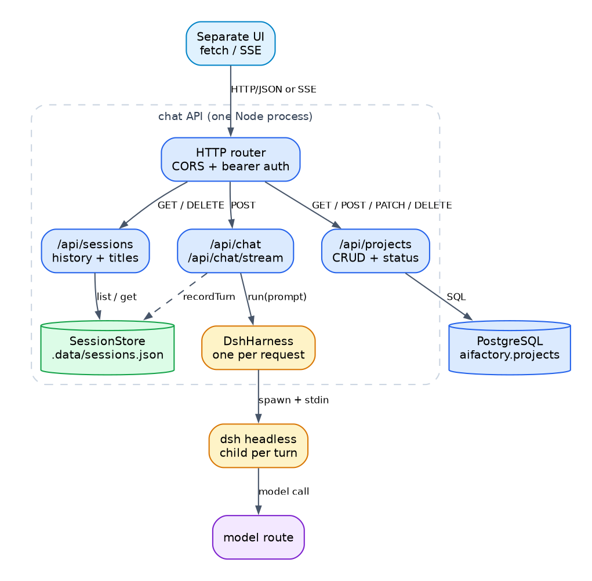

# Chat API

A small HTTP/JSON and Server-Sent Events API over the same harness transport as the terminal client, so a separate UI can create conversations, send messages, stream progress and render history.

It is intentionally a **thin adapter**: one chat request is one harness turn. The harness Session remains the source of truth; the API keeps a lightweight session index for UI listing.



## Live API console

The running server serves an interactive console at:

```text
http://127.0.0.1:8787/docs
```

It is a self-contained page — no CDN, no build step, no external assets. It shows live health, lists sessions and projects, runs non-streaming chat, streams SSE into a transcript and event log, and lets you paste the bearer token for protected servers. The machine-readable contract is at `/openapi.yaml`.

## Start

```sh
cd /data/AIFactory2/apps/chat-cli
node src/api.ts
```

With the workspace `.env` from the setup:

```dotenv
DEEPSEEK_API_KEY=sk-...
AIFACTORY_DSH_BIN=/fs22/deepseek-harness/apps/cli/lib/bin.js
```

Expected output:

```text
AI Factory chat API
  url       http://127.0.0.1:8787
  harness   /fs22/deepseek-harness/apps/cli/lib/bin.js --profile headless
  data      /data/AIFactory2/apps/chat-cli/.data
  cors      *
  auth      none
```

Use `npm run api` if you prefer the package script.

## Configuration

| Setting | Flag | Environment | Default |
|---|---|---|---|
| Bind address | `--host` | `AIFACTORY_API_HOST` | `127.0.0.1` |
| Port | `--port` | `AIFACTORY_API_PORT` | `8787` |
| Session data directory | `--data-dir` | `AIFACTORY_DATA_DIR` | `./.data` |
| Bearer token | `--token` | `AIFACTORY_API_TOKEN` | none |
| CORS origins | `--cors` | `AIFACTORY_CORS_ORIGIN` | `*` |
| Harness executable | `--dsh-bin` | `AIFACTORY_DSH_BIN` / `DSH_BIN` | `dsh` |
| Harness profile | `--profile` | `AIFACTORY_PROFILE` | `headless` |
| Turn timeout | `--timeout` | `AIFACTORY_TIMEOUT_MS` / `DSH_TIMEOUT_MS` | `120000` ms |
| Reasoning events | `--show-thinking` | — | off |
| Request logging | `--quiet` | — | on |
| Project database | — | `DATABASE_URL` | unset; project routes return 503 |

The docs console is at `/docs`; the OpenAPI contract is at `/openapi.yaml`; `/api` is a small JSON index of the API.

As with the CLI, `DSH_*` variables cannot live in `.env`; use the `AIFACTORY_*` names there. `DSH_BIN` can still be exported in the shell.

## Security defaults

- The server binds to **loopback** by default and has **no authentication** by default.
- Set `AIFACTORY_API_TOKEN` (or `--token`) before exposing it to a UI on another machine. Clients then send:
  ```http
  Authorization: Bearer <token>
  ```
- `--cors http://localhost:5173` restricts browser origins. The default `*` is convenient for local development; tighten it for anything shared.
- There is no TLS. Put the API behind a TLS-terminating reverse proxy if it leaves localhost.
- The API never accepts a harness executable or shell command from a client.
- Message content is not logged; request lines only.

## Endpoints

### `GET /api/health`

Public even when a token is configured.

```json
{
  "ok": true,
  "version": "0.1.0",
  "uptimeSeconds": 42,
  "harness": {
    "command": "/fs22/deepseek-harness/apps/cli/lib/bin.js",
    "profile": "headless"
  },
  "database": "postgres"
}
```

### `GET /api/sessions`

```json
{
  "sessions": [
    {
      "id": "session-53dedc16-56c1-4f0e-b076-b7a799b75933",
      "title": "hello",
      "createdAt": "2026-11-09T17:17:03.948Z",
      "updatedAt": "2026-11-09T17:17:04.033Z",
      "messageCount": 4
    }
  ]
}
```

Sorted by most recently updated first.

### `GET /api/sessions/:id`

Returns the full local record, including messages.

### `GET /api/sessions/:id/messages`

Returns only the message array, convenient for a chat transcript view.

### `DELETE /api/sessions/:id`

Deletes the **local API record** and returns `204`. It does not delete the harness Session or its transcript on disk.

### Settings

The chat-level setting is the maximum number of simultaneously active projects. Default: **3**. Allowed range: **1–1000**.

| Method | Path | Purpose |
|---|---|---|
| `GET` | `/api/settings` | View settings |
| `PATCH` | `/api/settings` | Update `maxActiveProjects` |

```sh
curl -s http://127.0.0.1:8787/api/settings
```

```json
{
  "settings": {
    "maxActiveProjects": 3,
    "updatedAt": "2026-11-10T05:30:00.000Z"
  }
}
```

```sh
curl -s -X PATCH http://127.0.0.1:8787/api/settings \
  -H 'Content-Type: application/json' \
  -d '{"maxActiveProjects":5}'
```

Lowering the limit below the current active count returns `409 ACTIVE_LIMIT_BELOW_ACTIVE`; deactivate, archive, complete or put projects on hold first.

### Projects

A project is a name plus an existing, absolute root directory. Multiple projects may be active at the same time. `rootPath` is unique across the registry.

| Method | Path | Purpose |
|---|---|---|
| `GET` | `/api/projects` | List projects; optional `?status=active&organization=Acme` |
| `POST` | `/api/projects` | Create a project |
| `GET` | `/api/projects/:id` | Get one project |
| `PATCH` | `/api/projects/:id` | Update name, rootPath, organization, ownerEmail or status |
| `PATCH` | `/api/projects/:id/status` | Change status only |
| `DELETE` | `/api/projects/:id` | Remove the row; the root directory is untouched |

Create:

```sh
curl -s http://127.0.0.1:8787/api/projects \
  -H 'Content-Type: application/json' \
  -d '{
    "name": "customer-portal",
    "rootPath": "/srv/projects/customer-portal",
    "organization": "Acme",
    "ownerEmail": "owner@acme.example",
    "status": "active"
  }'
```

```json
{
  "project": {
    "id": "7e8fb883-4e1d-4c13-ab77-566bf4b2e178",
    "name": "customer-portal",
    "rootPath": "/srv/projects/customer-portal",
    "organization": "Acme",
    "ownerEmail": "owner@acme.example",
    "status": "active",
    "currentStage": "planning",
    "stageUpdatedAt": "2026-11-10T04:49:18.845Z",
    "createdAt": "2026-11-10T04:49:18.845Z",
    "updatedAt": "2026-11-10T04:49:18.845Z"
  }
}
```

The root path must be absolute, exist and be a directory. It is canonicalised with `realpath` and must be unique. `name` is required; `organization`, `ownerEmail` and `status` are optional. Status defaults to `inactive`; allowed values are `active`, `inactive`, `archived`, `completed` and `on_hold`. Only `active` counts against the settings limit.

Change status:

```sh
curl -s -X PATCH http://127.0.0.1:8787/api/projects/<id>/status \
  -H 'Content-Type: application/json' \
  -d '{"status":"active"}'
```

Remove:

```sh
curl -s -o /dev/null -w '%{http_code}\n' -X DELETE http://127.0.0.1:8787/api/projects/<id>
# 204
```

Removal deletes the project row only. It never deletes the directory or its contents.

Project-specific errors: `INVALID_PROJECT_ID`, `INVALID_NAME`, `INVALID_ROOT_PATH`, `INVALID_OWNER_EMAIL`, `INVALID_STATUS`, `PROJECT_NOT_FOUND`, `ROOT_PATH_CONFLICT`, `ACTIVE_PROJECT_LIMIT_REACHED`.

`DATABASE_URL` must be set for project routes. Without it, they return `503 DATABASE_NOT_CONFIGURED`; chat/session routes keep working.

### Default SDLC stages

UI clients can fetch the display names without reading project state:

```sh
curl -s http://127.0.0.1:8787/api/sdlc/stages
```

```json
{
  "stages": [
    { "key": "planning", "name": "Planning & Feasibility", "position": 0 },
    { "key": "requirements", "name": "Requirements", "position": 1 },
    { "key": "design", "name": "Design", "position": 2 },
    { "key": "architecture", "name": "Architecture", "position": 3 },
    { "key": "development", "name": "Development", "position": 4 },
    { "key": "testing", "name": "Testing", "position": 5 },
    { "key": "deployment", "name": "Deployment", "position": 6 },
    { "key": "maintenance", "name": "Maintenance", "position": 7 }
  ]
}
```

This table is a **reference list only**. `project_stages.stage` stores the key and does not use a foreign key to `sdlc_stages`; per-project renames and skipping will be added later.

### Project status, stages and documents

`GET /api/projects/:id` returns deterministic project state, not chat history:

```json
{
  "project": {
    "id": "...",
    "name": "customer-portal",
    "currentStage": "requirements",
    "status": "active"
  },
  "sdlc": {
    "currentStage": "requirements",
    "stages": [
      { "stage": "planning", "status": "completed", "completedAt": "..." },
      { "stage": "requirements", "status": "in_progress", "startedAt": "..." }
    ],
    "checklist": [
      {
        "stage": "requirements",
        "key": "requirement_document",
        "label": "Requirement document is provided",
        "required": true,
        "status": "done"
      }
    ],
    "nextActions": [
      {
        "kind": "checklist",
        "stage": "requirements",
        "key": "acceptance_criteria",
        "label": "Acceptance criteria are defined",
        "required": true
      }
    ],
    "progress": {
      "completedStages": 1,
      "totalStages": 8,
      "completedRequiredItems": 2,
      "totalRequiredItems": 16
    }
  },
  "documents": [
    {
      "id": "...",
      "stage": "requirements",
      "kind": "requirement_pdf",
      "title": "requirements.pdf",
      "storagePath": ".aifactory/documents/requirements/...-requirements.pdf",
      "status": "uploaded",
      "sha256": "..."
    }
  ]
}
```

Stages: `planning`, `requirements`, `design`, `architecture`, `development`, `testing`, `deployment`, `maintenance`. The planning stage is displayed as **Planning & Feasibility**. Stage statuses: `not_started`, `in_progress`, `completed`, `blocked`, `skipped`.

| Method | Path | Purpose |
|---|---|---|
| `PATCH` | `/api/projects/:id/stage` | Advance to the next stage; validates required checklist items |
| `PATCH` | `/api/projects/:id/checklist/:stage/:key` | Set `open`, `done` or `waived` |
| `GET` | `/api/projects/:id/documents` | List documents |
| `POST` | `/api/projects/:id/documents` | Upload a document (multipart: `file`, `stage`, `kind`, `title`) |
| `GET` | `/api/projects/:id/documents/:documentId` | Get document metadata |
| `PATCH` | `/api/projects/:id/documents/:documentId` | Set document status |
| `GET` | `/api/projects/:id/documents/:documentId/content` | Download the stored file |
| `GET` | `/api/projects/:id/briefing` | Read the cached AI briefing |
| `POST` | `/api/projects/:id/briefing` | Generate or refresh the AI briefing |

Advance a stage:

```sh
curl -s -X PATCH http://127.0.0.1:8787/api/projects/<id>/stage \
  -H 'Content-Type: application/json' \
  -d '{"stage":"requirements"}'
```

Missing required items return `409 STAGE_CHECKLIST_INCOMPLETE` with the labels that must be completed.

Complete a checklist item:

```sh
curl -s -X PATCH http://127.0.0.1:8787/api/projects/<id>/checklist/requirements/acceptance_criteria \
  -H 'Content-Type: application/json' \
  -d '{"status":"done"}'
```

Upload a document:

```sh
curl -s -X POST http://127.0.0.1:8787/api/projects/<id>/documents \
  -F 'stage=requirements' \
  -F 'kind=requirement_pdf' \
  -F 'title=requirements.pdf' \
  -F 'file=@requirements.pdf;type=application/pdf'
```

Files are stored under `<project-root>/.aifactory/documents/<stage>/`, and the database stores the relative path, SHA-256, size and status. Uploading a recognized kind marks the matching checklist item done. The PDF review endpoint also persists its PDF as a `requirement_pdf` document.

The **Planning & Feasibility** stage produces one document, kind `telos_report`, with cardinality `one`. Uploading it completes the `telos_report` checklist item. The report covers Technical, Economic, Legal, Operational and Schedule feasibility, plus the business idea, stakeholder goals and the go/conditional-go/no-go decision.

```sh
curl -s -X POST http://127.0.0.1:8787/api/projects/<id>/documents \
  -F 'stage=planning' \
  -F 'kind=telos_report' \
  -F 'title=TELOS feasibility report' \
  -F 'file=@telos.md;type=text/markdown'
```

Generate an AI briefing:

```sh
curl -s -X POST http://127.0.0.1:8787/api/projects/<id>/briefing \
  -H 'Content-Type: application/json' \
  -d '{}'
```

The briefing is cached by an input hash. `GET` returns `404 BRIEFING_NOT_FOUND` until one is generated; a cached briefing includes `stale: true` when the project changed after generation. `POST` with `{"refresh":true}` forces regeneration. The narrative is AI-written; `nextActions`, stages, checklist and documents remain deterministic server data.

### Stage input documents (PDF)

Requester-supplied PDFs that a stage run should analyse alongside the text brief. Images are rejected: the harness consumes text only, so an image would not influence the analysis and accepting one would be misleading.

| Method | Path | Purpose |
|---|---|---|
| `POST` | `/api/projects/:id/attachments` | Upload 1–10 PDFs in one multipart request (field `files`; optional `stage`, `title` for single files) |
| `GET` | `/api/projects/:id/attachments?stage=` | List attachments |
| `GET` | `/api/projects/:id/attachments/:attachmentId/content` | Download the original PDF |
| `DELETE` | `/api/projects/:id/attachments/:attachmentId` | Remove an attachment and its stored files |

```bash
curl -s -X POST http://127.0.0.1:8787/api/projects/<id>/attachments \
  -F 'files=@requirements.pdf' -F 'files=@constraints.pdf' -F 'stage=planning'
```

```json
{ "attachments": [
  { "id": "…", "title": "requirements", "filename": "requirements.pdf", "pages": 4,
    "characters": 18400, "truncated": false, "sizeBytes": 91234,
    "storagePath": ".aifactory/attachments/…/requirements.pdf",
    "textPath": ".aifactory/attachments/…/text.txt", "createdAt": "2026-11-16T10:00:00.000Z" } ] }
```

Text is extracted once at upload and cached, so runs never pay extraction cost and a re-run sees identical input. Limits: 20 MB per file, 300 pages, 20 000 extracted characters per document.

Errors: `415 UNSUPPORTED_FILE_TYPE` (images and non-PDF files), `413 ATTACHMENT_TOO_LARGE`, `422 PDF_HAS_NO_TEXT` (a scanned PDF with no text layer — OCR is required first), `400 INVALID_PDF`.

Pass the ids when starting a run:

```json
POST /api/projects/:id/stages/planning/runs
{ "brief": "Build a customer portal", "attachmentIds": ["…", "…"] }
```

Attachments must belong to the project (`404 ATTACHMENT_NOT_FOUND` otherwise) and a run accepts at most 20. Every role prompt receives an `INPUT DOCUMENTS` section with the extracted text (20 000 characters per document, 60 000 in total, truncation stated inline).

### The exported PDF

When the operator **approves** the document at the final gate (the stage becomes `completed`), the deliverable is rendered to PDF and written **outside** `.aifactory`, into the project's own tree:

```
<project-root>/documents/<stage>/<Document Title> — <Project Name>.pdf
e.g. documents/planning/TELOS Feasibility Report — ABCClothing.pdf
```

Re-running the stage overwrites that file; the Markdown source and version history stay in `.aifactory`. `POST /api/stage-runs/:runId/export` re-renders on demand.

```json
{ "export": { "path": "documents/planning/TELOS Feasibility Report — ABCClothing.pdf", "bytes": 48213, "documentId": "…" } }
```

The run detail exposes it on the document:

```json
{ "run": { "documents": [ { "kind": "telos_report", "exportPath": "documents/planning/TELOS Feasibility Report — ABCClothing.pdf" } ] } }
```

A rendering failure **never fails the stage run**: the Markdown artifact is already stored, the run continues to `awaiting_human`, and the failure appears as a `document_export_failed` event plus a warning log. `POST …/export` is the way to retry, and reports `500 PDF_EXPORT_FAILED` when it still cannot produce the file.

The renderer is pure JavaScript (`pdf-lib`): no LibreOffice, browser or Python needed. Markdown support covers headings, paragraphs, lists, tables, fenced code, quotes and rules; standard fonts are used, so characters outside their repertoire are mapped (for example `✓ → x`, `→ → ->`) rather than dropped.

### Stage runs

The stage controller is implemented for **Planning & Feasibility** first. A stage run has its own context hash, session, review history and TELOS document.

| Method | Path | Purpose |
|---|---|---|
| `POST` | `/api/projects/:id/stages/:stage/runs` | Create a planning run; body `{"brief":"..."}` |
| `GET` | `/api/projects/:id/stages/:stage/runs` | List runs for a stage |
| `GET` | `/api/stage-runs/:runId` | Run, reviews, documents and summary |
| `GET` | `/api/stage-runs/:runId/reviews` | Review history |
| `POST` | `/api/stage-runs/:runId/execute` | Start analyzer → TELOS author → reviewer; returns `202` |
| `POST` | `/api/stage-runs/:runId/decision` | Human gate: `go`, `conditional_go` or `no_go` |

Start:

```sh
curl -s -X POST http://127.0.0.1:8787/api/projects/<id>/stages/planning/runs \
  -H 'Content-Type: application/json' \
  -d '{"brief":"Build a customer invoice portal with self-service payments."}'
```

Execute:

```sh
curl -s -X POST http://127.0.0.1:8787/api/stage-runs/<runId>/execute
# 202 Accepted; poll:
curl -s http://127.0.0.1:8787/api/stage-runs/<runId>
```

Use `POST .../execute?wait=1` to block until completion (useful for scripts, but the request can take minutes).

Each execute claim takes a database lease (`lockedBy`, `leaseExpiresAt`). A second worker gets `409 STAGE_RUN_LEASED`; a worker renews the lease while the run is active. On API start, and every 60 seconds, runs with expired leases are marked `failed` with a `run_recovered` event so a new attempt can be started.

Role outputs are saved on the run as `analysisMarkdown` and `draftMarkdown`, so a later reviewer timeout does not discard the analysis or draft. The default per-role timeout is 300 seconds, separate from the 120-second chat timeout; override it with `AIFACTORY_STAGE_ROLE_TIMEOUT_MS`.

The controller:

1. builds a planning context packet and hashes it;
2. runs the analyzer;
3. drafts the single TELOS report;
4. runs the independent reviewer;
5. sends blocker/major findings back to the author, up to three revisions;
6. stores the approved TELOS document and marks planning evidence;
7. moves the run to `awaiting_human`.

A needs-revision reviewer response produces a new author pass; the review history remains in `stage_reviews`. A run that exceeds the cycle limit is marked `failed` with `REVIEW_CYCLE_LIMIT`.

The API process must have write access to the project root because the TELOS document is stored under `<project-root>/.aifactory/documents/planning/`. Missing write access fails fast with `PROJECT_ROOT_NOT_WRITABLE`; a failure during document persistence is reported as `DOCUMENT_WRITE_FAILED`.

Human decision:

```sh
curl -s -X POST http://127.0.0.1:8787/api/stage-runs/<runId>/decision \
  -H 'Content-Type: application/json' \
  -d '{"decision":"go","note":"Approved by sponsor"}'
```

The decision completes the `feasibility_decision` checklist item and the run. Advancing the project to Requirements remains a separate `PATCH /api/projects/:id/stage` action.

Only `planning` is executable today; other stages return `501 STAGE_RUNTIME_NOT_IMPLEMENTED`. Stage-scoped chat is not implemented yet.

### Review gates and the final decision

A planning run does **not** complete on its own. It pauses at a **gate** with status `awaiting_human` and a `pendingGate`, releases its lease, and resumes when a human answers. Two gates exist:

| `pendingGate.kind` | When | Asked | Answered with |
|---|---|---|---|
| `review_changes` | after a review that is not `approved`, **when gating is on** | "Apply the reviewer findings, or accept the draft as it is?" | `POST …/gate {action:"apply"\|"accept"}` |
| `final` | an approved review, or the automatic cycle budget is spent | "Complete the stage, or refine it further?" | `POST …/decision {decision, refine}` |

```json
{ "run": { "status": "awaiting_human",
  "pendingGate": { "kind": "review_changes", "cycle": 0, "maxReviewCycles": 3,
    "gateAfterEachReview": true, "reviewDecision": "needs_revision",
    "findings": [ { "id": "F-001", "severity": "major" } ],
    "question": "Apply the reviewer findings, or accept the draft as it is?",
    "waitingSince": "2026-11-16T17:00:00.000Z" } } }
```

**Applying or accepting a review**

```bash
curl -X POST /api/stage-runs/<runId>/gate -d '{"action":"apply"}'   # revise, then review again
curl -X POST /api/stage-runs/<runId>/gate -d '{"action":"accept"}'  # skip changes, go to the final gate
```

`apply` runs the author with the findings, then reviews again (another review gate if gating is on). `accept` overrides the reviewer and moves straight to the final gate, recording the override.

**The final gate**

```bash
curl -X POST /api/stage-runs/<runId>/decision -d '{"decision":"go","note":"Approved by sponsor"}'
curl -X POST /api/stage-runs/<runId>/decision -d '{"refine":true}'
```

- `decision` (`go` / `conditional_go` / `no_go`) is required unless `refine` is true.
- `refine: true` runs one more review plus a revision if needed, then returns to the final gate. Nothing is completed.
- Without `refine`, the stage becomes `completed`: the Markdown document is stored, the PDF is produced, and the `feasibility_decision` checklist item is marked done.

**Neither the document nor the PDF exists before approval.** While a run is paused, the draft is available as `run.draftMarkdown`.

Errors: `409 STAGE_RUN_NOT_AT_REVIEW_GATE` (wrong gate kind for `/gate`), `409 STAGE_RUN_NOT_AWAITING_DECISION` (wrong gate kind for `/decision`), `400 INVALID_GATE_ACTION`, `400 INVALID_HUMAN_DECISION`.

### Planning-stage settings

How much review happens before a human is asked. Values resolve **project override → Factory default**; a run snapshots them at start, so changing them mid-run affects later runs only.

| Method | Path | Purpose |
|---|---|---|
| `GET` | `/api/settings/stage-defaults` | Factory defaults |
| `PATCH` | `/api/settings/stage-defaults` | Update defaults |
| `GET` | `/api/projects/:id/stages/planning/settings` | Effective settings and their source |
| `PATCH` | `/api/projects/:id/stages/planning/settings` | Set a project override |
| `DELETE` | `/api/projects/:id/stages/planning/settings` | Clear the override (back to the Factory default) |

```json
{ "stageDefaults": { "gateAfterEachReview": false, "maxReviewCycles": 3 } }
{ "settings": { "gateAfterEachReview": true, "maxReviewCycles": 3, "source": "project" } }
```

| Field | Meaning |
|---|---|
| `gateAfterEachReview` | `true`: pause after **every** review and ask before applying its changes. `false`: apply changes automatically. |
| `maxReviewCycles` | Revision cycles run automatically when gating is off, counted **after** the first review (1–10). When the budget is spent, the run stops at the final gate instead of failing. |

Validation: `400 INVALID_GATE_SETTING`, `400 INVALID_REVIEW_CYCLES` (integer 1–10), `400 NO_FIELDS`. Settings exist only for `planning` so far (`501 STAGE_SETTINGS_NOT_IMPLEMENTED` otherwise). A corrupt stored value falls back to the defaults rather than blocking runs.

### Stage event log

Every stage role writes an ordered event log. Events survive completion and can be replayed.

| Method | Path | Purpose |
|---|---|---|
| `GET` | `/api/stage-runs/:runId/events?after=<id>&limit=200` | Read persisted events |
| `GET` | `/api/stage-runs/:runId/events/stream?after=<id>` | SSE replay + live tail |

Event types:

| Type | Meaning |
|---|---|
| `role_start` / `role_end` / `role_error` | Role lifecycle and duration |
| `thinking` | Reasoning block, when the provider emits one |
| `text` | Committed assistant text |
| `tool_call` | Tool name and input/command |
| `tool_result` | Tool output or error |
| `status` | Step/turn boundary and usage |
| `final` | Terminal role output |
| `review_decision` | Approved / needs_revision |
| `document_created` | TELOS document path and id |
| `human_decision` | Go / conditional-go / no-go |
| `run_recovered` | A worker lease expired; run marked failed |

JSON:

```sh
curl -s 'http://127.0.0.1:8787/api/stage-runs/<runId>/events?after=0'
```

SSE:

```sh
curl -N 'http://127.0.0.1:8787/api/stage-runs/<runId>/events/stream?after=0'
```

The SSE stream:

- replays events after `after` or the `Last-Event-ID` request header;
- tails new events every 500 ms;
- sends `: keepalive` every 15 seconds;
- ends with `event: end` after a terminal run.

Browser `EventSource` cannot send the bearer token. Use `fetch()` with a `ReadableStream`, or put the API behind a same-origin session proxy.

### Semantic retrieval

When `AIFACTORY_EMBEDDING_URL` and `AIFACTORY_EMBEDDING_MODEL` are set, the API indexes project documents into PostgreSQL + pgvector.

| Method | Path | Purpose |
|---|---|---|
| `POST` | `/api/projects/:id/index` | Index all supported documents |
| `POST` | `/api/projects/:id/index` | Body `{"documentId":"..."}` to index one |
| `GET` | `/api/projects/:id/search?q=...&limit=8` | Semantic search |

Approved TELOS documents are indexed automatically when retrieval is configured; other uploaded documents need an explicit index call.

Index:

```sh
curl -s -X POST http://127.0.0.1:8787/api/projects/<id>/index \
  -H 'Content-Type: application/json' -d '{}'
```

```json
{
  "indexed": [{ "documentId": "...", "title": "TELOS feasibility report", "chunks": 86 }],
  "skipped": [],
  "chunks": 86
}
```

Search:

```sh
curl -s 'http://127.0.0.1:8787/api/projects/<id>/search?q=invoice%20payment&limit=3'
```

```json
{
  "query": "invoice payment",
  "results": [
    {
      "sourceType": "document",
      "sourcePath": ".aifactory/documents/planning/...-telos.md",
      "chunkIndex": 12,
      "content": "...",
      "score": 0.4194
    }
  ]
}
```

- Chunks are always filtered by `project_id`; no cross-project search.
- Supported inputs: Markdown/text, JSON/YAML/CSV, common code extensions, and PDFs with extractable text.
- The embedding dimension is fixed when `project_chunks` is created (`AIFACTORY_EMBEDDING_DIMENSIONS`, default 1024).
- Without configuration, these routes return `503 SEMANTIC_INDEX_DISABLED`.
- The `vector` extension must exist; the API cannot create it without database superuser permission.

### Project log viewer

Project logs are a filtered, newest-first view over `stage_run_events`.

```http
GET /api/projects/:id/logs?limit=100&level=error&role=reviewer&runId=<id>&q=timeout
```

Parameters:

| Parameter | Meaning |
|---|---|
| `limit` | 1–500, default 100 |
| `before` | Event id cursor; returns older events |
| `level` | `debug`, `info`, `warn`, `error` |
| `type` | Event type |
| `role` | `analyzer`, `author`, `reviewer`, or null for run events |
| `runId` | One stage run |
| `stage` | SDLC stage key |
| `q` | Search event type/role/payload |

Response:

```json
{
  "logs": [
    {
      "id": "128",
      "stageRunId": "...",
      "stage": "planning",
      "attempt": 2,
      "role": "reviewer",
      "level": "error",
      "type": "role_error",
      "message": "reviewer failed: harness turn timed out",
      "preview": null,
      "payload": {},
      "createdAt": "..."
    }
  ],
  "nextBefore": "128"
}
```

The viewer can display the derived `message`, use `preview` for thinking/text, expand `payload` for raw detail, and request older pages with `before=nextBefore`.

### Application logs and logging control

Structured application logs (startup, HTTP, leases, harness, database, sink health) are separate from the per-run `stage_run_events` audit log. By default they go to the console and a rolling file (`.data/logs/aifactory-YYYY-MM-DD.jsonl`, 7 days). PostgreSQL storage is **off by default** and is switched on from settings; once on, logs are queryable here.

Every response carries `X-Request-Id` (a well-formed client `X-Request-Id` is reused), and every log record written while serving that request, including a stage run started by it, carries the same `requestId`.

| Method | Path | Purpose |
|---|---|---|
| `GET` | `/api/settings/logging` | Read logging settings |
| `PATCH` | `/api/settings/logging` | Change settings; applied live, persisted |
| `GET` | `/api/logs` | Query application logs (needs PostgreSQL storage) |
| `GET` | `/api/projects/:id/logs?source=events\|app\|all` | Project log viewer, now merging app logs |
| `GET` | `/api/admin/logging` | Pipeline health: queue, drops, per-sink state |
| `PUT` | `/api/admin/logging/level` | Temporary or runtime level change |

**Settings**

```json
{
  "level": null,
  "postgres": { "enabled": false, "minLevel": "info", "retentionDays": 14 },
  "file": { "retentionDays": 7 }
}
```

`level: null` follows `AIFACTORY_LOG_LEVEL`. `PATCH` accepts any partial subset, e.g. `{"postgres":{"enabled":true}}`. Enabling the PostgreSQL sink hot-adds it (no restart) and creates the `app_logs` table on first write; without a database it returns `409 POSTGRES_UNAVAILABLE`. Errors: `INVALID_LOG_LEVEL`, `INVALID_RETENTION` (1–365; file may be 0 = keep forever), `INVALID_ENABLED`, `UNKNOWN_FIELD`, `NO_FIELDS`.

**Query** `GET /api/logs` — newest first, `before` is a numeric id cursor.

| Parameter | Meaning |
|---|---|
| `limit` | 1–500, default 100 |
| `before` | Return rows with a smaller id (`nextBefore` from the previous page) |
| `level` / `minLevel` | Exact level / that level and above (`trace`…`fatal`) |
| `event` | Exact event, or a prefix with a trailing `*` (`stage.*`) |
| `component`, `projectId`, `stageRunId`, `requestId`, `role` | Exact match |
| `q` | Substring search in message, event and record (LIKE wildcards are escaped) |
| `from`, `to` | ISO-8601 time range |

```json
{
  "logs": [{
    "id": "13", "ts": "2026-11-12T12:31:48.225Z", "level": "info",
    "event": "stage.run.awaiting_human", "component": "stage-runtime",
    "message": "stage run awaiting human", "requestId": "e2e-exec-0001",
    "traceId": null, "projectId": "…", "stageRunId": "…", "stage": "planning",
    "role": null, "record": { "…": "full structured record" }
  }],
  "nextBefore": "10",
  "postgresEnabled": true
}
```

If storage is not configured the route returns `503 LOG_STORE_NOT_CONFIGURED`. Existing rows stay queryable after the sink is switched off (`postgresEnabled: false`).

**Project view** — `source=events` (default, unchanged cursor), `source=app` (application logs for the project, id cursor) or `source=all` (both merged newest-first; `before` is an **ISO timestamp** cursor and rows sharing the exact millisecond of the cursor can be skipped). Rows share one shape: `source` (`events`|`app`), `id`, `type`, `level`, `message`, `preview`, `stage`, `stageRunId`, `role`, `component`, `requestId`, `traceId`, `payload`, `createdAt`. Dedupe client-side on `source:id`.

**Admin** — `GET /api/admin/logging` returns settings, effective levels (including `revertAt`), and diagnostics: queue size/drops per level, `facadeErrors`, and each sink's `state` (`healthy`, `degraded`, `open`, `half_open`), `written`, `failed`, `dropped`, `droppedByBreaker`, `retries`, `breakerOpens`, `openUntil`, `lastError`, and for spool-enabled sinks `spooled`, `replayed`, `spoolFailures`, `spool`. Admin routes require the bearer token, or a loopback client when no token is configured (`403 ADMIN_FORBIDDEN` otherwise).

```sh
# debug for 15 minutes, then revert automatically
curl -X PUT http://127.0.0.1:8787/api/admin/logging/level \
  -H 'Content-Type: application/json' -d '{"level":"debug","ttlSeconds":900}'
# per-component override (no TTL); null clears it
curl -X PUT … -d '{"component":"stage-runtime","level":"debug"}'
```

`ttlSeconds` is 1–86400 and applies to the global level only. Every change is itself logged as a `warn` `logging.level_changed` event. There is intentionally no signal-based toggle.

**Optional OTLP log export.** Phoenix ingests traces, not logs, so this targets an OTel Collector or another OTLP/HTTP JSON logs backend:

```sh
AIFACTORY_OTLP_LOGS_URL=http://127.0.0.1:4318
AIFACTORY_OTLP_LOGS_HEADERS={"Authorization":"Bearer …"}
AIFACTORY_OTLP_LOGS_TIMEOUT_MS=5000
```

The sink sends `POST <endpoint>/v1/logs` with resource attributes, severity, body, all structured fields and `traceId`/`spanId` when present, so a log line can be correlated with its Phoenix trace. It is disabled unless the URL is set, and never blocks the application.

**Disk spool.** PostgreSQL and OTLP batches that fail (or arrive while their breaker is open) are written to a bounded spool instead of being lost:

```sh
AIFACTORY_LOG_SPOOL_DIR=./.data/logs/spool   # default inside the log directory
AIFACTORY_LOG_SPOOL_MB=64                    # hard cap; oldest segments are dropped
```

Segments replay oldest-first after the sink recovers and at startup. Delivery is **at-least-once**, so a crash between delivery and segment deletion can duplicate records. `GET /api/admin/logging` reports `spooled`, `replayed`, `spoolFailures` and the spool's file/byte/drop counts per sink.

**Phoenix outage.** Phoenix is optional observability only. Trace exports have a hard timeout and a per-project breaker; a dead Phoenix drops spans instead of blocking. Stage runs, HTTP requests, logs, project deletion and API shutdown do not wait for Phoenix. `GET /api/projects/:id/observability` returns `available:false` quickly, and project deletion cleans up Phoenix in the background.

**Failure isolation** — a sink that throws or hangs is retried with backoff, then its breaker opens (after 5 consecutive failed batches) and its batches are dropped and counted instead of blocking; one probe batch retries after the cool-down (30 s, doubling to 5 min). The application and the other sinks are unaffected. Deleting a project also deletes its `app_logs` rows.

### Model providers and the global target

One provider/model is active for the whole Factory. Every project and every stage use it; there is no per-project or per-stage override.

| Method | Path | Purpose |
|---|---|---|
| `GET` | `/api/models/providers` | Configured providers, credential presence, model counts |
| `GET` | `/api/models?provider=` | Static catalogue |
| `POST` | `/api/models/providers/:id/discover` | Sync the provider's catalogue: models still listed keep their prices, vanished ones are removed (admin) |
| `POST` | `/api/models/providers/:id/health` | Bounded reachability probe (admin) |
| `GET` | `/api/settings/models` | Current target, its source and warnings |
| `PATCH` | `/api/settings/models` | Validate and persist a target |
| `DELETE` | `/api/settings/models` | Remove the stored target (fall back to the environment) |

**Credentials are references, never values.** A provider row holds `apiKeyEnv` (for example `OPENAI_API_KEY`); the API returns only `credentialPresent: true|false`. A missing key is a warning, not an error.

```json
{
  "providers": [
    { "id": "anthropic", "kind": "anthropic", "baseUrl": null, "apiKeyEnv": "ANTHROPIC_API_KEY",
      "local": false, "enabled": true, "credentialPresent": false, "modelCount": 0 },
    { "id": "llamacpp", "kind": "openai-compatible", "baseUrl": "http://127.0.0.1:8080/v1",
      "apiKeyEnv": null, "local": true, "enabled": true, "credentialPresent": true, "modelCount": 2 }
  ]
}
```

Seeded providers: `anthropic`, `openai`, `openrouter`, `llamacpp`, `ollama`. A per-provider base URL can be overridden with `AIFACTORY_<ID>_BASE_URL` (for example `AIFACTORY_LLAMACPP_BASE_URL`).

**Target resolution:** stored setting → environment (`AIFACTORY_MODEL_PROVIDER` + `AIFACTORY_MODEL`) → `unconfigured`.

```json
{
  "provider": "llamacpp",
  "model": "qwen3-8b",
  "temperature": 0.2,
  "maxTokens": 4096,
  "reasoningEffort": "medium",
  "fallback": [{ "provider": "openai", "model": "gpt-5" }]
}
```

Validation errors: `INVALID_BODY`, `INVALID_TARGET`, `PROVIDER_NOT_FOUND`, `PROVIDER_DISABLED`, `MODEL_NOT_FOUND` (only when that provider's catalogue is non-empty), `INVALID_FALLBACK` (max 4 entries, no duplicates). When a provider has no catalogue yet, any model string is accepted; run discovery to enforce membership.

`GET /api/settings/models` returns the target plus `source` (`settings`|`environment`|`unconfigured`) and `warnings` such as `OPENAI_API_KEY is not set; openai cannot be called`.

The target is a snapshot taken when a run starts; changing it affects later runs only.

**Applying the target.** Each target revision generates a harness overlay, passed to every run as `dsh --profile <p> --patch <file>`:

```json
[
  { "id": "llm-pi-ai", "config": { "providers": { "llamacpp": {
      "api": "openai-completions", "baseURL": "http://127.0.0.1:8080/v1",
      "models": [{ "id": "qwen3-8b", "contextWindow": 32768 }] } } } },
  { "id": "agent-default-model", "config": { "provider": "llamacpp", "model": "qwen3-8b", "reasoningEffort": "medium" } }
]
```

- Patch files live in `.data/model-patches` (directory 0700, file 0600 where the filesystem honours it), and the last five are kept so an in-flight run can still read its own.
- The overlay contains **credential references only** (`apiKeyEnv`), never values.
- On refresh, the patch is validated with `dsh --profile <p> --dump-config --patch <file>`; a rejection is recorded as a **warning**, not an error, so a broken harness never blocks saving settings. Disable with `AIFACTORY_MODEL_PATCH_VALIDATE=0`.
- A failed refresh keeps the previous patch applied and reports `lastError`.
- The spawned harness receives only the credentials the selected routes need: other managed provider keys (`ANTHROPIC_API_KEY`, `OPENAI_API_KEY`, `OPENROUTER_API_KEY`, …) are removed from its environment.

`GET /api/admin/models` shows what is actually applied (admin token or loopback):

```json
{ "models": { "applied": true, "provider": "llamacpp", "model": "qwen3-8b",
  "source": "settings", "patchPath": ".data/model-patches/model-target-….json",
  "warnings": [], "lastError": null } }
```

**Direct path (single completions).** Alongside the harness, a provider-neutral router can call a model directly — OpenAI Chat Completions (OpenAI, llama.cpp, Ollama, vLLM, OpenRouter, gateways) and the Anthropic Messages API — with a per-provider circuit breaker, bounded retry and the target's fallback chain. No stage run uses it yet; it is exercised by `POST /api/models/test`.

| Method | Path | Purpose |
|---|---|---|
| `POST` | `/api/models/test` | Run a small completion through the real routing path (admin) |
| `PUT` | `/api/models/price` | Set a model's price, USD per million tokens (admin) |
| `POST` | `/api/admin/models/providers/:id/reset` | Close a provider's circuit breaker (admin) |

```sh
curl -X POST http://127.0.0.1:8787/api/models/test \
  -H 'Content-Type: application/json' \
  -d '{"prompt":"Reply with the single word: ok","maxTokens":32,"timeoutMs":60000}'
```

```json
{ "test": {
    "provider": "anthropic", "model": "claude-sonnet-4-5", "text": "ok", "truncated": false,
    "finishReason": "stop",
    "usage": { "inputTokens": 12, "outputTokens": 4, "totalTokens": 16, "cacheReadTokens": 0, "cacheWriteTokens": 0 },
    "costUsd": 0.000096, "durationMs": 412,
    "attempts": [
      { "provider": "openai", "model": "gpt-4o", "position": 0, "outcome": "error", "kind": "overloaded", "status": 503, "durationMs": 99 },
      { "provider": "anthropic", "model": "claude-sonnet-4-5", "position": 1, "outcome": "ok", "durationMs": 313 }
    ] } }
```

Limits: `prompt` ≤ 2000 characters (default `Reply with the single word: ok`), `maxTokens` 1–256 (default 32), `timeoutMs` 1000–300000 (default 60000). `text` is truncated to 500 characters. `costUsd` is `null` when the model has no price (a free local model with price 0 reports `0`).

`PUT /api/models/price` takes `{ "provider", "model", "input"?, "output"?, "cacheRead"?, "cacheWrite"? }` (numbers 0–100000). The model must already be in the catalogue (run discovery first). Cost is computed when a call is made and is not recomputed when prices change later.

**Which model produced the tokens.** The harness reports usage without naming the model, so the stage runtime records it itself. When a stage run starts it takes a **pin** of the current target (provider, model, source and the price in force). Every role of that run uses the pin, so changing or clearing the target mid-run affects *later runs only*. Each role's `role_start` event carries `payload.model` (`{provider, model, source}`, or `null` when the harness default is used), and each usage `status` event is stamped with `payload.model` and `payload.costUsd`. Cost is therefore fixed at record time and never changes when prices change later. Events written before this existed have neither field and are reported as **unattributed**.

**Cost semantics.** `costUsd: null` means *unknown* (the model has no price); `costUsd: 0` means *priced and free* (a local model with price 0). Cost objects state their coverage:

```json
{ "usd": 0.0225, "pricedTokens": 4500, "unpricedTokens": 0 }
```

`unpricedTokens > 0` means the figure is partial. `usd: null` means nothing in scope was priced.

### Usage and cost in project stats

`GET /api/projects/:id/stats` additionally returns `cost` and `byModel`, plus `costUsd` on every `byRole`, `byStage`, `daily` and `recentRuns` entry (`recentRuns[].models` lists the model(s) used):

```json
{ "stats": {
    "cost": { "usd": 0.0225, "pricedTokens": 4500, "unpricedTokens": 0 },
    "byModel": [
      { "provider": "openai", "model": "gpt-4o", "tokens": { "input": 3000, "output": 1500, "total": 4500, "cacheRead": 0, "cacheWrite": 0 },
        "calls": 3, "pricedCalls": 3, "costUsd": 0.0225, "unpricedTokens": 0, "runs": 1 },
      { "provider": null, "model": null, "tokens": { "total": 63415 }, "calls": 3, "pricedCalls": 0, "costUsd": null, "unpricedTokens": 63415, "runs": 1 }
    ] } }
```

An entry with `provider: null, model: null` is **unattributed** usage (recorded before attribution existed); it is never guessed. `calls` is the number of usage events.

### Run telemetry (status bar)

Live numbers for a run come from one place, so the status bar and a reloaded page always agree.

| Method | Path | Purpose |
|---|---|---|
| `GET` | `/api/stage-runs/:runId/telemetry` | Current telemetry folded from stored events |
| `GET` | `/api/stage-runs/:runId/events/stream` | SSE: now also emits `event: telemetry` on connect and after changes |
| `POST` | `/api/chat/stream` | SSE: now also emits `event: telemetry`, and `status` events carry `usage` |

```json
{ "telemetry": {
    "turns": 1, "steps": 2, "phase": "step_end",
    "usage": { "input": 4000, "output": 1500, "total": 5500, "cacheRead": 8000, "cacheWrite": 0 },
    "lastStep": { "input": 2000, "output": 1000, "total": 3000, "cacheRead": 8000, "cacheWrite": 0,
                  "durationMs": 4000, "tokensPerSecond": 250 },
    "tokensPerSecond": 250,
    "averageTokensPerSecond": 187.5,
    "cacheHitPercent": 66.7,
    "contextUsedTokens": 10000,
    "contextWindow": 200000,
    "contextUsedPercent": 5,
    "model": { "provider": "anthropic", "model": "claude-sonnet-4-5" },
    "startedAt": "2026-11-16T09:00:00.000Z",
    "updatedAt": "2026-11-16T09:00:04.000Z" } }
```

| Field | Meaning |
|---|---|
| `turns` | Highest turn number seen |
| `steps` | Completed steps (`step_end` events) |
| `phase` | Phase of the last status event |
| `usage` | Cumulative tokens for the run |
| `lastStep` | Tokens and duration of the most recent step that reported usage |
| `tokensPerSecond` | Output tokens ÷ last-step duration; **the live figure** for a status bar |
| `averageTokensPerSecond` | Output tokens ÷ time across all timed steps |
| `cacheHitPercent` | `cacheRead ÷ (input + cacheRead + cacheWrite) × 100` |
| `contextUsedTokens` | Prompt size of the last step (input + cache reads + cache writes) |
| `contextWindow` | The model's context window, from the catalogue when the run started |
| `contextUsedPercent` | `contextUsedTokens ÷ contextWindow × 100` |
| `model` | Provider/model stamped by the run's pin; `null` with the harness default |

**Null means "cannot be computed", never zero.** `tokensPerSecond` is `null` until a step with both start and end is seen; `cacheHitPercent` is `null` with no prompt tokens; `contextUsedPercent` is `null` without a known window. Render them as "—".

**Why the numbers are trustworthy:** the run pins its model, price and context window when it starts, and those are stamped onto every usage event, so a reload or a later catalogue change cannot change a finished run's telemetry.

**A step without usage still counts** toward `steps` but contributes no tokens — the harness omits usage when an attempt failed to report it, and inventing a number would be worse.

### Factory-wide usage report

`GET /api/models/usage?days=30` (or `from=` / `to=`) — **admin only**, because it spans every project. `days` must be digits only, 1–365 (`1.5` and `7abc` are rejected). It reads stored events, so it works without the model catalogue and returns `503 WORKSPACE_NOT_CONFIGURED` only when there is no database.

```json
{ "usage": {
    "from": "2026-10-14T00:00:00.000Z", "to": "2026-11-13T00:00:00.000Z",
    "tokens": { "input": 4000, "output": 5000, "total": 9000, "cacheRead": 0, "cacheWrite": 0 },
    "cost": { "usd": 0.0225, "pricedTokens": 9000, "unpricedTokens": 0 },
    "byModel": [ { "provider": "openai", "model": "gpt-4o", "tokens": { "total": 4500 }, "calls": 3, "runs": 1, "pricedCalls": 3, "costUsd": 0.0225, "unpricedTokens": 0 } ],
    "byProject": [ { "projectId": "…", "name": "Portal", "tokens": { "total": 4500 }, "calls": 3, "runs": 1, "costUsd": 0.0225, "unpricedTokens": 0 } ],
    "daily": [ { "date": "2026-11-13", "tokens": { "total": 9000 }, "calls": 6, "costUsd": 0.0225, "unpricedTokens": 0 } ] } }
```

`byProject` is capped at 200 rows (largest first) and `name` is `null` for a deleted project. Days are UTC.

**Direct-path calls are not in these numbers.** Only harness runs (stage roles) are recorded in the event log. Calls through the direct router (`POST /api/models/test`) are logged (`models.call`) but not stored as usage, because no production code path uses the router yet.

**Token convention.** `inputTokens` excludes cached tokens, which are reported separately; `totalTokens = input + output + cacheRead + cacheWrite`.

**Error mapping for model failures:**

| Code | HTTP | Meaning |
|---|---|---|
| `MODEL_INVALID_REQUEST`, `MODEL_UNSUPPORTED`, `MODEL_CONTEXT_OVERFLOW` | 400 | The request cannot be served as sent |
| `MODEL_CONTENT_FILTER` | 422 | The provider refused; never falls back |
| `MODEL_UNCONFIGURED` | 503 | No target is set |
| `MODEL_TIMEOUT` | 504 | The call did not finish in time |
| `MODEL_AUTH`, `MODEL_QUOTA`, `MODEL_RATE_LIMIT`, `MODEL_OVERLOADED`, `MODEL_NETWORK`, `MODEL_UNKNOWN` | 502 | The provider (or our credential for it) failed |
| `MODEL_UNAVAILABLE` | 502 | Every target failed or is quarantined; the message lists each one |

**Fallback.** After a failure the router tries the next target for `rate_limit`, `overloaded`, `timeout`, `network`, `auth`, `quota`, `invalid_request`, `unsupported` and `unavailable`. It does **not** fall back for `content_filter` or a caller abort, and a `context_overflow` only moves to a model with a larger context window. A stream falls back only before its first event.

**Circuit breaker (per provider).** After `AIFACTORY_MODEL_BREAKER_THRESHOLD` consecutive retryable failures the route opens for `AIFACTORY_MODEL_BREAKER_COOLDOWN_MS`; calls then skip it without network I/O. After the cool-down one probe call is admitted: success closes it, failure re-opens it. Changing a provider's endpoint, key reference or headers starts a fresh breaker.

`GET /api/admin/models` also reports each provider's breaker:

```json
{ "models": { "applied": true, "provider": "openai", "model": "gpt-4o", "source": "settings",
  "providers": [
    { "provider": "openai", "breaker": { "state": "open", "consecutiveFailures": 3,
      "retryAt": 1794577000000, "lastError": "network: openai unreachable: ECONNREFUSED",
      "successes": 4, "failures": 3 } } ] } }
```

**Egress policy.** `AIFACTORY_MODEL_EGRESS=local-only` rejects a target (or fallback) that is not a local provider with `400 EGRESS_BLOCKED` when it is saved, and skips non-local providers on every routed call.

**Logs.** Each attempt is logged as `models.call` (tokens, cost, duration, `providerRequestId`), `models.call_failed` or `models.call_skipped` (kind, status, redacted reason), and each retry as `models.retry`. Prompts, completions and keys are never logged.

`.env` is resolved from the working directory, then the nearest parent up to the workspace root (a directory containing `.git`). `AIFACTORY_DOTENV` overrides the path. Real environment variables always win over `.env` values.

### Token and task-duration statistics

```http
GET /api/projects/:id/stats?days=30&stage=planning&role=reviewer&from=&to=
```

Derived from the durable harness event log, **not** from Phoenix:

- tokens from harness `status` → `payload.usage` (`inputTokens`, `outputTokens`, `totalTokens`, `cacheReadTokens`, `cacheWriteTokens`);
- role durations from `role_end` → `payload.durationMs`;
- run durations from `started_at`/`completed_at` (falling back to `updated_at` for incomplete runs).

This keeps working when Phoenix is down and is not limited to Phoenix's retention.

| Parameter | Meaning |
|---|---|
| `days` | Window ending now; 1–365, default **30** (ignored when `from` is set) |
| `from`, `to` | ISO-8601 window; `from` must be before `to` |
| `stage` | Only one SDLC stage |
| `role` | Only one role (`analyzer`, `author`, `reviewer`, …); run count still includes runs containing that role |

Response (abridged):

```json
{
  "stats": {
    "projectId": "…",
    "from": "2026-10-14T07:40:19.495Z",
    "to": "2026-11-13T07:40:19.495Z",
    "runs": {
      "total": 1,
      "byStatus": { "completed": 1 },
      "byStage": { "planning": 1 }
    },
    "tokens": {
      "input": 14311, "output": 31696, "total": 63415,
      "cacheRead": 17408, "cacheWrite": 0
    },
    "runDurationMs": { "count": 1, "totalMs": 1168387, "avgMs": 1168387, "p50Ms": 1168387, "p95Ms": 1168387, "maxMs": 1168387 },
    "activeDurationMs": { "count": 1, "totalMs": 210614, "avgMs": 210614, "p50Ms": 210614, "p95Ms": 210614, "maxMs": 210614 },
    "byRole": [
      { "role": "analyzer", "runs": 1, "attempts": 1, "tokens": { "…": 0 }, "durationMs": { "totalMs": 87327, "…": 0 } }
    ],
    "byStage": [
      { "stage": "planning", "runs": 1, "tokens": { "…": 0 }, "activeDurationMs": { "totalMs": 210614, "…": 0 } }
    ],
    "daily": [
      { "date": "2026-11-11", "runs": 1, "tokens": { "…": 0 }, "activeDurationMs": 210614 }
    ],
    "recentRuns": [
      { "id": "…", "stage": "planning", "status": "completed", "startedAt": "…", "endedAt": "…",
        "durationMs": 1168387, "activeDurationMs": 210614, "tokens": { "…": 0 }, "roles": ["analyzer", "author", "reviewer"] }
    ]
  }
}
```

Important distinction:

- `runDurationMs` is **wall-clock** from run start to completion/update; it can include time waiting at the human gate (the example run waited ~16 minutes).
- `activeDurationMs` is the sum of actual role execution time (analyzer + author + reviewer), i.e. agent task time.
- `tokens.total` is the harness `totalTokens`; if a provider omits it, it falls back to input + output. It can exceed input + output because it includes cached/reasoning tokens.
- `daily` uses UTC dates.
- `recentRuns` is limited to the 20 newest runs in the window.

Errors: `400 INVALID_TIME`, `400 INVALID_DAYS`, `400 INVALID_STAGE`; `503 DATABASE_NOT_CONFIGURED` when PostgreSQL is not configured.

Phoenix remains a trace-level view: `GET /api/projects/:id/observability` returns span durations/tokens, but only for its retention window and only when Phoenix is available. The stats endpoint is the durable source for product metrics.

### Observability health

```http
GET /api/admin/observability
```

Operator view of the configured provider (admin token or loopback client, like `/api/admin/logging`):

```json
{
  "observability": {
    "provider": "phoenix",
    "enabled": true,
    "state": "degraded",
    "projects": 2,
    "exports": 12,
    "failures": 1,
    "droppedSpans": 0,
    "lastError": "fetch failed",
    "openUntil": null,
    "cache": { "entries": 1, "hits": 4, "misses": 2, "timeouts": 0, "ttlMs": 15000, "deadlineMs": 3000 }
  }
}
```

- `state` reflects **both** the OTLP exporter breaker and the REST reader breaker: `healthy`, `degraded` (recent failures, breaker still closed), `open` (breaker tripped; reads return cached/stale data and spans are dropped), or `disabled`.
- `projects` is the number of live per-project tracer providers.
- `exports`/`failures` count span batches plus REST requests.
- `cache` reports the summary cache; `timeouts` counts reads that hit the overall deadline.
- `provider` is the selected adapter: `phoenix` (default when enabled), `noop`, `memory` (in-process, for tests/local development), or any registered adapter.
- `503 OBSERVABILITY_DISABLED` when no provider is configured.

Selection order: `AIFACTORY_OBSERVABILITY_PROVIDER` when set, otherwise Phoenix when `AIFACTORY_PHOENIX_ENABLED` is on, otherwise no-op. An unknown name falls back to no-op.

Observability health never affects stage runs, logs or project deletion.

### Summary caching and staleness

`GET /api/projects/:id/observability` is cached per project and window for **15 s** by default, with single-flight (concurrent requests share one backend read) and an overall **3 s** deadline.

The summary may include:

- `stale: true` — a refresh failed, so the last successful summary is returned instead of an empty result;
- `cachedAt` — when that cached summary was produced.

Tunable with `AIFACTORY_OBSERVABILITY_CACHE_TTL_MS` and `AIFACTORY_OBSERVABILITY_DEADLINE_MS`.

### Phoenix observability summary

Phoenix is optional. When `AIFACTORY_PHOENIX_ENABLED=1` is set, AI Factory reads Phoenix spans for the last 24 hours and returns a project-scoped summary:

```http
GET /api/projects/:id/observability?hours=24
```

```json
{
  "observability": {
    "available": true,
    "projectName": "aifactory-<projectId>",
    "windowHours": 24,
    "traces": 1,
    "spans": 4,
    "errors": 0,
    "tokens": 0,
    "latencyMs": { "count": 4, "avg": 83, "p50": 87, "p95": 124, "max": 124 },
    "roles": [
      { "role": "reviewer", "spans": 1, "errors": 0, "durationMs": 119, "tokens": 0 }
    ],
    "lastSpanAt": "2026-11-11T14:30:00.000Z"
  }
}
```

- Each AI Factory project exports to its own Phoenix project via `openinference.project.name = aifactory-<projectId>`.
- The summary is filtered by the Phoenix project name; it never queries all projects.
- If Phoenix is unreachable, the response is `200` with `available: false` and a reason.
- If observability is disabled, the route returns `503 OBSERVABILITY_DISABLED`.
- The 24-hour value is the summary window. Phoenix itself still needs a retention/cleanup policy.

Trace content capture is controlled by:

```sh
AIFACTORY_PHOENIX_CAPTURE_CONTENT=0   # default
```

When enabled, prompts, outputs, thinking and tool input/output are truncated and attached to spans. Keep it disabled unless the project data classification allows it.

### Agent-facing project tools

The same `ProjectService` also exposes six tool descriptors in [project-tools.ts](src/project-tools.ts):

| Tool | Purpose |
|---|---|
| `create_project` | Create from name + rootPath |
| `change_project_status` | Change status only |
| `get_project` | Read one project |
| `list_projects` | List, optionally filtered |
| `update_project` | Patch fields |
| `remove_project` | Delete the registry row only |

They are ready for a DSH plugin/MCP registration; they are not mounted as agent tools yet. The descriptors are available live at `GET /api/tools`, and the HTTP routes above are the working surface.

### `GET /api/fs/directories`

Read-only directory browser for picking a project root (browsers cannot reveal local paths).

```sh
curl -s 'http://127.0.0.1:8787/api/fs/directories?path=/data'
```

```json
{ "path": "/data", "parent": "/", "home": "/home/me", "truncated": false,
  "entries": [{ "name": "AIFactory2", "path": "/data/AIFactory2" }] }
```

`path` defaults to the API host's home directory and must be absolute. Only subdirectory names are returned (dot-directories only with `hidden=1`, at most 1000). Errors: `INVALID_PATH` (400), `NOT_A_DIRECTORY` (400), `PATH_NOT_READABLE` (403), `PATH_NOT_FOUND` (404). Protected by the bearer token like every other `/api/*` route except health.

### PDF requirement review

`POST /api/projects/{projectId}/sessions/{sessionId}/pdf-review`

Multipart form:

| Field | Required | Meaning |
|---|---|---|
| `file` | yes | Requirement PDF, up to 20 MB |
| `message` | yes | Reviewer instruction, e.g. "Review this document for completeness" |

The project must exist. The session must exist locally; if it is not yet bound to a project, this call binds it. A session already bound to another project returns `409 SESSION_PROJECT_MISMATCH`. Future versions can have multiple sessions per project; the data model already allows it.

The prompt includes the project name, id, root path, organization, owner email and status, plus the extracted PDF text. PDF text is capped at 120,000 characters and 300 pages; scanned PDFs with no extractable text return `422 PDF_HAS_NO_TEXT`.

```sh
curl -s http://127.0.0.1:8787/api/projects/<project-id>/sessions/<session-id>/pdf-review \
  -F 'message=Review this requirement document for completeness and risks.' \
  -F 'file=@requirements.pdf;type=application/pdf'
```

A review response:

```json
{
  "project": { "id": "...", "name": "customer-portal", "status": "active" },
  "sessionId": "session-...",
  "document": {
    "filename": "requirements.pdf",
    "pages": 8,
    "characters": 18422,
    "truncated": false
  },
  "analysis": {
    "type": "review",
    "decision": "needs_revision",
    "markdown": "# Requirement Review\n\n## Summary\n...",
    "questions": []
  },
  "durationMs": 4210
}
```

A questions response:

```json
{
  "analysis": {
    "type": "questions",
    "decision": "questions_required",
    "questions": [
      "Which payment provider must be supported?",
      "What is explicitly out of scope for the first release?"
    ],
    "markdown": "# Open Questions\n\n1. ...\n2. ..."
  }
}
```

The model is instructed to return only JSON with one of those two shapes. If it returns plain Markdown instead, the API normalises it to a `review` with `decision: "needs_revision"` so a useful answer is not lost.

PDF-specific errors: `INVALID_PDF`, `PDF_TOO_MANY_PAGES`, `PDF_HAS_NO_TEXT`, `PDF_TOO_LARGE`, `PDF_REQUIRED`, `INVALID_PDF_TYPE`, `EMPTY_ANALYSIS`.

### `POST /api/chat`

Non-streaming turn.

```sh
curl -s http://127.0.0.1:8787/api/chat \
  -H 'Content-Type: application/json' \
  -d '{"message":"Explain the difference between a session and a run"}'
```

```json
{
  "sessionId": "session-53dedc16-56c1-4f0e-b076-b7a799b75933",
  "reply": "A run is one task execution...",
  "reason": { "kind": "completed" },
  "durationMs": 3393
}
```

Continue the same conversation by sending the returned id:

```sh
curl -s http://127.0.0.1:8787/api/chat \
  -H 'Content-Type: application/json' \
  -d '{"message":"Give me an example","sessionId":"session-53dedc16-56c1-4f0e-b076-b7a799b75933"}'
```

Omit `sessionId` to start a new conversation. The API creates the harness Session on the first turn and returns its id.

#### Project-scoped chats

Add `projectId` (a registry project id) to run the turn in that project's `rootPath`:

```sh
curl -s http://127.0.0.1:8787/api/chat \
  -H 'Content-Type: application/json' \
  -d '{"message":"Summarise this repo","projectId":"<project id>"}'
```

- The first turn binds the session to the project; `GET /api/sessions` then reports `projectId` and accepts `?projectId=<id>` as a filter.
- Continuing a session always runs in its bound project, so `projectId` may be omitted. A different `projectId` (or adding one to a session started without a project) is `409 SESSION_PROJECT_MISMATCH`.
- Archived projects cannot start new sessions (`409 PROJECT_ARCHIVED`); existing sessions can continue.
- Unknown projects are `404 PROJECT_NOT_FOUND`; without `DATABASE_URL` the request is `503 DATABASE_NOT_CONFIGURED`.

### `POST /api/chat/stream`

Same body, but the response is `text/event-stream`. This is the endpoint a UI should use for progressive rendering.

```sh
curl -N -X POST http://127.0.0.1:8787/api/chat/stream \
  -H 'Content-Type: application/json' \
  -d '{"message":"Write a short status update"}'
```

```text
event: session
data: {"sessionId":"session-7af1d95b-1951-482e-9f25-781864fc2abe","cwd":"/data/AIFactory2/apps/chat-cli"}

event: status
data: {"phase":"turn_start","turn":1}

event: text
data: {"text":"Here is a short status update..."}

event: final
data: {"sessionId":"session-7af1d95b-1951-482e-9f25-781864fc2abe","text":"...","reason":{"kind":"completed"}}

event: done
data: {"sessionId":"session-7af1d95b-1951-482e-9f25-781864fc2abe","text":"...","durationMs":1200}
```

| Event | Data | Notes |
|---|---|---|
| `session` | `sessionId`, `cwd` | First event; the UI can store the id immediately |
| `status` | `phase`, optional `turn`/`step` | Progress display |
| `text` | `text` | Committed assistant block; append it to the transcript |
| `thinking` | `text` | Only with `--show-thinking`; off by default |
| `tool_call` | `name`, `callId` | Tool activity |
| `tool_result` | `name`, `status`, optional `error` | Tool outcome |
| `final` | `sessionId`, `text`, `reason` | Terminal event from the harness |
| `done` | `sessionId`, `text`, `durationMs` | API-level completion; persisted before this is sent |
| `error` | `message`, `code`, `status` | Terminal API-level failure |

A client should treat `text` as append-only and `done.text` as the authoritative final answer. The `final` event carries the harness-level answer and reason.

#### Browser client

`EventSource` cannot send a POST body, so use `fetch` with a streaming body:

```js
export async function streamChat({ message, sessionId, onEvent, signal }) {
  const response = await fetch('http://127.0.0.1:8787/api/chat/stream', {
    method: 'POST',
    headers: {
      'Content-Type': 'application/json',
      // 'Authorization': `Bearer ${token}`,
    },
    body: JSON.stringify({ message, ...(sessionId ? { sessionId } : {}) }),
    signal,
  })

  if (!response.ok) {
    const body = await response.json().catch(() => null)
    throw new Error(body?.error?.message ?? `HTTP ${response.status}`)
  }

  const reader = response.body.getReader()
  const decoder = new TextDecoder()
  let buffer = ''

  while (true) {
    const { done, value } = await reader.read()
    if (done) break
    buffer += decoder.decode(value, { stream: true })

    const frames = buffer.split('\n\n')
    buffer = frames.pop() ?? ''
    for (const frame of frames) {
      const event = frame.match(/^event: (.+)$/m)?.[1]
      const data = frame.match(/^data: (.+)$/m)?.[1]
      if (event && data) onEvent(event, JSON.parse(data))
    }
  }
}
```

## Errors

Errors use a consistent envelope:

```json
{
  "error": {
    "message": "session ... already has a turn in progress",
    "code": "SESSION_BUSY",
    "status": 409
  }
}
```

| Status | Code | Meaning |
|---|---|---|
| 400 | `INVALID_BODY`, `INVALID_JSON`, `INVALID_MESSAGE`, `INVALID_SESSION_ID` | Malformed request |
| 401 | `UNAUTHORIZED` | Missing or wrong bearer token |
| 404 | `NOT_FOUND`, `SESSION_NOT_FOUND` | Unknown route or local session |
| 409 | `SESSION_BUSY`, `SESSION_PROJECT_MISMATCH`, `PROJECT_ARCHIVED` | Turn already running, session bound to another project, or archived project |
| 413 | `BODY_TOO_LARGE`, `MESSAGE_TOO_LARGE` | Body > 1 MiB or message > 64 KiB |
| 502 | `HARNESS_ERROR`, `HARNESS_AUTH`, `HARNESS_CANCELLED` | Harness turn failed |
| 503 | `HARNESS_UNAVAILABLE` | Harness executable could not start |
| 504 | `HARNESS_TIMEOUT` | Per-turn timeout |
| 500 | `INTERNAL_ERROR` | Unexpected server error |

For SSE the same error shape is sent as an `error` event, then the stream ends.

## Session semantics

- The returned `sessionId` is the **harness Session id**, not a separate API id.
- The first turn creates the harness Session; later turns pass the id back and the harness loads its history.
- The API persists `id`, title (first user message, 80 chars), timestamps and the user/assistant messages in `.data/sessions.json`. The harness transcript remains canonical.
- `DELETE` removes only the API's local record. A later message with the same id still works because the harness Session still exists.
- `.data/` is gitignored.
- The store is single-process and writes atomically. Do not run multiple API instances against the same data directory.
- One turn per session at a time; a second concurrent request gets `409 SESSION_BUSY`.

## Limits and next steps

Current limitations, deliberate for this slice:

- no tool-approval UI — the API forwards the permission mode but cannot answer approval requests;
- no token-level deltas — SSE `text` events are committed blocks;
- no authentication beyond a static bearer token;
- no WebSocket transport;
- no usage/cost fields yet.

The next natural step is the SDK transport (`@deepseek-ai/dsh-sdk-client`), which keeps one runtime alive and can route `approval/request` events to the UI. That would change the transport behind `DshHarness`, not this HTTP surface.

A machine-readable contract is in [openapi.yaml](openapi.yaml).
