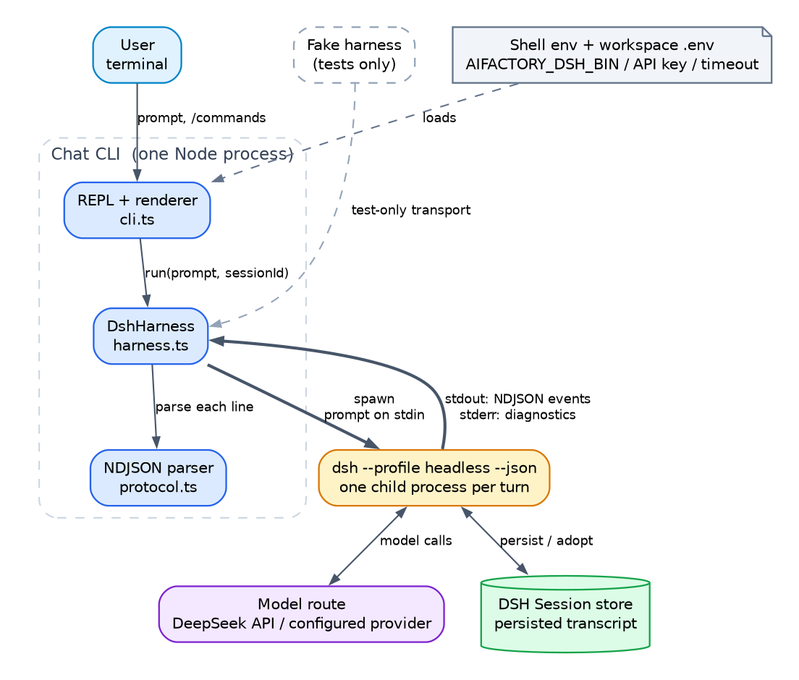
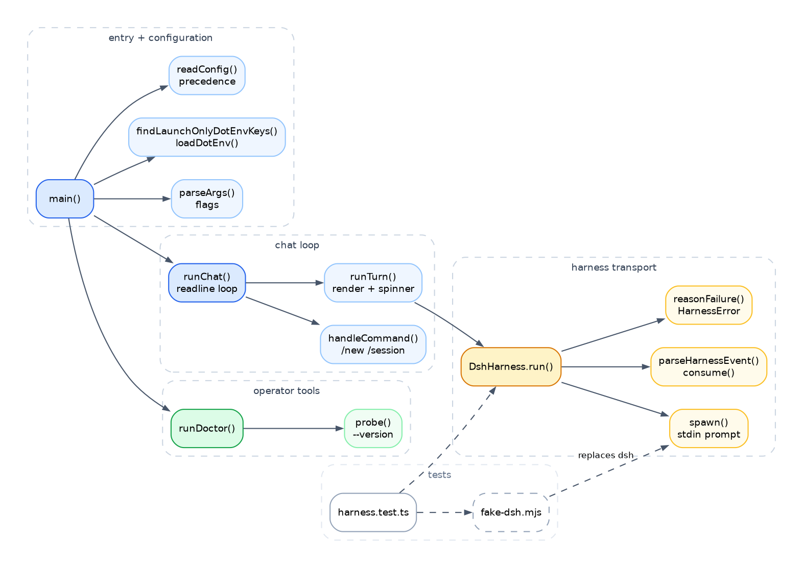
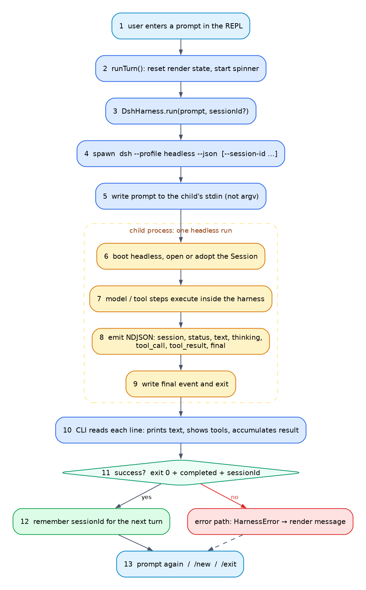
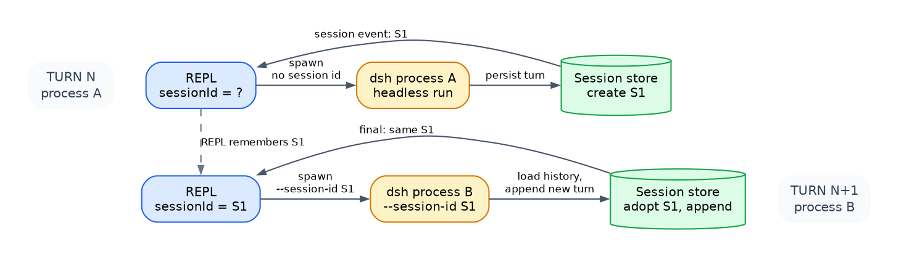
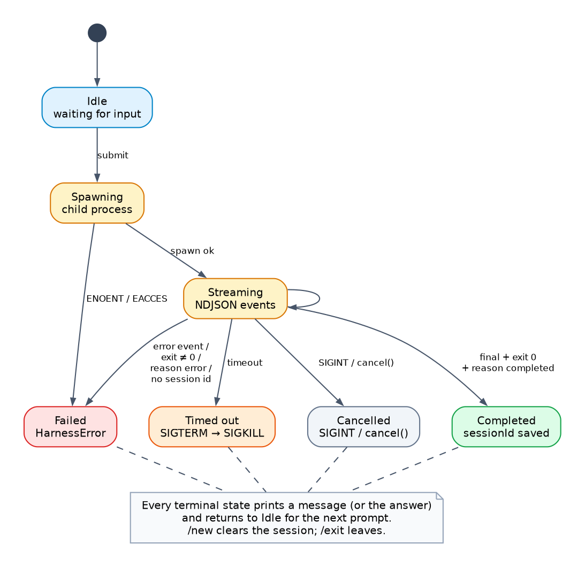

# Chat CLI — design walkthrough

This note explains the current implementation, from the terminal down to the harness child process. It is the design companion to the [README](README.md); the code is small enough that every box below maps to a real function.

**Scope of this slice:** one interactive conversation, one harness process per turn, persisted session continuity, readable failures, and a setup check (`doctor`). It is deliberately not a daemon, not a tool-approval UI, and not a cost dashboard yet.

---

## 1. System context



The CLI is a **thin client**. It owns the terminal experience and the process lifecycle, but it does not own the agent loop, model calls, tools or the transcript:

| Concern | Owner |
|---|---|
| Prompt editing, commands, output rendering | `cli.ts` |
| Spawning, stdin/stdout, timeouts, error mapping | `harness.ts` |
| Agent loop, model calls, tools, permissions | `dsh --profile headless` |
| Conversation transcript | DSH Session store |
| Session identity across turns | The CLI keeps one `sessionId` string in memory |
| API key, executable path, profile, timeout | Shell environment and/or workspace `.env` |

The most important consequence: **there is no conversation state in the CLI except the session id.** If the CLI process restarts, `--resume <sessionId>` restores the conversation because the transcript lives in the harness Session store.

---

## 2. Code map



| File | Responsibility | Key entry points |
|---|---|---|
| [`src/cli.ts`](src/cli.ts) | Flags, `.env` safety, config precedence, REPL, rendering, `doctor` | `main`, `readConfig`, `runChat`, `runTurn`, `runDoctor` |
| [`src/harness.ts`](src/harness.ts) | One harness run: spawn, stdin, NDJSON collection, timeout, abort, failure mapping | `DshHarness.run`, `DshHarness.cancel`, `HarnessError` |
| [`src/protocol.ts`](src/protocol.ts) | Public event shapes and a tolerant line parser | `parseHarnessEvent`, `reasonKind` |
| [`scripts/fake-dsh.mjs`](scripts/fake-dsh.mjs) | Deterministic child for tests; no model or network | Test-only |
| [`test/harness.test.ts`](test/harness.test.ts) | Session continuity, parser tolerance, structured failures, timeout | `node --test` |

The dependency direction is acyclic:

```text
cli.ts  →  harness.ts  →  protocol.ts
```

`harness.ts` never imports `cli.ts`, and `protocol.ts` has no process or I/O logic. That is what makes the transport testable with a fake executable.

---

## 3. One turn, step by step



1. **Prompt.** `readline` yields a line. Empty lines are ignored; `/commands` are handled locally and never sent to the harness.
2. **Turn setup.** `runTurn` clears its render flags, writes the `thinking…` hint to stderr, and calls `DshHarness.run(prompt, {sessionId})`.
3. **Argument construction.** `DshHarness` builds `--profile <name> --json`, then adds `--session-id <id>` when known, then `--permission-mode` when configured.
4. **Spawn.** `spawn(command, args, {cwd, env, stdio: 'pipe'})` starts the child with `shell: false`. The prompt is **not** an argument.
5. **Prompt delivery.** The prompt is written to the child's stdin and stdin is closed. This avoids option parsing for prompts that begin with `-`, and avoids argv length limits.
6. **Harness boot.** The child boots the headless profile, opens a new Session or adopts the one named by `--session-id`, and emits the opening `session` event.
7. **Execution.** The harness runs its model/tool loop. Model calls happen inside the child, using the provider configured in the harness profile.
8. **Event stream.** The child writes newline-delimited JSON to stdout; diagnostics go to stderr.
9. **Completion.** The child writes a terminal `final` event and exits.
10. **Consumption.** The CLI parses each line, prints `text` blocks, optionally prints thinking/tool events, and accumulates the answer.
11. **Success check.** A turn is successful only when the process exits `0`, the stream carried a session id, and `final.reason.kind` is `completed` (when present).
12. **Session update.** The returned `sessionId` replaces the REPL's previous value. The next turn will pass it back.

### Why stdin rather than argv

The headless runner accepts a positional task, but a positional prompt interacts with option parsing (`-`, `--help`) and with operating-system argument limits. Piping the prompt as a task keeps the CLI's argument surface stable and the prompt opaque.

### Why `text` is printed as blocks

The `--json` projection emits `text` at **commit points**, not per token. A retried model attempt never reaches the stream. The CLI therefore prints whole committed blocks; it is not a token-by-token typewriter. True delta streaming is a different transport (see §10).

---

## 4. The event contract

The CLI understands the public headless projection. Unknown events are ignored; malformed JSON lines increment a warning counter rather than discarding the turn.

| Event | Meaning | CLI action |
|---|---|---|
| `session` | Opening identity: `sessionId`, `cwd` | Store the session id |
| `status` | `turn_start`, `step_start`, `step_end`, `turn_end` | Ignore for display; can drive a spinner later |
| `text` | A committed assistant text block | Print it; prefix the first block with `ai>` |
| `thinking` | Committed reasoning text | Print only with `--show-thinking` |
| `tool_call` | Tool name, call id, arguments | Print only with `--debug` |
| `tool_result` | Tool status; `error` when the call failed | Print failures only with `--debug` |
| `final` | Authoritative answer, `sessionId`, terminal `reason` | Fallback answer and failure decision |
| `error` | Runner failure outside a turn (for example a usage error) | Raise `HarnessError` with message/code |
| anything else | Forward-compatible addition | Ignore |

Two details matter for correctness:

- **`final` is authoritative.** If no `text` block arrived (for example a one-block answer or an error), `result.text` comes from `final.text`.
- **`final.reason.error` is structured.** A missing API key produces `{ kind: "error", error: { message, code: "MISSING_CREDENTIAL" } }`; the CLI surfaces that message and code instead of a generic exit-code error.

---

## 5. Session continuity across processes



Each turn is a new OS process, but the conversation is one DSH Session:

1. **Turn N** starts with no `--session-id`. The harness creates `session-<uuid>` and reports it in `session` (and again in `final`).
2. The CLI stores that string in memory.
3. **Turn N+1** spawns a completely new child with `--session-id session-<uuid>`.
4. The harness validates that the Session exists, that its recorded working directory matches, and that its preset is compatible, then loads the history and appends the new turn.
5. The CLI receives the same id and keeps using it.

`/new` drops the id, so the next turn starts a fresh Session. `--resume <id>` seeds the id at startup. The CLI never writes the transcript itself.

**Why this is enough for a basic chat:** session identity is the only cross-turn state; the harness already persists everything else. A later local history index would be for search and replay, not for correctness.

---

## 6. Process lifecycle and failure



A run moves `Idle → Spawning → Streaming → terminal`. Terminal states are `Completed`, `Failed`, `Timed out`, and `Cancelled`. The REPL prints a message (or the answer) and returns to `Idle`; the Session id is preserved on failure so the user can continue or `/new`.

The implementation evaluates failures in this order:

| Order | Condition | Result |
|---|---|---|
| 1 | `spawn` fails (`ENOENT`, `EACCES`) | `cannot start "<command>" in <cwd>…` with `.env`/`DSH_BIN` hint |
| 2 | Wall-clock timeout | `harness turn timed out after <n> ms` |
| 3 | SIGINT / `cancel()` | `harness turn cancelled` |
| 4 | `error` event | `HarnessError` with the event message and code |
| 5 | Non-zero exit with `final.reason.error` | The reason's message and code |
| 6 | Non-zero exit without a reason | `harness exited with code <n>` |
| 7 | Exit 0 but `reason.kind ≠ completed` | `harness turn ended with "<kind>"` |
| 8 | No session id | `harness did not report a session id` |

On timeout the child gets `SIGTERM`, then `SIGKILL` after a two-second grace period. If the renderer callback throws, the transport kills the child with `SIGKILL` rather than leaving an orphan. The `finally` block clears timers, removes the abort listener, closes the readline interface and clears the active-run slot.

**Trade-off:** a process-per-turn gives crash isolation and a simple lifecycle, at the cost of process startup latency. A hung or crashed turn cannot poison the next one.

---

## 7. Configuration, including the `.env` rule

Configuration resolves in this order (first match wins):

| Setting | CLI flag | `.env` / environment | Default |
|---|---|---|---|
| Harness executable | `--dsh-bin` | `AIFACTORY_DSH_BIN`, then `DSH_BIN` | `dsh` |
| Profile | `--profile` | `AIFACTORY_PROFILE` | `headless` |
| Timeout | `--timeout` | `AIFACTORY_TIMEOUT_MS`, then `DSH_TIMEOUT_MS` | `120000` ms |
| Permission preset | `--permission-mode` | — | harness default |

`DSH_BIN` and `DSH_TIMEOUT_MS` are accepted only from the launching shell. The `AIFACTORY_*` names above are the `.env`-safe forms.

The CLI loads `<cwd>/.env` at startup. One restriction is easy to miss:

> **The harness rejects every `DSH_*` variable found in `.env`.** Those names are launch-only because they decide how the process starts, where code loads from, or how it reaches the network.

So `.env` uses the safe aliases:

```dotenv
DEEPSEEK_API_KEY=sk-...
AIFACTORY_DSH_BIN=/fs22/deepseek-harness/apps/cli/lib/bin.js
AIFACTORY_TIMEOUT_MS=120000
```

If a `DSH_*` key is present, `findLaunchOnlyDotEnvKeys` stops before spawning and prints the fix. `DSH_BIN` can still be exported in the shell; it just cannot live in the file.

`doctor` performs the cheap checks: Node version, working directory, resolved command/profile, harness `--version`, whether `DEEPSEEK_API_KEY` is present, and whether `.env` exists. It never prints the key.

---

## 8. Security boundaries

| Boundary | Current behaviour |
|---|---|
| Shell injection | `spawn` uses `shell: false`; the prompt is never interpolated into a command line |
| Prompt handling | Prompt goes over stdin; it is not visible in the process list as an argument |
| Credentials | Inherited by the child from the environment/`.env`; `doctor` reports presence only; `.env` is gitignored |
| Model output | Printed as text; never executed or evaluated |
| Tool execution | Controlled by the harness profile and optional `--permission-mode`; the CLI has no approval prompt yet |
| File access | The child's `cwd` is the CLI's working directory; changes are governed by the harness sandbox/permission policy |
| Orphans | Timeout/cancel kill the child; renderer failures trigger `SIGKILL` |

The important gap is **tool approval**. Headless mode has no live approval channel, so this CLI is currently safe for conversation and read-oriented work, but it is not yet a safe interactive shell for destructive tools.

---

## 9. What this design optimizes

- **A stable seam.** The headless `--json` contract is public and versioned by the harness; the CLI does not import developer-preview internals.
- **Replaceable transport.** `DshHarness` is the only place that knows how to start a process. A future SDK transport can implement the same `run()` surface.
- **Small failure surface.** One process, one run, one exit code, one Session id. No reconnect state machine yet.
- **Testability without a model.** The fake harness covers lifecycle and parsing in milliseconds.

It deliberately pays for that with process startup latency, no live token deltas, no interactive approvals and no local transcript.

---

## 10. Next structural step

The natural replacement for the process-per-turn transport is [`@deepseek-ai/dsh-sdk-client`](https://github.com/deepseek-ai/deepseek-harness/tree/main/packages/sdk/client): it keeps one runtime alive over stdio JSON-RPC, exposes notifications, supports `resumeSession`, and routes `approval/request` to a client handler. That unlocks:

1. **Interactive tool approvals** — allow once / reject / always, with a real permission preset.
2. **Lower latency** — no boot per turn.
3. **Live notifications** — progress and tool activity without waiting for committed blocks.
4. **Usage and cost** — per-turn accounting from the SDK result/events.

The CLI surface (`chat`, `doctor`, `/new`, `/session`, `/resume`) can stay the same; only `harness.ts` changes.

---

## Appendix — file map

```text
apps/chat-cli/
├── src/
│   ├── cli.ts          REPL, config, rendering, doctor
│   ├── harness.ts      one run, process lifecycle, error mapping
│   └── protocol.ts     event types and parser
├── test/
│   └── harness.test.ts 7 tests, fake harness
├── scripts/
│   ├── fake-dsh.mjs    deterministic child
│   └── fake-dsh        executable wrapper
├── docs/diagrams/      Graphviz sources + rendered PNG/SVG
├── .env.example
└── README.md
```
