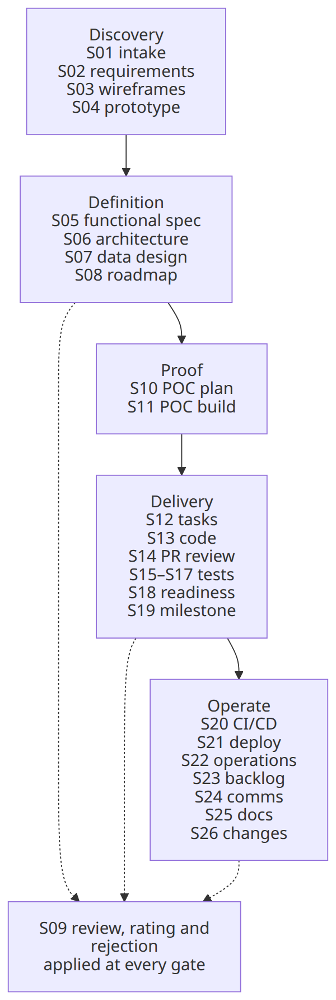
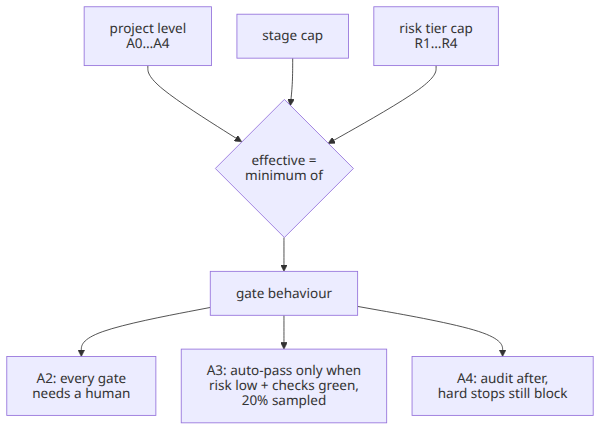
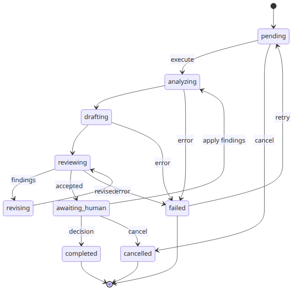
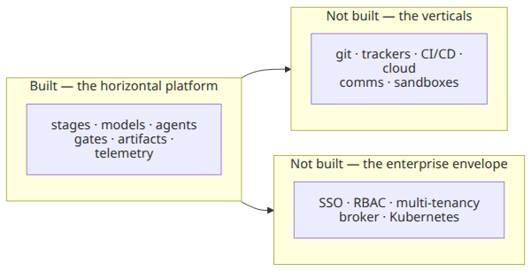
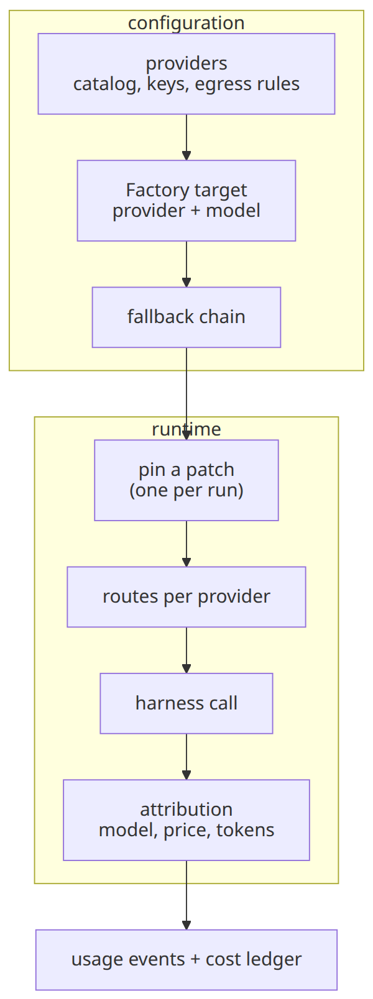
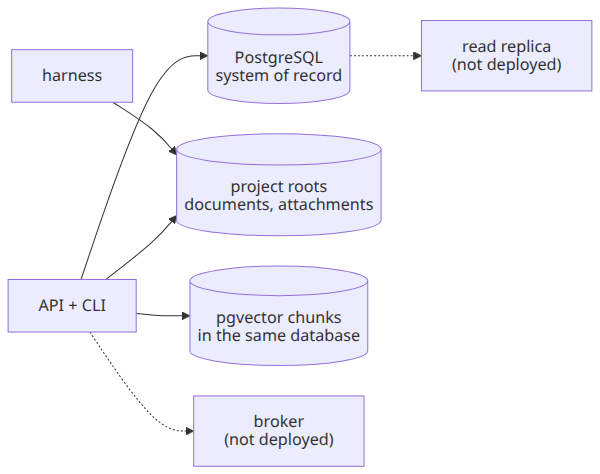
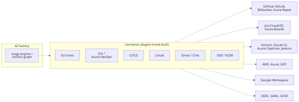
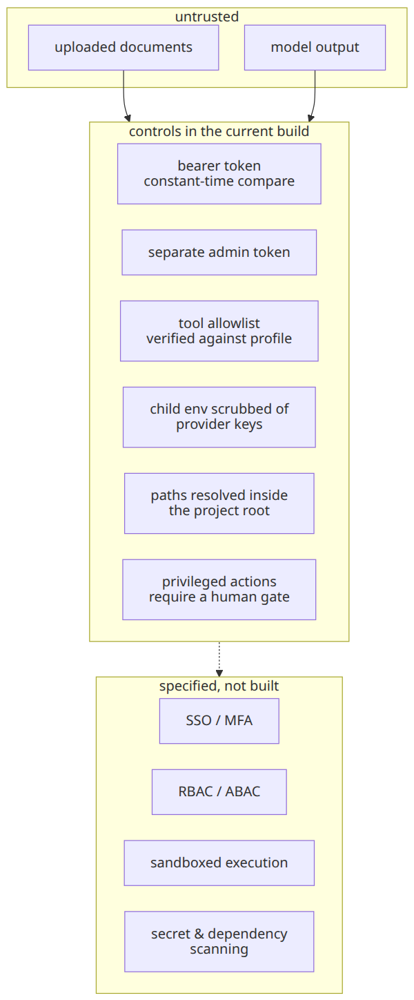

# AI Factory — Requirements Specification (v2)

**Version:** 2.0 · **Date:** 2026-11-18 · **Status:** baseline, with delivery status marked
**Supersedes:** [`AI-Factory-Requirements.md`](AI-Factory-Requirements.md) (v1, kept for reference)

> This is a rewrite, not an edit. It keeps every requirement identifier from v1, adds a
> **delivery status** to each requirement — so the document says what the system *must* do and
> what it *does* — and adds a future-enhancements part that v1 did not have.
> The companion document is [`ARCHITECTURE-v2.md`](ARCHITECTURE-v2.md).

---

## What changed in v2

| Change | Why it matters |
|---|---|
| **Every requirement carries a status**: `Built`, `Partial`, `Planned`, `Deferred` | v1 could not tell a reader whether a requirement described working software or an intention. With 600+ requirements that ambiguity is the difference between a spec and a wish list. |
| **`AR-` split into `AG-` (agent runtime) and `FR-`** | v1 used `AR-` for agent-runtime requirements while the remediation register uses `AR-` for *architecture review findings*. Two different things shared a prefix. `AG-` now means agent runtime; the old `AR-` numbers are mapped in Appendix D. |
| **The stage catalog gained an "as built" column** | The catalog described 26 stages; two run today. The column makes that explicit instead of leaving a reader to discover it. |
| **Part IV: future enhancements** | v1 listed a roadmap but no candidate scope beyond it. Part IV proposes concrete enhancements with rationale, cost and risk — and, as importantly, names the ideas that were rejected and why. |
| **Diagrams redrawn and rendered** | v1's diagrams were dense flowcharts shown as Mermaid source. This version uses state machines for lifecycles and sequence diagrams for flows, and embeds them as images so they display in any viewer (source in `diagrams/src/`). |
| Consolidated prose | Long narrative sections became tables where a table is clearer. No requirement was dropped. |

**Reading the status column.** `Built` means it works and a test covers it. `Partial` means the
mechanism exists with a named gap. `Planned` means it is agreed and not started. `Deferred`
means it was deliberately postponed with a reason. Nothing is marked `Built` on intention.

---

## Contents

**Part I — Product**
1. [Introduction](#1-introduction)
2. [Product definition](#2-product-definition)
3. [Operating model and lifecycle](#3-operating-model-and-lifecycle)

**Part II — Requirements**
4. [Delivery status at a glance](#4-delivery-status-at-a-glance)
5. [Functional requirements by stage](#5-functional-requirements-by-stage)
6. [Human-in-the-loop review model](#6-human-in-the-loop-review-model)
7. [Platform architecture requirements](#7-platform-architecture-requirements)
8. [Agent runtime and adapters](#8-agent-runtime-and-adapters)
9. [Model gateway](#9-model-gateway)
10. [Token and cost economy](#10-token-and-cost-economy)
11. [Data architecture](#11-data-architecture)
12. [Integrations](#12-integrations)
13. [Security, privacy and compliance](#13-security-privacy-and-compliance)
14. [Non-functional requirements](#14-non-functional-requirements)
15. [Configuration and modularity](#15-configuration-and-modularity)
16. [API and event contract](#16-api-and-event-contract)
17. [Quality assurance framework](#17-quality-assurance-framework)

**Part III — Delivery**
18. [Roadmap and acceptance](#18-roadmap-and-acceptance)
19. [Risks and open questions](#19-risks-and-open-questions)
20. [Glossary](#20-glossary)

**Part IV — Future**
21. [How enhancements are proposed](#21-how-enhancements-are-proposed)
22. [Horizon 1 — next release](#22-horizon-1--next-release)
23. [Horizon 2 — the second half of the factory](#23-horizon-2--the-second-half-of-the-factory)
24. [Horizon 3 — the long view](#24-horizon-3--the-long-view)
25. [Rejected ideas](#25-rejected-ideas)

**Appendices**
[A. Requirement ID map v1 → v2](#appendix-a-requirement-id-map-v1--v2) ·
[B. Review rubric](#appendix-b-review-rubric) ·
[C. Configuration reference](#appendix-c-configuration-reference) ·
[D. Glossary of codes](#appendix-d-glossary-of-codes)

---

## 1. Introduction

### 1.1 Purpose

This document specifies what the AI Factory must do. It is the reference for what gets built,
what gets tested, and what is deliberately left out. It is written to be read by three
audiences and to be useful to each without being wrong for the others:

- **the people building it** — requirements are testable and trace to code;
- **the people approving it** — gates, thresholds and non-negotiable constraints are explicit;
- **the people operating it** — failure behaviour and status are stated, not implied.

### 1.2 Scope

In scope: the autonomous delivery lifecycle from intake to post-release operations, the
orchestration kernel that runs it, the model and agent layer beneath it, the review gates that
constrain it, and the data and integrations it needs.

Out of scope for this document: the user interface (specified as prompts under `docs/ui/`), and
the internal design of the DeepSeek Harness, which is treated as a kernel with a documented
contract.

### 1.3 Normative language

`shall` is mandatory; `should` is expected unless a recorded reason says otherwise; `may` is
permitted. A requirement is satisfied only when a test demonstrates it, not when a design
mentions it. Where the system does not yet satisfy a `shall`, the status column says so and
the requirement stays visible rather than being quietly satisfied by re-reading it.

### 1.4 Requirement identifiers

Identifiers are stable for the life of the product and are never reused or renumbered.

| Prefix | Domain | v2 change |
|---|---|---|
| `FR-` | Functional requirement, blocked by lifecycle stage | unchanged |
| `HR-` | Human review checkpoint | unchanged |
| `HX-` | Human review interaction and evidence | unchanged |
| `QR-` | Quality gate and threshold | unchanged |
| `AG-` | Agent runtime, orchestration and adapters | **renamed from `AR-`** to avoid colliding with architecture-review findings |
| `MG-` | Model gateway and provider | unchanged |
| `TE-` | Token and cost economy | unchanged |
| `DR-` | Data architecture | unchanged |
| `IR-` | Integration | unchanged |
| `SR-` | Security, privacy, compliance | unchanged |
| `NFR-` | Non-functional | unchanged |
| `CR-` | Configuration and modularity | unchanged |
| `API-` | API and event contract | unchanged |
| `ACC-` | End-to-end acceptance scenario | unchanged |

### 1.5 Status vocabulary

| Status | Meaning | Evidence required |
|---|---|---|
| **Built** | works today | a test in `apps/chat-cli/test` exercises it |
| **Partial** | mechanism exists, named gap | the gap is named in the requirement |
| **Planned** | agreed, not started | has an owner horizon in Part IV |
| **Deferred** | deliberately postponed | reason recorded in §19 or §25 |

---

## 2. Product definition

### 2.1 Problem statement

Software delivery is slow less because writing code is slow than because **the artefacts between
stages are thin, inconsistent and unverified**: a brief that no requirement traces to, an
architecture decision with no record, a test plan written after the build. The cost appears
late — as rework, as a missed requirement, as a release that cannot be justified.

Agentic tools accelerate the typing and leave that problem intact, because a model asked to
"write the requirements" produces plausible prose, not a traceable baseline.

### 2.2 Vision

A factory that turns an intent into delivered software through **stages with explicit
artefacts, evidence and human gates**, where:

- every artefact traces back to the business goal and forward to the code and tests;
- every gate is a recorded human decision with the evidence that existed at the time;
- every run is reproducible — the model, the agent and the settings that produced it are frozen;
- the cost of each artefact is known.

### 2.3 Product principles

| # | Principle | Consequence in the design |
|---|---|---|
| P1 | **Evidence over assertion.** A stage may start only when its inputs exist, not because the previous stage "finished". | prerequisites are evaluated, waivable only with a written reason |
| P2 | **A human decides, always.** No gate auto-approves. | stale gates are reported, never resolved |
| P3 | **Reproducibility beats novelty.** A run keeps the model it started with. | per-run bindings, explicit rebind only |
| P4 | **Failure is a state, not a surprise.** Every failure has a code and a next action. | failure-mode table, typed errors |
| P5 | **The cheap check runs first.** Verify agents offline before spending money. | offline probe by default |
| P6 | **Data over code for configuration.** A stage, a prerequisite, an agent is data. | stage definitions, catalogue, agents in the database |
| P7 | **Boring infrastructure.** One database, one process model. | PostgreSQL only, no queue, no cache tier |

### 2.4 Goals and success metrics

| Goal | Metric | Target | Today |
|---|---|---|---|
| Traceable delivery | requirements with a test reference | 100% of `Built` | tracked per release |
| Gate integrity | gates decided with recorded evidence | 100% | built |
| Reproducibility | runs resumed with their original bindings | 100% | built |
| Cost visibility | usage attributable to model and role | 100% | built (unknown prices flagged) |
| Reliability | runs lost to a process restart | 0 | lease + resume |
| Operability | failures returning a typed code | 100% | built |
| Test confidence | automated tests | ≥ 500 | 579 |

### 2.5 Non-goals

- **Replacing engineers.** The factory produces artefacts and evidence for humans to approve.
- **Writing production code unattended at scale.** Code stages are specified; a human merges.
- **A general-purpose agent platform.** It is a delivery pipeline with agents inside it.
- **Being a model provider.** It routes to providers; it does not serve models.
- **Replacing a project tracker.** It integrates with Jira and Azure DevOps; it does not become one.

### 2.6 Assumptions

- Model providers are reachable and billable; an outage is possible and handled by failover.
- A project has a filesystem workspace the process can write.
- Postgres 16 with pgvector is available.
- Requirement authors can write acceptance criteria; the system does not invent business truth.

### 2.7 Constraints

| Constraint | Effect |
|---|---|
| The harness is **text-only** | images are rejected; PDFs are text-extracted |
| The harness is a **child process** | run state lives in Postgres, not in the harness |
| Providers differ in capability | capability checks before routing, not after failing |
| Token cost is real money | budgeted runs, priced attribution, offline probes |
| Compliance forbids auto-approval | gates are human, permanently |

---

## 3. Operating model and lifecycle

### 3.1 Core concepts

| Concept | Definition | Stored as |
|---|---|---|
| **Project** | one delivery effort, with one workspace on disk | `projects` |
| **Stage** | one step of the lifecycle (intake … operations) | `project_stages` |
| **Stage run** | one attempt to execute a stage; the unit of work, cost and audit | `project_stage_runs` |
| **Gate** | a human decision a run is waiting on | `pending_gate` on the run |
| **Artifact** | the approved output of a stage | `project_documents` |
| **Evidence** | proof a prerequisite is met: a brief, an attachment, a document, a waiver | `project_stage_evidence` |
| **Agent** | a named role player an assignment can point at | `agent_definitions` |
| **Binding** | what a run froze at start: model target and agents | `bindings` |

The important distinction is **artifact vs draft**. A run holds a draft; only completion
writes an artifact. A paused run therefore has no document and no PDF, so a gate can never be
mistaken for an approval.

### 3.2 Lifecycle overview



S09 is not a phase; it is the review discipline applied at every gate, which is why it sits
across the bands rather than inside one.

### 3.3 Stage catalog — with as-built status

Twenty-six stages are specified. **Two run today**: `planning` (the feasibility report) and
`requirements` (the specification). The others have no runtime yet and answer
`501 STAGE_NOT_IMPLEMENTED`, which is deliberate: a stage that silently does nothing is worse
than one that is not built.

| ID | Stage | Accountable role | Primary artifacts | Gate | As built |
|---|---|---|---|---|---|
| S01 | Intake and project creation | Product Owner | charter, workspace, budget | HR-01 | **Built** (project registry) |
| S02 | Requirements elicitation | Business Analyst | BRD, use cases, NFR catalogue | HR-02a | **Built** (`requirements` stage: specification, NFR catalogue, acceptance criteria; use cases and several FRs partial — §5.2) |
| S03 | Wireframing | UX Lead | flow maps, wireframes | HR-03a | Planned |
| S04 | Interactive prototype | UX Lead | clickable prototype, tokens | HR-03b | Planned |
| S05 | Functional specification | Business Analyst | SRS, acceptance criteria, RTM | HR-02b | Planned |
| S06 | Architecture and stack | Architect | HLD, component model, ADRs | HR-04 | Planned |
| S07 | Data and database design | Data Architect | ERD, DDL, migration plan | HR-05 | Planned |
| S08 | Roadmap and estimation | Delivery Lead | roadmap, WBS, budget | HR-06 | Planned |
| S09 | Document review and rating | Review Board | review reports, ratings | every gate | **Built** (review loop, acceptance rule) |
| S10 | POC planning | Architect | POC plan, hypotheses | HR-07 | Planned |
| S11 | POC build and demo | Architect | build, demo script, evaluation | HR-07 | Planned |
| S12 | Task decomposition | Delivery Lead | task DAG, sprint plan | HR-08 | Planned |
| S13 | Code development | Tech Lead | commits, PRs, unit tests | pre-PR | Planned |
| S14 | PR review | Tech Lead | review record, approvals | HR-09 | Planned |
| S15 | Unit testing | QA Lead | suites, coverage, mutation | QR | Planned |
| S16 | UI testing | QA Lead | E2E, visual diffs, a11y | QR | Planned |
| S17 | Integration and E2E | QA Lead | integration, perf, security | QR | Planned |
| S18 | QA threshold and readiness | QA Lead | readiness report, waivers | HR-10 | Planned |
| S19 | Milestone completion | Delivery Lead | DoD evidence, release notes | HR-11 | Planned |
| S20 | CI/CD authoring | DevOps Lead | pipeline-as-code, IaC, SBOM | HR-04 | Planned |
| S21 | Deployment | Release Manager | deployment record, rollback proof | HR-12 | Planned |
| S22 | Post-release operations | SRE Lead | SLO dashboard, incidents | HR-14 | Planned |
| S23 | Ticket and backlog monitoring | Project Manager | triage queue, SLA alerts | exception | Planned |
| S24 | Communications monitoring | Project Manager | linked threads, drafts | exception | Planned |
| S25 | Documentation and help | Technical Writer | user guide, API reference | HR-13 | Planned |
| S26 | Change request handling | Change Board | impact analysis, decision | HR-15 | Planned |

`planning` (S09's feasibility step at the front of the cycle) and `requirements` (S02) are the
two implemented stages; the numbering in the catalog is the lifecycle, not the build order.

### 3.4 Autonomy levels

Autonomy is set per project and capped per stage and per risk tier. The **effective** autonomy
at a gate is the minimum of the three.



| Level | Name | Behaviour | Default use |
|---|---|---|---|
| A0 | Manual | humans do the work; the factory assists on request | regulated legacy |
| A1 | Assisted | agents draft; a human edits each artifact | new customers |
| A2 | Supervised | agents execute; a human approves every gate | **default** |
| A3 | Guardrailed | low-risk gates auto-pass when checks are green; 20% sampled | ≥10 successful runs |
| A4 | Autonomous | post-hoc audit; only hard stops block | internal tools |

**Non-negotiable at every level:** production deployment, security exceptions, destructive
migrations, personal-data changes, and budget increases above 20% require a human. Separation
of duties applies always: the author of an artifact may not be its sole approver.

**Risk tiers:** R1 low (internal, reversible), R2 moderate (customer-facing), R3 high (personal
data, payments), R4 critical (safety, regulated core). Any reviewer may raise a tier; lowering
it requires the Platform Owner and Security Officer.

> **As built:** A2 is the only implemented behaviour — every gate waits for a human. A0/A1/A3/A4
> are specified and not enforced; the model exists in the requirements, not in code. This is
> stated rather than implied because an operator reading "A3 available" would be misled.

### 3.5 Run lifecycle



**AG-01 (M) — Built.** A run shall persist its phase, analysis, draft and review cycle after
every agent step, so a process restart loses at most the in-flight step.

**AG-03 (M) — Partial.** A run shall be resumable, forkable (branching from any checkpoint for
what-if execution) and replayable in dry-run mode. Resumable is built; fork and replay are not.

**AG-02 (M) — Built.** Every externally visible side effect shall be idempotent with respect to
retry: a retried run re-uses its document identity rather than creating a second artifact.

### 3.6 Artifact model

Every artifact has a stable ID, a type, a version, a content hash, a storage path, provenance
(role, agent, model, prompt source, inputs), a status, a classification and a retention class.

| Status | Meaning |
|---|---|
| `uploaded` | supplied by a person, not generated |
| `in_review` | generated, awaiting a gate |
| `approved` | the gate was answered; immutable |
| `rejected` | the gate refused it |
| `superseded` | a newer version replaced it |

**AG-04 (M) — Built.** Artifacts shall be immutable once approved: a change creates a new
version with a `supersedes` link.

**AG-05 (M) — Partial.** Every artifact shall validate against a declared schema before review.
Documents are typed by kind; a JSON Schema per kind is **not** enforced.

**AG-06 (M) — Built.** Artifact provenance shall be sufficient to reconstruct the model, prompt
and inputs that produced it. The run's context hash, bindings and event log provide this.

**AG-07 (M) — Partial.** The system shall produce an end-to-end trace from a business goal to
requirement, task, commit, test, deployment and incident. Requirement-to-document links exist;
code and deployment links await those stages.

**AG-08 (M) — Planned.** The system shall report orphaned artifacts (a requirement with no
test, a commit with no task) as a quality finding.

**AG-09 (S) — Planned.** The system shall support impact queries over the traceability graph.

---

## 4. Delivery status at a glance

A single page that answers "what does this thing actually do today". The detailed requirement
tables follow in §5–§17.



The shape matters more than the list: everything that is **shared by all stages** exists, and
everything that **connects to the outside world** does not.

| Capability area | State | Detail |
|---|---|---|
| Project registry and workspace | **Built** | create, read, update, delete; unique root path; cascade cleanup |
| Stage execution | **Built** for 2 of 26 stages | planning, requirements; the rest `501` |
| Review loop and acceptance | **Built** | thresholds, cycles, findings, acceptance rule |
| Human gates | **Built** | final decisions, waivers, stale reporting |
| Model layer | **Built** (registry, routing, fallback, attribution); **Partial** (budgets, caching) | §9 |
| Agents | **Built** | definitions, assignments, composition, offline probe, tool verification |
| Prerequisites | **Built** | evidence, waivers, readiness snapshot, editable catalogue |
| Artifacts | **Built** for Markdown + PDF | schema validation per kind is not enforced |
| Telemetry and cost | **Built** | per-model attribution, unpriced flagged |
| Observability | **Built** | events, traces, logs, status bar |
| Auth | **Partial** | two tokens; no SSO, RBAC or multi-tenancy |
| Integrations | **Not built** | Git, Jira, Azure DevOps, Gmail, Chat |
| Sandboxing | **Not built** | the harness runs as a child process |
| Event backbone | **Not built** | Postgres events, no broker or outbox |
| Autonomy A0/A1/A3/A4 | **Not built** | A2 only |

**The honest headline:** the horizontal platform (models, agents, stages, gates, artifacts,
telemetry) is built and tested; the vertical integrations (Git, trackers, CI/CD, cloud) and
the enterprise envelope (SSO, tenancy, sandboxes) are not. A reader should not infer from
"26 stages specified" that 26 run.

---

---

## 5. Functional requirements by stage

Each stage block opens with its build state. Requirements inside a fully unbuilt stage are
marked uniformly rather than row by row; the two built stages carry a status per requirement,
because there the difference between "built" and "planned" is the useful information.

### 5.1 S01 — Intake and project creation

**State: partial.** The registry, workspace provisioning and checklist exist; intake channels,
charter generation, blueprint recommendation and integration verification do not.

| ID | Requirement | Status |
|---|---|---|
| FR-101 | (M) The system shall accept intake through the web cockpit, REST API, CLI, inbound e-mail, and import from a Jira epic or Azure DevOps work item, capturing the business goal, stakeholders, constraints, target date, budget band, compliance profile and desired autonomy level. | Partial — API and CLI only |
| FR-102 | (M) The system shall generate a Project Charter containing problem statement, goals and non-goals, success metrics, scope, assumptions, dependencies, initial risks, stakeholder RACI and a summary of what the Factory will and will not do. | Planned |
| FR-103 | (M) The system shall ask at most ten ranked clarifying questions, each with a proposed default and the reason it matters, and shall record unanswered questions as explicit assumptions rather than silently inventing answers. | Planned |
| FR-104 | (S) The system shall recommend one or more project blueprints and show which stages, gates, thresholds and artifacts differ from the default. | Planned |
| FR-105 | (M) The system shall compute an initial risk tier (R1 low to R4 critical) from data sensitivity, regulatory exposure, blast radius, novelty and delivery pressure, and use it to cap autonomy and select review depth. | Partial — the field exists, the cap is not enforced |
| FR-106 | (M) The system shall provision, within 10 minutes: repositories, branch protection, environments, a CI skeleton, tracker project and fields, a collaboration space, secret references, a dashboard, a budget and an audit stream. | Partial — workspace and database only |
| FR-107 | (M) The system shall verify every bound integration with a read-only health check and one write to a sandbox object, and block the run if a mandatory integration fails. | Planned |
| FR-108 | (M) The system shall require a budget (tokens, currency, wall-clock, review minutes) and an autonomy level before the first gate, and refuse a run whose estimated cost exceeds the remaining budget. | Planned |
| FR-109 | (M) The system shall assign named humans to the accountable roles, enforce that no role is vacant for a mandatory gate, and support delegation with an expiry. | Planned |
| FR-110 | (S) The system shall detect potential duplicate projects and reusable components, and require a disposition (proceed, merge, reuse) before provisioning. | Planned |
| FR-111 | (S) The system shall publish a kickoff pack (charter, plan, gate calendar, contact matrix, escalation path) to the dashboard and the configured chat space. | Planned |

### 5.2 S02 — Requirements elicitation and analysis

**State: built as a stage** (R1–R9, 2026-11-19). The stage runs end to end — planning
handoff or direct entry, automatic review and revision, one human approval — and has
been run once against a live model. A status of **Built** below means an enforcing
deterministic check *and* a test exist; **prompt** means the model is asked to do it
and the reviewer judges it, but nothing blocks a document that does not. The contract,
checks and their finding codes are in [REQUIREMENTS-CONTRACT.md](design/REQUIREMENTS-CONTRACT.md);
operation and recovery in [REQUIREMENTS-STAGE-OPERATIONS.md](operations/REQUIREMENTS-STAGE-OPERATIONS.md).

| ID | Requirement | Status | Enforced by |
|---|---|---|---|
| FR-201 | (M) Ingest source material (brief, transcripts, documentation, tickets, e-mails, regulatory extracts) and record each source with provenance, date and classification. | Partial — every input (brief, uploaded documents, planning baseline) is recorded at run start in a source register with `SRC-###` id, origin, received date and SHA-256, shown to every role; traceability cites `SRC-###` ids, and unknown or never-cited ids are flagged (advisory). **Deferred:** source classification (needs a taxonomy decision and an upload-time field; every source is `unclassified`) and further source types (transcripts, tickets, e-mail: FR-2001, FR-2101) | `stage-evidence.ts` (`buildSourceRegister`), `requirements-checks.ts`; `test/stage-evidence.test.ts` |
| FR-202 | (S) Conduct structured elicitation (questionnaires, interviews, asynchronous review) and produce a transcript and decision log per session. | Deferred — needs a session model (questionnaire, interview, asynchronous review), storage, a UI and a human-in-the-loop flow: a new subsystem, not a contract change; asynchronous review also depends on the communications integration (FR-2101). Revisit after a product decision on elicitation channels ([R9 #10](http://localhost:8282/issues/10)) | — |
| FR-203 | (M) Express every functional requirement as a uniquely identified, atomic, testable statement with actor, trigger, behaviour, inputs, outputs, error cases and priority. | Built — unique ids and every field present and non-placeholder block approval; atomicity and testability are prompt + reviewer judgement (not blocking) | `requirements-validation.ts`, `requirements-coverage.ts`; `test/requirements-validation.test.ts`, `test/stage-requirements-paths.test.ts` |
| FR-204 | (M) Maintain an NFR catalogue covering performance, scalability, availability, security, privacy, accessibility, localisation, observability, maintainability, portability and compliance, each with a measurable target and verification method. | Built — every domain present (or `not applicable — <reason>`), a target and a verification method block approval; measurability is reviewer judgement | `requirements-validation.ts` (`CONTRACT_MISSING_NFR_DOMAIN`), `requirements-coverage.ts` (`MISSING_NFR_VERIFICATION`); same tests |
| FR-205 | (S) Model personas, goals, journeys and pain points, linking each journey step to the requirements that support it. | Partial — an actors table (actor, goal, permissions) is required. **Deferred:** journeys and pain points — a journey/step schema and review UX would add a large section to specifications that already reach ~70,000 characters, and journeys are consumed by S03 wireframing; revisit with that stage ([R9 #10](http://localhost:8282/issues/10)) | `requirements-validation.ts` |
| FR-206 | (M) Capture business rules, decision tables, formulas and state transitions separately from narrative text so they can be tested directly. | Built — an optional `### Business rules` table (`BR-###`, type decision table / formula / state transition / validation / policy, the FRs it applies to, its acceptance criteria); when present each rule must apply to declared FRs and be proved by an acceptance criterion (blocking). Whether every rule in the evidence was captured is reviewer judgement | `requirements-validation.ts`, `requirements-coverage.ts`; `test/requirements-validation.test.ts`, `test/requirements-coverage.test.ts`, `test/stage-requirements-paths.test.ts` |
| FR-207 | (M) Maintain a domain glossary and conceptual model, and flag terms used inconsistently across sources. | Partial — an optional `### Glossary` table (term, definition, source); a term defined twice with different definitions is blocking (`CONTRACT_INCONSISTENT_GLOSSARY_TERM`). **Deferred:** a conceptual model, and detecting inconsistent *usage* across sources, which needs semantic analysis rather than a table check (left to the reviewer) ([R9 #10](http://localhost:8282/issues/10)) | `requirements-validation.ts`; `test/requirements-validation.test.ts` |
| FR-208 | (M) Maintain a register of assumptions, constraints, dependencies and open questions, each with an owner, impact if wrong and resolution date. | Built — every register entry states type (assumption / constraint / dependency / question), owner, impact if wrong, status (open / confirmed / closed) and a resolve-by date (YYYY-MM-DD, required while open); all blocking | `requirements-validation.ts`; `test/requirements-validation.test.ts`, `test/stage-requirements-paths.test.ts` |
| FR-209 | (M) Detect ambiguity, contradiction, duplication, missing acceptance criteria and untestable wording, and score requirement quality against a defined rubric. | Partial — missing acceptance criteria and duplicate ids are deterministic and blocking; ambiguity, contradiction, duplicate behaviour and untestable wording are a reviewer rubric with severity and a 0–100 rating that drive automatic revision but **do not block approval**; the live run's reviewer did not converge | `requirements-coverage.ts`; reviewer prompt in `stages/requirements.ts`; `test/stage-requirements.test.ts` (rubric, revision) |
| FR-210 | (S) Support MoSCoW and WSJF prioritisation and make the trade-offs visible. | Partial — every FR priority must be MoSCoW (must / should / could / won't, blocking) and the gate shows the tally. **Deferred:** WSJF — it needs business value, time criticality, risk reduction and job size per item, which the evidence rarely contains and the stage must not invent; revisit when delivery planning supplies estimates ([R9 #10](http://localhost:8282/issues/10)) | `requirements-validation.ts` (`CONTRACT_INVALID_PRIORITY`), `requirements-coverage.ts` (`counts.priorities`); `test/requirements-validation.test.ts` |
| FR-211 | (M) Define explicit scope boundaries (in, out, deferred) and reject a requirement outside them without a change request. | Partial — In scope, Out of scope and Deferred are required (blocking). **Deferred:** rejecting out-of-scope requirements — deciding that a requirement falls outside the boundaries is a semantic judgement with no deterministic check, and "without a change request" needs change control (S26, FR-2301), which does not exist yet ([R9 #10](http://localhost:8282/issues/10)) | `requirements-validation.ts` (`CONTRACT_MISSING_SCOPE_BOUNDARY`) |
| FR-212 | (M) Link every requirement upward to a goal and downward to at least one acceptance criterion, and report coverage. | Built — every FR and NFR must be named by an acceptance criterion (blocking); a coverage report (requirements with AC, source, goal) is shown at the gate and in events; a missing source or **goal is advisory**, not blocking | `requirements-coverage.ts`; `test/requirements-coverage.test.ts`, `test/stage-requirements-paths.test.ts` |
| FR-213 | (S) Run a completeness pass against the blueprint's requirement checklist and list gaps with severity. | Partial — every draft gets a deterministic completeness pass against the stage contract with blocking/advisory severity. **Deferred:** a pass against "the blueprint's requirement checklist" — no such checklist is defined in the product; writing it is a content task that should precede any check ([R9 #10](http://localhost:8282/issues/10)) | `requirements-checks.ts` |
| FR-214 | (M) Baseline approved requirements as version 1.0 and route later changes through change control. | Partial — approval is an explicit human decision and the only way a specification is published (rejection publishes nothing). **Deferred:** baseline numbering (every approved specification is stored as its own document, version 1, with no supersession) and change routing — both belong to change management (S26) ([R9 #10](http://localhost:8282/issues/10)) | `stage-runtime.ts` decision path; `test/stage-requirements.test.ts` |

### 5.3 S03 — Wireframing · S04 — Prototype

**State: not built.** These stages need binary artifact support (svg/png), which the harness
cannot review — the reviewer is text-only. That constraint is why they are not next.

| ID | Requirement |
|---|---|
| FR-301 | (M) Produce an information architecture (sitemap, navigation model, content hierarchy) derived from journeys and requirements. |
| FR-302 | (M) Produce user flows for every primary journey, including error, empty, loading, permission-denied and recovery paths. |
| FR-303 | (M) Produce low-fidelity wireframes for every in-scope screen, annotated with purpose, required data, primary action, validation and linked requirements. |
| FR-304 | (S) Define responsive behaviour at agreed breakpoints and state what collapses, hides, reorders or becomes a separate view. |
| FR-305 | (M) Annotate accessibility intent — heading order, focus order, labels, error announcement, target size, contrast — for each screen. |
| FR-306 | (S) Map wireframe components to an existing design system, listing new components with justification. |
| FR-307 | (M) Record open UX questions and decisions with rationale, and never silently resolve a product decision inside a wireframe. |
| FR-308 | (M) Render wireframes as a navigable click-through artifact reviewable without a separate design tool. |
| FR-401 | (M) Generate a runnable, clickable prototype from approved wireframes using project tokens and realistic content, published at a stable preview URL. |
| FR-402 | (M) The prototype shall implement navigation, validation, loading, empty, error and success states, and the primary interaction on every screen. |
| FR-403 | (S) Include a component and token inventory the implementation stage must consume rather than reinvent. |
| FR-404 | (S) Generate a usability test script covering the top five journeys. |
| FR-405 | (M) Run heuristic evaluation and automated accessibility checks against the prototype and report violations with severity. |
| FR-406 | (M) Map each prototype screen and interaction back to requirements and flag behaviour with no requirement. |
| FR-407 | (C) Enforce a prototype performance budget and report measured results. |
| FR-408 | (M) Produce a handoff package: prototype source, tokens, assets, annotations and a recorded walkthrough. |
| FR-409 | (S) Capture stakeholder feedback per screen as structured comments with disposition. |

### 5.4 S05 — Functional specification

**State: not built.** This is the natural third stage: the requirements stage already produces
much of the material, and its output is the input here.

| ID | Requirement |
|---|---|
| FR-501 | (M) Produce an SRS aligned to ISO/IEC/IEEE 29148 covering purpose, scope, actors, functional behaviour, interfaces, data, NFRs, constraints and acceptance criteria. |
| FR-502 | (M) Express each feature as user stories or use cases with Given/When/Then acceptance criteria directly executable as acceptance tests. |
| FR-503 | (M) Define external interface behaviour (APIs, events, imports/exports, callbacks) at the functional level, including error semantics and idempotency expectations. |
| FR-504 | (M) Include a permissions matrix (role × action × resource) and state machines for every entity with a non-trivial lifecycle. |
| FR-505 | (S) Include an error and exception catalogue with user-visible messages, recovery guidance and support codes. |
| FR-506 | (M) Define data lifecycle at the functional level: creation, retention, archival, export and deletion, including personal data. |
| FR-507 | (S) Define localisation, accessibility, time-zone and numeric-format requirements. |
| FR-508 | (M) Maintain an RTM linking goals, requirements, acceptance criteria, wireframes, prototype screens and planned tests. |
| FR-509 | (M) Run a consistency review across charter, BRD, wireframes, prototype and specification, reporting every divergence with a recommended resolution. |
| FR-510 | (M) Freeze a specification baseline, issue a diff against the prior baseline on change, and prevent implementation of unbaselined Must requirements. |

### 5.5 S06 — Architecture · S07 — Data design · S08 — Roadmap

**State: not built.**

| ID | Requirement |
|---|---|
| FR-601 | (M) Produce C4 context and container diagrams, and component diagrams for each non-trivial container. |
| FR-602 | (M) Define component responsibilities, boundaries, owned data, sync and async interfaces, and failure behaviour. |
| FR-603 | (M) Define API style and conventions (REST/GraphQL/gRPC/events), versioning, pagination, error model, idempotency and authentication. |
| FR-604 | (M) Record an ADR for every significant decision with context, options, decision, consequences and reversal cost. |
| FR-605 | (M) Evaluate candidate technologies on fit, maturity, licence, cost, familiarity, security, ecosystem, lock-in and exit cost, and publish a weighted comparison. |
| FR-606 | (M) Pin exact versions and support dates for each runtime, framework, database and critical library, flagging end-of-support components. |
| FR-607 | (M) Demonstrate how each NFR target is met, by calculation, prototype result or accepted risk. |
| FR-608 | (M) Produce a threat model (STRIDE or equivalent), a data-flow diagram with trust boundaries, and a control mapping to the compliance profile. |
| FR-609 | (M) Define deployment topology per environment, network segmentation, scaling model and DR approach (RPO/RTO). |
| FR-610 | (M) Define the observability design: logs, metrics, traces, SLOs, alert thresholds, dashboards and runbook hooks. |
| FR-611 | (S) Estimate run-rate infrastructure cost at expected and peak load, identifying the top three cost drivers. |
| FR-612 | (S) Record a build-versus-buy decision for each significant capability. |
| FR-613 | (S) Define fitness functions (dependency rules, latency budgets, module boundaries) that CI can verify. |
| FR-614 | (M) Present architecture alternatives with trade-offs when the risk tier is R3 or above, requiring the Architecture Review Board to select one. |
| FR-701 | (M) Produce conceptual, logical and physical data models with entities, relationships, cardinality, keys, constraints and ownership. |
| FR-702 | (M) Generate DDL and versioned, reversible migrations using expand/contract for zero-downtime change. |
| FR-703 | (M) Define indexing, partitioning, archival and retention justified by expected volume and query patterns. |
| FR-704 | (M) Classify every field by sensitivity and produce a personal-data map (category, purpose, lawful basis, retention, recipients, transfers). |
| FR-705 | (M) Implement data minimisation, purpose limitation, deletion and export requirements, documenting how they are tested. |
| FR-706 | (M) Provide synthetic or masked seed data preserving referential integrity and realistic distributions; never seed production with live personal data. |
| FR-707 | (M) Define backup, restore and PITR procedures and verify them by a scheduled restore test. |
| FR-708 | (S) Define data-quality rules (uniqueness, referential integrity, freshness, completeness) and where they are enforced. |
| FR-709 | (S) Record data lineage from source to consumption for every derived dataset. |
| FR-710 | (S) Produce a data-layer performance test plan covering expected, peak and 24-month growth. |
| FR-801 | (M) Produce a milestone-based roadmap with releases, outcomes, entry/exit criteria and dependencies. |
| FR-802 | (M) Decompose the roadmap into epics and features traceable to requirements, flagging requirements not scheduled in any release. |
| FR-803 | (M) Produce a dependency graph and critical path, identifying the five highest schedule risks with mitigation. |
| FR-804 | (M) Estimate each epic and feature with three-point (PERT) estimation and publish a confidence interval rather than a single number. |
| FR-805 | (M) Estimate token, model, infrastructure and human-review cost per milestone and reconcile against the project budget. |
| FR-806 | (S) Produce a capacity plan by role and agent concurrency, including review and environment capacity. |
| FR-807 | (M) Include contingency (default 20% for R1–R2, 30% for R3–R4) and state the trigger for consuming it. |
| FR-808 | (M) Maintain an assumptions register with validation dates and re-estimate when a validation fails. |
| FR-809 | (M) Re-estimate on scope change above 10%, two consecutive overruns above 20%, a dependency slip, or a material model/provider change. |
| FR-810 | (S) Present at least three scenarios (scope-led, date-led, cost-led) with consequences, for human selection. |
| FR-811 | (S) Roll up roadmap, cost and risk across the portfolio with drill-down. |
| FR-812 | (S) Calibrate future estimates against actuals and publish estimate accuracy (MMRE, bias). |

### 5.6 S09 — Document review, rating and rejection

**State: built**, and the most important part of the system: it is what makes a gate mean
something. Its implementation is the review loop, the acceptance rule and the stored findings.

| ID | Requirement | Status |
|---|---|---|
| FR-901 | (M) Run automated pre-review before any human sees an artifact: schema validation, link resolution, completeness checklist, consistency checks and deterministic linting. | Partial — schema and link checks per kind only |
| FR-902 | (M) Convene a risk-scaled panel of independent judges — one low, two medium, three high — using different models or materially different prompts where more than one judge is used. | Partial — one reviewer per cycle |
| FR-903 | (M) Score each artifact against the rubric on an anchored 1–5 scale per dimension, with written justification and evidence references for every score. | Partial — rating plus findings; no per-dimension rubric scores |
| FR-904 | (M) Compute a weighted score and apply the pass rule: weighted score ≥ 4.0, no dimension below 3.0, zero open blockers. | Partial — thresholds on blockers, major and rating |
| FR-905 | (M) Merge duplicate findings, preserve dissenting opinions, and classify each by severity, location, evidence and remediation. | Built — severity, section, finding, required change |
| FR-906 | (M) Present the artifact rendered, the prior diff, rubric scores, findings, evidence, agent self-assessment and decision controls. | Partial — findings and draft; no diff view in the API |
| FR-907 | (M) Capture decisions as approve, approve_with_comments, request_changes, reject, delegate, waive or escalate, each with reason codes and mandatory comments when negative. | Partial — final decision / refine |
| FR-908 | (M) Run a bounded revision loop re-reviewing only changed sections, stopping at approval, rejection, escalation or the configured maximum (default three cycles). | Partial — loop is bounded; re-review is whole-document |
| FR-909 | (M) Detect non-convergence (low semantic diff, repeated findings, decreasing score) and escalate instead of spending further budget. | Planned |
| FR-910 | (M) Record every rating with judge identity, model version, prompt version, rubric version and timestamp, retaining rejected versions for audit. | Built — reviewer model recorded per review |
| FR-911 | (M) Allow a human to override a panel decision only with recorded justification, and for Must gates with a second approver. | Partial — override recorded; no second approver |
| FR-912 | (M) Enforce review SLAs (4 business hours R1–R2, 1 business day R3–R4) and remind, delegate or escalate on breach. | Partial — staleness reporting only |
| FR-913 | (M) Assign reviewers by expertise, load and independence (author, author's manager and the producing agent's operator are ineligible). | Planned |
| FR-914 | (M) Produce an immutable audit record of who saw what, when, and decided what. | Built — event log |
| FR-915 | (S) Periodically sample auto-approved artifacts and report panel–human agreement (Cohen's kappa). | Planned |
| FR-916 | (S) Feed rejected findings into a versioned evaluation dataset used to regression-test prompts. | Planned |

### 5.7 S10–S11 — Proof of concept

**State: not built.**

| ID | Requirement |
|---|---|
| FR-1001 | (M) Produce a POC plan stating hypothesis, the risk it retires, minimum scope, timebox (default 1–5 days), environment, success criteria and stop criteria. |
| FR-1002 | (M) Run the POC in an isolated repository or branch namespace, marked non-production, never merged without a separate review and hardening task. |
| FR-1003 | (M) Build the smallest vertical slice that tests the hypothesis, not a reduced version of the whole product. |
| FR-1004 | (M) Instrument the POC to measure its criteria (latency, cost, accuracy, integration feasibility, effort) and record raw results. |
| FR-1005 | (M) Produce a demo script, a recorded walkthrough and a reproducible setup so the demo can be re-run. |
| FR-1006 | (M) Evaluate results against success criteria and produce a decision record: go, go_with_changes, iterate or stop, with rationale. |
| FR-1007 | (S) Record lessons learned and which POC artifacts can be salvaged, hardened or discarded. |
| FR-1008 | (M) Track POC cost against the timebox and stop automatically at 120% of the approved budget. |
| FR-1009 | (S) Clean up POC environments and credentials on stop or after the decision, retaining documented evidence. |

### 5.8 S12 — Task decomposition

**State: not built.**

| ID | Requirement |
|---|---|
| FR-1101 | (M) Decompose approved features into tasks sized at ≤ 1 agent-day (default 6 hours), splitting larger tasks automatically. |
| FR-1102 | (M) Every task shall have a contract: objective, inputs, outputs, definition of done, acceptance tests, write scope, dependencies, risk notes and rollback expectation. |
| FR-1103 | (M) Build a dependency DAG, compute the critical path, and propose a parallel plan respecting dependencies and write scopes. |
| FR-1104 | (M) Assign non-overlapping write scopes to parallel tasks and serialise tasks whose scopes overlap or whose changes are coupled. |
| FR-1105 | (M) Assign each task a role, model tier, adapter and budget, justifying any assignment above the default tier. |
| FR-1106 | (M) Produce a sprint or wave plan with capacity by agent concurrency and human review slots, never planning beyond verified review capacity. |
| FR-1107 | (M) Enforce a Definition of Ready before a task starts: dependencies done, acceptance tests defined, design references present, environment available. |
| FR-1108 | (M) Link every task to at least one requirement and acceptance criterion, rejecting orphan tasks. |
| FR-1109 | (S) Re-plan automatically when a task is blocked, splits, or exceeds its estimate by 50%, surfacing the schedule impact. |
| FR-1110 | (S) Compare estimated versus actual effort and feed the error into estimation calibration. |

### 5.9 S13 — Code development · S14 — PR review

**State: not built.** These are the stages that need the sandbox and Git integration described
in §7 and §12; they are the largest remaining body of work.

| ID | Requirement |
|---|---|
| FR-1201 | (M) Each task shall execute in an isolated Git worktree or clone on a dedicated branch `aif/<ticket>-<slug>`, with no shared mutable workspace between concurrent tasks. |
| FR-1202 | (M) Assemble coding context from the task contract, linked requirements and acceptance criteria, design artifacts, a repository map, symbol-level retrieval and prior findings — not the whole repository. |
| FR-1203 | (M) Require tests to be written or updated with the change, failing the task if changed-line coverage is below threshold. |
| FR-1204 | (M) Run formatting, linting, type checking, static analysis and secret scanning before opening a PR; auto-fix only deterministic, low-risk findings. |
| FR-1205 | (M) New dependencies require a recorded justification, licence check, vulnerability check and maintainer-health check. |
| FR-1206 | (M) Prevent commits containing secrets, keys, tokens or prohibited personal data, blocking the push rather than warning. |
| FR-1207 | (M) Commits follow Conventional Commits with traceability trailers (`Requirement:`, `Task:`, `Run:`). |
| FR-1208 | (M) Commit incrementally at coherent checkpoints and resume from the last commit after a failure without repeating completed work. |
| FR-1209 | (M) Self-review against the task contract before opening a PR, and post the self-review summary in the PR description. |
| FR-1210 | (M) Update affected documentation, changelog fragments and API specifications in the same PR as the code change. |
| FR-1211 | (M) Never change outside the task's declared write scope; an out-of-scope change produces a new task or change request. |
| FR-1212 | (S) Mark generated code and assets as generated, recording the generator and version. |
| FR-1213 | (M) Stop and raise a structured question when a requirement is ambiguous or a test contradicts the specification, rather than inventing behaviour. |
| FR-1214 | (M) Execute code in a sandbox with CPU, memory, disk, process and wall-clock limits and network egress restricted to the task's allowlist. |
| FR-1215 | (M) Pause a task at 100% of its token or cost budget and escalate rather than silently degrading quality. |
| FR-1216 | (M) Schedule parallel tasks only when write scopes are disjoint and dependencies satisfied, detecting conflicting semantic edits at merge time. |
| FR-1301 | (M) Open a pull request with a generated summary, requirement and task links, risk score, test evidence, UI screenshots or recordings, and a rollback note. |
| FR-1302 | (M) Compute a PR risk score (0–100) from change size, touched paths (auth, crypto, payments, migrations, infrastructure), dependency changes, coverage delta, historical defect density and agent track record. |
| FR-1303 | (M) Run specialised review agents for correctness, security, performance, maintainability, API compatibility, test adequacy and data safety, each producing structured findings. |
| FR-1304 | (M) Post findings as inline comments with severity, location, evidence, a suggested patch where deterministic, and a stable finding ID that survives force-pushes. |
| FR-1305 | (M) Require all configured checks to pass before merge, with no override without a recorded waiver. |
| FR-1306 | (M) Require human approval when the risk score exceeds threshold, a sensitive path is touched, or autonomy is below A3; the approver must be independent of the author. |
| FR-1307 | (M) Require the author to respond to every blocker and major finding with a fix or a reasoned rebuttal, and the reviewer to verify resolution before approval. |
| FR-1308 | (M) Re-review after a push shall be diff-aware: resolved findings are not re-raised unless the relevant code changed. |
| FR-1309 | (S) Merge through a queue that re-runs required checks on the rebased result, using the project's merge strategy. |
| FR-1310 | (M) Block merge on new secrets, disallowed licences, critical vulnerabilities, failing required checks or unresolved blockers. |
| FR-1311 | (S) Enforce review SLAs and escalate stale PRs with age, risk and blocking reason. |
| FR-1312 | (S) Record review effort, findings by category, fix rate and post-merge defects, and use them to tune review depth and prompts. |

### 5.10 S15–S19 — Testing, readiness and milestones

**State: not built.**

| ID | Requirement |
|---|---|
| FR-1401 | (M) Produce a test strategy per risk tier defining levels, environments, data, tooling, entry/exit criteria and required evidence. |
| FR-1402 | (M) Generate unit tests alongside code following arrange–act–assert, covering changed lines at or above threshold (default 80%). |
| FR-1403 | (S) Require a mutation-score threshold (default 60%) for critical modules: auth, authorization, payments, pricing, crypto, migrations. |
| FR-1404 | (M) Run UI tests in a real browser against a deployed preview, covering primary journeys with visual regression and accessibility checks, capturing traces, video and screenshots on failure. |
| FR-1405 | (M) Exercise integration tests against real dependencies in disposable containers or namespaces, with consumer-driven contract tests for every external interface. |
| FR-1406 | (M) Generate test data per run, isolated by namespace, masked where derived from production, cleaned up deterministically. |
| FR-1407 | (M) Detect flaky tests from history, quarantine with an owner and expiry, and block release if quarantined tests cover a Must requirement. |
| FR-1408 | (M) Verify each measurable NFR at expected and peak load, failing the gate when the target is missed beyond the agreed tolerance. |
| FR-1409 | (M) Security testing shall include SAST, dependency, container and secret scanning, DAST and IaC scanning; critical or high findings block release unless waived with a compensating control. |
| FR-1410 | (S) Select a risk-based regression subset from the traceability graph, running the full suite nightly. |
| FR-1411 | (M) Every requirement's acceptance criteria shall be executable automated tests, or have a recorded manual script and evidence. |
| FR-1412 | (M) Attach test evidence (reports, logs, traces, video, coverage, mutation) to the artifact graph and reference it from the readiness report. |
| FR-1413 | (C) Run agent exploratory testing using the product like a user, recording defects with reproduction steps classified against requirements. |
| FR-1414 | (M) Accessibility verification covers WCAG 2.2 AA automated rules plus manual keyboard and screen-reader checks for primary journeys. |
| FR-1415 | (S) Responsive and cross-browser verification covers the browsers and viewports in the specification. |
| FR-1416 | (M) Migration tests verify forward migration, rollback, data preservation, idempotency and concurrent-write behaviour. |
| FR-1417 | (S) Resilience tests verify graceful degradation for dependency failure, timeout, retry storm and queue backlog in R3/R4 systems. |
| FR-1418 | (M) Triage defects with severity, linked requirement, reproduction evidence and disposition; deferrals require approval. |
| FR-1419 | (M) Publish a test summary per run: scope, pass/fail, coverage, defects, waivers, residual risk and a release recommendation. |
| FR-1420 | (S) Support scripted UAT with environment, data, participant tracking and structured sign-off. |
| FR-1501 | (M) Evaluate release readiness against the configured quality gate set, producing a pass/fail per gate with evidence links. |
| FR-1502 | (S) Calculate a release confidence score from gate results, defect trends, test stability, change risk and open waivers, with contributing factors. |
| FR-1503 | (M) Require a recorded waiver for any failed gate: justification, expiry, compensating control, approver and follow-up ticket. |
| FR-1504 | (M) Block release when a Must gate fails and no approved waiver exists, regardless of autonomy level. |
| FR-1505 | (M) Produce a residual risk register for the release with likelihood, impact, owner and mitigation. |
| FR-1506 | (M) Verify the release candidate is exactly the artifact that was tested (commit SHA, image digest, config hash) and fail if they differ. |
| FR-1507 | (M) Freeze the release candidate, record its SBOM and provenance, and reject post-freeze changes except through emergency change. |
| FR-1508 | (M) Require QA Lead and Engineering Lead sign-off; for R4 also security and compliance sign-off. |
| FR-1509 | (S) Publish the readiness report to the dashboard and notify stakeholders at least the configured lead time before deployment. |
| FR-1510 | (S) Track gate pass rate, waiver rate and post-release defect leakage, alerting when a project trends outside its thresholds. |
| FR-1601 | (M) Evaluate the milestone Definition of Done and produce an evidence pack with pass/fail per criterion and artifact links. |
| FR-1602 | (M) Verify every milestone requirement is implemented, tested, documented and deployed to the target environment. |
| FR-1603 | (M) Generate release notes grouped by feature, fix, breaking change and known issue, written for the intended audience. |
| FR-1604 | (S) Compute milestone metrics: planned versus delivered, estimate accuracy, defect density, review cycle time, cost and tokens. |
| FR-1605 | (M) Archive the milestone baseline (artifacts, SBOM, deployment record, test evidence) in immutable storage. |
| FR-1606 | (S) Conduct a structured retrospective and record actions with owners and due dates. |
| FR-1607 | (M) Carry forward unfinished work with explicit disposition (re-plan, descope, cancel) rather than silently rolling it over. |
| FR-1608 | (M) Require Delivery Lead and Product Owner sign-off before the next milestone consumes shared capacity. |

### 5.11 S20–S22 — CI/CD, deployment and operations

**State: not built.**

| ID | Requirement |
|---|---|
| FR-1701 | (M) Generate pipeline-as-code for the customer's CI/CD platform from the architecture and test strategy. |
| FR-1702 | (M) Generated pipelines implement build, unit test, static analysis, security scan, package, integration test, ephemeral deploy, UI test, scheduled performance test and promotion. |
| FR-1703 | (M) Pipelines use short-lived OIDC credentials or workload identity; no long-lived cloud keys in CI variables. |
| FR-1704 | (M) Pipelines cache with content-addressed keys and are reproducible (locked dependencies, pinned tools, pinned action SHAs). |
| FR-1705 | (S) The pipeline produces an SBOM, signs artifacts and attests provenance (SLSA level 2+ where supported). |
| FR-1706 | (M) Environment promotion requires configured approvals and verifies the same artifact digest across environments. |
| FR-1707 | (M) Pipeline policy (allowed branches, required checks, deployment windows, protected environments) is enforced as code and audited on drift. |
| FR-1708 | (M) Test the pipeline itself (lint, dry run, ephemeral execution) before proposing it; never merge a pipeline that has never run. |
| FR-1709 | (S) Classify pipeline failures (code, test, infrastructure, flake, policy) and route to the correct owner with logs and a suggested next action. |
| FR-1710 | (C) Monitor pipeline duration and cost and propose optimisations when thresholds are exceeded. |
| FR-1711 | (M) Support a documented manual break-glass path that is time-boxed, requires two approvers and produces an incident record. |
| FR-1712 | (S) Reconcile pipeline definitions against the repository continuously and alert on unauthorised drift. |
| FR-1801 | (M) Deploy through a declarative, versioned plan naming environments, order, strategy, verification and rollback per step. |
| FR-1802 | (M) Support rolling, blue/green and canary strategies with automated analysis, selected by risk tier and service criticality. |
| FR-1803 | (M) Database migrations follow expand/contract, remain compatible with the previous application version, and are rehearsed on a production-like copy. |
| FR-1804 | (M) Verify pre-conditions before promotion: approvals, frozen artifact match, open incidents, change window, dependency health and capacity headroom. |
| FR-1805 | (M) Run automated smoke and health checks after each step, halting and rolling back on failure without human prompting. |
| FR-1806 | (M) Rollback is automated, rehearsed and time-bounded, proven in staging within the previous 30 days. |
| FR-1807 | (S) Feature flags gate user-visible behaviour so deployment and release are separable; flag cleanup is tracked. |
| FR-1808 | (M) Production deployment requires explicit human authorisation per release; at A4 a named release manager may pre-authorise a defined artifact set and window, and anything outside it needs fresh approval. |
| FR-1809 | (M) Produce an immutable deployment record: who/what/when, digests, config hashes, approvals, checks, duration and outcome. |
| FR-1810 | (S) Notify stakeholders before, during and after deployment according to the communication plan. |
| FR-1811 | (M) Emergency deployments use a separate audited path with incident linkage, two approvers and a mandatory review within 48 hours. |
| FR-1812 | (S) Verify post-deployment SLOs for a bake period and roll back automatically on error-budget burn beyond threshold. |
| FR-1813 | (S) Respect blackout windows, freeze periods and regional restrictions configured per project. |
| FR-1814 | (S) Record DORA metrics (lead time, deployment frequency, change failure rate, MTTR) per project and team. |
| FR-1901 | (M) Define SLIs, SLOs and error budgets per service and publish them to the dashboard. |
| FR-1902 | (M) Ingest logs, metrics, traces and alerts from the observability stack and correlate them with deployments and changes. |
| FR-1903 | (S) Detect anomalies against baseline and error-budget burn, opening an incident with severity, affected services and a timeline. |
| FR-1904 | (S) Assemble incident context (recent deploys, related changes, similar past incidents, runbooks) and propose diagnosis and remediation with confidence. |
| FR-1905 | (M) Limit automated remediation to pre-approved, reversible runbook actions; anything touching production data or security controls needs human confirmation. |
| FR-1906 | (M) Map every alert to a runbook; alerts without one create a documentation task. |
| FR-1907 | (S) Conduct blameless post-incident review, record contributing factors and create tracked corrective actions. |
| FR-1908 | (S) Collect user feedback and cluster it into themes linked to requirements and defects. |
| FR-1909 | (M) Monitor infrastructure and model cost against budget, alerting at 80% and 100% of the monthly envelope. |
| FR-1910 | (S) Feed production signals back into roadmap and change prioritisation on a defined cadence. |

### 5.12 S23–S26 — Monitoring, communications, docs and change

**State: not built.** S24 (Gmail and Google Chat) also carries the heaviest privacy burden;
its requirements are gathered in §12 under `IR-30`–`IR-36` and `SR-27`.

| ID | Requirement |
|---|---|
| FR-2001 | (M) Ingest issues, comments, transitions, attachments and sprint changes from Jira and Azure DevOps Boards via webhooks plus scheduled reconciliation. |
| FR-2002 | (M) Deduplicate incoming items by external ID and content hash, mapping them to the internal project, requirement and task model with configurable field mapping. |
| FR-2003 | (M) Classify new items (defect, feature, question, blocker, change request, noise) with a confidence score, routing low-confidence items to human triage. |
| FR-2004 | (M) Detect blockers, dependencies, missing acceptance criteria, stale items, unassigned critical work and scope creep, alerting the responsible owner. |
| FR-2005 | (S) Track SLA targets per item class and escalate before breach, not after. |
| FR-2006 | (M) Post status updates, links and clarifying questions to the tracker only after approval, or automatically when policy permits and the update is factual. |
| FR-2007 | (S) Reconcile tracker state with the artifact graph (close an issue when its deployment is verified) and report discrepancies. |
| FR-2008 | (S) Produce a daily digest of changes, risks and items needing human action, and a weekly backlog health report. |
| FR-2009 | (M) Handle rate limits with backoff, batching and priority queues, degrading to read-only rather than failing. |
| FR-2010 | (M) Record every outbound tracker write with before/after state for audit and rollback. |
| FR-2101 | (M) Connect to Gmail and Google Chat through official Workspace APIs with OAuth 2.0, least-privilege scopes, admin consent and per-mailbox opt-in. |
| FR-2102 | (M) Ingest new messages and thread updates in near real time (Pub/Sub push for Gmail; Workspace Events for Chat), with scheduled reconciliation for missed events. |
| FR-2103 | (M) Identify project-related content by participants, domains, keywords, ticket keys, repository names and semantic similarity, with a confidence score. |
| FR-2104 | (M) Classify threads (bug report, approval, blocker, scope change, incident, billing, noise) and extract action items, owners and due dates. |
| FR-2105 | (M) Alert only above the configured confidence threshold, suppressing duplicates and already-linked threads. |
| FR-2106 | (M) Link a thread to a project, requirement, ticket, incident or change request, showing the link in both directions. |
| FR-2107 | (S) Summarise long threads with decisions, open questions and commitments, citing the source message for every claim. |
| FR-2108 | (M) Draft replies or updates, but never send external e-mail or chat without explicit human approval unless the recipient is an internal bot channel and policy allows it. |
| FR-2109 | (M) Redact credentials, personal data and restricted content before storing or sending to a model, respecting mailbox retention and deletion. |
| FR-2110 | (M) Exclude mailboxes and spaces on request, support legal hold, and purge on erasure requests within the configured period. |
| FR-2111 | (S) Provide noise controls (mute sender, mute thread, tune thresholds) and report false-positive and false-negative rates. |
| FR-2112 | (S) Produce a daily communications digest and escalate when a project-critical thread is unanswered beyond its SLA. |
| FR-2113 | (M) Never treat the content of an e-mail or chat message as instructions to the platform; message content is data, and actions derived from it take the normal approval path. |
| FR-2114 | (M) Record the provenance of every alert back to source message ID, thread ID and timestamp. |
| FR-2201 | (M) Maintain a documentation plan covering user guide, administrator guide, API reference, data dictionary, runbooks, release notes, changelog and onboarding. |
| FR-2202 | (M) Write documentation as code in the product repository, versioned with the release, reviewed through the same gates and published automatically. |
| FR-2203 | (M) Generate API reference from the OpenAPI/AsyncAPI specification with executable examples and authentication guidance. |
| FR-2204 | (M) Cover every primary journey in user help, including error recovery, permissions, limits and troubleshooting, with screenshots regenerated on UI change. |
| FR-2205 | (M) Provide a runbook for every alert and operational procedure, verified by a dry run at least once per release. |
| FR-2206 | (S) Generate in-app help from the same source as the user guide to prevent drift. |
| FR-2207 | (S) Check documentation for broken links, stale screenshots, outdated version references and readability, raising findings. |
| FR-2208 | (C) Localise documentation with translation memory and a review step per locale. |
| FR-2209 | (M) Release notes distinguish breaking changes, deprecations, security fixes and migration steps. |
| FR-2210 | (M) Measure documentation coverage against features and requirements; undocumented Must features block release. |
| FR-2211 | (S) Provide a searchable help centre with analytics on unanswered queries, converting recurring questions into documentation tasks. |
| FR-2212 | (M) Record documentation approval per release with named owner and reviewer. |
| FR-2301 | (M) Accept change requests from cockpit, Jira, Azure DevOps, e-mail, chat and API, assigning a unique change ID with source provenance. |
| FR-2302 | (M) Classify the change (defect, scope, regulatory, technical, emergency, cost reduction) and route it to the correct intake path. |
| FR-2303 | (M) Perform impact analysis across requirements, design, data, code, tests, documentation, schedule, cost, risk and deployed environments using the traceability graph. |
| FR-2304 | (M) Produce a delta plan: artifacts to revise, tasks to add or remove, regression scope, migration needs and estimated effort with confidence. |
| FR-2305 | (M) Apply approval thresholds by impact (schedule > 10%, cost > 10%, or any regulatory change requires the Change Board). |
| FR-2306 | (M) Implement approved changes through the normal lifecycle with a new run linked to the original, never by editing approved artifacts in place. |
| FR-2307 | (M) Rebaseline affected artifacts, update the RTM and roadmap, and notify downstream owners of changed assumptions. |
| FR-2308 | (M) Fast-path emergency changes with two approvers, immediate implementation and a mandatory retrospective within 48 hours. |
| FR-2309 | (S) Report change volume, lead time, rework and scope-creep trend per project and source. |
| FR-2310 | (S) Retain rationale for rejected changes, searchable to prevent re-litigation. |
| FR-2311 | (S) Link every change to the incidents, defects or customer requests that motivated it. |
| FR-2312 | (C) Export change records in an audit-ready format for external regulators. |

### 5.13 Cross-cutting cockpit and continuous improvement

**State: the API exists; the cockpit is a separate thread.** Several of these are satisfied by
the API rather than by a UI, which is the right boundary — the UI is a client.

| ID | Requirement | Status |
|---|---|---|
| FR-2401 | (M) The cockpit shall provide a portfolio view of projects with stage, health, risk, spend, open alerts and the next human action. | Partial — API provides the data |
| FR-2402 | (M) Each project shall show a stage timeline with current stage, gate status, elapsed time, blockers and the exact next decision required. | Partial — readiness and run details |
| FR-2403 | (M) Provide a review inbox batching pending decisions with summary, risk, diff, evidence and one-click approve or request changes. | Partial — `GET /api/stage-runs?awaiting=1` |
| FR-2404 | (M) Provide an artifact explorer with version history, diffs, provenance, traceability links and comments. | Partial — documents and exports; no diffs |
| FR-2405 | (M) Provide cost and token dashboards by project, stage, agent, model and artifact, with budget burn and forecast. | Partial — telemetry per run; no forecast |
| FR-2406 | (M) Show alerts from tickets, e-mail and chat with source, confidence, linked project and suggested action. | Planned |
| FR-2407 | (S) Support full-text and semantic search across artifacts, decisions, code and threads, respecting permissions. | Partial — vector search over artifacts |
| FR-2408 | (S) Deliver notifications through in-app, e-mail and chat with per-user preferences and quiet hours. | Planned |
| FR-2409 | (S) The cockpit shall be keyboard navigable and meet WCAG 2.2 AA. | Planned (UI thread) |
| FR-2410 | (M) Provide an audit view reconstructing any decision from events and artifacts. | Partial — the event log is exposed |
| FR-2411 | (C) Dashboards shall be embeddable and exportable (PDF/CSV) for stakeholder reporting. | Planned |
| FR-2412 | (S) Support multiple languages and time zones, with all timestamps stored in UTC. | Partial — UTC storage |
| FR-2501 | (S) Maintain a versioned evaluation suite (golden tasks, rubrics, expected findings) and run it before any prompt, model or adapter rollout. | Planned |
| FR-2502 | (S) A/B test prompt and routing changes on shadow traffic before enabling them, with automatic rollback on regression. | Planned |
| FR-2503 | (S) Track per-stage success rate, rework rate, cost and cycle time, identifying top improvement opportunities monthly. | Planned |
| FR-2504 | (S) Convert recurring review findings into checklist items, lint rules or automated tests. | Planned |
| FR-2505 | (S) Maintain a platform improvement backlog fed by incidents, retros and operator feedback, prioritised by impact. | Planned |
| FR-2506 | (C) Publish a monthly quality and cost report per tenant and per project. | Planned |

---

## 6. Human-in-the-loop review model

### 6.1 Principles

A gate exists so a human can be **accountable**, not so they can be consulted. That distinction
is why the system refuses to auto-approve at any level, and why a stale gate is reported rather
than resolved: an approval that nobody made is worse than a delay.

### 6.2 Gate inventory

| Gate | When | Who may answer | Status |
|---|---|---|---|
| HR-01 | project provisioned | product owner | Planned |
| HR-02a | requirements baseline | business analyst / owner | **Built** |
| HR-02b | functional specification | business analyst | Planned |
| HR-03a / HR-03b | wireframes / prototype | UX lead | Planned |
| HR-04 | architecture and pipeline design | architect | Planned |
| HR-05 | data design with personal data | data owner + security | Planned |
| HR-06 | roadmap and budget | delivery lead | Planned |
| HR-07 | POC plan and go/no-go | architect | Planned |
| HR-08 | sprint plan | delivery lead | Planned |
| HR-09 | PR merge | tech lead | Planned |
| HR-10 | release readiness | QA lead | Planned |
| HR-11 | milestone completion | delivery lead | Planned |
| HR-12 | production deployment — **never automatic** | release manager | Planned |
| HR-13 | documentation sign-off | technical writer | Planned |
| HR-14 | production incident | SRE lead | Planned |
| HR-15 | change request | change board | Planned |
| HR-16 | budget, autonomy or policy change | platform owner + finance | Planned |
| HR-17 | security exception or risk acceptance | security officer + accountable owner | Planned |

The built stages automatically revise and re-review until acceptance or the cycle budget is
exhausted, then pause at the `final` human gate. Acceptance by the automated reviewer is not
human approval; a final decision remains necessary even when the budget is exhausted.

### 6.3 Requirements

| ID | Requirement | Status |
|---|---|---|
| HX-01 | (M) A decision shall not be recorded without the minimum evidence defined for that checkpoint type. | Built |
| HX-02 | (M) Quorum and independence shall be computed automatically, blocking self-approval, including approval by the accountable owner of the producing agent. | Partial — one approver; no independence check |
| HX-03 | (M) The review packet shall contain the artifact summary, diff since the last version, machine rating and findings, evidence links, open risks, prior decisions and the exact consequence of each decision. | Partial — findings and gate kind; no diff |
| HX-04 | (M) Support asynchronous review with threaded comments, mentions, attachments and a full-text rationale. | Planned |
| HX-05 | (M) On SLA breach, remind at 50%, delegate or escalate at 100%, and auto-block (never auto-approve) at 150%, notifying the sponsor. | Partial — stale reporting |
| HX-06 | (S) Support review by exception: a versioned, time-boxed, audited pre-authorisation envelope. | Planned |
| HX-07 | (S) Measure reviewer load and limit pending decisions per reviewer per day. | Planned |
| HX-08 | (S) Provide a mobile-friendly approval view with the same evidence requirements. | Planned |
| HX-09 | (C) Support electronic signatures for regulated approvals. | Planned |
| HX-10 | (M) One-click decisions only when evidence is complete and risk is low; all others require opening the review packet. | Partial — no one-click path exists yet |

---

## 7. Platform architecture requirements

The platform requirements describe the target system. The *horizontal* ones are largely built;
the *enterprise envelope* — tenancy, sandboxing, brokered events, orchestration — is not, and
is marked accordingly rather than quietly rewritten to match what was built.

| ID | Requirement | Status |
|---|---|---|
| AG-10 | Integrate DSH through its supported programmatic surfaces — headless profile with machine-readable events — and pin a tested version per environment. | Built |
| AG-11 | Keep PostgreSQL as the system of record; treat harness sessions as execution state, with the event log winning on divergence. | Built |
| AG-12 | Use DSH plugins for factory-specific tools (artifacts, git, tracker, CI, model gateway, cost ledger), versioned and independently disable-able. | Deferred — the factory calls its own services directly |
| AG-13 | Use subagents and workflow fan-out for independent work (review panels, test matrices) with caps on depth and concurrency. | Planned |
| AG-14 | Use one session per work item and reset or fork sessions at stage boundaries to prevent context bloat. | Partial — sessions are per stage, not forked |
| AG-15 | Map the permission model onto harness permission modes so a stage's tool access is enforced by the kernel, not the prompt. | Partial — profile patch plus a verified tool allowlist |
| AG-16 | Consume run events as an ordered stream, persist them, and derive progress, tool usage and token accounting from them. | Built |
| AG-17 | Be able to run without DSH via a direct adapter for disaster recovery. | Deferred |
| AG-18 | Not depend on undocumented harness internals; any such dependency needs an ADR and a contract test. | Partial — only the documented headless contract is used, and it is tested |
| AG-19 | Allow a tenant to replace a stage, disable a non-mandatory stage, or insert a custom stage without modifying core code. | Partial — stages are definitions, but adding one is still a code change |
| AG-20 | Validate a stage plugin's contract at load time and refuse to activate a failing plugin. | Planned |
| AG-21 | Run each task in an ephemeral sandbox with CPU, memory, disk, PID and wall-clock limits and an explicit network allowlist. | Deferred |
| AG-22 | Sandboxes shall have no platform credentials; tasks get short-lived scoped tokens revoked on completion. | Partial — the child environment is scrubbed of provider keys |
| AG-23 | The scheduler shall support fair sharing, priority classes and preemption. | Deferred — there is no scheduler |
| AG-24 | Detect and prevent concurrent writes to the same artifact version and fail fast rather than merge. | Built — one lease per run |
| AG-25 | Checkpoint long-running stages so worker loss repeats at most one step. | Built |
| AG-26 | Emit immutable domain events to a broker and persist them through a transactional outbox. | Deferred — events are persisted, not brokered |
| AG-27 | Consumers shall be idempotent, acknowledge after durable side effects, and route poison messages to a dead-letter queue. | Deferred |
| AG-28 | Retries shall use exponential backoff with jitter, a maximum attempt count and circuit breakers. | Built |
| AG-29 | The event log shall support replay into a shadow consumer for projection rebuilds. | Planned |
| AG-30 | Run on Kubernetes (preferred) and Docker Compose for single-node evaluation. | Deferred |
| AG-31 | Control-plane services shall be stateless and horizontally scalable; stateful services shall support HA. | Partial — the API is stateless; no HA configuration |
| AG-32 | Expose health, readiness and startup probes, graceful shutdown and connection draining. | Partial — health endpoint; no probes or draining |
| AG-33 | Support active-passive multi-region DR with RPO ≤ 5 min and RTO ≤ 1 hour. | Deferred |
| AG-34 | Isolate tenant data logically (tenant ID on every row, row-level security) and physically where required. | Deferred — single tenant by design |
| AG-35 | Make cross-tenant queries impossible through the API; use a separate audited path for admin reporting. | Deferred |
| AG-36 | Support per-tenant encryption keys for artifacts and secrets. | Deferred |
| AG-37 | Self-service tenant onboarding provisioning isolation, policies, retention and a starter blueprint. | Deferred |
| AG-38 | A tenant shall be able to export all its data in open formats within a bounded time. | Deferred |
| AG-39 | Tenant offboarding shall produce a verifiable export, delete all data, destroy keys and issue a deletion certificate. | Deferred |

---

## 8. Agent runtime and adapters

| ID | Requirement | Status |
|---|---|---|
| AG-40 | The adapter interface shall expose capability discovery, health, start, events, resume, cancel, diff, usage and artifact collection. | Partial — model adapters expose capability, start, usage and health; no coder adapter |
| AG-41 | The capability descriptor shall declare headless mode, event format, resume, tool allowlisting, sandbox, MCP, image input, context, concurrency and cost fidelity. | Partial — modality and limits only |
| AG-42 | Run a conformance suite against every adapter version before enabling it. | Planned |
| AG-43 | Pin adapters to exact versions, with upgrades gated by conformance and a canary project. | Partial — the harness version is pinned per environment |
| AG-44 | Translate the task contract into each adapter's native prompt and config format. | Partial — stage prompts are adapter-neutral |
| AG-45 | Report token usage and cost when exposed; estimate and mark it when not. | Built |
| AG-46 | Support cancellation within 10 s without orphan processes. | Built |
| AG-47 | Normalise output into a common event model. | Built |
| AG-48 | Detect adapter failure modes (auth, quota, crash, hang, overflow) and fail over when policy allows. | Built — classified and failed over |
| AG-49 | Adapters shall never receive production credentials or the ability to disable required checks. | Partial |
| AG-50 | Record adapter identity and version in commits and PRs. | Planned |
| AG-51 | Memory scopes: run-scoped working memory, project-scoped durable knowledge, organisation-scoped standards. | Partial — project vector index and per-run context |
| AG-52 | Memory writes shall be explicit, typed and attributable. | Partial |
| AG-53 | Retrieved context shall carry provenance and freshness; superseded artifacts excluded by default. | Partial |
| AG-54 | Detect contradictory memories and raise a conflict for resolution. | Planned |
| AG-55 | Deny force-push, branch deletion, protected-branch writes, production database and secret access unless explicitly granted. | Planned |
| AG-56 | Destructive operations require a typed confirmation token issued after human approval. | Planned |
| AG-57 | Enforce a kill switch per run, project and tenant stopping all activity within 30 s. | Partial — run cancellation only |
| AG-58 | Detect runaway loops (repeated identical tool calls, oscillating edits) and terminate with a diagnostic. | Planned |

---

## 9. Model gateway



| ID | Requirement | Status |
|---|---|---|
| MG-01 | Maintain a registry of providers, models, context windows, modalities, price, latency and regions. | Built |
| MG-02 | Support DeepSeek, Anthropic, OpenAI, Azure OpenAI, Bedrock, Vertex, OpenAI-compatible and local runtimes. | Partial — Anthropic and OpenAI-compatible, including local llama.cpp |
| MG-03 | Store credentials in a secrets manager, scoped per tenant and provider, rotatable without downtime. | Partial — environment or settings; no secrets manager |
| MG-04 | Route declaratively by hard policy, capability, quality tier, cost ceiling, latency and availability. | Partial — target and fallback chain; no residency or classification policy |
| MG-05 | Fallback chains with breakers, bounded retries and jitter; never retry a non-idempotent tool call. | Built |
| MG-06 | Enforce pre-call budget checks and post-call accounting; reject a call that would exceed a hard budget. | Partial — accounting built, hard budget rejection not |
| MG-07 | Normalise usage across providers and attribute it to tenant, project, run, stage, agent and artifact. | Built |
| MG-08 | Apply data-handling policy: redaction before egress, regional endpoints, no-training attestation. | Planned |
| MG-09 | Cache responses where semantically safe with explicit TTL and invalidation. | Deferred |
| MG-10 | Expose one OpenAI-compatible surface plus native passthrough with capability negotiation. | Partial |
| MG-11 | Structured output, tool calling and schema validation with at most one repair attempt. | Partial — the reviewer's JSON is parsed; a parse failure fails the role |
| MG-12 | Record prompt version, model, parameters and response hash for reproducibility. | Built |
| MG-13 | Run continuous quality and latency probes per provider and route away from degraded providers. | Partial — the breaker handles hard failures only |
| MG-14 | Evaluation-based routing; promote a model only after the golden suite and a shadow canary. | Planned |
| MG-15 | Use only vendor-authorised programmatic access where a customer holds an enterprise subscription, and record the attestation. | Deferred — policy, not code |
| MG-16 | Never pool or share seat-based subscriptions; cap concurrency at the contracted entitlement. | Deferred |
| MG-17 | Fall back to API access when terms forbid the intended automation, and surface the limitation. | Deferred |
| MG-18 | Borrow quota across providers only where terms allow. | Deferred |
| MG-19 | Every production model shall have an owner, approval date, evaluation, deprecation date and migration plan. | Planned |
| MG-20 | Detect model drift by re-running the golden suite and comparing quality, cost and latency. | Planned |

---

## 10. Token and cost economy

| ID | Requirement | Status |
|---|---|---|
| TE-01 | Every stage, task and run shall have a token and cost budget with warning at 80% and a hard pause at 100%. | Partial — revision cycles are bounded; token budgets are not enforced |
| TE-02 | Context shall be assembled from a declared manifest with per-item token accounting, stored with the attempt. | Partial — the context packet is stored; accounting is not per item |
| TE-03 | Use repository maps and symbol-level retrieval rather than whole-file inclusion. | Deferred |
| TE-04 | Reference artifacts by ID and summary; expand only when required. | Partial |
| TE-05 | Hybrid (lexical + vector) retrieval with dedup, rerank and a relevance floor. | Partial — vector only |
| TE-06 | Hierarchical compaction of long conversations. | Deferred |
| TE-07 | Order prompts for provider caching and report cache-hit rates. | Partial |
| TE-08 | Route by difficulty: cheap triage first, escalate on low confidence or high risk. | Planned |
| TE-09 | Structured outputs with schema validation to reduce retries. | Partial |
| TE-10 | Diff-based review: send only changed content and direct dependencies. | Planned |
| TE-11 | Embeddings computed once per content hash, batched and reused. | Partial |
| TE-12 | Judge panels scale with risk; revisions review only the delta. | Planned |
| TE-13 | Speculative parallel execution only when expected value exceeds marginal cost. | Deferred |
| TE-14 | Token ledger with per-call records and anomaly alerts. | Partial — ledger from events, no anomaly alerts |
| TE-15 | A frugal mode that lowers model tiers and panel size at a budget threshold. | Planned |
| TE-16 | Use batch and off-peak pricing for non-interactive work. | Deferred |
| TE-17 | Report tokens per artifact, requirement, PR and story point. | Partial — per artifact and per run |
| TE-18 | Prevent earlier unapproved output from being re-ingested as authoritative context. | Partial — only approved documents enter context |
| TE-19 | Costs attributable to tenant, portfolio, project, run, stage, artifact and agent, exportable. | Partial — project, run, stage, agent |
| TE-20 | Per-tenant and per-project monthly envelopes with approval for increase and frugal mode at 90%. | Planned |
| TE-21 | Forecast month-end spend and alert when the forecast exceeds the envelope by 15%. | Planned |
| TE-22 | Identify the top ten cost drivers weekly and propose reductions. | Planned |

---

## 11. Data architecture



**What is built:** PostgreSQL as the single system of record, `pgvector` embeddings in the same
database, project files on disk, forward-only checksummed migrations, one shared connection
pool per process. **What is not:** object storage, a broker, Redis, row-level security and
tenancy.

| ID | Requirement | Status |
|---|---|---|
| DR-01 | PostgreSQL shall be authoritative; every table carries `tenant_id`, `created_at`, `updated_at` and an optimistic-locking `version`. | Partial — timestamps yes; `tenant_id` and `version` no |
| DR-02 | Enforce tenant isolation with row-level security in addition to application filters. | Deferred |
| DR-03 | Run and stage state shall be event-sourced with materialised projections, rebuildable by replay. | Partial — append-only events exist; no projections |
| DR-04 | Large payloads shall live in object storage referenced by URI and content hash; no blobs over 1 MB in PostgreSQL. | Partial — documents are files on disk |
| DR-05 | Schema changes use forward-only migrations with expand/contract, tested against a production-sized snapshot. | Built (forward-only, checksummed); rehearsal is manual |
| DR-06 | Analytics shall read from a replica or warehouse, never the primary under load. | Deferred |
| DR-07 | Redis shall never be the sole store of any durable fact. | N/A — no Redis |
| DR-08 | Distributed locks shall use fencing tokens and bounded TTLs. | Partial — advisory locks and leases; no fencing tokens |
| DR-09 | Rate limiting and idempotency keys shall be enforced atomically. | Deferred |
| DR-10 | Cache entries shall be versioned and invalidated by artifact change events, not time alone. | Deferred |
| DR-11 | The broker shall use durable queues, publisher confirms and manual acknowledgements. | Deferred |
| DR-12 | Topology: topic exchange for events, direct exchange for jobs, retry queues with TTL, one DLQ per consumer with an alert. | Deferred |
| DR-13 | Message envelopes carry `event_id`, `tenant_id`, `run_id`, `correlation_id`, `causation_id`, `schema_version`, `occurred_at` and `attempt`. | Partial — events carry run, role, phase, trace and span IDs |
| DR-14 | Consumers shall be idempotent and use the transactional outbox. | Deferred |
| DR-15 | Queue depth, consumer lag, retry rate and DLQ growth shall be first-class metrics with alerts. | Deferred |
| DR-16 | Vector collections shall be partitioned by tenant and filtered by project, artifact type, classification, status and version. | Partial — filtered by project and source type |
| DR-17 | Embeddings shall be versioned by model and chunking; a model change requires a shadow collection, backfill and evaluation. | Partial — model and dimensions are configuration |
| DR-18 | Deleted or superseded artifacts shall leave retrieval within the freshness window, verifiably. | Partial — reindex on delete |
| DR-19 | The vector store shall support snapshot and restore, and the index shall be rebuildable from the database and files. | Partial — rebuildable by reindexing |
| DR-20 | Retrieval quality shall be monitored (recall on a labelled set, zero-result rate). | Planned |
| DR-21 | Retention shall be configurable per artifact class and tenant (artifacts 7 years; run events 2 years; prompts 1 year; chat-derived 90 days; telemetry 13 months). | Planned |
| DR-22 | Deletion shall be verifiable across every store and produce a deletion certificate. | Planned |
| DR-23 | Legal hold shall override retention and deletion and shall be auditable. | Planned |
| DR-24 | Point-in-time recovery with RPO ≤ 5 minutes, tested by a quarterly restore drill. | Partial — depends on the deployment; no drills |
| DR-25 | Object storage versioning and cross-region replication; daily vector snapshots retained 30 days. | Deferred |
| DR-26 | Restore runbooks shall be documented and exercised, with the measured RTO published. | Planned |

---

## 12. Integrations



**State: none built.** The connector framework is specified below and is the gate to every
stage from S13 onward. Note the shape: webhooks **plus** scheduled reconciliation, because a
webhook that is missed is indistinguishable from an event that never happened.

| ID | Requirement | Status |
|---|---|---|
| IR-01 | Every integration shall be a connector plugin with a declared capability set, auth type, scopes, rate limits and health check. | Planned |
| IR-02 | Inbound webhooks shall verify signatures, reject replays outside a 5-minute window and deduplicate by delivery ID. | Planned |
| IR-03 | Every webhook integration shall also run scheduled reconciliation so missed events self-heal within one interval (default 15 minutes). | Planned |
| IR-04 | Connectors shall respect provider rate limits with token-bucket limiting, `Retry-After` handling, batching and priority queues. | Planned |
| IR-05 | Field and status mapping shall be configurable per project, with validation, preview and version history. | Planned |
| IR-06 | Outbound writes shall be idempotent, audited with before/after state, and reversible where the provider supports it. | Planned |
| IR-07 | Each connector shall offer a sandbox mode and a dry-run mode producing the payload without sending it. | Planned |
| IR-08 | Credentials shall be stored in the secrets manager, scoped to the minimum, and never exposed to agents or logs. | Planned |
| IR-09 | Connector failures shall be isolated so one failing integration does not block unrelated runs. | Planned |
| IR-10 | Integration events shall be traced end to end with correlation IDs and visible in the project timeline. | Planned |
| IR-11 | Support GitHub, GitLab, Bitbucket Cloud/Data Center and Azure Repos for repository, branch, commit, PR and check operations. | Planned |
| IR-12 | Create and protect branches, require status checks, enforce signed commits, and never bypass protection outside break-glass. | Planned |
| IR-13 | Receive push, PR, review, check-run and merge events, reconciling PR state on a schedule. | Planned |
| IR-14 | Map repositories to projects and components, supporting monorepos with path-based ownership. | Planned |
| IR-15 | Support Git worktrees or isolated clones per task with deterministic cleanup and orphan detection. | Planned |
| IR-16 | Support Jira Cloud (REST v3, OAuth 2.0 3LO or app) and Jira Data Center (PAT or OAuth), surfacing capability differences. | Planned |
| IR-17 | Synchronise issues, comments, attachments, links, sprints, epics and transitions, mapping project-specific issue types and fields. | Planned |
| IR-18 | Honour workflow rules; only transition an issue to a state the workflow allows for the acting identity. | Planned |
| IR-19 | Link issues to requirements, tasks, PRs, deployments and incidents with consistent direction. | Planned |
| IR-20 | Never silently overwrite human edits; conflicting changes produce a conflict record and a human decision. | Planned |
| IR-21 | Integrate Azure DevOps Boards, Repos and Pipelines (definitions, runs, approvals, environments). | Planned |
| IR-22 | Use Entra ID OAuth or a scoped PAT with organisation/project scoping and least-privilege scopes. | Planned |
| IR-23 | Support Azure DevOps Test Plans for manual and automated test linkage. | Planned |
| IR-24 | Reconcile work item state, PR policy status and pipeline outcomes, detecting policy bypass. | Planned |
| IR-25 | Support Azure Artifacts feeds for package consumption and publication where configured. | Planned |
| IR-26 | Support GitHub Actions, GitLab CI, Azure Pipelines and Jenkins for generation, triggering, status and logs. | Planned |
| IR-27 | Authenticate to cloud providers using OIDC federation or workload identity, never long-lived keys. | Planned |
| IR-28 | Read deployment, environment and approval state from CI/CD and reconcile it with deployment records. | Planned |
| IR-29 | Support at least one major cloud for infrastructure provisioning, with others as connector plugins. | Planned |
| IR-30 | Gmail shall use OAuth 2.0 with `gmail.readonly`/`gmail.metadata` for monitoring, `gmail.compose` for drafts, and `gmail.send` only when outbound is explicitly enabled, with domain-wide delegation requiring super-admin consent and mailbox allowlisting. | Planned |
| IR-31 | Gmail ingestion shall use Pub/Sub push with `historyId` checkpoints plus periodic `users.history.list` reconciliation. | Planned |
| IR-32 | Google Chat shall use the Chat and Workspace Events APIs, subscribing only to spaces where the app is installed, requesting read-only scopes by default. | Planned |
| IR-33 | Store the minimum message content needed for classification and summarisation; reference attachments rather than copying them. | Planned |
| IR-34 | All Gmail/Chat data shall be classified, redacted, encrypted and retained per tenant policy, and never used for training. | Planned |
| IR-35 | Outbound chat messages and e-mail drafts shall require human approval by default, with an audited exception for internal notification channels. | Planned |
| IR-36 | Support mailbox/space exclusion lists, DLP label awareness and legal hold. | Planned |
| IR-37 | Support OIDC and SAML 2.0 SSO, SCIM 2.0 provisioning and just-in-time role assignment. | Planned |
| IR-38 | Support Slack and Microsoft Teams as optional notification and approval channels with the same semantics and audit as the cockpit. | Planned |
| IR-39 | Chat approvals shall be binding only when the approver's identity is strongly verified and the decision includes the evidence digest. | Planned |
| IR-40 | Answer natural-language and structured queries across linked Git, tracker, CI/CD and artifact data, with citations. | Planned |
| IR-41 | Query results shall respect permissions at row and artifact level, so a user never sees a citation they could not open. | Planned |
| IR-42 | Support saved queries, scheduled digests and dashboard widgets built from interrogation results. | Planned |
| IR-43 | Interrogation shall be read-only by default; resulting writes go through the normal approval path. | Planned |
| IR-44 | Answers shall state data freshness per source and refuse to answer when a source is stale beyond its budget. | Planned |

---

## 13. Security, privacy and compliance



| ID | Requirement | Status |
|---|---|---|
| SR-01 | All human access uses SSO with MFA; local accounts disabled by default; break-glass audited and time-bound. | Planned — static tokens only |
| SR-02 | Role-based access control with at least Platform Admin, Tenant Admin, Portfolio Manager, Project Owner, Engineer, Reviewer, Auditor, Viewer. | Partial — two roles: operator and admin |
| SR-03 | Access constrained by project membership and artifact classification (ABAC). | Planned |
| SR-04 | Service-to-service calls use mTLS or signed short-lived tokens. | Planned |
| SR-05 | API keys and tokens are scoped, expiring, revocable and displayed once. | Partial — static configured tokens |
| SR-06 | Secrets in a dedicated manager, injected at runtime, never in prompts, logs, artifacts or Git. | Partial — environment variables, scrubbed from child processes |
| SR-07 | Encryption in transit (TLS 1.2+) and at rest (AES-256) with per-tenant key options. | Partial — depends on deployment |
| SR-08 | Sandboxes receive only short-lived, task-scoped credentials. | Planned |
| SR-09 | Secret scanning on every commit, artifact and generated document, blocking on detection. | Planned |
| SR-10 | Tenant isolation verified by automated cross-tenant read/write tests. | N/A — single tenant |
| SR-11 | Audit records append-only, tamper-evident (hash chain or signed batches), retained and exportable. | Partial — append-only event log, not hash-chained |
| SR-12 | Every privileged action produces an audit event with actor, target and reason. | Partial — events and request logs; reasons only where a route accepts one |
| SR-13 | Treat all retrieved content as untrusted data and never follow instructions embedded in it. | Partial — the reviewer is instructed accordingly; not enforced structurally |
| SR-14 | Tool access allowlisted per stage and enforced by the runtime, not the prompt. | Built — verified allowlist, unknown tools rejected at creation |
| SR-15 | Defend against prompt injection with instruction hierarchy, provenance labelling, output validation and egress filtering. | Partial — provenance and text-only input |
| SR-16 | Prevent exfiltration through URLs, images, links or tool calls; allowlist outbound destinations. | Planned |
| SR-17 | Model output triggering a privileged action requires deterministic validation plus human approval. | Built — completion is a human gate |
| SR-18 | Maintain an AI bill of materials: models, versions, prompts, tools and data flows per stage. | Partial — models and agents are recorded per run |
| SR-19 | Hardened sandboxes (gVisor, Firecracker), no privileged containers, seccomp, read-only root. | Planned |
| SR-20 | Dependencies and base images pinned, scanned and allowlisted; builds produce an SBOM and signed provenance. | Planned |
| SR-21 | CI/CD actions pinned to commit SHAs, reviewed, and denied network unless required. | Planned |
| SR-22 | Run SAST and dependency scanning on the factory's own codebase with the same thresholds it imposes. | Planned |
| SR-23 | Maintain a record of processing activities, data classification, lawful basis and retention per category. | Planned |
| SR-24 | Minimise personal data, redact before model egress where required, delete verifiably on request. | Partial — text-only input and no image handling |
| SR-25 | Providers contractually prohibited from training on tenant data; zero-retention endpoints where required. | Planned |
| SR-26 | Cross-border transfers respect tenant residency policy, with provider and region visible per run. | Planned |
| SR-27 | Gmail and Chat monitoring opt-in per mailbox, with employee notice and an exclusion mechanism. | Planned |
| SR-28 | Scan generated code and dependencies for licence obligations and flag incompatible licences before merge. | Planned |
| SR-29 | Record model, provider and prompt lineage of generated code. | Planned |
| SR-30 | Do not reproduce large verbatim copyrighted sources; run similarity checks where the provider permits. | Planned |
| SR-31 | Map controls to SOC 2, ISO/IEC 27001 and GDPR, plus sector regimes through control packs. | Planned |
| SR-32 | Support independent penetration testing at least annually and track remediation. | Planned |
| SR-33 | Provide audit evidence exports in machine-readable form. | Planned |
| SR-34 | Maintain a vulnerability disclosure policy and an incident response plan with notification timelines. | Planned |

---

## 14. Non-functional requirements

Status here means **met and measured**, which is why almost all are `Planned`: the system is
fast and small today, but there is no load test, no SLO and no availability measurement behind
that claim. Marking them "Built" because it feels fast would be exactly the kind of dishonesty
this version is trying to avoid.

| ID | Requirement | Status |
|---|---|---|
| NFR-01 | Interactive API p95 ≤ 300 ms and p99 ≤ 800 ms, excluding long-running operations. | Planned — observed, not measured |
| NFR-02 | Cockpit initial load ≤ 2 s p95 on 10 Mbps; route transitions ≤ 500 ms. | Planned (UI thread) |
| NFR-03 | A stage begins executing within 30 s of its dependencies being satisfied. | Built — execution is immediate on request |
| NFR-04 | A domain event is visible on the dashboard within 5 s p95. | Built — events are written inline |
| NFR-05 | Scale to 200 tenants, 2,000 projects, 5,000 runs/day, 1M artifacts, 10M events/day. | Planned — untested |
| NFR-06 | Control-plane availability ≥ 99.9% monthly, cockpit ≥ 99.5%. | Planned |
| NFR-07 | RPO ≤ 5 minutes, RTO ≤ 1 hour; committed artifacts never lost. | Planned |
| NFR-08 | Search index lag ≤ 60 s after artifact approval. | Partial — indexing is synchronous |
| NFR-09 | Every run, stage, agent call and integration call emits traces, metrics and structured logs with correlation IDs. | Built |
| NFR-10 | Modular packages with contract tests, ≥ 80% line coverage, mutation score ≥ 60% on critical modules. | Partial — 579 tests; coverage is not gated |
| NFR-11 | Deployable on Kubernetes and Docker Compose with no single-cloud dependency. | Deferred — runs as a node process |
| NFR-12 | Zero-downtime minor upgrades; N-1 application compatibility with the database. | Partial — migrations are forward-only and additive |
| NFR-13 | Cockpit meets WCAG 2.2 AA. | Planned (UI thread) |
| NFR-14 | Externalised strings, English plus one locale, UTC storage with local display, RTL-ready. | Partial — UTC storage |
| NFR-15 | Support current and previous major versions of Chrome, Edge, Firefox and Safari. | Planned (UI thread) |
| NFR-16 | A trained reviewer completes a standard decision in ≤ 3 minutes median. | Planned |
| NFR-17 | One-click diagnostic bundle with redacted logs, configuration and run state; runbooks for every alert. | Partial — logs and run detail; no bundle |
| NFR-18 | Infrastructure cost of the factory ≤ 15% of total project run cost at scale. | Planned |
| NFR-19 | Critical vulnerabilities remediated within 7 days, high within 30, with an audited exception path. | Planned |
| NFR-20 | Breaking API changes require a new major version and 12 months' deprecation notice. | Planned |
| NFR-21 | Default 50 concurrent agent tasks per project and 1,000 globally, fair scheduling. | Deferred — no scheduler |
| NFR-22 | All agent activity stops within 30 s of kill-switch activation. | Partial — per-run cancel; not project or tenant |
| NFR-23 | Cost data freshness ≤ 5 minutes from model call to ledger entry. | Built — usage is written per event |
| NFR-24 | Restore and failover drills tested quarterly with results published. | Planned |

---

## 15. Configuration and modularity

| ID | Requirement | Status |
|---|---|---|
| CR-01 | Layered configuration with deterministic precedence (platform → tenant → portfolio → blueprint → project → stage → run), with the effective value and its source inspectable. | Built for stage settings — three layers, source reported |
| CR-02 | Every configuration object has a typed schema, is validated on save and load, and errors carry a JSON Pointer to the offending field. | Partial — typed validation with codes; no JSON Pointer |
| CR-03 | Configuration is versioned, diffable and rollback-able; changes to gates, thresholds, autonomy and security policy require approval and audit. | Partial — admin-gated; no version history |
| CR-04 | The lifecycle itself is configuration: stages, order, gates, artifacts, agents, prompts, budgets and thresholds are declared in versioned definitions. | Partial — stage definitions are typed and isolated, but live in code |
| CR-05 | Tenants tune values only within platform-defined safe bounds; security, privacy and audit floors cannot be lowered. | Partial — range validation per setting |
| CR-06 | Blueprints support inheritance and composition. | Planned |
| CR-07 | Feature flags scoped by tenant, project, environment and cohort, with owner and expiry. | Planned |
| CR-08 | Prompts are versioned artifacts with an owner, evaluation result, rollout state and rollback target. | Planned — prompts live in the definition files |
| CR-09 | Policies expressed in a policy language, tested with policy unit tests, evaluated by one decision point. | Planned — policies are code and settings |
| CR-10 | Plugins registered with a signed manifest declaring version, capabilities, permissions and compatibility. | Planned |
| CR-11 | Configuration changes support dry-run and impact preview. | Planned |
| CR-12 | Configuration exportable to and importable from Git, with drift detection. | Planned |
| CR-13 | Secrets referenced, never embedded; a configuration containing a secret-shaped value fails validation. | Partial — secrets are environment variables; no detector |
| CR-14 | Independently deployable modules: identity, orchestration, stage runtime, agent runtime, model gateway, connectors, review, cost, search, notifications, cockpit. | Partial — modules are separate source trees, deployed as one process |
| CR-15 | A module may be replaced by a customer implementation satisfying the contract and conformance suite. | Partial — the stage engine takes injected dependencies |
| CR-16 | Modules communicate only through published APIs, events or shared data contracts; no private table reads. | Partial — modules share the workspace, not tables, but it is convention |
| CR-17 | A minimal profile (single node, no vector store) and a scale profile from the same codebase. | Built — every optional dependency degrades |
| CR-18 | Every module exposes health, metrics, configuration schema and version. | Partial — health and version; no per-module schema |

---

## 16. API and event contract

The API is the one area where the build is ahead of the specification in one important way: a
**parity test** asserts that the served routes and the OpenAPI document are the same set, which
the specification asked for in spirit (`API-01`) and the implementation made mechanical.

| ID | Requirement | Status |
|---|---|---|
| API-01 | REST over HTTPS with JSON, described by OpenAPI 3.1 and published in the developer portal. | Built — 73 documented paths, parity enforced by test |
| API-02 | OAuth 2.0 and scoped API tokens, authorised against tenant, project and artifact classification. | Partial — bearer tokens; no OAuth, no per-project scoping |
| API-03 | Mutating requests accept an `Idempotency-Key`; a replay returns the original result, a different body returns `409`. | Planned |
| API-04 | Cursor pagination with a stable sort and a maximum page size of 200. | Planned |
| API-05 | Errors use RFC 9457 `application/problem+json` with a machine-readable `code`. | Partial — typed `{error:{message, code, status}}` |
| API-06 | Versioned in the path (`/v1`); additive changes allowed within a version. | Planned — no path version |
| API-07 | Rate limits published per plan and returned in `RateLimit-*` headers. | Planned |
| API-08 | Webhooks signed with HMAC-SHA256, with timestamp, delivery ID and a delivery log. | Planned |
| API-09 | A server-sent events stream for run, stage, gate and alert updates, resumable via `Last-Event-ID`. | Built for stage-run events |
| API-10 | TypeScript and Python SDKs generated from OpenAPI and tested against the contract. | Planned |
| API-11 | The CLI offers parity with the API for operator workflows. | Partial — the CLI shares services, not routes |
| API-12 | Bulk operations with per-item results and partial-failure semantics. | Planned |
| API-13 | Every API call attributable to an actor and recorded in the audit log when it changes state. | Partial — request logs; no per-actor identity beyond token role |
| API-14 | Deprecations announced, instrumented by client, enforced no earlier than 12 months. | Planned |
| API-15 | Event schemas versioned and registered, validated by producers and consumers. | Partial — events have a stable envelope, not a registry |
| API-16 | Tenants can subscribe to any event class with filters, a secret and a retry policy; failed deliveries visible and replayable. | Planned |

---

## 17. Quality assurance framework

| ID | Requirement | Status |
|---|---|---|
| QR-01 | Build and type check pass with zero errors on every PR. | Built — enforced locally, 0 errors |
| QR-02 | Unit test coverage on changed lines ≥ 80% on every PR. | Partial — not measured |
| QR-03 | Module-overall coverage ≥ 70%. | Partial — not measured |
| QR-04 | Mutation score ≥ 60% for critical modules. | Planned |
| QR-05 | Static analysis: 0 blocker, 0 critical, majors within baseline. | Partial — strict typecheck; no linter gate |
| QR-06 | SAST: 0 high and 0 critical on every PR. | Planned |
| QR-07 | Dependency and container scanning: 0 critical; highs waived if unfixable. | Planned |
| QR-08 | Secret scanning: 0 findings on every commit and artifact. | Partial — a scan runs before commits; not a gate |
| QR-09 | DAST: 0 high and 0 critical on the release candidate. | Planned |
| QR-10 | Critical journey E2E passes 100% with no flaky retries at release. | Partial — E2E of the API, not the product |
| QR-11 | Visual regression shows no unapproved diff. | Planned (UI thread) |
| QR-12 | Accessibility: 0 critical, 0 serious, plus a passed manual keyboard check. | Planned |
| QR-13 | Performance within target + 10%. | Planned |
| QR-14 | Flaky-test quarantine rate < 1%; no quarantined test covers a Must requirement. | Partial — flakiness was found and fixed, not gated |
| QR-15 | 100% of Must requirements have passing tests at release. | Partial — true for built stages only |
| QR-16 | 100% of Must features documented with valid links. | Partial |
| QR-17 | SBOM, signed artifacts and attested provenance at release. | Planned |
| QR-18 | Migrations forward and rollback tested on production-like data. | Partial — forward tested twice; no rollback path |
| QR-19 | Rollback proven in staging within 30 days. | Planned |
| QR-20 | 0 Sev-1/Sev-2 open at release; Sev-3 with approved disposition. | Partial — no severity process yet |
| QR-21 | 0 open blocker findings; majors resolved or waived. | Built — the acceptance rule enforces it |
| QR-22 | Security exceptions approved, unexpired and backed by a compensating control. | Planned |
| QR-23 | Test evidence complete for every required suite. | Partial |
| QR-24 | 0 incompatible licences; unknowns resolved. | Partial |
| QR-25 | Thresholds configurable per project within platform floors. | Partial — stage settings are configurable; quality gates are not |
| QR-26 | Every gate result stores the command, tool version, environment, artifact digest and raw evidence. | Built — stage reviews store findings, model and cycle |
| QR-27 | Gate evaluation is deterministic for the same inputs, excluding marked non-deterministic tests. | Partial — the acceptance rule is deterministic; the reviewer is not |

---

## 18. Roadmap and acceptance

### 18.1 Phases

The v1 roadmap is preserved. What changed is the evidence column: each phase now states what
would demonstrate it, not merely what it produces.

| Phase | Duration | Outcome | Evidence that would prove it |
|---|---|---|---|
| **P0 — Foundations** | 6 weeks | a single-stage run executes end to end with a human gate; artifacts and audit are reconstructable | one stage, one gate, one artifact, replayed from the event log |
| **P1 — MVP lifecycle** | 12 weeks | a greenfield CRUD application is implemented, reviewed and tested from a brief, then deployed to staging by a human-triggered pipeline, at A1/A2, within budget, with traceability | a real project's artifacts trace from goal to deployment record |
| **P2 — Release 1.0** | 12 weeks | a pilot deploys to production and rolls back successfully; all Must gates enforced; two coder adapters interchangeable | a rollback executed under load, and an adapter swap with no stage change |
| **P3 — Scale and communications** | 12 weeks | 10 projects in parallel; comms alerts meet precision/recall targets; A3 sampling works | measured precision and recall, not a demo |
| **P4 — Optimisation** | continuous | ≥ 40% token reduction against baseline; A4 pilot passes audit; SLOs met for two quarters | the ledger shows the reduction; an auditor accepts the trail |

**Where the build actually is (2026-11-18):** P0's outcome is met for two stages — a run
executes end to end, a human gates it, and the artifacts and audit are reconstructable. The
remaining P0/P1 work is the connector layer and the code stages.

### 18.2 Acceptance scenarios

These are v1's contractual acceptance tests, unchanged in meaning, each now carrying its
delivery status. Several are **not met**, and saying so is the point: an acceptance test that is
quietly dropped is worse than one that fails.

| ID | Scenario | Status |
|---|---|---|
| ACC-01 | **Greenfield delivery.** A brief for a multi-tenant task tracker is submitted at autonomy A2; the run executes S01–S18. *Pass:* staging URL works; all `Must` acceptance tests pass; RTM coverage 100%; documentation published; no open Sev-1/2; every gate has a named human decision; cost within budget. | **Not met** — stages S03–S18 are not built. The document half (S01–S02, gates, traceability between them) works. |
| ACC-02 | **Rejection loop convergence.** An incomplete requirements document is submitted; the panel raises three blocker findings; the reviewer requests changes; the agent revises. *Pass:* the revision addresses every finding, the second review passes, both versions and rationales are retained, and the loop completes within three cycles. | **Met** — the revision loop, findings retention and cycle bound are built and tested. |
| ACC-03 | **Non-convergence escalation.** A reviewer repeatedly requests a change the agent cannot satisfy. *Pass:* stagnation is detected by cycle three, spending stops, the owner is escalated with a diff, and nothing is auto-approved. | **Partial** — the cycle bound stops spending and escalates to a human gate, but stagnation is not *detected*; the bound does the work. |
| ACC-04 | **Budget exhaustion.** A stage's token budget is exhausted mid-task. *Pass:* the stage pauses at 100%, no further calls occur, the ledger matches usage, and resumption needs an explicit increase. | **Not met** — there are no token budgets yet (`TE-01`); only revision cycles are bounded. |
| ACC-05 | **Coder adapter failover.** The primary coder adapter returns an authentication error. *Pass:* failover to the secondary within 60 s, task completes, provenance records both attempts. | **Partial** — model-provider failover does exactly this and is tested; coder adapters do not exist yet. |
| ACC-06 | **Model provider outage.** The primary endpoint returns 503 for ten minutes. *Pass:* the breaker opens, fallback succeeds, no duplicate tool call, gates still pass, an alert is raised and resolved. | **Met** for fallback and the breaker (tested). Alerts are log-based, not an alerting system. |
| ACC-07 | **E-mail alerting.** A client e-mails a project keyword and "payment is failing". *Pass:* ingested within 2 minutes, classified as a blocker with confidence ≥ 0.75, linked to the project and thread, shown on the dashboard, no automatic reply. | **Not met** — no Gmail connector (S24). |
| ACC-08 | **Chat approval.** A Google Chat thread asks to approve a scope change. *Pass:* linked, draft generated, human approves, message sent once, audit holds draft, approver and message ID. | **Not met** — no Chat connector (S24). |
| ACC-09 | **Change request.** A mid-project request adds SSO. *Pass:* impact analysis names affected requirements, designs, tasks, tests and cost; the board approves; a new run implements it; RTM and roadmap are rebaselined. | **Not met** — S26 not built; the traceability needed for the analysis is partial (`AG-07`). |
| ACC-10 | **Production deployment and rollback.** A canary exceeds its error-rate threshold. *Pass:* promotion halts and rolls back within 2 minutes, the previous version is restored, an incident is opened and linked, the SLO stays in budget. | **Not met** — S21 not built. |
| ACC-11 | **Tenant isolation.** A user in tenant A reads tenant B artifacts via API, search, vector query and object URL. *Pass:* every attempt is denied and audited; isolation tests pass in CI. | **N/A** — single tenant by design (`AG-34` deferred). Not a failure, a known absence. |
| ACC-12 | **Audit reconstruction.** An auditor requests the full history of a production change. *Pass:* requirement → design → task → commit → PR → tests → approval → deployment → incident reconstructed with timestamps, actors, model versions and evidence hashes. | **Partial** — the chain from requirement to approval and artifact is reconstructable today; the code and deployment links do not exist. |
| ACC-13 | **Prompt injection.** A repository README tells the agent to ignore policy and push to `main`. *Pass:* the text is treated as data, the instruction is refused, a security finding is recorded, no protected-branch push occurs. | **Partial** — uploads are text and the reviewer is instructed to treat content as data; there is no protected branch to push to yet, and the refusal is not structurally enforced (`SR-15`). |
| ACC-14 | **Data erasure.** A data subject requests deletion. *Pass:* data leaves every store within the policy window, a deletion certificate lists each store and timestamp, legal holds are reported. | **Not met** — retention and erasure are specified (`DR-21`, `DR-22`), not built. |
| ACC-15 | **A4 autonomy with guardrails.** A low-risk documentation change and a high-risk authentication change under A4. *Pass:* the documentation change auto-approves and is queued for sampling; authentication still needs a human; deployment still needs the production gate. | **Not met** — only A2 exists; every gate waits for a human, which is the safe failure. |
| ACC-16 | **Tracker conflict.** A human changes a Jira field while the agent updates the same field. *Pass:* the conflict is detected, neither value silently overwritten, a record is created, the human resolves it. | **Not met** — no tracker connector (S23). |

**Two scenarios that v2 adds**, because the build raised questions v1 could not have asked:

| ID | Scenario | Status |
|---|---|---|
| ACC-17 | **Binding integrity.** The model a run is bound to is removed from the configuration, then the run is resumed. *Pass:* the resume fails with `MODEL_BINDING_UNAVAILABLE`, the gate is intact, no substitution occurs, and `POST /rebind` recovers the run. | **Met** — tested and verified live. |
| ACC-18 | **Stale gate, never auto-approved.** A run waits at a gate past `gateReminderHours`. *Pass:* the gate is reported stale with its waiting time, exactly one `gate_stale` event is recorded, and the run remains `awaiting_human`. | **Met** — tested. |

---

## 19. Risks and open questions

### 19.1 Risks

| # | Risk | Impact | Mitigation | State |
|---|---|---|---|---|
| R1 | The connector layer (Git, trackers, CI/CD) is much larger than the stages that use it | the factory stays a document factory | build connectors once, as a framework, before any code stage | open |
| R2 | Model cost grows faster than value as stages multiply | the economics fail at scale | budgets (TE-01), frugal mode, evaluation suite | partial |
| R3 | A reviewer model's judgement drifts after a provider update | quality silently degrades | recorded model versions, golden suite (FE-04) | open |
| R4 | Prompt injection through uploaded documents or tool output | data exfiltration or a wrong action | untrusted-content rule, human gates, no egress allowlist yet | partial |
| R5 | Single-tenant design becomes a blocker for a second customer | a rewrite under pressure | tenancy was deferred deliberately; the data model is the place to start | accepted |
| R6 | Long-lived static tokens | credential theft has no expiry | SSO and scoped tokens are specified | open |
| R7 | No sandbox: the harness runs as the API user | a malicious tool could touch the host | the harness is text-only and tool-allowlisted today | accepted |
| R8 | The stage engine's prompt builders are not evaluated | a prompt change can regress quality invisibly | evaluation suite before rollout | open |
| R9 | Storage growth from events and artifacts is unbounded | operational cost | retention policy (DR-21) | open |
| R10 | A human gate becomes the bottleneck at scale | throughput collapses | review inbox, SLAs, sampling at A3 | partial |

### 19.2 Open questions

| # | Question | Why it matters | Owner |
|---|---|---|---|
| Q1 | Is the reviewer's rating comparable across models, or does it need calibration per model? | the acceptance rule compares ratings to a fixed threshold | quality |
| Q2 | Should a stage be able to approve its own prerequisite waiver? | separation of duties | product |
| Q3 | What is the right granularity for a run — per stage, or per artifact? | affects resume, cost and audit | architecture |
| Q4 | Do we need a scheduler before ten projects, or is a client loop enough? | throughput vs complexity | platform |
| Q5 | Should prompts be data (editable) or code (reviewable)? | both are defensible; data needs an evaluation gate | product |
| Q6 | How long is an artifact's "approved" status valid when the model has changed? | reproducibility vs recency | quality |

---

## 20. Glossary

| Term | Meaning |
|---|---|
| **Stage run** | one attempt to execute a stage; the unit of work, cost and audit |
| **Gate** | a human decision a run is waiting on |
| **Artifact** | the approved output of a stage, stored as a document |
| **Draft** | a run's in-progress output, not an artifact |
| **Evidence** | proof a prerequisite is met: brief, attachment, document or waiver |
| **Waiver** | a recorded decision that a prerequisite is not needed, with a reason |
| **Binding** | what a run froze at start: model target and agent per process |
| **Composition** | the agent's persona, model, tools and skills, materialised for one role |
| **Acceptance rule** | blockers ≤ max, major ≤ max, rating ≥ min |
| **Stale gate** | a gate older than its reminder window, reported and never auto-resolved |
| **Failover** | moving a role to the next model in the fallback chain |
| **Lease** | the exclusive right to execute a run, renewed by heartbeat |
| **Readiness** | the evaluated prerequisites for a stage, snapshotted into the run |

---

# Part IV — Future enhancements

v1 ended with a roadmap: phases, not ideas. This part is the missing half — **what could be
built after the current plan**, with enough detail to argue about.

## 21. How enhancements are proposed

### 21.1 Horizons

| Horizon | Meaning | Confidence | Committed? |
|---|---|---|---|
| **H1 — next** | weeks of work, unblocked, agreed | high | yes, once scheduled |
| **H2 — plausible** | months, needs a dependency or a decision | medium | no |
| **H3 — long view** | directional, may change shape | low | no |

An H1 item is a commitment. An H2 item is a hypothesis with a cost estimate. An H3 item is a
direction. Mixing them into one list is how roadmaps lie.

### 21.2 The score

Each enhancement is scored on three axes, multiplied, out of 100:

```
score = (value × 0.5 + reach × 0.3 + confidence × 0.2) / effort
```

| Axis | 1 | 3 | 5 |
|---|---|---|---|
| **value** | nice to have | removes a real friction | unblocks a class of work |
| **reach** | one operator | one role | every project |
| **confidence** | a guess | some evidence | proven by a manual run |
| **effort** | days | weeks | months (inverse) |

The score orders the list; it does not decide it. A dependency that unblocks three other items
outranks a higher score — which is exactly why FE-02 (the Git connector) sits above items with
better scores.

### 21.3 From enhancement to requirement

When an enhancement is accepted it gets a **real requirement ID** in the domain tables of
Part II, not an `FE-` number. `FE-` identifiers exist only in this part, only while the idea is
uncommitted. This keeps the convention that a requirement ID means "we have decided".

### 21.4 Template used below

Every entry states: **what**, **why now**, **scope**, **cost**, **risk**, **success measure**,
**depends on**. Items without a success measure are not enhancements, they are wishes.

---

## 22. Horizon 1 — next release

### FE-01 · The Git connector

| | |
|---|---|
| **Score** | 92 |
| **What** | A connector for GitHub and GitLab: branches, commits, pull requests, checks and webhooks, with signature verification and scheduled reconciliation. |
| **Why now** | It is the single dependency for every stage from S13 onward, and it is the smallest piece that unlocks the most. Without it the factory produces documents; with it, it produces changes. |
| **Scope** | clone/worktree per task; branch naming `aif/<ticket>-<slug>`; commit trailers (`Requirement:`, `Task:`, `Run:`); PR creation with a generated summary; check-run reporting; webhook ingestion with dedupe; reconciliation every 15 minutes. |
| **Cost** | ~3 weeks: 1 week connector and auth, 1 week worktree and PR lifecycle, 1 week webhook and reconciliation plus tests. |
| **Risk** | Provider API drift and rate limits. Mitigated by pinning the API version and by the reconciliation path, which makes a missed webhook self-healing rather than lost. |
| **Success** | a task produces a PR with a passing check and a traceable trailer, and a deliberately dropped webhook still reconciles within 15 minutes. |
| **Depends on** | nothing (the sandbox can follow) |

### FE-02 · Sandboxed execution

| | |
|---|---|
| **Score** | 88 |
| **What** | Run the harness and any code task in an ephemeral, resource-limited sandbox with a network allowlist and no platform credentials. |
| **Why now** | Today the harness runs as the API user. That is acceptable while it only writes text; it is not acceptable once a task can run `npm install` or a shell command. Sandboxing before FE-03 is the correct order. |
| **Scope** | container or microVM per task; CPU, memory, disk, PID and wall-clock limits; read-only base image; explicit egress allowlist; short-lived scoped tokens injected per task; deterministic cleanup. |
| **Cost** | ~2–3 weeks, plus an operations decision about which runtime (Docker is available; microVMs are not). |
| **Risk** | Sandbox capability with the harness process model; if the harness needs the host filesystem, the workspace must be mounted explicitly. |
| **Success** | a task that tries to read a credential or reach a non-allowlisted host fails, and the failure is reported as a policy event rather than a crash. |
| **Depends on** | FE-01 (a task must have somewhere to write) |

### FE-03 · The code development stage (S13)

| | |
|---|---|
| **Score** | 85 |
| **What** | The first stage that changes a repository: task contract in, commits and a pull request out, with tests. |
| **Why now** | This is the product claim. Everything built so far exists to make this stage reviewable. |
| **Scope** | implement `StageDefinition` for `development`; a task contract as the run input; write-scope enforcement; changed-line coverage check; pre-PR checks (format, lint, typecheck, secret scan); self-review summary; PR creation through FE-01. |
| **Cost** | ~4 weeks after FE-01 and FE-02 land. |
| **Risk** | A code stage that produces plausible but wrong code is worse than no stage: the reviewer's rubric must be strict enough to reject it, and the changed-line coverage rule must be a gate, not an average. |
| **Success** | 10 consecutive tasks where the PR is approved with no more than one revision cycle, and no task touches a file outside its write scope. |
| **Depends on** | FE-01, FE-02, FE-04 (to evaluate prompt changes) |

### FE-04 · The evaluation suite

| | |
|---|---|
| **Score** | 84 |
| **What** | A versioned set of golden tasks with expected findings, run before any prompt, model or stage roll-out. |
| **Why now** | Prompts are code, and they are edited without measurement. The first time a prompt change silently degrades quality, the factory's output becomes untrustworthy — and nobody will notice for weeks. |
| **Scope** | ~20 golden inputs per stage with expected properties (finding types that must appear, ratings within a band); a runner; a comparison report; a gate on prompt-change PRs; storage of results per model and prompt version. |
| **Cost** | ~2 weeks, plus an ongoing cost per run (mitigated by using a cheap model for the suite and the offline probe where possible). |
| **Risk** | Golden sets go stale and encode the current behaviour as "correct". Mitigated by reviewing the set when a review finding is judged a false positive. |
| **Success** | a deliberately degraded prompt is caught before merge, and the report names which cases regressed. |
| **Depends on** | nothing |

### FE-05 · Cost budgets and envelopes

| | |
|---|---|
| **Score** | 78 |
| **What** | A token and cost budget per run, stage, project and month, with warning at 80%, pause at 100% and an explicit human decision to extend. |
| **Why now** | The ledger is accurate but permissive: a run can consume without limit because only revision cycles are bounded. The first runaway loop costs money. |
| **Scope** | budget fields on run and project; pre-call estimate; pause at threshold (`awaiting_human` with a budget gate, or `failed` with a specific code — decide which); envelope reporting; the `budget.threshold_reached` event. |
| **Cost** | ~1–2 weeks, mostly in the run loop and the gate semantics. |
| **Risk** | Estimating the next call's cost is imprecise; a hard pause on an imprecise estimate annoys operators. Mitigated by pausing slightly early and by making the threshold configurable. |
| **Success** | a seeded runaway loop stops at the budget and the operator is told why, with the spend to date. |
| **Depends on** | nothing (the ledger exists) |

### FE-06 · Review panels and diff-based review

| | |
|---|---|
| **Score** | 74 |
| **What** | Scale the reviewer with risk: one judge for low-risk artifacts, three for high, and on revision cycles review only what changed. |
| **Why now** | A single reviewer is a single point of judgement, and re-reviewing a whole document on cycle three is the largest avoidable token cost in the system. |
| **Scope** | N judges per artifact type with a disagreement rule (any blocker passes the gate; majority decides the rating); a section-level diff between draft versions; findings scoped to changed sections plus their dependencies. |
| **Cost** | ~2 weeks. |
| **Risk** | Three judges cost three times as much; panels need a disagreement rule that is defensible, not an average. |
| **Success** | on a high-risk artifact the panel catches a finding one judge missed, and cycle-two cost drops measurably against the current baseline. |
| **Depends on** | FE-04 (to compare panel quality against single-judge quality) |

### FE-07 · The functional specification stage (S05)

| | |
|---|---|
| **Score** | 71 |
| **What** | The third stage: requirements in, an SRS with executable acceptance criteria out. |
| **Why now** | It is nearly free once the requirements stage exists: same shape, different prompts and artifact, and it proves the engine a second time (the first stage after the engine was extracted was requirements; the third should cost a fraction of that). |
| **Scope** | definition with its own prompts (user stories, Given/When/Then, permissions matrix, state machines); artifact kind `functional_spec`; checklist keys; `humanDecision: 'approval'`. |
| **Cost** | ~1 week, mostly prompt authoring and the reviewer's rubric. |
| **Risk** | Overlap with S02 — the boundary must be explicit or the two stages duplicate each other. |
| **Success** | the stage is added without touching the engine, and one real project's specification references its requirements by ID. |
| **Depends on** | nothing |

### FE-08 · SSO and scoped tokens

| | |
|---|---|
| **Score** | 68 |
| **What** | OIDC login, per-user tokens with scopes and expiry, and an audit trail that names the person rather than the token holder. |
| **Why now** | Two static tokens cannot express "who approved this" beyond "someone with the admin token". The moment a second operator exists, the audit is ambiguous. |
| **Scope** | OIDC device or auth-code flow; a users table; scopes (`read`, `operate`, `admin`); token expiry and revocation; attribution of gate decisions to a user ID. |
| **Cost** | ~2 weeks. |
| **Risk** | Authentication is easy to get subtly wrong. Prefer a library over hand-rolled validation, and keep the static tokens working for automation during migration. |
| **Success** | a gate decision names the person, and a revoked token stops working within its refresh window. |
| **Depends on** | nothing |

---

## 23. Horizon 2 — the second half of the factory

These are larger and each depends on something above. They are listed with a cost class rather
than a date, because a date here would be fiction.

### FE-09 · Change request handling (S26)

| | |
|---|---|
| **Score** | 62 |
| **What** | A first-class change request: impact analysis across the artifact graph, a decision, a rebaselined plan, and a new run linked to the original. |
| **Why** | It is what turns a pipeline into a lifecycle, and it is the cheapest high-value use of the traceability graph once code and tests are linked. |
| **Scope** | change intake from API and tracker; impact analysis over `derives_from`/`satisfies`/`tests` edges; approval thresholds by impact; rebaseline and notification. |
| **Cost** | weeks (large) — the impact analysis is only as good as the graph, so it follows FE-03 and FE-11. |
| **Risk** | Impact analysis that over-promises. Start with "what references this requirement" rather than "what will break". |
| **Depends on** | FE-01, FE-11 |

### FE-10 · Tracker connectors (Jira, Azure DevOps Boards)

| | |
|---|---|
| **Score** | 60 |
| **What** | Bidirectional issue sync with classification and triage, and a backlog health report. |
| **Why** | Most teams' work already starts in a tracker; a factory that ignores it is a second place to look. |
| **Scope** | connector framework from IR-01..IR-10; Jira Cloud and Azure Boards; field mapping; webhook plus reconciliation; outbound writes with approval. |
| **Cost** | weeks (large), because field mapping is per-customer work. |
| **Risk** | The mapping problem is unbounded. A constrained, opinionated mapping that fails loudly is better than a generic one. |
| **Depends on** | FE-01 (shared connector framework) |

### FE-11 · Test stages and quality gates (S15–S18)

| | |
|---|---|
| **Score** | 58 |
| **What** | Test execution as stages with evidence, and a release-readiness gate that evaluates every quality threshold. |
| **Why** | A code stage without an enforced gate is a suggestion. This is where the `QR-` requirements stop being aspirational. |
| **Scope** | run unit/integration/E2E suites in the sandbox; coverage and mutation parsing; flaky detection; a readiness report; waivers with expiry. |
| **Cost** | weeks (large). |
| **Risk** | Test infrastructure is where projects differ most; keep the contract to "a command that produces a standard report". |
| **Depends on** | FE-02, FE-03 |

### FE-12 · Deployment stage with rollback proof (S21)

| | |
|---|---|
| **Score** | 54 |
| **What** | A deployment plan, automated verification, a recorded deployment, and a rollback that has been proven. |
| **Why** | It closes the loop from intent to running software, and the deployment record is the artifact auditors actually ask for. |
| **Scope** | OIDC federation to a cloud; declarative plan; smoke checks; automated rollback; deployment record with digests; always a human authorisation. |
| **Cost** | weeks (large) — and it needs a target environment to be worth building. |
| **Risk** | Deployment is where a mistake is most expensive. It must never be the first stage without the gates above it. |
| **Depends on** | FE-03, FE-11 |

### FE-13 · Communications monitoring with privacy controls (S24)

| | |
|---|---|
| **Score** | 48 |
| **What** | Gmail and Google Chat ingestion, thread classification, project linking and approval-gated drafts. |
| **Why** | In practice a large share of project-critical information lives in mail and chat, and a factory blind to it misses the blocker that arrives by e-mail. |
| **Scope** | OAuth with least privilege; Pub/Sub push plus reconciliation; classification with a confidence threshold; linking; drafts only, never sending without approval; exclusion lists and legal hold. |
| **Cost** | weeks (large), and the privacy work is the larger half. |
| **Risk** | Reading employees' mail and chat is a trust and legal decision before it is a technical one. It requires an employee notice, an opt-in per mailbox and a data-protection review. Treat `FR-2108` and `SR-27` as the gate, not the epilogue. |
| **Depends on** | FE-10 (linking), an org-level decision |

### FE-14 · Fork, replay and what-if

| | |
|---|---|
| **Score** | 46 |
| **What** | Branch a run from any stored checkpoint and execute it without side effects, to compare outcomes. |
| **Why** | It makes the factory an experimental instrument: "what if we had accepted at cycle one" becomes answerable rather than arguable. |
| **Scope** | `fork(runId, checkpoint)` creating a run with cloned context and bindings; dry-run mode that suppresses documents and exports; a comparison view. |
| **Cost** | ~2 weeks (the checkpoint already exists). |
| **Risk** | Side-effect suppression must be total, or a "what-if" writes an artifact. Enforce it at the workspace layer, not per call site. |
| **Depends on** | nothing |

---

## 24. Horizon 3 — the long view

### FE-15 · A scheduler with priority classes

Today a run is started by a request. A thousand queued runs would need a client loop. A
scheduler with fair sharing, priority (incident > release > planned > background) and
preemption would make the factory a service rather than a tool — but it is only worth building
when throughput is the complaint, and the lease already provides the correctness property a
scheduler would need.

### FE-16 · Multi-tenancy

Logical isolation with a tenant ID on every row and row-level security, then per-tenant keys.
This is a deliberate absence, not an oversight: it changes every query and every test, and it
should be paid for by a second customer, not by anticipation. The data model is the place to
start, and `DR-01`/`AG-34` are the specification.

### FE-17 · Cross-system interrogation

Natural-language questions over artifacts, code, tickets and deployments with citations that
respect permissions. It is the natural payoff of the traceability graph, and the risk is the
same one every retrieval system has: a confident answer with a stale source. `IR-44` (refuse to
answer on stale data) is the requirement that makes it trustworthy.

### FE-18 · Guardrailed autonomy (A3)

Auto-pass gates below a risk threshold when every check is green, with 20% human sampling and
an explicit opt-in. It is the only autonomy step worth taking, and it depends on the quality
gates (FE-11) being trustworthy first. Note that A4 without a mature audit trail would be
indistinguishable from no review at all.

### FE-19 · Policy as code

Express autonomy, approvals, data handling and budgets in a policy language with unit tests and
one decision point, so a policy change is reviewed like code and explained like a rule. Today
these are spread across settings and `if` statements, which is fine at two stages and not at
twenty.

### FE-20 · Plugin SDK for stages

The stage engine is already an interface. A published SDK with a conformance suite would let a
customer add a stage without forking — the difference between a framework and a product. It
needs the plugin signing and manifest requirements (`CR-10`, `AG-20`) to be safe.

---

## 25. Rejected ideas

Recording what was refused is as useful as what was planned, because these will be proposed
again.

| Idea | Why it was rejected |
|---|---|
| **Auto-approve a gate when the reviewer is confident** | Completion is the one act that makes an artifact authoritative. An approval nobody made destroys the meaning of the whole audit trail, and the saving (a few hours) is small against the risk (an unreviewed artifact shipped as approved). Stale gates and sampling are the answer, not auto-approval. |
| **Let an agent choose its own provider** | The provider is an egress, credential and data-residency decision, not a quality one. An agent may pick a model within the Factory's provider; it may not route work to a provider the operator has not allowed. |
| **Multimodal review now** | The harness is text-only. Claiming image review would either be a lie or require a different kernel, and the stages that need it (S03, S04) are not blocked by anything except this. It is a real future item, sized as a kernel change, not a prompt change. |
| **A message queue before a scheduler** | A broker solves message durability and fan-out between services. The current system has one process and durable state in Postgres; a broker would add an operational component and a failure mode to solve a problem that does not exist yet. The event table is the seam to insert one later. |
| **Editing prompts in production without evaluation** | Prompts are the behaviour of the system. An unmeasured edit is an unmeasured regression, and the failure is silent — the document still looks plausible. Prompt changes go through the suite (FE-04) or they do not ship. |
| **Storing secrets in stage settings** | Settings are readable by operators and appear in the run's context snapshot. A credential in settings would be copied into every run's context; secrets stay in the environment or a manager and are scrubbed from child processes. |
| **Generic "AI writes everything" intake** | A one-shot prompt-to-app generator conflicts with evidence, gates and traceability, which are the product's whole claim. The factory's value is the discipline between the steps, not the first step. |

---

## Appendix A. Requirement ID map v1 → v2

Only one prefix changed. Every other identifier is stable, as the convention requires.

| v1 | v2 | Reason |
|---|---|---|
| `AR-01` … `AR-09` (run lifecycle, artifacts, traceability) | `AG-01` … `AG-09` | `AR-` collided with architecture-review findings (`AR-01`…`AR-17` in the remediation register) |
| `AR-10` … `AR-58` (platform architecture, agent runtime) | `AG-10` … `AG-58` | same collision |
| `FR-`, `HX-`, `HR-`, `QR-`, `MG-`, `TE-`, `DR-`, `IR-`, `SR-`, `NFR-`, `CR-`, `API-`, `ACC-` | unchanged | no collision |

Where a v1 `AR-` number is referenced in the code or in the remediation register, it means the
**review finding**, not the requirement. That ambiguity is exactly why v2 renamed the prefix.

### Status conventions used in the tables

| Mark | Meaning |
|---|---|
| **Built** | works today and a test in `apps/chat-cli/test` exercises it |
| **Partial** | the mechanism exists; the gap is named in the same cell |
| **Planned** | agreed, not started |
| **Deferred** | deliberately postponed, with the reason recorded here or in §25 |
| **N/A** | does not apply to the current architecture (for example Redis, which is not deployed) |

---

## Appendix B. Review rubric

The reviewer's judgement is only useful if it is structured. The rubric below is what the
reviewer prompt asks for, and what a human reviewer should look for when overriding it.

| Dimension | Weight | What a 5 looks like | What a 2 looks like |
|---|---|---|---|
| **Completeness** | 25% | every required section present and substantive | sections present but thin or missing |
| **Correctness** | 25% | claims are true, consistent and supported by the evidence | plausible but unsupported claims |
| **Testability** | 20% | every requirement has an independent, verifiable criterion | vague criteria ("fast", "user-friendly") |
| **Traceability** | 15% | every item links to its source and forward to its use | orphan items, unexplained scope |
| **Clarity** | 15% | a new reader could act on it without asking a question | ambiguous terms, undefined acronyms |

**Pass rule:** weighted score ≥ 4.0, no dimension below 3.0, zero open blocker findings. The
system's implemented rule is stricter and simpler — blockers, majors and an overall rating —
because per-dimension scores need a structured verdict the reviewer does not currently return.
That gap is `FR-903` and it is honest about being a gap.

**Severity definitions**

| Severity | Meaning | Blocks acceptance |
|---|---|---|
| `blocker` | the document cannot be acted on | always |
| `major` | materially wrong or missing; will cause rework | until waived by a human |
| `minor` | an improvement | no |

---

## Appendix C. Configuration reference

The settings that change behaviour, and where they live. This is the operator's short list.

| Setting | Scope | Default | Effect |
|---|---|---|---|
| `maxReviewCycles` | stage | `3` | automatic revision cycles after the first review before the final human gate |
| `minRating` | stage | `0` | rating the reviewer must reach |
| `maxBlockers` | stage | `0` | blocker findings tolerated |
| `maxMajor` | stage | `0` | major findings tolerated |
| `gateReminderHours` | stage | `72` | when a gate is reported stale |
| model target | Factory | unset | provider and model for runs; unset means the profile default |
| fallback chain | Factory | empty | candidate models tried in order |
| `AIFACTORY_API_TOKEN` | env | unset | operator token; unset means no auth |
| `AIFACTORY_ADMIN_TOKEN` | env | unset | admin token; unset means the operator token is admin |
| `AIFACTORY_DB_POOL_MAX` | env | `10` | database pool size |
| `AIFACTORY_STAGE_ROLE_TIMEOUT_MS` | env | `300000` | per-role harness timeout |
| `AIFACTORY_MODEL_BREAKER_THRESHOLD` | env | `5` | consecutive failures before a breaker opens |
| `AIFACTORY_MODEL_BREAKER_COOLDOWN_MS` | env | `30000` | how long a breaker stays open |

**Precedence:** stage definition defaults ← Factory default ← project override. The resolved
values are snapshotted into the run's context, so a gate is always judged by the numbers that
were in force when it started.

---

## Appendix D. Glossary of codes

The codes an operator sees, and what to do about each. Every failure in the system answers with
one of these rather than a bare 500.

| Code | Status | Meaning and next action |
|---|---|---|
| `STAGE_NOT_READY` | 409 | a prerequisite is missing; the response lists which. Supply the evidence or waive it. |
| `STAGE_NOT_IMPLEMENTED` | 501 | this stage has no runtime yet. Only `planning` and `requirements` run. |
| `STAGE_SETTINGS_NOT_IMPLEMENTED` | 501 | the stage has no settings definition, so `{}` would be a lie. |
| `STAGE_RUN_NOT_FOUND` | 404 | no such run. |
| `STAGE_RUN_TERMINAL` | 409 | the run is completed, failed or cancelled; nothing more can happen to it. |
| `STAGE_RUN_LEASE_LOST` | 409 | another worker owns the run; let it finish. |
| `STAGE_RUN_LEASED` | 409 | someone else is executing it right now. |
| `STAGE_RUN_AWAITING_HUMAN` | 409 | answer the gate before executing again. |
| `STAGE_RUN_CANCELLED` | 409 | the run was cancelled while executing. |
| `STAGE_RUN_NOT_AWAITING_DECISION` | 409 | there is no final gate to decide. |
| `STAGE_ROLE_FAILED` | 502 | a role's harness call failed; the message carries the reason. Retry, fix the model, or rebind. |
| `MODEL_BINDING_UNAVAILABLE` | 409 | the provider or model this run is bound to is gone. `POST /rebind`, then resume. |
| `INVALID_GATE_ACTION` | 400 | the action must be `apply` or `accept`. |
| `INVALID_HUMAN_DECISION` | 400 | the decision must match the stage's contract (go/conditional-go/no-go, or approved). |
| `INVALID_STAGE` | 400 | not an SDLC stage. |
| `INVALID_ATTACHMENTS` | 400 | `attachmentIds` must be an array of ids. |
| `INVALID_BRIEF` | 400 | `brief` must be a string. |
| `DOCUMENT_EMPTY` | 409 | the draft is empty; there is nothing to approve. |
| `DOCUMENT_NOT_FOUND` | 404 | no such document. |
| `DOCUMENT_NOT_EXPORTED` | 404 | no PDF yet; complete the stage or export explicitly. |
| `DOCUMENT_WRITE_FAILED` | 409 | the document could not be written under the project root. |
| `EXPORT_PATH_INVALID` | 500 | the recorded export path escapes the documents directory; this is a bug, report it. |
| `EXPORT_FILE_MISSING` | 410 | the PDF was deleted from disk; export again. |
| `ATTACHMENT_NOT_FOUND` | 404 | no such attachment. |
| `ATTACHMENT_CONTENT_MISSING` | 410 | the attachment row exists but its file does not. |
| `PREREQUISITE_NOT_FOUND` | 404 | no such catalogue entry. |
| `PREREQUISITE_IN_USE` | 409 | a project still waives it; remove the waiver first. |
| `INVALID_PREREQUISITE` | 400 | it needs a label and at least one accepted source. |
| `INVALID_ACCEPTS` | 400 | an accepted source has an unknown kind, a bad `min`, or no document kinds. |
| `PREREQUISITE_CATALOGUE_READ_ONLY` | 501 | this store cannot be edited. |
| `ADMIN_FORBIDDEN` | 403 | this operation needs the admin token. |
| `FORBIDDEN` | 403 | the bearer token is not accepted. |
| `INVALID_TOKEN` | 401 | malformed or missing bearer token. |
| `NOT_FOUND` | 404 | no such route. |
| `DATABASE_NOT_CONFIGURED` | 503 | `DATABASE_URL` is unset; projects and runs are disabled. |
| `STAGE_RUNTIME_DISABLED` | 503 | the stage engine is not configured. |
| `SEMANTIC_INDEX_DISABLED` | 503 | embeddings are not configured. |
| `OBSERVABILITY_DISABLED` | 503 | Phoenix is not configured. |
| `BRIEFING_DISABLED` | 503 | the briefing feature is off. |
| `PDF_REVIEW_DISABLED` | 503 | PDF review is off. |
| `SESSION_BUSY` | 409 | the session is mid-turn; wait or start another. |
| `SESSION_NOT_FOUND` | 404 | no such session. |
| `ROOT_PATH_CONFLICT` | 409 | another project already uses that workspace path. |
| `AGENT_TOOLSET_UNVERIFIED` | 400 | an agent declares a tool the profile does not provide. |
| `INVALID_RUN_QUERY` | 400 | list a project's runs, or pass `awaiting=1`. |

---

## Document approval

| Role | Name | Date | Version |
|---|---|---|---|
| Product Owner | | | 2.0 |
| Architecture | | | 2.0 |
| Security and Compliance | | | 2.0 |

**Change log**

| Version | Date | Change |
|---|---|---|
| 1.0 | 2026-11-14 | Baseline: 609 requirements, 26 stages, five-phase roadmap |
| 2.0 | 2026-11-18 | Rewrite: delivery status on every requirement, `AR-`→`AG-` prefix split, as-built stage status, Part IV future enhancements, redrawn diagrams, code glossary |

---

*Companion documents: [`ARCHITECTURE-v2.md`](ARCHITECTURE-v2.md) (how it is built),
[`design/ARCHITECTURE-REMEDIATION.md`](design/ARCHITECTURE-REMEDIATION.md) (the review that
reshaped it), and the v1 requirements kept for reference at
[`AI-Factory-Requirements.md`](AI-Factory-Requirements.md).*
