# AI Factory — Architecture (v2)

**Version:** 2.0 · **Date:** 2026-11-18 · **Status:** describes the system as built today

> This is a **rewrite** of [`ARCHITECTURE.md`](ARCHITECTURE.md) with more depth and diagrams
> designed to be read. The original is kept unchanged as a reference point: where the two
> disagree, this one is correct, because it was written against the code after the
> remediation work landed.

---

## How to read this document

The document moves from the outside in. If you are new to the system, read 1–4 in order
and stop when you have what you need. If you are debugging, go straight to the section for
your symptom via the index below.

| If you are… | Read |
|---|---|
| evaluating the design | 2, 3, 4, 5 |
| adding a stage | 4, 6, 7 |
| debugging a stuck run | 7, 8, 9, 17 |
| reviewing security | 15, 16 |
| operating it | 3, 16, 17, 18 |
| writing the UI | 4, 5, 10, 12 |

**Diagram conventions.** Every diagram answers exactly one question, and the question is its
title. Diagrams are small on purpose: a diagram that needs scrolling is a diagram that will not
be read. Where a flow is long it is a sequence diagram with numbered steps rather than a
flowchart with crossing arrows.

**The diagrams are embedded as images**, not as Mermaid source, so they render in any viewer —
a plain Markdown pane, a code review, a PDF export. The editable source for each one lives in
[`diagrams/src/`](diagrams/src/) as a `.mmd` file, and [`diagrams/README.md`](diagrams/README.md)
explains how to re-render them. A vector `.svg` of every diagram sits next to the `.png` if you
want to zoom or print.

---

## Contents

1. [Diagram index](#1-diagram-index)
2. [System context](#2-system-context)
3. [Containers and deployment](#3-containers-and-deployment)
4. [The request path](#4-the-request-path)
5. [The API surface and its policies](#5-the-api-surface-and-its-policies)
6. [The stage engine](#6-the-stage-engine)
7. [A stage run, step by step](#7-a-stage-run-step-by-step)
8. [Run lifecycle and gates](#8-run-lifecycle-and-gates)
9. [Cancellation](#9-cancellation)
10. [Model binding and failover](#10-model-binding-and-failover)
11. [Settings resolution](#11-settings-resolution)
12. [Agents and composition](#12-agents-and-composition)
13. [Prerequisites and readiness](#13-prerequisites-and-readiness)
14. [Data model](#14-data-model)
15. [Trust boundaries and authorisation](#15-trust-boundaries-and-authorisation)
16. [Observability](#16-observability)
17. [Failure modes](#17-failure-modes)
18. [Code map](#18-code-map)
19. [Decisions](#19-decisions)
20. [What is deliberately absent](#20-what-is-deliberately-absent)

---

## 1. Diagram index

Each entry names the diagram's question, so you can find the one you need without reading
the prose around it.

| # | Diagram | Answers |
|---|---|---|
| 2.1 | Context | Who talks to the Factory, and what does it talk to? |
| 3.1 | Containers | What processes exist, and what is in each? |
| 3.2 | Deployment | What runs where, and what is optional? |
| 4.1 | Request path | What happens to one HTTP request, start to finish? |
| 4.2 | Route resolution | How is a URL mapped to a handler, and to a permission? |
| 6.1 | Engine and definitions | What is shared between stages, and what differs? |
| 7.1 | A run, in order | What happens between "start" and "awaiting a human"? |
| 7.2 | One role turn | What does a single analyzer/author/reviewer call do? |
| 8.1 | Run lifecycle | What states can a run be in, and what moves it? |
| 8.2 | Gate decision | How is a reviewer's verdict turned into a gate? |
| 9.1 | Cancellation | How does a stop request reach a running harness? |
| 10.1 | Binding lifecycle | When is a run's model decided, and when may it change? |
| 10.2 | Failover | What happens when a model call fails? |
| 11.1 | Settings resolution | Which settings apply to one run? |
| 12.1 | Composition | How is an agent turned into a harness invocation? |
| 13.1 | Readiness | When may a stage start? |
| 14.1 | Entity model | What tables exist, and how do they relate? |
| 15.1 | Trust boundaries | Where does data cross a trust line? |
| 16.1 | Observability pipeline | How does a run's telemetry leave the process? |

---

## 2. System context

The Factory is a **backend**: an HTTP API and a CLI that drive a DeepSeek Harness process to
produce stage artifacts, with humans deciding at gates. The UI is a separate client of this
API and is not part of this document.

### 2.1 Context

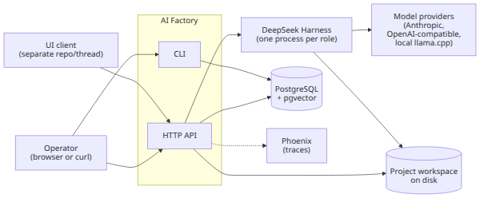

**What this tells you.** The API is the only component that owns state; the harness is
*stateless and disposable* — it is spawned per role run and its output is captured as text.
That is the single most important structural fact: it means a run can be resumed by a
different worker, failed over to another model, or cancelled, without the harness
cooperating.

**What it does not tell you.** Where the prompts come from, how a run survives a restart, and
who is allowed to call what. Sections 6–8 and 15 cover those.

---

## 3. Containers and deployment

### 3.1 Containers

Three processes and two stateful services. Everything else is a library.

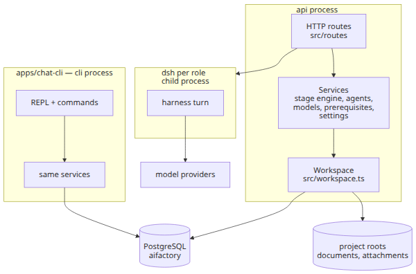

**Why two entry points.** The CLI and the API share every service, so behaviour cannot drift
between "what the UI does" and "what the shell does". The CLI is not a client of the HTTP API;
it constructs the same objects.

### 3.2 Deployment

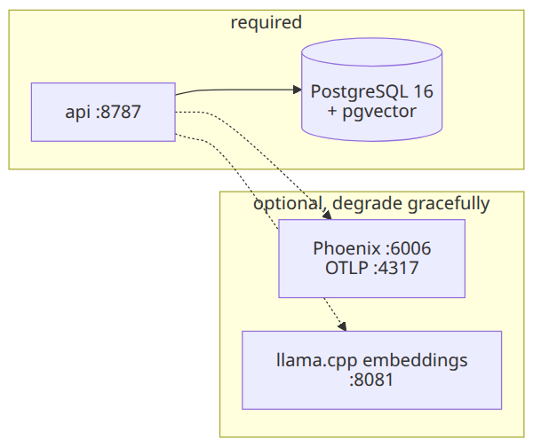

Each optional dependency fails **closed but not fatally**: with no embeddings the semantic
index answers `503 SEMANTIC_INDEX_DISABLED`; with no Phoenix, traces are dropped and nothing
else changes. The API starts and serves everything else.

| Component | Required | Failure behaviour |
|---|---|---|
| PostgreSQL | yes | API refuses to start (migrations cannot run) |
| DeepSeek Harness | yes, for runs | API serves; runs fail with `STAGE_ROLE_FAILED` |
| Model provider | yes, for runs | `409 MODEL_BINDING_UNAVAILABLE` or a role error |
| Phoenix | no | traces dropped, `observability` endpoint 503 |
| Embeddings | no | search and indexing 503 |

---

## 4. The request path

`server.ts` is deliberately thin (≈200 lines): it owns the server lifecycle, request logging,
and the router wiring. Everything else is a module.

### 4.1 What happens to one request

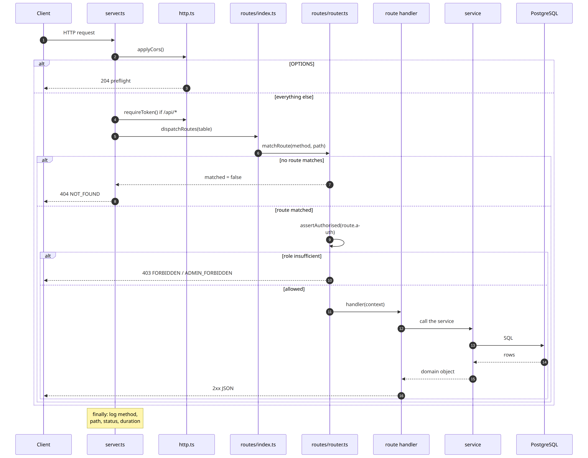

Two properties are worth noting because they are enforced, not conventional:

- **Authorisation happens before the handler runs.** `assertAuthorised` is the only place the
  decision is made, so a route cannot accidentally do work before checking.
- **Errors are mapped once.** A handler throws `HttpError` or a domain error; `toHttpError`
  turns it into `{error: {message, code, status}}`. Handlers do not format errors.

### 4.2 Route resolution

The table is an ordered array; matching compares segment count, then literals, then
parameters, so `/api/projects/:id/documents` cannot swallow `/api/projects/:id/stages/:stage/runs`.

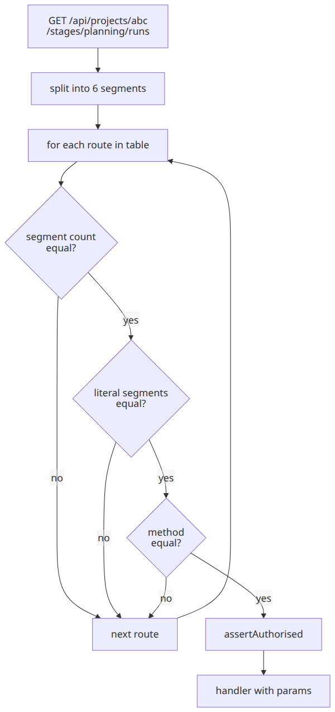

The table is also the source of two invariants enforced by tests: **every route declares a
role**, and **the table and `openapi.yaml` are the same set**. Both are asserted in
`test/auth.test.ts`; adding a route without documenting it fails the build.

---

## 5. The API surface and its policies

73 paths, grouped by resource. The grouping is the module layout, not an accident.

| Group | Module | Auth | Examples |
|---|---|---|---|
| system | `routes/system.ts` | public | `/`, `/api`, `/api/health`, `/docs`, `/openapi.yaml` |
| agents | `routes/agents.ts` | admin to write | `/api/agents`, `/api/stages/:stage/assignments/:process` |
| settings | `routes/settings.ts` | operator to read, admin to write | `/api/settings/stages/:stage`, `/api/stages/:stage/prerequisites/:key` |
| models | `routes/models.ts` | admin to write | `/api/settings/models`, `/api/models/test` |
| logging | `routes/logging.ts` | admin to write | `/api/admin/logging/level`, `/api/logs` |
| stage runs | `routes/stage-runs.ts` | operator | `/api/stage-runs/:runId/*` |
| projects | `routes/projects.ts` | operator | `/api/projects/:id/*`, documents, attachments |
| sessions | `routes/sessions.ts` | operator | `/api/sessions/:id`, `/api/chat` |

**The public set is exactly six routes** and a test asserts it: `/`, `/api`, `/api/health`,
`/docs`, `/docs/`, `/openapi.yaml`. Everything else needs a token when one is configured.

**Two tokens, not one.** `AIFACTORY_API_TOKEN` is the operator token; `AIFACTORY_ADMIN_TOKEN`
is required for reconfiguration (agents, settings, waivers, probes, assignments, rebind,
retry). With no admin token configured the operator token is admin — backwards compatible,
and the startup banner says so.

---

## 6. The stage engine

The engine is **stage-independent**. Everything that differs between stages — prompts,
artifact, checklist, decision contract — is a `StageDefinition`. This is the single most
important design decision in the codebase: without it, a second stage is a copy of a
thousand lines, and copies drift.

### 6.1 Engine and definitions

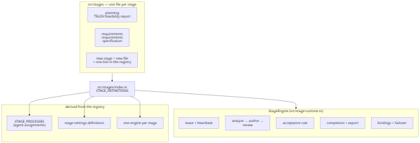

**The split, stated plainly.**

| The definition owns | The engine owns |
|---|---|
| stage key and the processes it runs | lease acquisition, heartbeat, cancellation |
| the four prompt builders | the analyze → author → review loop |
| artifact kind, title, file stem | the acceptance rule and revision cycles |
| which checklist keys the artifact evidences | completion, PDF export, summary |
| the review parser | bindings, failover, events, spans |
| the decision contract (`feasibility` or `approval`) | everything about *how*, nothing about *what* |

`humanDecision` is the field that keeps planning honest: planning records *go / conditional-go /
no-go*, requirements records a plain approval. A stage that has no feasibility question does
not get asked one.

**Each engine drives exactly one stage.** Asking a planning engine for a requirements run is
`501 STAGE_NOT_IMPLEMENTED`, not an empty list — a wrong call should be loud.

### 6.2 Two stages, as they exist

| | planning | requirements |
|---|---|---|
| processes | analyzer, author, reviewer | analyzer, author, reviewer |
| artifact kind | `telos_report` | `requirements_spec` |
| document title | TELOS feasibility report | Requirements specification |
| checklist evidenced | `business_idea`, `stakeholder_goals`, `feasibility_decision` | `requirement_document`, `acceptance_criteria`, `requirements_review` |
| decision | go / conditional-go / no-go | approved |
| prompts | TELOS feasibility questions | numbered `FR-`/`NFR-`, acceptance criteria, traceability |

`design`, `architecture`, `development`, `testing`, `deployment` and `maintenance` have no
definition yet and answer `501`.

---

## 7. A stage run, step by step

### 7.1 A run, in order

This is the whole loop for one planning run with one review cycle. Read it top to bottom;
each step names the module that does it.

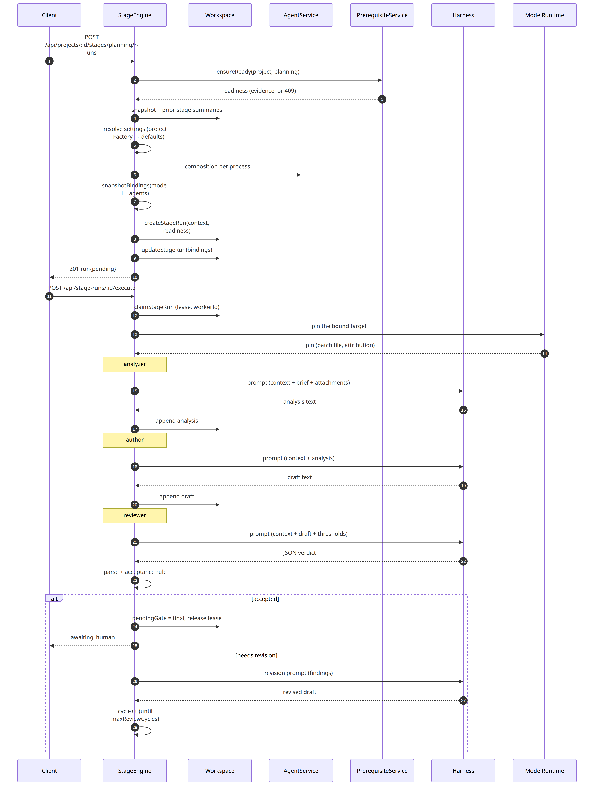

**Why the lease exists.** Two API processes may receive an execute for the same run. The
lease is a `UPDATE … WHERE locked_by IS NULL OR lease_expires_at < now()` — one winner, and
the loser gets `409 STAGE_RUN_LEASED`. The heartbeat renews it every 30 s; losing it sets a
flag that `assertLease` checks *before every write that matters*.

### 7.2 One role turn

A single role call is where the model, the agent, the tools and the telemetry meet.

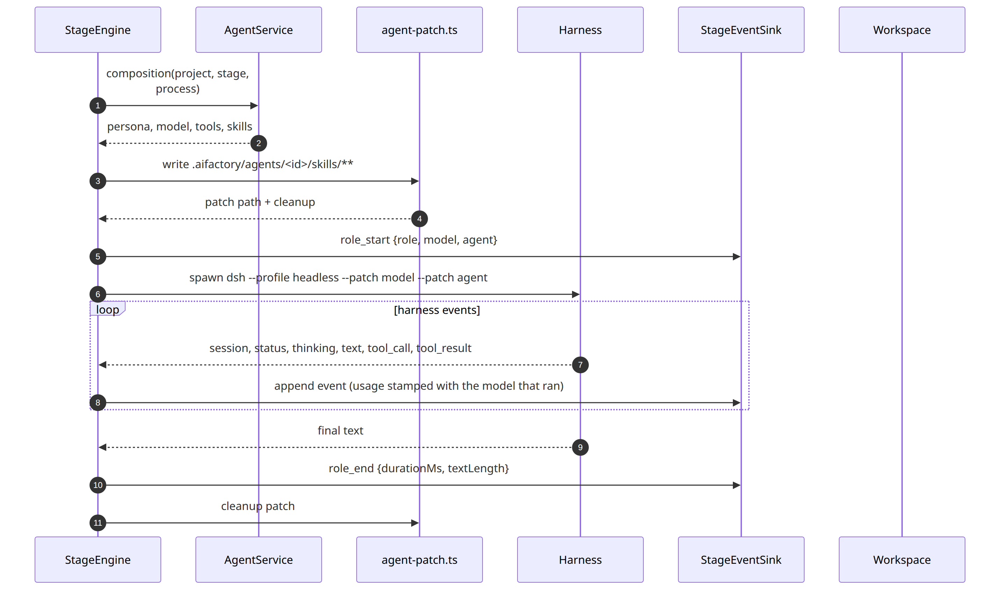

The agent is **composed, not configured**: its persona becomes an instruction layer, its
skills are materialised as files on disk, and its tools are enforced by the harness profile —
which is why a skill without `tool-skill` is rejected at creation rather than failing at 3 a.m.

---

## 8. Run lifecycle and gates

### 8.1 Run lifecycle

The eight statuses are the only ones the database accepts (a `CHECK` constraint, so a typo
fails at write time rather than living in the table forever).

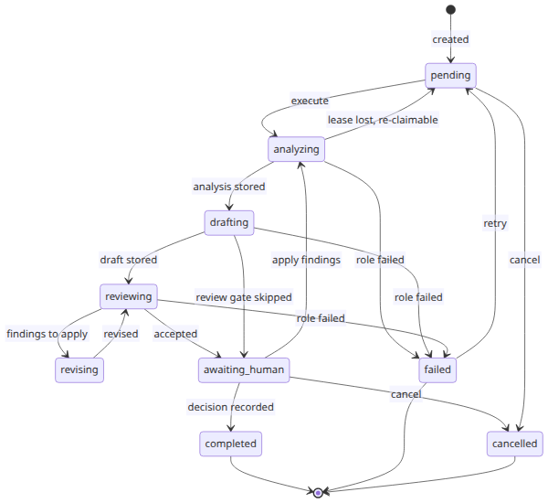

**Where artifacts appear.** Nothing is written to `project_documents` until `completed`. A
paused run holds its draft in `draft_markdown` and has **no document and no PDF** — so a gate
cannot be confused with an approved artifact, and a rejected draft leaves no litter.

### 8.2 Gate decision

Two gates, two shapes. The distinction matters for the UI: one asks a question, the other
asks for a verdict.

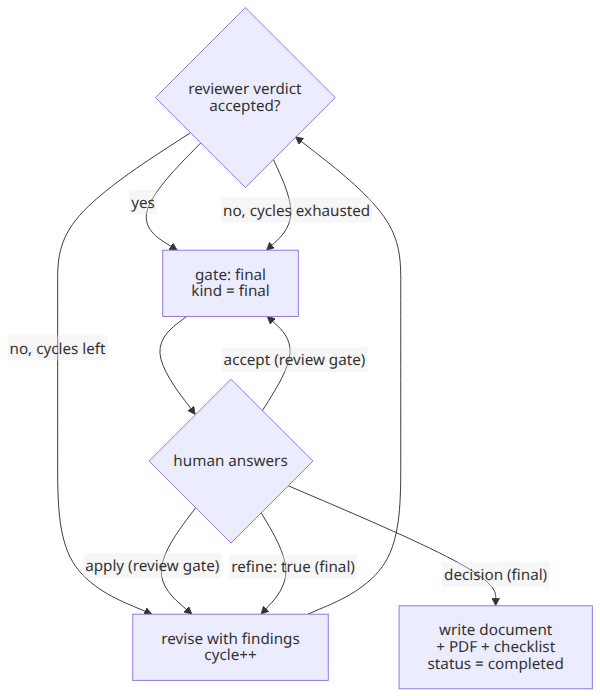

**The acceptance rule**, in one line, is the reason a reviewer's opinion is auditable:

```
accepted = blockers <= maxBlockers  AND  major <= maxMajor  AND  rating >= minRating
```

All three thresholds are settings, snapshotted into the run's context when it starts, so a
gate can always be judged against the numbers that were in force at the time — not against
whatever the settings say today.

### 8.3 The human gate contract

| Gate | Field | Answer by | Result |
|---|---|---|---|
| `final` | `pendingGate.kind` | `POST /api/stage-runs/:id/decision {decision}` or `{refine: true}` | records the decision and completes, or refines once more |

A gate carries the reviewer's findings and `waitingSince`. It has **no expiry**: after
`gateReminderHours` it is reported *stale* (`GET /api/stage-runs?awaiting=1&staleOnly=1`) and
gets one `gate_stale` event. It is never auto-approved — completion stays a human decision.

---

## 9. Cancellation

A run cannot be switched off from outside, because the harness is a separate process that
only its owner can abort. So cancellation is a **request the owner observes**.

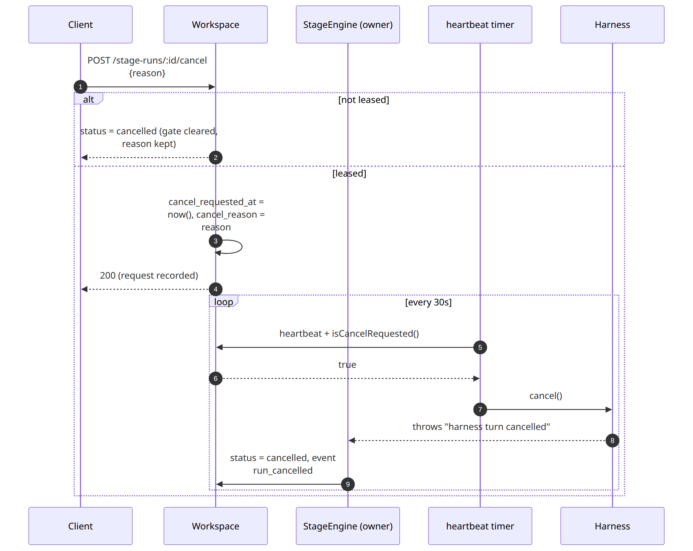

**Why not just set the status.** Flipping the row to `cancelled` while a harness is mid-turn
would leave the worker writing into a finished run — the classic lost-update. The request
flag means the owner decides *when*, and the abort is the same path as any other failure, so
the recovery code is shared.

`assertLease` also refuses further phases after a cancel, so a run that was cancelled between
two roles does not write a third.

---

## 10. Model binding and failover

### 10.1 Binding lifecycle

A run freezes the model it started with. This is what makes a review meaningful: a document
drafted by one model and reviewed by another is not a review, it is two opinions.

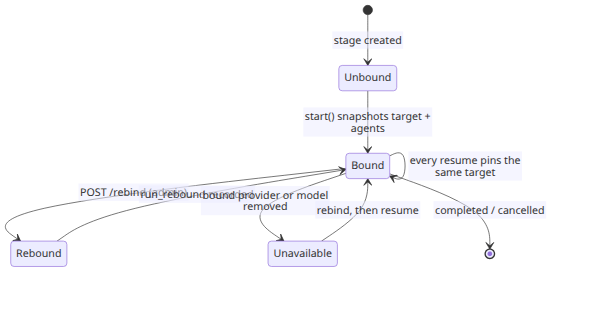

| Situation | Behaviour |
|---|---|
| no target configured | `model: null` in bindings; the harness profile default applies |
| target configured | provider, model, fallback chain and catalogue digest are stored |
| target gone at resume | `409 MODEL_BINDING_UNAVAILABLE`, gate intact, nothing substituted |
| operator wants to change it | `POST /rebind` — admin only, records before and after |

Storing `null` rather than an empty provider matters: "no target" and "a provider named `''`"
are different facts, and only one of them is true.

### 10.2 Failover

The fallback chain is declared in the model settings. A role walks it one candidate at a time.

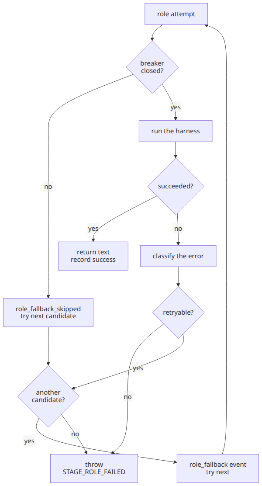

**Two errors never fall back**: `aborted` (a cancel is a decision) and `content_filter`
(another model would make the same decision about the same text). Everything else — transport,
rate limit, timeout, missing credential — falls back, because another provider might not fail.

**Why the breaker is shared.** The harness is a child process and cannot call the router, so
it cannot use the router's retry logic. But it *can* read the same circuit breaker, exposed as
`providerHealth(provider)`. That way a provider that direct calls have already found unhealthy
is not tried first by every role — the two paths agree about the world.

**Attribution.** Each attempt stamps usage with the model that actually ran, at that model's
price. A fallback is never billed as the primary, and an unpriced model gets a
`model_unpriced` event rather than a silent zero.

---

## 11. Settings resolution

Three layers, most specific first. A run snapshots the result, so the numbers it was judged
by never move underneath it.

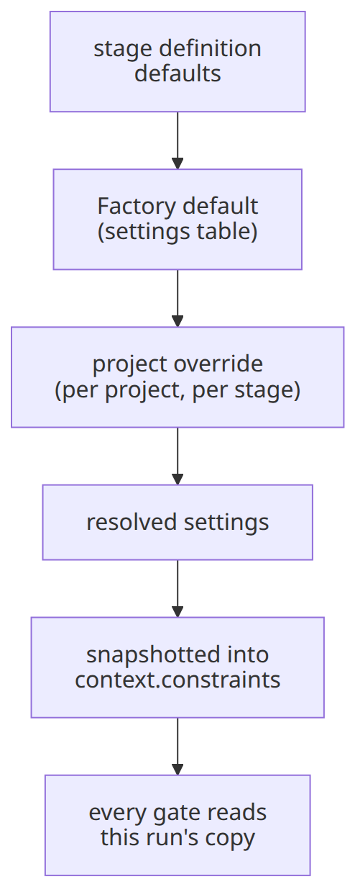

| Layer | Set by | Scope |
|---|---|---|
| definition defaults | the code | every run of that stage |
| Factory default | `PATCH /api/settings/stages/:stage` (admin) | every project |
| project override | `PATCH /api/projects/:id/stages/:stage/settings` (admin) | one project |

Stages without a runtime return `{}` and `501 STAGE_SETTINGS_NOT_IMPLEMENTED` — an empty
object would look like "all defaults", which is a different claim.

---

## 12. Agents and composition

An agent is **data plus a composition step**, not a prompt template with a name.

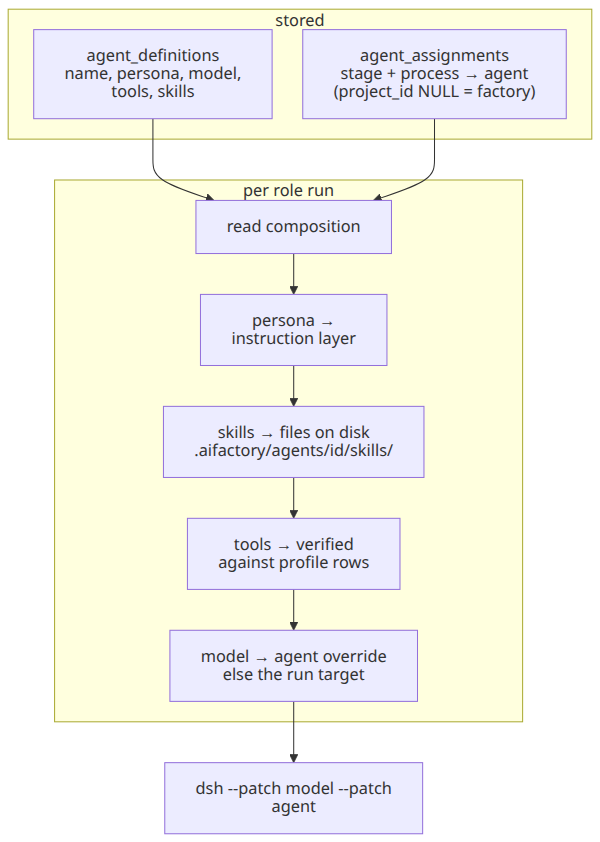

**Rules that are enforced, not documented:**

- an agent may choose a **model**, never a **provider** — the provider belongs to the Factory,
  so egress and credentials stay in one place;
- a skill without `tool-skill` is rejected at creation;
- the tool allowlist is checked against the profile's `tool-*` rows, and an unknown tool is
  `AGENT_TOOLSET_UNVERIFIED` rather than a runtime surprise;
- a run's bindings freeze which agent served which process, so reassigning an agent mid-run
  does not change who reviewed what.

**The probe.** `POST /api/agents/:id/test` runs the agent offline by default: a stand-in
endpoint with no credentials, asserting the request the harness actually made. This is why it
can verify all agents without spending money, and why "no request captured" counts as a
failure rather than a pass.

---

## 13. Prerequisites and readiness

A stage may only start when its **evidence** exists. That is deliberately not "the previous
stage ran": a project can start at requirements if it arrives with a specification.

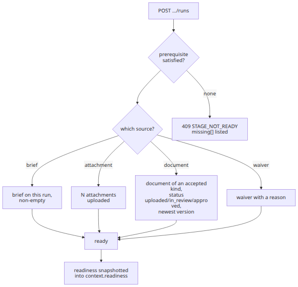

**Why snapshot readiness.** A gate must be auditable against the evidence that existed when
the run started. If someone deletes the brief an hour later, the run's record still shows it
was there.

**Why failed briefs are excluded.** A brief typed into a run that then failed is not evidence
that the project has a brief — only an uploaded, in-review or approved artifact counts.

---

## 14. Data model

Twenty-four tables. The core is six; the rest are configuration or derived.

### 14.1 Entity model

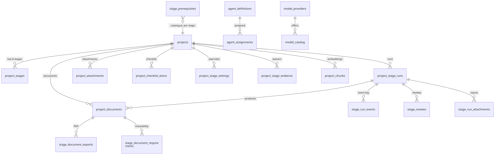

### 14.2 The tables that matter, and why

| Table | Holds | Note |
|---|---|---|
| `projects` | the registry | `root_path` is unique: two projects cannot share a workspace |
| `project_stage_runs` | every run | `bindings`, `pending_gate`, `cancel_*`, `context` (JSONB, snapshotted) |
| `stage_run_events` | the run's event log | append-only; the UI's timeline and the telemetry's source |
| `project_documents` | approved artifacts only | written in the completion transaction |
| `stage_reviews` | every reviewer verdict | findings, rating, decision, per cycle |
| `project_stage_evidence` | waivers | a waiver is evidence with a reason, not a boolean |
| `settings` | Factory defaults | key/value, so a new setting needs no migration |
| `schema_migrations` | applied versions + checksums | editing an applied migration fails boot |

### 14.3 Schema discipline

Migrations are numbered files (`migrations/NNNN_name.sql`) applied by `src/migrations.ts`
inside `pg_advisory_lock(7_164_202_602)`, so two API processes starting together cannot race.
Each applied file is checksummed: **editing an applied migration is an error, not a warning**,
because that is how a production database silently diverges from the code.

The baseline (`0001`) is fully idempotent — `CREATE TABLE IF NOT EXISTS`, guarded
`ADD CONSTRAINT` — so it can be applied to a database that already has the schema.

---

## 15. Trust boundaries and authorisation

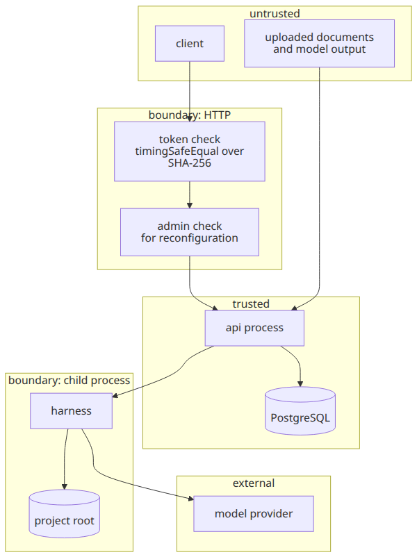

**Four boundaries, four different controls.**

| Boundary | Control | Why it is enough |
|---|---|---|
| client → API | bearer token, compared in constant time | a token is either right or wrong; timing must not leak which |
| operator → reconfiguration | separate admin token | a viewer cannot change what the factory does |
| API → harness | child process, scrubbed environment | the harness never sees provider credentials it does not need |
| harness → provider | the patch routes; keys are scrubbed from the child env | a runaway tool cannot read the key it is using |

**Things the API never does:** execute model output as code, follow a path from the database
without resolving it inside the project root, or trust a recorded export path (the PDF route
resolves and re-checks containment before reading).

**Uploads are validated by content, not by name.** A PDF is parsed; an image is rejected
because the harness is text-only. The check is what the bytes are, not what the client called
them.

---

## 16. Observability

Three layers, each answering a different question.

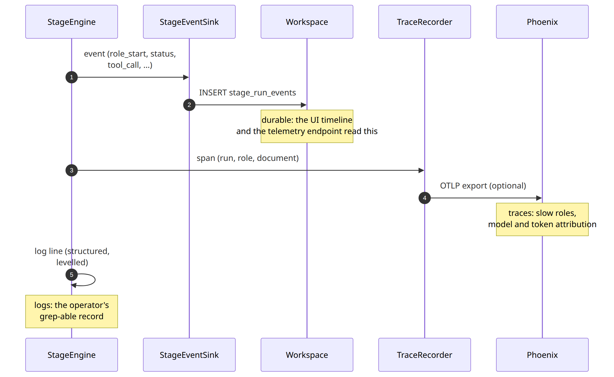

| Layer | Question it answers | Where |
|---|---|---|
| events | what did this run do, in order? | `stage_run_events`, `/stage-runs/:id/events` |
| traces | where did the time go, and which model? | Phoenix, OTLP |
| logs | what did the process do? | console + rotating files, `/api/admin/logs` |

**The status bar** (`/api/stage-runs/:id/telemetry`) is a projection of the events: token
counts, cost, per-role timing, and cache reads. It is computed from stored events rather than
in memory, so it survives a restart and works for a run another worker finished.

**Cost is per model, not per run.** Each usage event is stamped with the model that ran and
the price in force when the run started, so a fallback or an agent-specific model is priced
correctly instead of at the primary's rate.

---

## 17. Failure modes

The useful architecture question is not "what happens when it works" but "what happens when
each piece breaks". This table is the answer, and each row is a real code path.

| Failure | Detected by | What happens | What the operator sees |
|---|---|---|---|
| API process dies mid-run | lease expiry (120 s) | another worker may claim the run; the run is `pending`→re-claimable | a run that resumes, not a zombie |
| Worker holds the lease too long | `heartbeat` fails | `leaseLost`; `assertLease` refuses further writes | `409 STAGE_RUN_LEASE_LOST` |
| Harness crashes | non-zero exit | role fails, run `failed`, one `role_error` event | `502 STAGE_ROLE_FAILED` with the message |
| Provider down | classified error | failover to the next candidate | `role_fallback` event, run continues |
| Provider gone from config | resume pin | `409 MODEL_BINDING_UNAVAILABLE`, gate intact | "rebind the run" |
| Reviewer returns junk | parse failure | role fails; no gate is invented | `502 STAGE_ROLE_FAILED` |
| Run paused for days | `awaiting=1&staleOnly=1` | stale flag, one `gate_stale` event | a list of gates to look at |
| Cancel requested | heartbeat | harness aborted, run `cancelled` | `200`, then `cancelled` |
| Migration edited after apply | checksum mismatch | **boot refuses** | a clear `MigrationError` |
| Two API processes boot together | advisory lock | one migrates, the other waits | both start |
| Database connection storm | shared pool (max 10 + 2) | queries queue | `pools` in `/api/health` |
| PDF export fails | caught in completion | document kept, run still `completed` | a warning event, not a lost run |
| Attachment file deleted by hand | `readFile` ENOENT | `410 ATTACHMENT_CONTENT_MISSING` | a specific code, not a 500 |
| Provider credentials missing | harness error | `502` with the harness message | the exact reason |

**Every one of these is answered with a code**, never a bare 500. The UI can therefore decide
what to offer — retry, rebind, or wait — instead of showing "something went wrong".

---

## 18. Code map

Where to look, by question.

| Question | File |
|---|---|
| how does a request reach a handler? | `src/server.ts`, `src/routes/router.ts` |
| what does this route require? | `src/routes/index.ts` (the table) |
| how does a run progress? | `src/stage-runtime.ts` (`StageEngine`) |
| what makes a stage a stage? | `src/stage-definition.ts`, `src/stages/*.ts` |
| how are prompts built? | `src/stage-runtime.ts` (`build*Prompt`) |
| how are settings resolved? | `src/stage-settings.ts` |
| what may start a stage? | `src/stage-prerequisites.ts` |
| how is an agent composed? | `src/agents.ts`, `src/agent-patch.ts`, `src/agent-probe.ts` |
| how is a model chosen and priced? | `src/models/**` |
| how is state stored? | `src/workspace.ts`, `src/migrations.ts` |
| how is telemetry produced? | `src/stage-event-sink.ts`, `src/telemetry.ts`, `src/observability/**` |
| how is the PDF made? | `src/report/**` |

**Size, for orientation:** ~21,000 lines of source across 84 files, 66 test files, 73 API
paths, 4 migrations, 2 stage definitions.

---

## 19. Decisions

These were made deliberately, with alternatives considered. They are recorded because the
*why* is not recoverable from the code.

| # | Decision | Alternative rejected | Why |
|---|---|---|---|
| D-1 | Bind model and agents **per run**, change only by explicit rebind | re-resolve on every resume | a review by a different model than the draft is not a review |
| D-2 | Failover uses the **Factory** chain and may cross providers | pin one provider per run | an outage should not stop all work; only the model changes, not the agent |
| D-3 | Two tokens now, OIDC later | full OIDC immediately | reconfiguration is the dangerous operation; it is now separately gated |
| D-4 | Agent probe **offline** by default | always call the real model | verifying 20 agents must not cost money or need keys |
| D-5 | Stage engine + definitions, not per-stage code | copy planning for each stage | copies drift; a stage should be data |
| D-6 | Artifacts written only on approval | write a draft document per cycle | a gate must not look like an approved artifact |
| D-7 | Events stored, telemetry derived | telemetry in memory | a run finished by another worker must still report |
| D-8 | Migrations checksummed, edit = boot failure | "best effort" migrations | divergence is worse than a refused start |

---

## 20. What is deliberately absent

Naming what is *not* here is part of the architecture, because each absence is a decision
someone will otherwise assume was an oversight.

| Absent | Why | What would trigger adding it |
|---|---|---|
| A worker queue (Redis/RabbitMQ) | the lease plus `execute` is enough for one process, and a queue adds a component to operate | sustained throughput above a few concurrent runs, or jobs needing priorities |
| Multi-tenancy | single-tenant by design; project isolation is by `root_path` and FK cascades | a second customer, or per-tenant data-residency requirements |
| Fork/replay of runs | the checkpoint exists (analysis, draft, cycle) but no UI or API to branch | a "what if we had accepted at cycle 1" workflow |
| Auto-approval of gates | rejected on principle — completion must be a human decision | never; a stale gate is a reminder, not an approval |
| OIDC / SSO | two tokens cover the operator/admin split | more than a handful of operators, or audit requirements per person |
| Stages beyond planning and requirements | each needs prompts and a reviewer rubric that is worth writing carefully | the next stage's turn |
| Streaming token output | the harness reports events; the UI polls or subscribes to the run's events | a UI that needs live typing |

**Known limits, stated plainly.** A run paused at a gate occupies no worker, so there is no
capacity problem; but there is also no scheduler, so a thousand queued runs would all be
started by hand or by a client loop. The system is built for *correctness of delivery*, not
for throughput — which matches its purpose today.

---

*See also: [`AI-Factory-Requirements-v2.md`](AI-Factory-Requirements-v2.md) (what it must do),
[`design/ARCHITECTURE-REMEDIATION.md`](design/ARCHITECTURE-REMEDIATION.md) (the review that
produced this shape), and [`ARCHITECTURE.md`](ARCHITECTURE.md) (the previous version,
kept for reference).*
