# AI Factory — Architecture

**Status:** current state, 2026-11-18; corrected after the code review; Phases 1–3 applied (hotfixes, foundations, run integrity)  
**Scope:** the backend as implemented (`apps/chat-cli`). The UI is a separate workstream; its contracts are described in [`docs/ui/`](ui/).  
**Related:** [`AI-Factory-Requirements.md`](AI-Factory-Requirements.md) (what to build), [`design/`](design/) (per-area decisions), [`design/ARCHITECTURE-REMEDIATION.md`](design/ARCHITECTURE-REMEDIATION.md) (known defects and the plan to fix them).

This document describes what exists **today**, not the target. Where something is designed but not implemented, it says so. Where the code does not yet do what a diagram implies, a **Known defect** note follows the diagram and links to the remediation register.

---

## 1. Diagram index

| # | Diagram | Answers |
|---|---|---|
| 2 | System context | Who talks to what |
| 3 | Runtime topology | Which processes and ports exist |
| 4 | API layering | Where HTTP stops and services begin |
| 5 | Stage run lifecycle | Every run status and its transitions |
| 6 | Planning run sequence | One run end to end |
| 7 | Acceptance decision | When the loop stops revising |
| 8 | Human gates | Which question is asked, and where |
| 9 | Model layer | How a target becomes a harness patch |
| 10 | Per-role composition | How an agent changes one role's process |
| 11 | Settings resolution | Which value wins |
| 12 | Prerequisites | When a stage may start |
| 13 | Agents | Which agent runs a process |
| 14 | Documents and PDF | How the artifact is produced |
| 15 | Observability | Where events, traces and logs go |
| 16 | Data model | Tables and relationships |
| 16a | Schema and pools | Migrations, and how many connections this process holds |
| 17 | Trust boundaries | What is trusted, sandboxed or secret |

---

## 2. System context

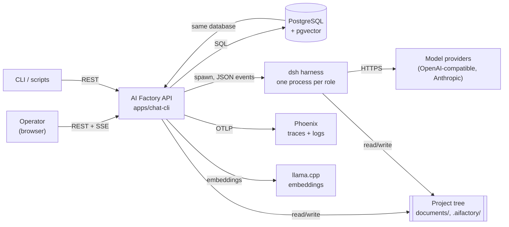

The API owns orchestration and state. The harness owns the model loop and tools. The project directory is the unit of isolation: each project has a root path, and its generated PDFs live under `documents/` inside it.

---

## 3. Runtime topology

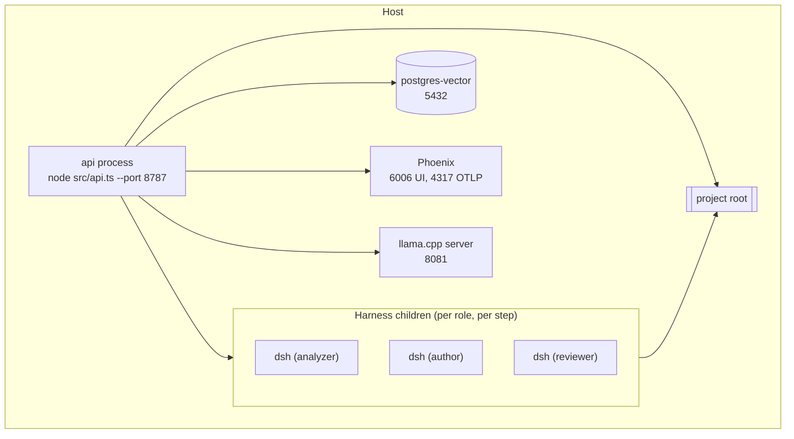

Each role is a **separate harness process** launched with `--profile headless --json --patch <model patch> [--patch <agent patch>]`. That is what makes per-role models, personas and tools possible; it is also why nothing may assume in-process agent state.

---

## 4. API layering

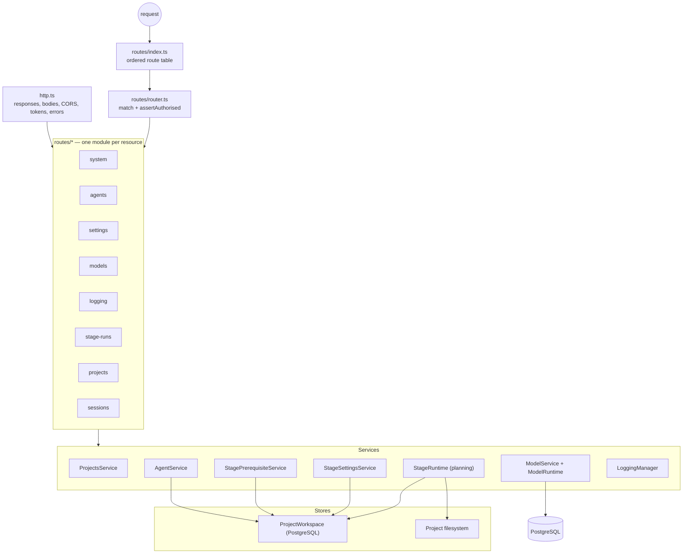

`server.ts` holds only the server lifecycle, request logging and the router wiring: registering a route is the same act as declaring who may call it.

| Concern | Where |
|---|---|
| routes, and their `public` / `operator` / `admin` policy | `src/routes/*.ts`, aggregated in `src/routes/index.ts` |
| matching and authorisation | `src/routes/router.ts` |
| responses, JSON bodies, CORS, token checks, error mapping | `src/http.ts` |
| the option type every module needs | `src/api-options.ts` |

Two guards keep the table honest: an **auth inventory** asserts every route declares a role and that a named set of write operations is `admin`; **OpenAPI parity** asserts the served routes and `openapi.yaml` are the same set.

Errors are typed at the boundary (`HttpError` with `status` + `code`) and rendered as `{ error: { message, code, status } }`. Domain errors (`StageRuntimeError`, `StageSettingsError`, `PrerequisiteError`, `AgentError`, `ModelSettingsError`) map to those codes in `toHttpError` rather than leaking messages.

---

## 5. Stage run lifecycle

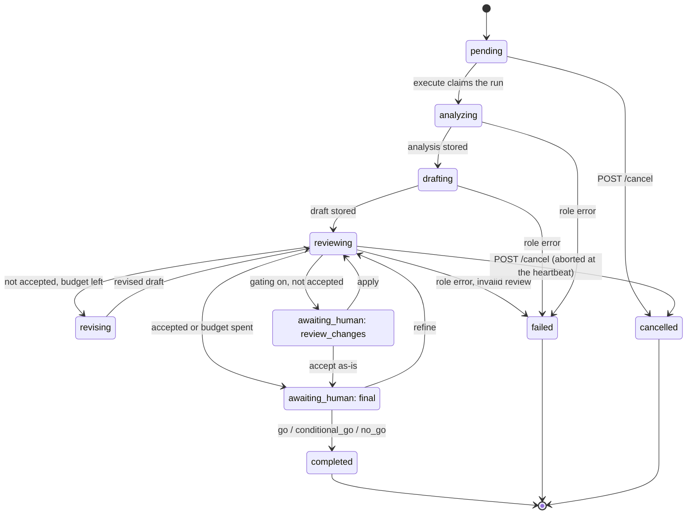

A paused run **releases its lease** and persists `pending_gate` + `review_cycles`, so it can wait for days and be resumed by any API instance. `claimStageRun` admits `awaiting_human` for that reason.

The status column also carries `execution_attempts` and `locked_by`/`lease_expires_at`: a 120 s lease with a 30 s heartbeat prevents two executors racing the same run.

> **Status** ([remediation register](design/ARCHITECTURE-REMEDIATION.md)):
> - A failed resume **restores the gate** instead of failing the run, and a failed run can be retried explicitly ([AR-04](design/ARCHITECTURE-REMEDIATION.md#ar-04), fixed).
> - A run is **cancelled** by `POST /stage-runs/:id/cancel`: at once if unleased, otherwise at its owner's next heartbeat, which aborts the running harness ([AR-11](design/ARCHITECTURE-REMEDIATION.md#ar-11), fixed).
> - Each run **freezes** its model target and agents at start (`bindings`), so a resume uses what it started with; `POST /stage-runs/:id/rebind` adopts the current ones explicitly ([AR-06](design/ARCHITECTURE-REMEDIATION.md#ar-06), fixed).

---

## 6. Planning run sequence

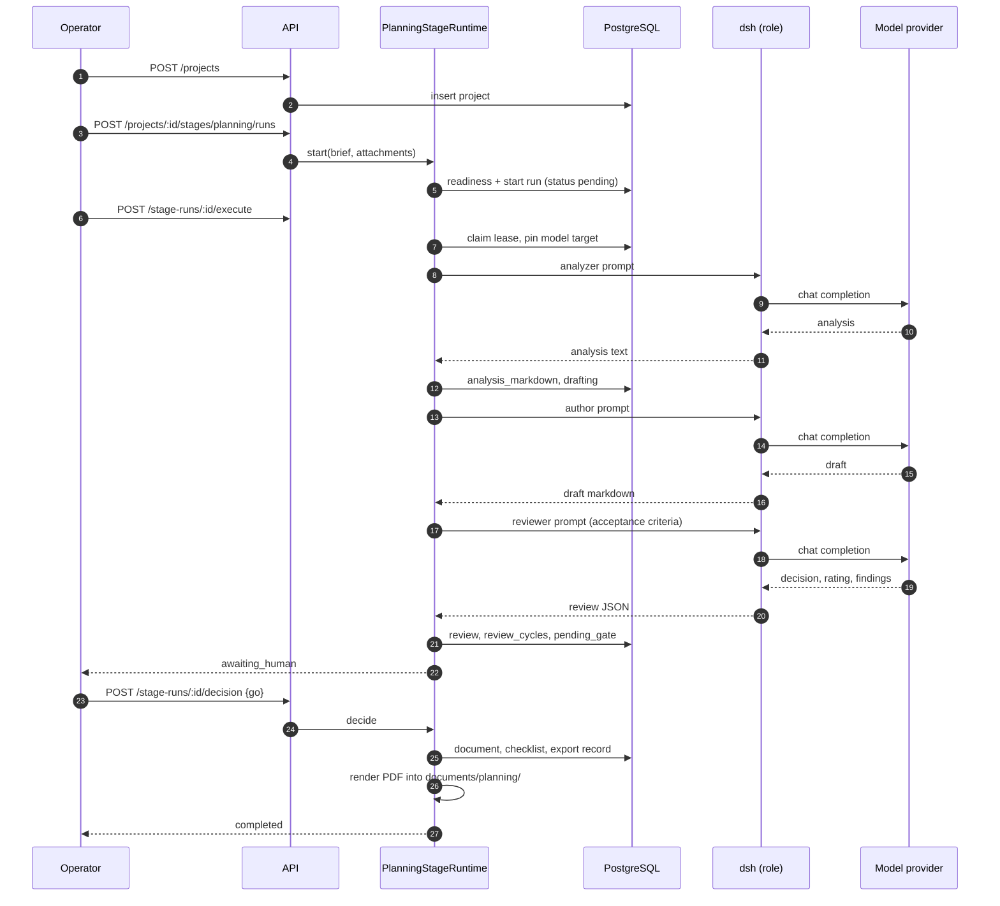

---

## 7. Acceptance decision

The reviewer returns `decision`, `rating` (0–100) and findings. The runtime decides whether the document is good enough to stop revising:

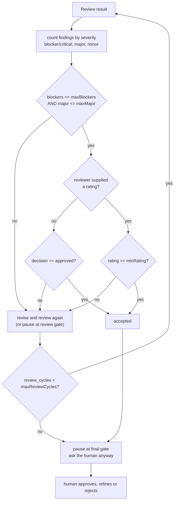

Defaults (`minRating 0`, `maxBlockers 0`, `maxMajor 0`) reproduce the behaviour before this feature: the reviewer's own `approved` decides, and any blocker or major keeps revising.

---

## 8. Human gates

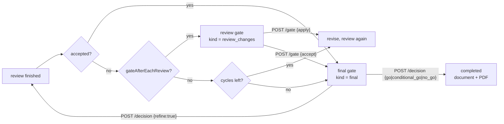

An artifact is produced **only** on approval. While paused, `run.documents` is empty and no PDF exists; the draft is in `draftMarkdown`.

---

## 9. Model layer

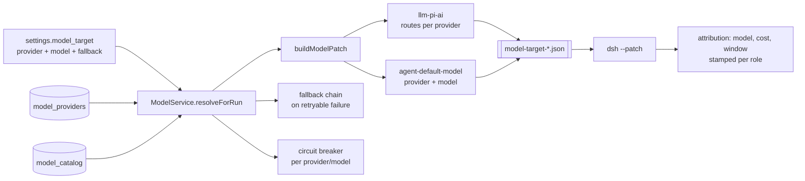

Credentials never enter the database or the patch file: a route references `apiKeyEnv`, and the child process receives only the variables it needs. A failed refresh keeps the last good patch, so a bad model setting cannot stop runs.

> **Failover on runs** ([AR-03](design/ARCHITECTURE-REMEDIATION.md#ar-03), fixed): a role that fails retryably moves to the next candidate in the run's fallback chain, one attempt each, using the **same** circuit breaker as direct calls. `aborted` and `content_filter` never fall back, because another model would make the same decision. Every attempt is attributed to the model that actually ran, and `role_fallback` / `role_fallback_skipped` record what happened.

---

## 10. Per-role composition

An agent does not use a harness preset. The model patch and the agent patch are both applied to the role's process, in that order:

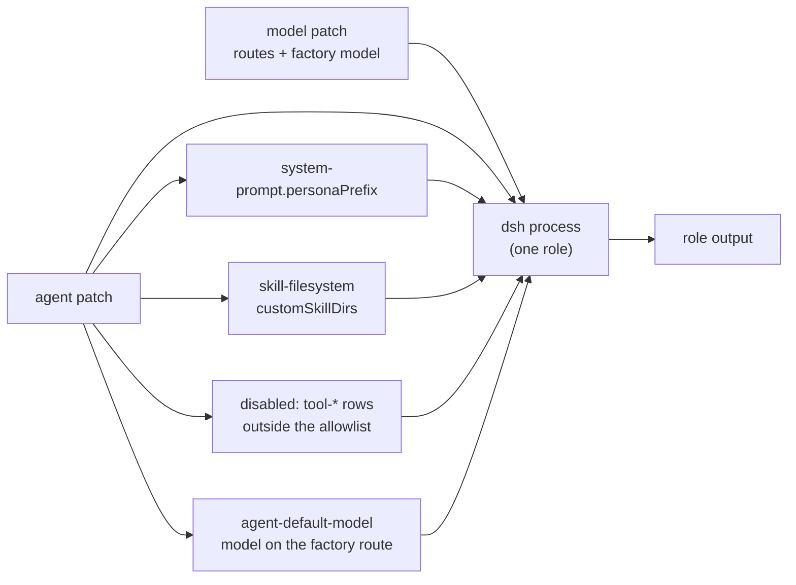

The agent's model is declared **on the factory route**, so an agent can change model but never provider. Applying the agent patch last means its `agent-default-model` wins.

> **Status** ([remediation register](design/ARCHITECTURE-REMEDIATION.md)):
> - Each role's usage is priced and measured as the model it ran, from the pin-time catalogue snapshot; an unknown model is reported as unpriced rather than billed at another's price ([AR-02](design/ARCHITECTURE-REMEDIATION.md#ar-02), fixed).
> - The allowlist **fails closed**: every `tool-*` row is classified, an unclassified row refuses a restricted agent, and `scripts/check-tool-rows.mjs` fails on drift ([AR-05](design/ARCHITECTURE-REMEDIATION.md#ar-05), fixed).

---

## 11. Settings resolution

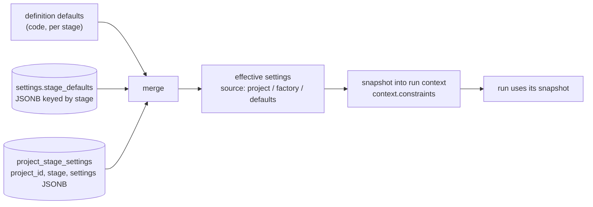

Settings are snapshotted at start, so changing them mid-run affects later runs only. Stages without a runtime have no definition: their settings are `{}` and writes return `501`.

---

## 12. Prerequisites

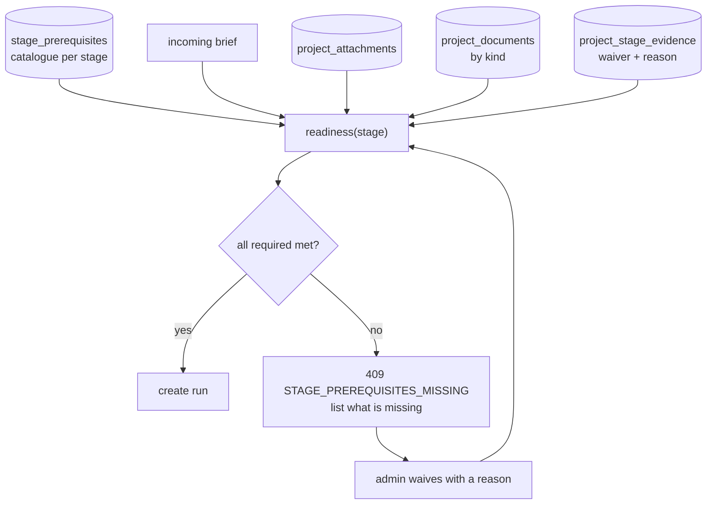

Readiness is **evidence**, not sequencing: a project can start at any stage when the artifacts exist. Only planning enforces it today; the catalogue covers all eight stages.

---

## 13. Agents

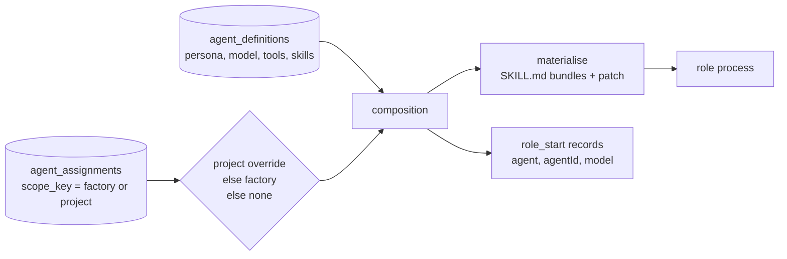

Deleting an agent cascades its assignments. A disabled agent is skipped rather than failing a run.

---

## 14. Documents and PDF

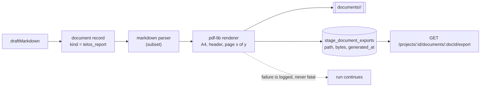

Rendering runs after approval, in the completion path. A render or write failure leaves the run completed with a logged `document_export_failed`, because a broken PDF must not lose the approval.

---

## 15. Observability

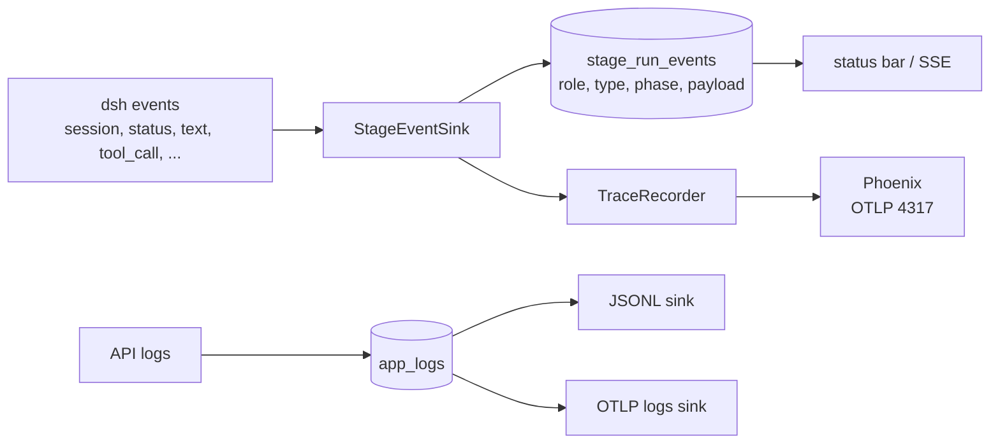

Usage follows the convention `inputTokens` excludes cached tokens, and `totalTokens = input + output + cacheRead + cacheWrite`. Content capture is off by default (`AIFACTORY_PHOENIX_CAPTURE_CONTENT=0`).

---

## 16. Data model

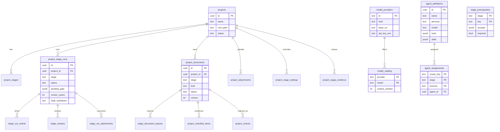

Reserved but unused today: `stage_role_configs`, `project_role_overrides`. They predate the agent tables; new work should use `agent_definitions`/`agent_assignments`.

---

## 16a. Schema and connection pools

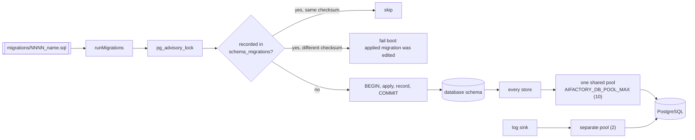

Two rules hold this together:

- **A migration that has shipped is never edited.** The checksum recorded in `schema_migrations` fails boot if it changes; a correction is a new migration. A destructive change is two releases (add and backfill, then drop) so the previous release still runs against the new schema.
- **A store never opens or closes a pool.** One application pool is shared by every store, and the PostgreSQL log sink has its own small one so a blocked log write cannot take a connection from a request. `GET /api/health` reports `pools` and `schema`, which is how the AR-12 fix is verified in production.

---

## 17. Trust boundaries

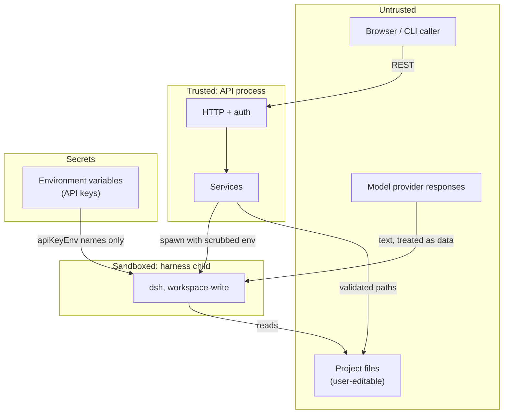

Rules enforced in code today:

- **Admin-only:** agent writes, assignment writes, agent probes, waivers and model settings call `requireAdmin`.
- **Credentials** live only in the environment; the database stores variable *names*.
- **Paths:** attachment and export paths are resolved and confined to the project.
- **Harness environment** is scrubbed of unrelated secrets.
- **Model output** is treated as data, never as instructions.

Also enforced since Phase 1:

- **Authorisation is data**: every route declares `public`/`operator`/`admin` and the router enforces it, so a route cannot be added without deciding who may call it. With `AIFACTORY_ADMIN_TOKEN` set the operator token cannot reconfigure the factory (tests: `test/auth.test.ts`, [AR-01](design/ARCHITECTURE-REMEDIATION.md#ar-01)).
- **Bearer tokens are compared in constant time** over SHA-256 digests.
- **Agent tool allowlists fail closed**, and an unclassified harness tool row refuses a restricted agent (tests: `test/agents.test.ts`, `scripts/check-tool-rows.mjs`, [AR-05](design/ARCHITECTURE-REMEDIATION.md#ar-05)).
- **Prerequisites accept only acceptable evidence**: `uploaded`/`in_review`/`approved` documents (newest version), and briefs from runs that did not fail ([AR-07](design/ARCHITECTURE-REMEDIATION.md#ar-07)).

Each rule here cites the test that proves it ([AR-17](design/ARCHITECTURE-REMEDIATION.md#ar-17)).

---

## 18. Known gaps and defects

The architecture review of 2026-11-17 found 17 shortcomings. They are tracked, with remedies and a phased plan, in [ARCHITECTURE-REMEDIATION.md](design/ARCHITECTURE-REMEDIATION.md). The defects are flagged inline above where they affect a diagram.

These gaps are deliberate scope limits rather than defects:

- **Only the planning stage executes.** Other stages have a prerequisite catalogue and empty settings, but no runtime ([AR-15](design/ARCHITECTURE-REMEDIATION.md#ar-15)).
- **Models and agents are configured globally.** Agent assignments can be project-scoped; model targets cannot yet.
- **The agent probe is offline by default**: a stand-in endpoint with no credentials, asserting the request the harness actually made. `?mode=online` uses the real model ([AR-08](design/ARCHITECTURE-REMEDIATION.md#ar-08), fixed).
- **A gate never expires by itself.** It is reported stale after `gateReminderHours` and listed by `GET /api/stage-runs?awaiting=1&staleOnly=1`; approval stays a human decision ([AR-16](design/ARCHITECTURE-REMEDIATION.md#ar-16), fixed).
- **Paused runs never expire.** A gate can wait indefinitely; auto-approval is rejected by design, so the only response is a stale flag ([AR-16](design/ARCHITECTURE-REMEDIATION.md#ar-16), fixed).
- **Reverse engineering an existing codebase** is designed but not built; the waiver and document-kind mechanisms are the hooks it will use.
- **Harness presets are unused.** The headless runner does not bind them; the composition patch is the supported path.

---

## 19. Where to read more

| Area | Document |
|---|---|
| Known defects, remedies, phased plan | [`design/ARCHITECTURE-REMEDIATION.md`](design/ARCHITECTURE-REMEDIATION.md) |
| Stage runtime internals | [`design/STAGE-RUNTIME.md`](design/STAGE-RUNTIME.md) |
| Gates, cycles, acceptance | [`design/STAGE-GATES.md`](design/STAGE-GATES.md) |
| Prerequisites and readiness | [`design/STAGE-PREREQUISITES.md`](design/STAGE-PREREQUISITES.md) |
| Agents and composition | [`design/AGENTS.md`](design/AGENTS.md) |
| Model providers and routing | [`design/MODEL-PROVIDERS.md`](design/MODEL-PROVIDERS.md) |
| PDF input/output | [`design/DOCUMENTS-AND-PDF.md`](design/DOCUMENTS-AND-PDF.md) |
| Logging and telemetry | [`design/LOGGING-ARCHITECTURE.md`](design/LOGGING-ARCHITECTURE.md), [`design/PHOENIX-OBSERVABILITY.md`](design/PHOENIX-OBSERVABILITY.md) |
| HTTP API | [`../apps/chat-cli/API.md`](../apps/chat-cli/API.md) |
