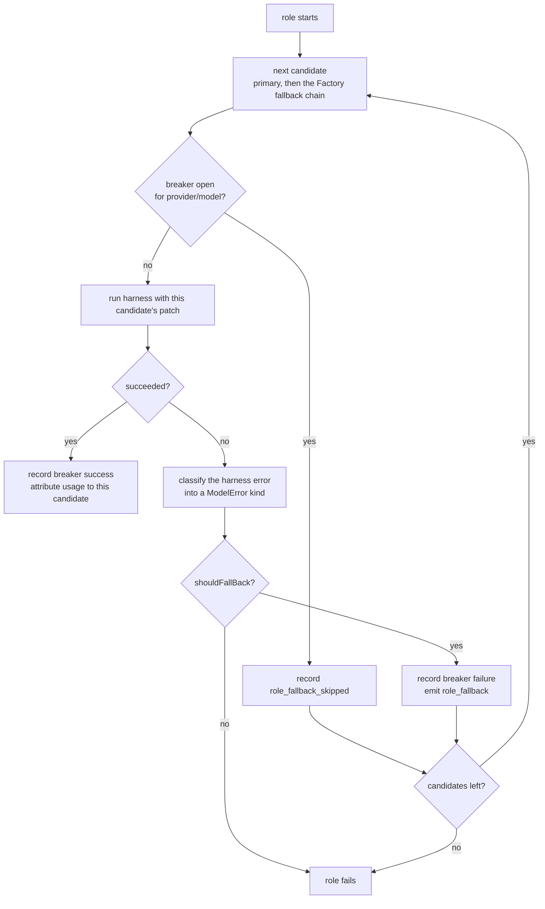
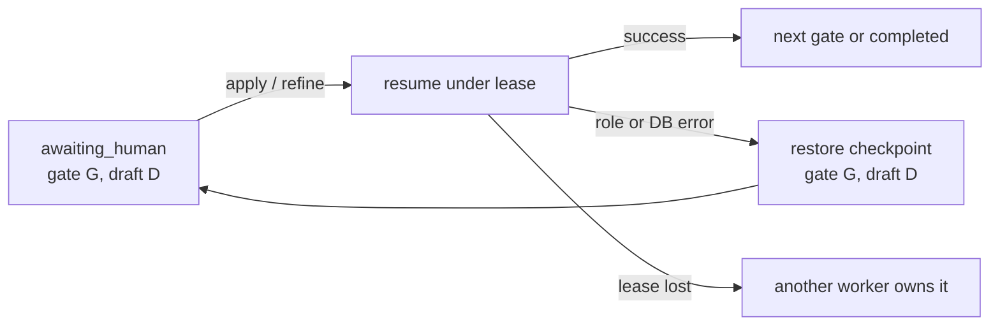
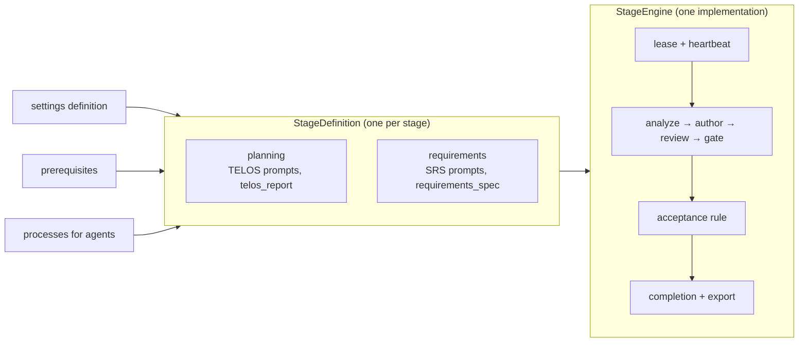
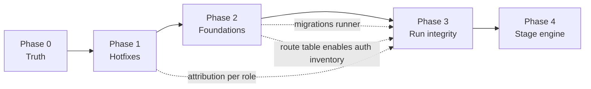

# Architecture Review — Shortcomings, Remedies and Execution Plan

**Status:** Phases 0–3 complete (2026-11-18); Phase 4 pending  
**Scope:** the backend as implemented (`apps/chat-cli`), reviewed against the code, not against [`../ARCHITECTURE.md`](../ARCHITECTURE.md)  
**Method:** every finding cites the code that proves it; every remedy states how it is verified as resolved.

---

## 1. Summary

The core design holds: leased runs with persisted gates, settings snapshotted per run, prerequisites defined as evidence, one harness process per role, credentials kept as environment variable names, and PDF failures kept out of the run outcome. Those stay.

The review found **17 shortcomings**:

| Severity | Count | Theme |
|---|---|---|
| High | 5 | admin access, cost attribution, no failover on runs, lost work on resume, tool allowlist fails open |
| Medium | 10 | run reproducibility, evidence quality, probe accuracy, orphaned rows, skills silently disabled, cancellation, pools, migrations, routing, single-stage runtime |
| Low | 2 | dead tables and gates that never expire; documentation that overstated enforcement |

Seven statements in the architecture and agent documents claimed behaviour the code does not have (§3). Those are corrected in Phase 0, and a rule is added so that it cannot happen silently again (AR-17).

Work is planned in five phases (§5). Phases 0–1 fix the defects that can lose money, work or access control without changing the schema. Phase 2 lays the foundations that every later schema change needs. Phase 3 makes runs reproducible and controllable. Phase 4 turns the planning runtime into a stage engine.

---

## 2. Findings register

| ID | Shortcoming | Severity | Phase | State |
|---|---|---|---|---|
| [AR-01](#ar-01) | Settings writes are not admin-only; "admin" means any token holder | High | 1, 3 | open — settings writes now admin-only; operator/admin split done |
| [AR-02](#ar-02) | Agent model overrides are billed and measured as the Factory model | High | 1 | fixed |
| [AR-03](#ar-03) | Stage runs have no fallback and no circuit breaker | High | 3 |  fixed |
| [AR-04](#ar-04) | A transient error during a resume destroys a run waiting for approval | High | 1 | fixed |
| [AR-05](#ar-05) | The tool allowlist fails open for tools it does not know | High | 1 | fixed |
| [AR-06](#ar-06) | Model and agents are re-resolved on every resume, not once per run | Medium | 3 |  fixed |
| [AR-07](#ar-07) | Prerequisites accept rejected documents and failed-run briefs | Medium | 1 | fixed |
| [AR-08](#ar-08) | The agent probe reports broken compositions as accepted | Medium | 1 | fixed |
| [AR-09](#ar-09) | Agent assignments outlive their project | Medium | 2 |  fixed |
| [AR-10](#ar-10) | Allowlisting tools can silently disable an agent's skills | Medium | 1 | fixed |
| [AR-11](#ar-11) | Runs cannot be cancelled | Medium | 3 |  fixed |
| [AR-12](#ar-12) | Twelve connection pools per process | Medium | 2 |  fixed |
| [AR-13](#ar-13) | No migration runner; seeds never update existing databases | Medium | 2, 4 |  fixed |
| [AR-14](#ar-14) | Positional router | Medium | 2 | fixed — route table, auth as data, both guards |
| [AR-15](#ar-15) | The runtime only knows the planning stage | Medium | 4 | open |
| [AR-16](#ar-16) | Dead tables from the superseded role-config design; gates never expire | Low | 2, 3 |  fixed |
| [AR-17](#ar-17) | Architecture documentation claimed enforcement that did not exist | Low | 0 | fixed |

---

## 3. Where the documentation was wrong

| Claim | Location | Reality | Finding |
|---|---|---|---|
| Settings are admin-only | ARCHITECTURE §17 | No admin check on settings writes | AR-01 |
| Runs use fallback and the breaker | ARCHITECTURE §9, AGENTS §1 | The router's only caller is `POST /api/models/test` | AR-03 |
| Agent usage is attributed honestly | AGENTS §4 | Usage is stamped with the Factory model and price | AR-02 |
| Runs transition to `cancelled` | ARCHITECTURE §5 | Nothing sets `cancelled`; there is no endpoint | AR-11 |
| The tool allowlist restricts tools | AGENTS §2 | It disables 15 known rows; `tool-subagent-fork` stays enabled | AR-05 |
| `configAccepted` is deterministic | AGENTS §7 | It is a word match on the error message | AR-08 |
| Editing an agent does not affect a run in flight | AGENTS §8 | It affects the run's next role | AR-06 |

---

## 4. Findings, remedies and resolutions

Each finding has the same parts. **Evidence** is the code that shows it. **Impact** is what goes wrong. **Remedy** is the change. **Resolved when** lists the checks that must pass before the finding is closed.

---

<a id="ar-01"></a>

### AR-01 — Settings writes are not admin-only

**Severity:** High · **Phase:** 1 (checks), 3 (roles)

**Evidence**

- Factory and project settings writes call the service with no `requireAdmin`: [server.ts:562](../../apps/chat-cli/src/server.ts#L562), [:581](../../apps/chat-cli/src/server.ts#L581), [:1322](../../apps/chat-cli/src/server.ts#L1322), [:1326](../../apps/chat-cli/src/server.ts#L1326).
- `requireAdmin` returns immediately whenever an API token is configured ([server.ts:665](../../apps/chat-cli/src/server.ts#L665)). Every caller holding the token is therefore an admin.
- The token is compared with `!==` ([server.ts:1840](../../apps/chat-cli/src/server.ts#L1840)), which is not a constant-time comparison.

**Impact.** Any API caller can change the review budget, acceptance thresholds and gating of every project. That defeats the human-in-the-loop controls the settings exist for, and it contradicts decision #4 ("admin-only").

**Root cause.** Authorisation is a call that each handler must remember to make. Nothing fails when a handler forgets it.

**Remedy**

1. *Phase 1:* add `requireAdmin` to the four settings writes and to the deprecated `stage-defaults` alias.
2. *Phase 1:* compare tokens with `crypto.timingSafeEqual` over SHA-256 digests, so the comparison cannot leak the token's length or content through timing.
3. *Phase 3:* separate the roles with two credentials.

   | Variable | Role | May do |
   |---|---|---|
   | `AIFACTORY_API_TOKEN` | operator | create projects, upload, start and execute runs, answer gates, decide |
   | `AIFACTORY_ADMIN_TOKEN` | admin | everything an operator may do, plus settings (model, logging, stage), agents, assignments, waivers, probes, the prerequisite catalogue |

   If only `AIFACTORY_API_TOKEN` is set, it remains admin (backwards compatible) and the server logs `auth.single_token_admin` at startup. The loopback exemption applies only when **no** token is set **and** the server is bound to a loopback address. Proper user identity (OIDC) is out of scope here; the role boundary is the part that matters now.
4. *Phase 2, through AR-14:* every route declares its role (`auth: 'operator' | 'admin' | 'public'`). Authorisation then becomes data the router enforces, not a call a handler can forget.

**Resolved when**

- An **inventory test** enumerates every route that mutates state and asserts it is either `admin` or listed in the operator allowlist. Adding a mutating route without declaring its role fails the test.
- HTTP tests show that a request with the operator token gets `403` on each settings write, and the admin token gets `200`.
- A unit test shows a wrong token is rejected through `timingSafeEqual`.

---

<a id="ar-02"></a>

### AR-02 — Agent model overrides are mis-attributed

**Severity:** High · **Phase:** 1

**Evidence.** `role_start` records the agent's model, but every usage event is stamped by `attributeUsage(event, pin?.attribution)` ([stage-runtime.ts:883](../../apps/chat-cli/src/stage-runtime.ts#L883)). `attribution` is fixed when the run is pinned: Factory model, Factory price, Factory context window ([attribution.ts:55–66](../../apps/chat-cli/src/models/attribution.ts#L55)).

**Impact.** When an agent overrides the model, its cost is computed at the wrong price. Per-model statistics credit the wrong model, and the status bar's context-consumed percentage uses the wrong window. Cost reports, the only financial control the Factory has, are wrong exactly when agents are in use.

**Root cause.** Attribution is a per-run value, but the model is now a per-role value.

**Remedy**

1. `ModelPin` gains `attributionFor(model?: string): ModelAttribution`. It resolves price and context window from the **catalog snapshot taken at pin time**, for the pinned provider.
2. `runRole` computes `roleAttribution = pin.attributionFor(composition?.model)` once, and uses it for `role_start`, `attributeUsage`, traces and the status bar.
3. If the model is not in the catalog, `price` is `null` and `costUsd` is **omitted**, never estimated, and the run emits a `model_unpriced` warning event. An unknown cost is reported as unknown, not as the Factory model's cost.
4. Saving an agent whose model is not in the Factory provider's catalog returns `400 AGENT_MODEL_UNKNOWN`. When the catalog is empty (discovery not yet run), the save is accepted with a warning, because rejecting it would block configuration on local providers.

Past events are not rewritten. No agent with a model override has run in production, and the document records that.

**Resolved when**

- A run where the author agent uses a model priced differently from the Factory model shows the author's `costUsd` at the agent's price. The analyzer and reviewer stay at the Factory price.
- `GET /api/models/usage` groups the author's tokens under the agent model.
- An unpriced model produces usage with no `costUsd` and one `model_unpriced` event.

---

<a id="ar-03"></a>

### AR-03 — Stage runs have no fallback and no circuit breaker

**Severity:** High · **Phase:** 3

**Evidence.** `ModelRouter` (fallback plus breaker) has a single caller, the model test endpoint ([service.ts:181](../../apps/chat-cli/src/models/service.ts#L181)). `buildModelPatch` writes the fallback models as routes ([patch.ts:98](../../apps/chat-cli/src/models/harness/patch.ts#L98)), but `agent-default-model` selects only the primary target, and nothing ever selects a fallback.

**Impact.** A provider outage, rate limit or expired key fails the role, which fails the run. A planning run can take many minutes across three roles and several revision cycles, and one transient error throws that work away (AR-04 makes this worse).

**Root cause.** Failover was built for direct model calls. Harness runs are separate processes the router never sees.

**Remedy — failover at the role level**



1. The pin carries the ordered candidate chain `[primary, ...fallback]`. Each candidate gets its own patch file, written at pin time and covered by the same lease, so pruning cannot delete a patch a run may still need.
2. The harness's structured error codes are mapped to `ModelError` kinds: `TRANSPORT` and HTTP 5xx → `unavailable`, `RATE_LIMIT` → `rate_limited`, `TIMEOUT` → `timeout`, `MISSING_CREDENTIAL` → `unconfigured`. Then the existing `shouldFallBack` decides. Content filters and aborts never fall back.
3. The breaker is the **same** `CircuitBreaker` instance the registry already keeps per provider/model. Direct calls and harness runs then share one view of provider health.
4. The fallback chain is **Factory policy** and may cross providers. That does not breach the agent rule (an agent may not choose a provider): the agent's persona, tools and skills are kept on fallback, and only the model changes. **This is decision D-2 in §6.**
5. Each candidate gets one attempt. The role's total time is bounded by `roleTimeoutMs`, not multiplied by the number of candidates.
6. Usage on a fallback attempt is attributed to the candidate that actually ran, which builds on AR-02.

Retrying a role is safe for state, because the runtime commits a role's output only after it returns. A role may have written files into the workspace before failing; the retry overwrites them, and that is acceptable for planning.

**Resolved when**

- With the primary scripted to return `TRANSPORT` and the fallback to succeed, the run completes. The events show `role_fallback` and usage under the fallback model.
- With `content_filter` on the primary, the role fails without trying the fallback.
- After N consecutive primary failures, the next role skips the primary (`role_fallback_skipped`) until the cooldown expires.
- [ARCHITECTURE §9](../ARCHITECTURE.md) is redrawn to show both paths.

---

<a id="ar-04"></a>

### AR-04 — A transient error during a resume destroys a run waiting for approval

**Severity:** High · **Phase:** 1

**Evidence**

- `withLease` marks the run `failed` on any error that is not a lost lease ([stage-runtime.ts:519–533](../../apps/chat-cli/src/stage-runtime.ts#L519)).
- `answerGate` and `decide` (including `refine`) both run their work inside `withLease` ([stage-runtime.ts:375](../../apps/chat-cli/src/stage-runtime.ts#L375), [:415](../../apps/chat-cli/src/stage-runtime.ts#L415)).
- A failed run can never be claimed again ([workspace.ts:1131](../../apps/chat-cli/src/workspace.ts#L1131)).

**Impact.** Suppose a draft has waited three days for approval, and the operator clicks *refine*. If the reviewer then times out, the run becomes `failed`, and the approvable draft is stranded in a run that can never move again. The operator has to start over, paying again for every role. This is the most expensive way the system can fail, and it happens on the path users touch most.

**Root cause.** The same failure rule is used for first execution, where failing is correct, and for resuming from a gate, where the run had already reached a safe state.

**Remedy**

1. **Resume checkpoints.** Before resuming, record `{status, pendingGate, draftMarkdown, reviewCycles}`. If a resume fails for any reason other than a lost lease, restore the checkpoint: status `awaiting_human`, the same gate, the same draft. Then append `gate_resume_failed` with the error and answer `502 STAGE_RESUME_FAILED`. The run is exactly where it was, and the operator can try again.
2. **Atomic completion.** Inserting the document, updating the checklist item, setting the status to `completed` and clearing `pending_gate` happen in **one transaction**. Today they are separate statements, so a failure in the middle leaves a document without a completed run, or the reverse. The PDF stays after the commit and stays non-fatal.
3. **Retrying failed first executions.** Add `POST /api/stage-runs/:id/retry` (operator). It moves a `failed` run back to `pending` and increments `attempt`. Because the analysis and draft are already stored, `advance` resumes from the last completed phase rather than starting again. Retrying is explicit and audited (`run_retried`), never automatic.



**Resolved when**

- A reviewer failure injected during `refine` leaves the run `awaiting_human` with the same `pendingGate` and `draftMarkdown`, plus one `gate_resume_failed` event.
- A database failure injected between the document insert and the status update leaves no document and no completed run.
- A failed run retried with `/retry` completes without running the analyzer again (counted by role).

---

<a id="ar-05"></a>

### AR-05 — The tool allowlist fails open

**Severity:** High · **Phase:** 1

**Evidence.** An allowlist is applied by disabling the tool rows listed in the hardcoded `TOOL_ROW_IDS`. Checked against the live headless profile:

| | Count |
|---|---|
| `tool-*` rows in the profile | 19 |
| known to `TOOL_ROW_IDS` | 15 |
| unknown, therefore **never disabled** | `tool-subagent-fork`, `tool-executor-native`, `tool-executor-ptc`, `tool-result-pruner` |

`tool-subagent-fork` is a model-facing tool (`subagent_fork`). An agent restricted to `["tool-fs"]` can still spawn subagents.

**Impact.** The allowlist is a security control, and it fails open: every tool added by a harness upgrade is silently granted to every restricted agent.

**Root cause.** It is a denylist built from a list that falls out of date, presented as an allowlist.

**Remedy**

1. Classify every `tool-*` row explicitly in code:

   | Class | Rows | Behaviour |
   |---|---|---|
   | `model` | `tool-bash`, `tool-fs`, `tool-subagent`, `tool-subagent-fork`, … | governed by the allowlist |
   | `infrastructure` | `tool-executor-native`, `tool-executor-ptc`, `tool-result-pruner` | never disabled; disabling them breaks tool execution |

2. When an agent is materialised, the deny set is **all `model`-class rows not in the allowlist**.
3. A **drift test** reads the real profile (`dsh --dump-config`, skipped when the harness is unavailable) and fails when any `tool-*` row is unclassified. A harness upgrade that adds a tool then fails CI instead of granting it.
4. At runtime, if the profile has an unclassified `tool-*` row, materialisation refuses agents that have an allowlist (`AGENT_TOOLSET_UNVERIFIED`) rather than guessing. The failure is closed and explicit.

**Resolved when**

- The drift test passes against the current profile and fails when a fake `tool-new` row is injected.
- A patch for `tools: ["tool-fs"]` disables `tool-subagent-fork` and leaves the three infrastructure rows alone.
- Verified with the offline probe (AR-08): the captured request lists no tools outside the allowlist.

---

<a id="ar-06"></a>

### AR-06 — Model and agents are re-resolved on every resume

**Severity:** Medium · **Phase:** 3

**Evidence.** The model is pinned inside `withLease` ([stage-runtime.ts:478](../../apps/chat-cli/src/stage-runtime.ts#L478)), so it is pinned again on every execute, gate answer and decision. Agent compositions are resolved at every role start ([stage-runtime.ts:860](../../apps/chat-cli/src/stage-runtime.ts#L860)).

**Impact.** A run drafted by model A, paused for a day while the Factory target changes, is revised by model B and reviewed by model C. The same applies to agents. The document is then the product of an untraceable mix, and the review history cannot be reproduced. It is also inconsistent: settings *are* snapshotted per run.

**Remedy — bindings fixed at run start** (decision D-1 in §6)

1. A new column, `project_stage_runs.bindings JSONB`, is written once when the run starts:

   ```json
   { "model":  { "provider": "acme", "model": "m1", "fallback": [...], "catalogDigest": "…" },
     "agents": { "analyzer": null, "author": { "...composition..." }, "reviewer": { "..." } } }
   ```

2. `ModelRuntime.pinFrom(bindings.model)` builds the patch for **that** target. Patch files are named by a content hash, so identical bindings share a file and pruning stays lease-safe.
3. Roles use `bindings.agents[role]`, never the current assignment.
4. If a bound model becomes unavailable (provider disabled, credential removed), resuming fails with `409 MODEL_BINDING_UNAVAILABLE` and the run stays at its gate. The model is never swapped silently.
5. `POST /api/stage-runs/:id/rebind` (admin) adopts the current model and agents on purpose, records `run_rebound` with the before and after values, and is the only way bindings change.

**Resolved when**

- Changing the Factory target and the author assignment while a run is paused has no effect on that run's next roles (asserted from `role_start` events).
- `rebind` changes them and leaves a `run_rebound` event.
- Removing the bound provider's credential makes `apply` return `409 MODEL_BINDING_UNAVAILABLE` with the gate intact.

---

<a id="ar-07"></a>

### AR-07 — Prerequisites accept rejected documents and failed-run briefs

**Severity:** Medium · **Phase:** 1

**Evidence.** The document query has no status filter: `SELECT DISTINCT kind FROM project_documents WHERE project_id = $1` ([stage-prerequisites.ts:331](../../apps/chat-cli/src/stage-prerequisites.ts#L331)). The brief check counts any run of that stage, including failed ones ([:322](../../apps/chat-cli/src/stage-prerequisites.ts#L322)).

**Impact.** A requirements specification the reviewer **rejected** unlocks Design. A run that failed before producing anything permanently satisfies "project brief". So the gate admits exactly the evidence it was built to reject.

**Remedy**

1. Documents count only when their status is `uploaded`, `in_review` or `approved`, and only the latest version of each document. `rejected` and `superseded` never count. Imported documents (`uploaded`) count, because entering mid-SDLC depends on them.
2. Briefs count only from runs that are not `failed` or `cancelled`, plus the incoming brief.
3. Readiness returns the **ids** of the evidence that satisfied each prerequisite (`evidence: [{ kind: "document", id, status }]`) for traceability.
4. The readiness result at run start is **snapshotted into the run context**, so an audit can show what the run was allowed to start on.

**Resolved when**

- A project whose only `requirements_spec` is `rejected` is not ready for Design, and is ready after a new `uploaded` version is added.
- A failed planning run with a brief does not satisfy `project-brief`.
- Readiness responses include evidence ids, and run contexts include the readiness snapshot.

---

<a id="ar-08"></a>

### AR-08 — The agent probe reports broken compositions as accepted

**Severity:** Medium · **Phase:** 1

**Evidence.** The probe classifies failures with `/MISSING_CREDENTIAL|TRANSPORT|RATE_LIMIT|TIMEOUT|HTTP \d{3}|model|provider/i` ([api.ts:475](../../apps/chat-cli/src/api.ts#L475)). Most configuration errors contain "model" or "provider", so `configAccepted: true` is reported for broken compositions. That is the false positive the probe exists to prevent.

**Root cause.** It infers a structural fact (did the composition load?) from free-text error messages.

**Remedy — two probes, both structural**

1. **Offline probe (default).** Point the composition at an in-process fake OpenAI-compatible endpoint on an ephemeral port, the technique the preset prototype proved. Capture the request and **assert the effects directly**:

   | Check | How |
   |---|---|
   | composition loaded | the harness emitted `session`, then `step_start` |
   | persona applied | the system prompt contains the persona text |
   | tools restricted | the request's tool list is exactly the allowlist plus infrastructure tools |
   | skills discoverable | each skill name appears in the skill catalogue the model was shown |
   | model selected | the request's `model` field equals the agent's model |

   This needs no credentials and costs nothing, so it can run on every agent save.
2. **Online probe (`?mode=online`).** The current behaviour, but classified by structure. If no `session` event arrived, the result is `COMPOSITION_REJECTED` with the stderr tail. If the harness booted and then failed, the result is `MODEL_CALL_FAILED` carrying the harness's structured `reason.error.code`, not a match on the message.

**Resolved when**

- The offline probe fails a composition that has a nonexistent plugin row, a missing persona marker, or an extra tool, and passes a correct one.
- The online probe reports `COMPOSITION_REJECTED` for a patch that stops the harness booting, and `MODEL_CALL_FAILED` for a missing key.
- Saving an agent runs the offline probe and returns the result in the save response, which the UI shows as "verified". Persisting it (an `agent_definitions.verified_at` column) waits for the Phase 2 migration runner.

---

<a id="ar-09"></a>

### AR-09 — Agent assignments outlive their project

**Severity:** Medium · **Phase:** 2

**Evidence.** `agent_assignments.scope_key` is free text holding either `'factory'` or a project id, with no foreign key ([agents.ts:247](../../apps/chat-cli/src/agents.ts#L247)). `setAssignment` does not check that the project exists.

**Impact.** Deleting a project leaves its overrides behind, and an override for a mistyped project id is accepted. Neither is visible until something reads the table.

**Remedy.** The first migration on the new runner (AR-13) replaces `scope_key` with `project_id UUID NULL REFERENCES projects ON DELETE CASCADE`, enforced unique by two partial indexes:

```sql
CREATE UNIQUE INDEX agent_assignments_factory ON agent_assignments (stage, process) WHERE project_id IS NULL;
CREATE UNIQUE INDEX agent_assignments_project ON agent_assignments (project_id, stage, process) WHERE project_id IS NOT NULL;
```

The data moves in the same migration, and rows whose project no longer exists are deleted and counted in the migration log.

**Resolved when**

- Deleting a project removes its assignments.
- Assigning to an unknown project returns `404 PROJECT_NOT_FOUND`.
- Running the migration twice is a no-op.

---

<a id="ar-10"></a>

### AR-10 — Allowlisting tools can silently disable skills

**Severity:** Medium · **Phase:** 1

**Evidence.** Skills are written as files and the skill root is configured, but the model reaches them only through `tool-skill`. An agent with `skills` and an allowlist that omits `tool-skill` passes validation ([agents.ts](../../apps/chat-cli/src/agents.ts)), and its skills are then unreachable.

**Remedy.** Declare tool dependencies next to the classification from AR-05: `skills → tool-skill`. `parseAgent` returns `400 AGENT_SKILLS_NEED_SKILL_TOOL` when an agent has skills, a non-empty allowlist and no `tool-skill`. The tool is not added silently: the person who wrote the allowlist decides.

**Resolved when** that request is rejected, and the offline probe (AR-08) confirms skills appear for a valid agent.

---

<a id="ar-11"></a>

### AR-11 — Runs cannot be cancelled

**Severity:** Medium · **Phase:** 3

**Evidence.** `cancelled` is a valid status, but nothing sets it and there is no endpoint. The only reference is a check in `execute` ([stage-runtime.ts:348](../../apps/chat-cli/src/stage-runtime.ts#L348)). The harness supports aborting a turn ([harness.ts:160–210](../../apps/chat-cli/src/harness.ts#L160)), but nothing uses it.

**Impact.** A run that is looping, too expensive or simply wrong can only be stopped by killing the API process, which also kills every other run.

**Remedy**

1. `POST /api/stage-runs/:id/cancel` (operator), with an optional `reason`.
2. A run that is not leased (`pending`, `awaiting_human`) is cancelled immediately: `pending_gate` is cleared and a `run_cancelled` event is appended.
3. A leased run gets `cancel_requested_at`. The heartbeat (every 30 s) reads it and aborts the running harness through its `AbortSignal`. `assertLease` also checks it at every phase boundary. The run ends `cancelled`, not `failed`.
4. A cancelled run releases its pin and lease and produces no document.

**Resolved when**

- Cancelling a paused run leaves it `cancelled` with no pending gate.
- Cancelling during a long scripted role stops the child process within one heartbeat interval, and no later role starts.

---

<a id="ar-12"></a>

### AR-12 — Twelve connection pools per process

**Severity:** Medium · **Phase:** 2

**Evidence.** Twelve modules each create their own `new Pool(...)`, together up to **46 connections per API process**, against PostgreSQL's `max_connections` of 100. Two API instances plus a test run exhaust it. The intermittent test failures earlier in this project were this; lowering test concurrency hid the symptom without fixing it.

**Remedy**

1. One `src/db.ts` owns the application pool, sized by `AIFACTORY_DB_POOL_MAX` (default 10). It sets `application_name`, a `statement_timeout` and an idle timeout. Every store receives the pool in its constructor and creates none.
2. The PostgreSQL log sink keeps a **separate** small pool (2), the only justified exception, so log back-pressure can never take connections away from requests.
3. Tests share one pool per test file.

**Resolved when**

- A grep for `new Pool(` finds exactly two sites.
- An idle API holds at most 12 connections, measured from `pg_stat_activity`.
- The full test suite passes **five consecutive times at default concurrency**, and the `--test-concurrency=6` limit is removed from `npm test`.

---

<a id="ar-13"></a>

### AR-13 — No migration runner; seeds never update existing databases

**Severity:** Medium · **Phase:** 2 (runner), 4 (catalogue)

**Evidence**

- Eight modules each run their own `migrate()`, with no `schema_migrations` table.
- Schema checks are improvised through `information_schema`, and one migration drops columns (the typed settings columns).
- Prerequisite seeds use `ON CONFLICT DO NOTHING`, so a change to `STAGE_PREREQUISITE_SEEDS` never reaches an existing database.
- The documentation says the catalogue is "editable without a deploy", but no API edits it.

**Impact.** Migrations run in an order nobody controls, cannot be audited, and can race when two instances start together. One expensive mistake (an exclusive lock on every boot) has already happened.

**Remedy**

1. Numbered migration files, `apps/chat-cli/migrations/NNNN_name.sql`, recorded in `schema_migrations(version, name, checksum, applied_at)`.
2. The runner takes `pg_advisory_lock` so concurrent instances run migrations once. Changing a file that was already applied (checksum mismatch) fails boot.
3. Migration `0001_baseline` is today's schema, generated from the live database. Existing databases are marked as already at the baseline. The per-module `migrate()` functions are deleted.
4. **Expand/contract policy:** a destructive change ships as two migrations in two releases (add and backfill first; drop later). That makes rolling back the first release safe.
5. **Seeds are versioned.** Catalogue rows carry `source ('seed' | 'admin')` and `seed_version`. A seed migration updates rows still marked `seed` and never overwrites rows an admin edited.
6. *Phase 4:* `PUT/DELETE /api/stages/:stage/prerequisites/:key` (admin) makes the "editable without a deploy" statement true, and edited rows become `source='admin'`.

**Resolved when**

- A fresh database and an existing one both reach the same `schema_migrations` head, and `pg_dump --schema-only` of the two is identical.
- Starting two API processes at once applies each migration exactly once.
- A changed seed reaches an existing database without touching admin-edited rows.

---

<a id="ar-14"></a>

### AR-14 — 2,079-line positional router

**Severity:** Medium · **Phase:** 2 (deferred from the Phase 2 commit, **fixed** 2026-11-18)

**The story.** This finding was raised by the code review, deferred out of the Phase 2 commit on purpose, and is being closed now. That sequence is worth recording, because the reasons for deferring it are the same reasons it is the riskiest item in the plan.

*What is wrong.* [server.ts](../../apps/chat-cli/src/server.ts) routes by position. `url.pathname.split('/')` becomes `rest`, and every handler re-derives what it needs from indices: `rest.length === 4 && rest[1] === 'documents' && rest[3] === 'content'`. This has already caused real bugs — the attachment content and delete routes shipped with an off-by-one and returned 404 — because the project id sits at `rest[0]` while sub-resources start at `rest[1]`, which is easy to misread. Authorisation is likewise a call each handler must remember (AR-01), so a new route can be added without one and nothing complains.

*Why it was deferred.* It is a pure refactor: no user-visible behaviour, no new capability, and the largest single diff in the plan. Landing it inside the Phase 2 commit, alongside the first real migrations, would have made two risky changes reviewable as one and impossible to bisect. The Phase 1 structural guard (`test/auth.test.ts`, which fails if a settings write loses its `requireAdmin`) held the line in the meantime.

*Why it cannot be deferred forever.* Every new route added before this lands adds to the conversion cost, and the auth inventory cannot exist without declared policy. It is also the prerequisite for the stage engine (AR-15): a `StageEngine` that registers its own routes should not have to learn index arithmetic.

**Remedy**

1. **A route table with named parameters and declared policy.** One entry per endpoint:

   ```ts
   route('POST', '/api/stage-runs/:runId/gate', { auth: 'operator' }, answerGate)
   route('POST', '/api/agents/:agentId/test', { auth: 'admin' }, testAgent)
   ```

   A small internal matcher compiles the pattern once and returns named `params`, so no handler does arithmetic on indices. No framework dependency.
2. **Authorisation becomes data.** The router enforces `auth` before the handler runs — `public`, `operator` or `admin` — so a route cannot be added without declaring whose request may call it. This completes AR-01's fourth part.
3. **Handlers are split by resource**, each in `src/routes/`: `system`, `agents`, `settings`, `models`, `prerequisites`, `stage-runs`, `projects`, `sessions`, `logging`. Shared HTTP plumbing (JSON, errors, body limits, CORS, token checks, `HttpError`) moves to `src/http.ts`.
4. **Fallback during the conversion.** The table is consulted first; the old positional dispatcher answers anything it does not claim, and cannot be deleted until it claims nothing. This keeps every intermediate state shippable.
5. **Two guard tests:**
   - *auth inventory* — every mutating route declares a role, and reads the source to prove it;
   - *OpenAPI parity* — every route in the table appears in `openapi.yaml`, and every path in `openapi.yaml` has a route. This is the check that prevents the API documentation drifting from the API again.

**Resolved when**

- The positional dispatcher is gone and no handler reads an index into path segments.
- Both guard tests pass.
- [server.ts](../../apps/chat-cli/src/server.ts) holds only the server lifecycle and the router wiring, under 300 lines.
- All existing HTTP tests pass unchanged, which is the real proof that behaviour was preserved.

---

<a id="ar-15"></a>

### AR-15 — The runtime only knows the planning stage

**Severity:** Medium · **Phase:** 4

**Evidence.** The class is `PlanningStageRuntime`, and `PLANNING_STAGE` is hardcoded, including in the agent lookup inside `runRole` ([stage-runtime.ts:42](../../apps/chat-cli/src/stage-runtime.ts#L42)). Prompts, the TELOS document kind and the review parser all live in the same 1,352-line file.

**Impact.** The requirements stage would be a copy of 1,352 lines, and then every fix to leases, gates or acceptance would have to be made twice.

**Remedy — a stage engine plus stage definitions**



`StageDefinition` holds: `stage`, `processes`, prompt builders per process, the document kind and title, a settings definition, the review parser, and the prerequisite keys. The engine owns everything else. Planning becomes the first definition, with no behaviour change.

**Resolved when**

- Every existing gate, acceptance and stage-runtime test passes unchanged against the engine.
- A minimal `requirements` definition runs end to end in tests with scripted roles, and uses its own settings, prerequisites and agent processes.
- No stage name is hardcoded in the engine (checked by grep).

---

<a id="ar-16"></a>

### AR-16 — Dead tables; gates never expire

**Severity:** Low · **Phase:** 2 (tables), 3 (gates)

**Dead tables.** `stage_role_configs` and `project_role_overrides` were reserved for a role-config design that the agent tables replaced. A migration drops them after asserting they are empty. If they are not empty, it stops and reports rather than discarding data.

**Gates never expire.** A run can wait for approval forever. **Auto-approval is rejected**, because it would break "complete only on approval". Instead:

- A per-stage setting, `gateReminderHours` (default 72), emits a `gate_stale` event and marks the run `stale: true` in listings.
- `GET /api/stage-runs?awaiting=true&staleOnly=true` lists runs waiting on a human.
- Nothing is approved, rejected or cancelled automatically.

**Resolved when** the tables are gone, and a run older than its reminder window appears as stale without changing status.

---

<a id="ar-17"></a>

### AR-17 — Documentation claimed enforcement that did not exist

**Severity:** Low (but it hid AR-01, AR-02, AR-03 and AR-11) · **Phase:** 0

**Evidence.** §3 above.

**Root cause.** The architecture document was written from intent and memory, and nothing tied its claims to the code.

**Remedy**

1. *Phase 0:* correct [ARCHITECTURE.md](../ARCHITECTURE.md) and [AGENTS.md](AGENTS.md) so they describe current behaviour, with each gap linked to its finding here.
2. **Claims ledger.** Every *enforced* rule in ARCHITECTURE §17 cites the test that proves it. A rule without a test is written as a goal ("intended"), never as fact.
3. Every phase below ends by updating ARCHITECTURE.md, and the phase is not complete until it is updated.

**Resolved when** every rule in §17 links to a passing test, and no §3 row is still untrue.

---

## 5. Execution plan

### 5.1 Why this order



- **Phase 1 needs no schema changes**, so it ships fixes for loss of money, work and access control before any risky change.
- **Phase 2 comes before run integrity** because Phase 3 adds columns (`bindings`, `cancel_requested_at`). Adding them to the old improvised migrations would grow the debt Phase 2 removes.
- **Phase 4 comes last** because the engine should be built on the route table, the migration runner and per-run bindings, not refactored onto them afterwards.

### 5.2 Phases

Effort is a rough estimate in engineering days, including tests, live verification and documentation.

#### Phase 0 — Truth (0.5 day)

| Item | Work |
|---|---|
| AR-17 | Correct ARCHITECTURE.md and AGENTS.md; link each gap to this register |

**Exit:** no claim in §3 is still untrue.

#### Phase 1 — Security and correctness hotfixes (4–5 days) — **done**

| Item | Work |
|---|---|
| AR-01 (1–2) | `requireAdmin` on settings writes; constant-time token compare |
| AR-05 | Tool classification, fail-closed materialisation, profile drift test |
| AR-10 | Reject skills without `tool-skill` |
| AR-02 | `attributionFor(model)`; unpriced models omit cost; unknown agent models rejected |
| AR-04 | Resume checkpoints, atomic completion, `/retry` |
| AR-07 | Evidence status filters, evidence ids, readiness snapshot |
| AR-08 | Offline probe by default; structural online classification |

**Exit criteria**

- Every "Resolved when" check for these items passes.
- Full suite green; a live run completes; the offline probe verifies persona, tools and skills against the real harness.

**Risk.** AR-05 may reject existing allowlisted agents if the profile has unclassified rows. Mitigation: classify all 19 current rows in the same change, and the drift test proves it.

#### Phase 1 — done (2026-11-17)

All seven items are implemented, tested and verified live. What changed in behaviour:

| Finding | Now |
|---|---|
| AR-01 | `AIFACTORY_ADMIN_TOKEN` separates admin from operator; every settings write calls `requireAdmin`, and authorisation happens before a 404 can reveal whether a project exists. Tokens are compared with `timingSafeEqual` over SHA-256 digests. |
| AR-02 | A pin exposes `attributionFor(model)`; each role's usage, cost and context window come from the catalogue snapshot taken at pin time. An unpriced model reports `unpriced: true` and **no** `costUsd`. Saving an agent with a model the Factory provider does not offer returns `400 AGENT_MODEL_UNKNOWN`. |
| AR-04 | Resuming from a gate records a checkpoint and restores it on failure (`502 STAGE_RESUME_FAILED`, `gate_resume_failed` event) instead of failing the run. Completion is one transaction. `POST /api/stage-runs/:id/retry` resumes a failed run from its stored analysis and draft. |
| AR-05 | Every `tool-*` row is classified; an unclassified row refuses a restricted agent (`AGENT_TOOLSET_UNVERIFIED`). `scripts/check-tool-rows.mjs` reads the real profile and fails on drift — it currently reports **19 rows: 16 model-facing, 3 infrastructure**. |
| AR-07 | Only `uploaded`/`in_review`/`approved` documents count, newest version only; briefs from `failed`/`cancelled` runs do not. Readiness returns the evidence that satisfied each prerequisite, and the evaluation is snapshotted into the run context. |
| AR-08 | The probe is structural and offline by default: a local stand-in endpoint, no credentials, asserting that a request was made and that persona, model, skills and the tool allowlist took effect. `?mode=online` keeps the real call, but its verdict now comes from whether the harness booted. |
| AR-10 | An agent with skills and an allowlist without `tool-skill` is rejected (`AGENT_SKILLS_NEED_SKILL_TOOL`), including on a partial update and at materialisation for definitions saved earlier. |

Two bugs were found by the live check that the tests had missed, both now covered:

- the probe dropped the model override when an agent chose no model, so it silently measured the profile default;
- it treated "no request captured" as a pass. A composition is now only proven by a request that reached the stand-in (`request` check).

**Verification:** 544 tests pass; `check-tool-rows.mjs` and the model import guard pass; live API with both tokens: operator read `200`, operator write `403 ADMIN_FORBIDDEN`, admin write `200`, bad token `401`; the live probe against the real harness returned PASS for composition, request, persona, model, skill and tools (`['edit','read','read_image','skill','todo_write','write']`).

**Not done in Phase 1, deliberately:** persisting the probe result on the agent (`verified_at`) needs the Phase 2 migration runner, so the save response carries it instead.

#### Phase 2 — Platform foundations (6–8 days) — **done except AR-14**

| Item | Work |
|---|---|
| AR-12 | One application pool plus one log pool; restore default test concurrency |
| AR-13 (1–5) | Migration runner, baseline, advisory lock, expand/contract, versioned seeds |
| AR-09 | First migration on the runner: assignment foreign key and cascade |
| AR-16 (tables) | Drop the dead tables |
| AR-14 | Route table, per-resource handlers, auth inventory, OpenAPI parity |
| AR-01 (4) | Routes declare their role |

**Exit criteria**

- Fresh and existing databases produce identical schemas.
- Five consecutive green runs at default concurrency.
- The old dispatcher is deleted, and the auth-inventory and OpenAPI-parity tests pass.

**Risk.** The baseline migration on the real database. Mitigation: dump the database first; the baseline only records its version on an existing database and never alters it; rehearse on a copy of `aifactory`.

#### Phase 2 — done, except the route table (2026-11-18)

| Finding | Now |
|---|---|
| AR-12 | One application pool per connection string plus one small log pool (`src/db.ts`). Stores never end a pool; `closeSharedPools()` runs at shutdown. **Live: the API holds 2 connections where it previously allowed up to 46.** `GET /api/health` reports `pools` and `schema`. |
| AR-13 | `migrations/NNNN_name.sql` applied by `src/migrations.ts`: recorded in `schema_migrations` with a checksum, one transaction each, serialised by an advisory lock, and an edited applied migration fails boot. The eleven store `migrate()` methods now only seed reference data. |
| AR-09 | `agent_assignments.project_id UUID REFERENCES projects ON DELETE CASCADE`, with two partial unique indexes replacing the `scope_key` key. Unknown project ids now fail the foreign key. |
| AR-16 | Dead tables dropped, guarded so a non-empty table fails the migration instead of losing data. Gate reminders remain open. |

**How the baseline works.** `0001_baseline.sql` is generated from the live schema and is **fully idempotent**: `CREATE TABLE IF NOT EXISTS`, guarded `ADD CONSTRAINT`, `ADD COLUMN IF NOT EXISTS`, `CREATE INDEX IF NOT EXISTS`. It therefore runs harmlessly on a database that predates the runner *and* on an older one that lags behind the baseline. The first design recorded the baseline as applied without running it; that broke on a database missing a later table, so it was replaced.

Rehearsed on a restored copy of the real database and on an empty one, then applied live: 3 projects intact, `schema_migrations` at `0003`, dead tables gone, foreign key present.

**Verification:** 556 tests; both guards; `test/migrations.test.ts` covers checksums, rollback, idempotency and — on a scratch schema with a pending migration — that two concurrent runners apply it exactly once; `test/db-pool.test.ts` asserts at most 12 connections per process; `test/agents.test.ts` asserts the cascade and the foreign-key rejection.

**Deferred: AR-14 (route table).** `server.ts` is still the positional dispatcher, so AR-01's fourth part — authorisation as data rather than a call each handler must remember — is not done. It is a pure refactor of 2,000 lines with no behaviour change, and it carries the most risk for the least user-visible benefit, so it is sequenced on its own rather than bundled with schema work. The auth guard added in Phase 1 (`test/auth.test.ts`) holds the line meanwhile.

#### AR-14 closed (2026-11-18)

`server.ts` is **202 lines**: server lifecycle, request logging and the router wiring. Everything else moved:

| Module | Holds |
|---|---|
| `src/api-options.ts` | `ChatApiOptions`, so route modules do not import the server |
| `src/http.ts` | responses, JSON bodies, CORS, token checks, `HttpError`, error mapping |
| `src/routes/router.ts` | the matcher, `RouteContext`, `assertAuthorised` |
| `src/routes/{system,agents,settings,models,logging,stage-runs,projects,sessions}.ts` | the handlers |
| `src/routes/{shared,index}.ts` | cross-resource helpers, and the ordered table |

**How.** Each branch of the old `if (rest.length === N && rest[i] === 'x')` chain became a route with its own pattern and handler. `rest[2]!` became `params.documentId`, and the off-by-one that historically broke the attachment routes is now unrepresentable: there is no index to get wrong.

**Auth is data.** Every route declares `public`, `operator` or `admin`, and the router enforces it before the handler runs. `assertAuthorised` is the only place the decision is made. AR-01's fourth part is therefore complete.

**Two guards now hold it:**

- *auth inventory* (`test/auth.test.ts`) — every route declares a role; the public set is an exact expected list; 21 named write operations must be `admin`; no write may be public; no duplicate method+pattern.
- *OpenAPI parity* — every served route appears in `openapi.yaml` and every documented path is served. **It found eight undocumented routes and two where the parameter was named differently from the contract** (`:sessionId` vs `{id}`, `:id` vs `{projectId}`); both were fixed rather than exempted.

**Behaviour preserved.** All HTTP tests pass unchanged. The refactor did introduce three regressions, caught by the suite and fixed against the original source rather than by editing the tests:

- the run-creation validation used a new code (`INVALID_ATTACHMENT_IDS`) and dropped the `brief` type check — restored to `INVALID_ATTACHMENTS` and `INVALID_BRIEF`;
- stage-run read routes checked the workspace before the runtime, so a deployment without a runtime answered 503 `WORKSPACE_NOT_CONFIGURED` instead of `STAGE_RUNTIME_DISABLED` — the original order is restored;
- the PDF review sent `message: ''` instead of the uploaded `message` field.

**Verification:** 557 tests, both guards, live smoke test across every resource and the run sub-resources (200s), validation codes (`INVALID_ATTACHMENTS`, `INVALID_BRIEF`, `STAGE_RUN_NOT_FOUND`, `INVALID_STAGE`) and an unknown path returning `404 NOT_FOUND`.

#### Phase 3 — Run integrity (6–8 days) — **done**

| Item | Work |
|---|---|
| AR-01 (3) | Operator and admin tokens |
| AR-06 | `bindings` per run, content-hashed patches, `/rebind`, `MODEL_BINDING_UNAVAILABLE` |
| AR-03 | Role failover through the shared breaker, `role_fallback` events |
| AR-11 | `/cancel`, abort through the heartbeat |
| AR-16 (gates) | `gateReminderHours`, stale listing |

**Exit criteria**

- A scripted provider outage on the primary completes the run on the fallback.
- A paused run is unaffected by target and assignment changes until `/rebind`.
- Cancelling a long role stops it within one heartbeat.

**Risk.** Failover across providers changes cost unexpectedly. Mitigation: `role_fallback` events carry both models, and the status bar shows when the model in use is not the primary.

#### Phase 3 — done (2026-11-18)

| Finding | Now |
|---|---|
| AR-06 | Each run freezes `bindings` - the model target with its fallback chain and digest, plus the agent for every process. A resume pins **that** target and uses **those** agents; changing settings or assignments mid-run has no effect. `POST /stage-runs/:id/rebind` is the only way it changes, and records `run_rebound` with before and after. A bound provider or model that has since gone returns `409 MODEL_BINDING_UNAVAILABLE` with the gate intact. |
| AR-11 | `POST /stage-runs/:id/cancel`. An unleased run is cancelled at once (gate cleared, reason kept). A leased run gets `cancel_requested_at`; the heartbeat notices, aborts the running harness, and the run ends `cancelled` - not `failed` - with a `run_cancelled` event. `assertLease` also refuses further phases after a cancel. |
| AR-03 | Roles fail over through the fallback chain. Harness errors are classified; only retryable ones fall back (`aborted` and `content_filter` never do). Each candidate gets one attempt, uses the **shared** circuit breaker (`providerHealth`), and is attributed to the model that actually ran. `role_fallback` and `role_fallback_skipped` events record what happened and why. |
| AR-16 | `gateReminderHours` (default 72, 1–720) is a per-stage setting snapshotted into the run. `GET /api/stage-runs?awaiting=1[&staleOnly=1]` lists gates waiting on a human with `stale`, `waitingHours` and `reminderAfterHours`; a stale gate gets **one** `gate_stale` event. Nothing is auto-approved, rejected or cancelled: stale is a reminder. |

**Migration `0004`** adds `bindings`, `cancel_requested_at`, `cancel_reason` and a status index. Applied live; head is `0004`.

**Decisions honoured.** D-1 (bind only at start, explicit rebind) and D-2 (failover uses the Factory chain and may cross providers; the agent keeps its persona, tools and skills because only the model changes).

**Two things the tests caught after the fact:**

- the immediate-cancel path dropped the reason (only the leased path stored it) - fixed, and covered;
- "no model target" was recorded as `provider: ''`, which reads like a provider with an empty name; the model binding is now explicitly `null`.

**Verification:** 572 tests. New: `test/stage-failover.test.ts` (classification, fallback, non-retryable refusal, open-breaker skip, attribution) and `test/stage-bindings.test.ts` (freezing, mid-run immunity, rebind, cancel, one-shot staleness). Live: migration applied, cancel keeps its reason, a run with an assigned agent records the binding, rebind returns both sides.

#### Phase 4 — Stage engine (8–10 days)

| Item | Work |
|---|---|
| AR-15 | `StageEngine` and `StageDefinition`; planning ported with no behaviour change |
| AR-13 (6) | Prerequisite catalogue admin API |
| — | A `requirements` definition, end to end in tests |

**Exit criteria**

- All planning tests pass against the engine unchanged.
- The requirements skeleton runs end to end.
- The engine contains no hardcoded stage name.

### 5.3 Totals and checkpoints

| Phase | Effort | Cumulative | Checkpoint |
|---|---|---|---|
| 0 | 0.5 d | 0.5 d | Docs true — **done** |
| 1 | 4–5 d | ~5 d | Defects that lose money, work or access control are closed — **done** |
| 2 | 6–8 d | ~12 d | Schema under control — **done**; routing deferred (AR-14) |
| 3 | 6–8 d | ~19 d | Runs reproducible, cancellable, fail over — **done** |
| 4 | 8–10 d | ~28 d | Second stage is configuration, not a copy |

Each phase is a separate set of commits with its own tests, live verification and an ARCHITECTURE.md update (AR-17). A phase can be released on its own; none depends on a later one.

---

## 6. Decisions

These carry recommended resolutions. The plan proceeds on the recommendation unless it is overridden.

| # | Question | Recommendation | Why | Alternative |
|---|---|---|---|---|
| D-1 | Pin model and agents per run, or pick up the latest on each resume? | **Per run**, changed only by an explicit `/rebind` | Reproducible reviews; consistent with settings snapshots; no silent change of author | Latest on resume: gets fixes automatically, but the history cannot be reproduced |
| D-2 | Should stage runs fail over, and may failover cross providers? | **Yes, using the Factory fallback chain, which may cross providers.** The agent keeps its persona, tools and skills; only the model changes | A provider blip should not cost a multi-role run. The fallback chain is Factory policy, not the agent's choice, so the rule "an agent may not choose a provider" still holds | No failover on runs: simpler, but a run is only as reliable as one provider |
| D-3 | How should admin be separated from operator? | **Two tokens now**; identity (OIDC) later | Enforces decision #4 today without building user management | Keep one token: "admin-only" stays nominal |
| D-4 | Probe offline or online by default? | **Offline by default**, online on request | Deterministic, free, runs on every save, and verifies effects rather than inferring them | Online only: needs credentials, costs money, proves less about the composition |

---

## 7. What does not change

These were reviewed and kept:

- leased runs with persisted gates (`pending_gate`, `review_cycles`) that survive restarts;
- settings resolved as definition ← Factory ← project, then snapshotted per run;
- prerequisites defined as evidence, with waivers that require a reason;
- one harness process per role, configured by a composition patch, with no harness presets;
- credentials kept in the environment, with the database storing only variable names;
- PDF rendering isolated from the run outcome;
- artifacts produced only on human approval.
