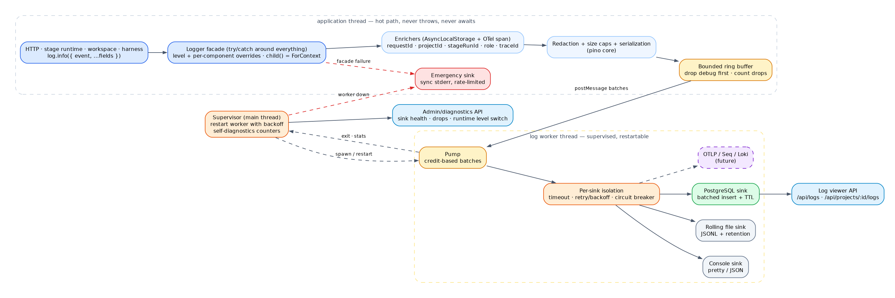

# Logging Architecture — Plan

**Status:** decisions confirmed 2026-11-12; Phases 1–4 implemented (in-process async pipeline with retry, circuit breaker, console/file/PostgreSQL/OTLP sinks, bounded disk spool, settings, log and admin APIs). Worker-thread isolation remains deliberately deferred — see section 15.1.  
**Date:** 2026-11-12  
**Goal:** a Serilog-style structured logging system for AI Factory: async, pluggable sinks, and guaranteed unable to hurt the application.



---

## 1. Requirements

| ID | Requirement |
|---|---|
| L-01 | Structured events (fields, not string concatenation), with levels and named events |
| L-02 | Serilog-like ergonomics: contextual child loggers, enrichers, per-component minimum levels, runtime level switch |
| L-03 | **Async**: a log call never waits for I/O |
| L-04 | **Pluggable sinks**: console, rolling file, PostgreSQL first; OTLP/Seq/Loki later without touching call sites |
| L-05 | **Isolation**: no logging bug, sink failure, slow disk, DB outage or worker crash may throw into, block, or exhaust memory of the app |
| L-06 | Correlation across logs, stage events and Phoenix traces (`requestId`, `projectId`, `stageRunId`, `traceId`) |
| L-07 | Security by default: secrets redacted, no prompts/documents at normal levels, size-capped, per-sink retention |
| L-08 | Observable logging: dropped counts, queue depth, sink health, last error — exposed via API |
| L-09 | Safe shutdown: bounded flush, never hangs or throws |

## 2. Where we are today

- Ad-hoc `logger?: (line: string) => void` callbacks injected into `stage-runtime`, `stage-event-sink` and `server`.
- Direct `process.stdout.write` / `process.stderr.write` in `api.ts`, `store.ts`, `config.ts`.
- Request logging is a single access-log string.
- Three *other* things that look like logs but are not application logs — keep them separate:

| System | Purpose | Keep? |
|---|---|---|
| `stage_run_events` | Domain audit/replay record of a stage run; transactional with domain state; drives the Activity UI | **Keep as is** |
| Phoenix / OTel traces | Latency, tokens, span trees | **Keep as is** |
| Application logs (this plan) | Diagnostics: startup, HTTP, lease, recovery, harness, DB, sink health, errors | **New** |

The CLI's interactive terminal output (`cli.ts`) is user interface, not logging; leave it.

## 3. Library decision

| Option | Verdict |
|---|---|
| **pino 10** (MIT) | **Use as the core.** Fastest, structured JSON, child loggers, redaction, serializers, mixin (enrichers), level overrides. Closest fit to Serilog's model. |
| winston 3 | Rejected: slower, string-oriented transports, in-process stream plumbing, weaker structure |
| bunyan | Rejected: effectively unmaintained |
| roarr | Rejected: niche; less ecosystem |
| loglayer 9 | Optional facade over loggers; unnecessary extra layer since we already write our own facade |
| `pino.transport()` (thread-stream worker) | **Not sufficient alone** — see spike below |
| OpenTelemetry `api-logs` / `sdk-logs` / OTLP log exporter | Use later as one sink for correlated export |

Verified npm versions: pino 10.4.0, pino-pretty 13.2.0, pino-abstract-transport 3.0.0, thread-stream 4.2.1, pino-roll 4.0.0, `@opentelemetry/sdk-logs` 3.1.1 (all MIT/Apache-2.0).

**Decision:** pino for event construction and serialization, plus a small AI Factory module (`src/logging/`) that owns everything pino does not guarantee: no-throw facade, bounded queue, sink isolation, supervisor and shutdown.

## 4. Spike results (Node 24, pino 10.4, run 2026-11-12)

These are why a custom pipeline is needed rather than plain `pino.transport()`.

| Experiment | Result | Consequence |
|---|---|---|
| Sink throws inside transport worker | Main thread keeps running, but **all later logs are silently lost**; no error event surfaced | Need a supervisor that detects sink/worker death and restarts it |
| Sink calls `process.exit(7)` in worker | Main survives; `transport` emits an `error` event **for every later write** ("the worker has exited") | Must attach an `error` handler (an unhandled `error` event would crash the app) and rate-limit it |
| Slow sink (5 ms/line), 200 000 lines | Main thread unblocked (~600k lines/s) but **RSS grew ~180 MB**; buffer is unbounded | Need our own bounded queue with drop policy |
| Same, then `process.exit()` | pino's exit hook **threw `_flushSync took too long (10s)`** | Logging could crash/hang shutdown; we must own shutdown with a deadline |
| Caller passes throwing getter / serializer / mixin | **`log.info()` throws in the caller** | Facade must wrap every call in try/catch |
| Circular object, BigInt, throwing `toJSON`, throwing Proxy, 50 MB string | No throw (pino handles) — but 50 MB string is accepted verbatim | Add size caps |

## 5. Serilog → AI Factory mapping

| Serilog | AI Factory |
|---|---|
| `ILogger`, `Log.ForContext<T>()` | `logger.child({ component: 'stage-runtime' })` |
| Message template + properties | Required `event` name (`stage.run.claimed`) + structured fields; optional `msg` |
| Enrichers (`LogContext`, `WithMachineName`) | `AsyncLocalStorage` context + OTel span → `requestId`, `projectId`, `stageRunId`, `stage`, `role`, `traceId`, `spanId`; static: service, version, env, pid, host |
| `MinimumLevel` + `Override` | Global level + per-component overrides |
| `LoggingLevelSwitch` | Runtime level switch (admin API / signal) |
| Sinks (`WriteTo`) | `LogSink` interface (below) |
| Sink `restrictedToMinimumLevel`, filters | Per-sink `minLevel` and predicate |
| Destructuring policies | pino `serializers` + `redact` + our secret scrubber |
| `Serilog.Sinks.Async` | Bounded queue + worker pump |
| `SelfLog` | Self-diagnostics channel (rate-limited stderr + counters API) |
| `Log.CloseAndFlush()` | `await logging.shutdown({ timeoutMs })` |

## 6. Architecture

### 6.1 Application thread (hot path)

```text
log.info({ event, ...fields })
  → facade: level check (cheap, before any work)
  → try { enrich → redact → cap sizes → pino serialize → enqueue } catch { emergency sink }
```

- No `await`, no I/O, no sink code on this thread.
- Level check first so disabled levels cost almost nothing.
- **Facade never throws.** Any internal failure falls back to the emergency sink and increments `facadeErrors`.
- Passing an `Error` produces a normalized `err` field: `type`, `message`, `stack` (capped), `code`, `cause` chain (depth-capped).

### 6.2 Bounded queue

- Fixed-capacity ring buffer (bytes and count). Default: 10 000 records / 16 MB.
- **Drop policy when full:** drop `debug`, then `info`, never `error` until the buffer is completely full; oldest first within a level.
- Counters: `queued`, `dropped{level}`, `bytesDropped`. A synthetic `logging.dropped` record is emitted (rate-limited) when drops stop so gaps are visible.
- Memory is bounded regardless of sink speed (fixes the unbounded growth seen in the spike).

### 6.3 Log worker thread

- Receives batches via `postMessage` using **credit-based flow control**: the worker grants N credits; the main thread sends a batch only with credit available. A slow sink therefore fills the *bounded* queue instead of unbounded memory.
- The worker hosts the sinks, so heavy serialization/IO/compression cannot stall the event loop.
- Each sink is wrapped in an isolation envelope:
  - **timeout** per write (default 5 s);
  - **retry** with exponential backoff and jitter (bounded attempts);
  - **circuit breaker**: after N consecutive failures the sink is opened for a cool-down; records for it are dropped and counted, other sinks continue;
  - **per-sink queue**, so one slow sink does not delay the others;
  - **min level / filter** per sink.

### 6.4 Supervisor (main thread)

- Spawns the worker, listens for `error`/`exit`.
- On crash: logs to the emergency sink, restarts with exponential backoff (cap 30 s), and gives up (staying on the emergency sink) after a crash-loop threshold — never takes the app down.
- **Always attaches an `error` handler** to worker/transport events (the spike showed an unhandled `error` event would throw).
- Publishes health: `workerState`, `restarts`, `lastError`, per-sink state.

### 6.5 Emergency sink

- Synchronous `stderr` JSON line, token-bucket rate limited (e.g. 20 lines/s), used only when the facade or worker is unavailable.
- Also receives `uncaughtException` / `unhandledRejection` records so a crash is logged even if the pipeline is down. We log and then let Node's default crash policy proceed; logging must not swallow fatal errors.

### 6.6 Shutdown

`await logging.shutdown({ timeoutMs: 2000 })`:

1. stop accepting new records (late records go to emergency);
2. drain queue to the worker within the deadline;
3. ask sinks to `flush()`/`close()` within the deadline;
4. terminate the worker;
5. **always resolves**; if the deadline passes, report what was lost via the emergency sink.

We do not rely on pino's built-in exit hook (spike: it can throw after 10 s).

## 7. Record schema (v1)

```json
{
  "schema": 1,
  "ts": "2026-11-12T10:44:55.123Z",
  "level": "warn",
  "event": "stage.run.lease_lost",
  "msg": "Worker lease was lost",
  "service": "aifactory-api",
  "version": "0.1.0",
  "env": "local",
  "host": "…",
  "pid": 4242,
  "component": "stage-runtime",
  "requestId": "…",
  "traceId": "…",
  "spanId": "…",
  "projectId": "…",
  "stageRunId": "…",
  "stage": "planning",
  "role": "reviewer",
  "workerId": "…",
  "err": { "type": "StageRuntimeError", "message": "…", "code": "STAGE_RUN_LEASE_LOST", "stack": "…" },
  "durationMs": 1234
}
```

Rules:

- `event` is mandatory for `warn`/`error` and follows `domain.object.action` (stable, queryable, like Serilog event IDs).
- Field names are camelCase; no dynamic keys at the top level (user data goes under `data`).
- Levels: `trace`, `debug`, `info`, `warn`, `error`, `fatal`.
- Hard caps: message 4 KB, each string field 8 KB, stack 8 KB, record 64 KB, depth 6, array 100 items.

## 8. Sinks

```ts
interface LogSink {
  readonly name: string
  readonly minLevel?: Level
  write(batch: readonly LogRecord[], signal: AbortSignal): Promise<void>
  flush?(signal: AbortSignal): Promise<void>
  close?(): Promise<void>
}
type SinkFactory = (options: unknown) => LogSink   // registered by `type`
```

| Sink | Phase | Notes |
|---|---|---|
| Console | 1 | Pretty (pino-pretty) in dev, JSON lines in prod |
| Rolling file | 2 | JSONL, size/time rotation, retention days; evaluate `pino-roll` vs `rotating-file-stream` |
| PostgreSQL `app_logs` | 3 | **Opt-in via settings**; batched multi-row insert, indexed by `ts`, `level`, `project_id`, `stage_run_id`, `event`; retention job; separate pool so logging cannot exhaust the app pool |
| OTLP logs | 4 | **Implemented** as OTLP/HTTP JSON (`OtlpLogsSink`), opt-in. Targets an OTel Collector/backend — **Phoenix only ingests traces, not logs** (`POST /v1/logs` is 405) |
| Seq / Loki / Datadog | later | New sink type only; no call-site change |
| Disk spool | 4 | **Implemented** (`FileSpool`): bounded files, oldest-first replay, at-least-once; opt-in via `sink.spool`, enabled for PostgreSQL and OTLP |

Adding a sink = implement `LogSink`, register a factory, add a config entry.

## 9. Configuration

```json
{
  "minimumLevel": "info",
  "override": { "stage-runtime": "debug", "http": "info", "workspace": "warn" },
  "queue": { "maxRecords": 10000, "maxBytes": 16777216 },
  "redact": ["req.headers.authorization", "*.apiKey", "*.password", "*.token"],
  "sinks": [
    { "type": "console", "format": "pretty" },
    { "type": "file", "path": "./.data/logs/aifactory-%DATE%.jsonl", "retentionDays": 7 }
  ]
}
```

The PostgreSQL sink is **not** in the default config. It is switched on from AI Factory settings (section 9.1).

Environment overrides: `AIFACTORY_LOG_LEVEL`, `AIFACTORY_LOG_CONFIG`, `AIFACTORY_LOG_FORMAT`. Invalid config falls back to console-only at `info` and logs the problem; it never prevents startup.

### 9.1 Settings-controlled sinks (confirmed)

Default: **console + rolling file only**. PostgreSQL storage is opt-in from AI Factory settings (the same `settings` table and `/api/settings` API used for `maxActiveProjects`):

| Setting | Default | Meaning |
|---|---|---|
| `logging.postgres.enabled` | `false` | Add/remove the PostgreSQL sink at runtime |
| `logging.postgres.minLevel` | `info` | Lowest level stored in the database |
| `logging.postgres.retentionDays` | `14` | Retention for `app_logs` |
| `logging.file.retentionDays` | `7` | Retention for rolling files |
| `logging.level` | `info` | Global minimum level (also editable via admin API) |

Enabling the sink hot-adds it to the running pipeline (`logging.reconfigure()`); no restart. The `app_logs` table is created on first enable. The UI log viewer shows a banner when only file logs exist ("enable database logs in Settings to search here"). The sink is still isolated like any other: if PostgreSQL is down, its breaker opens and file logging continues.

### 9.2 Runtime level control and the signal question

Goal: turn `debug` on for a short time to investigate something, without a restart and without leaving it on.

| Mechanism | Pros | Cons |
|---|---|---|
| **Admin API / settings** (`PUT /api/admin/logging/level`) | Authenticated, auditable, per-component, supports a **TTL** ("debug for 15 min, then revert") | Needs the HTTP server to be responsive |
| **Config file watch** (`fs.watch` on the logging config) | No API or signal needed; works in containers | Slightly slower; file permissions |
| **POSIX signal** (e.g. `SIGUSR2`) | Works even if HTTP is wedged; common ops habit | Unix-only; no auth or audit trail; ambiguous semantics (what does one signal mean — toggle? cycle?); `SIGUSR1` is reserved by Node's inspector; awkward under sandboxes/launchers |

**Decision (recommended, your call):** v1 supports the **admin API and settings with a TTL auto-revert**, plus optional config-file reload. **No signal handler in v1.** If we later need an out-of-band switch, add `SIGUSR2` with one well-defined meaning: "raise the global level to `debug` for N minutes (default 15), then auto-revert", and log the change as a `warn` event so it is visible. Reason: the API gives authentication and audit; a bare signal gives neither, and the cases where HTTP is dead but the event loop is alive are rare.

## 10. Security and privacy

- Redaction list applied before enqueue (pino `redact`) plus a string scrubber for bearer tokens, `sk-…`-style keys, connection strings and `password=` patterns.
- Prompts, model output, thinking, tool input/output and document content are **not logged** at `info` or above. They go through the same capture switch as Phoenix (`AIFACTORY_LOG_CAPTURE_CONTENT`, default off) and are truncated.
- `projectId` is on every project-scoped record. Postgres sink stores it as a column so the log API can enforce project scoping. (Project-scoped authorization of the API itself is still a separate open item.)
- Retention is per sink; deletion on project removal covers `app_logs` rows by `project_id`.
- Log files created `0600`; directory outside the project roots.

## 11. Correlation

- HTTP middleware creates/accepts `x-request-id`, stores it in `AsyncLocalStorage`, returns it in the response.
- Stage runtime sets `projectId`, `stageRunId`, `stage` in context for the duration of a run (including worker-side callbacks).
- Active OTel span supplies `traceId`/`spanId`, so a log line links to its Phoenix trace.
- Domain events keep writing `stage_run_events`; important ones also emit an app log with the same `stageRunId`.

## 12. APIs

| Endpoint | Purpose |
|---|---|
| `GET /api/logs` | Operator view of `app_logs` (filters: level, event, component, project, run, request, q, time range, cursor) |
| `GET /api/projects/:id/logs?source=events\|app\|all` | Extend the existing project log API to merge app logs with stage events |
| `GET /api/admin/logging` | Health: worker state, restarts, queue depth, drops, per-sink state/last error, effective levels |
| `PUT /api/admin/logging/level` | Runtime level/override change (token + loopback only; audited) |

## 13. Migration

1. Introduce `Logger` interface (`trace/debug/info/warn/error/fatal`, `child`, `isEnabled`) and `NoopLogger` for tests.
2. Replace injected `logger?: (line) => void` with `Logger` (stage runtime, event sink, server, workspace, embeddings, Phoenix).
3. Replace `process.stdout/stderr.write` in `api.ts`, `store.ts`, `config.ts` with logger calls; keep the startup banner as UX, plus a structured `app.started` event.
4. Convert the HTTP access line into a structured `http.request` event.
5. Lint rule: no `console.*` / `process.std*.write` outside `src/logging/` and `cli.ts`.

## 14. Failure-isolation matrix

| Failure | Behavior |
|---|---|
| Caller passes throwing getter/serializer | Caught; emergency record; app continues |
| Circular/huge object | Serialized safely; capped; truncation flag set |
| Sink throws | Retry → breaker opens; other sinks unaffected; counted |
| Sink hangs | Per-write timeout; breaker |
| Sink slow | Per-sink queue fills; oldest low-level dropped; memory bounded |
| Worker crashes / exits | Supervisor restart with backoff; emergency sink meanwhile |
| Crash loop | Stop restarting; stay on emergency; one rate-limited warning |
| PostgreSQL down | Postgres sink breaker open; file/console continue; batches spool to disk and replay when the sink recovers |
| OTLP collector down | OTLP sink breaker open; file/console/PostgreSQL continue; batches spool and replay |
| Phoenix down or hung | Trace exports time out and the per-project exporter breaker opens; spans are dropped. Stage runs, HTTP, logs and shutdown are unaffected. REST summary returns `available:false` quickly; project cleanup runs in the background |
| Disk full / permission error | File sink breaker; console continues |
| Queue full | Drop low levels first; synthetic `logging.dropped` |
| Shutdown under load | Bounded flush; always resolves |
| Config invalid | Fall back to console `info`; app starts |
| Fatal process error | Emergency synchronous write; default crash policy preserved |

## 15. Phases

| Phase | Scope | Exit criteria |
|---|---|---|
| **0** | Spike and decision | Done (section 4) |
| **1 — Core** | `src/logging/`: facade, context (ALS), enrichers, redaction, caps, level overrides, console sink, emergency sink, `Logger` interface, migrate injected callbacks | No `logger?: (line)=>void` left; unit tests; no-throw proven |
| **2 — Pipeline** | Bounded queue, worker host, credit flow control, supervisor, file sink, shutdown | Chaos suite passes (below) |
| **3 — Storage and API** | Postgres `app_logs` sink, retention job, `/api/logs`, merged project logs, admin diagnostics, runtime level switch | UI log viewer reads app logs; drop/health visible |
| **4 — Export** | OTLP logs, trace correlation, disk spool, optional Seq/Loki sink | Log ↔ Phoenix trace navigation works |

## 15.1 Implementation status (2026-11-12)

Code: `apps/chat-cli/src/logging/`. Tests: `test/logging.test.ts`, `test/file-sink.test.ts`, `test/http-logging.test.ts`.

| Item | Status |
|---|---|
| `Logger` facade, `child()`, never-throws guarantee | Done |
| Levels, per-component overrides (hierarchical), runtime switch with TTL auto-revert | Done |
| Ambient context via `AsyncLocalStorage` + active OTel span ids | Done |
| Sanitizer: guarded property reads, depth/width/string caps, circular cut, secret scrubbing, reserved-key protection, error normalization | Done |
| pino core with redaction paths | Done |
| Bounded priority queue (drop low levels first, count drops) | Done |
| Emergency sink (sync stderr, token bucket, suppression summary) | Done |
| Per-sink runner: own pending list, write timeout, failure stats, drop-oldest | Done |
| Console sink (json / pretty) and rolling file sink (daily, size segments, retention, 0600) | Done |
| Bounded `flush()` / `shutdown()` that always resolves | Done |
| `uncaughtExceptionMonitor` emergency record | Done |
| Migrated: `stage-runtime`, `stage-event-sink`, HTTP server (request id, structured access log), `api.ts` bootstrap | Done |
| Request id: accepted from `X-Request-Id` if well-formed, always returned | Done |
| Retry with backoff + per-sink **circuit breaker** (open → drop + count → half-open probe → close) | Done |
| PostgreSQL `app_logs` sink: private pool, batched inserts, NUL-safe, hourly retention, opt-in | Done |
| Persisted logging settings (`settings` key `logging`), hot add/remove of the PostgreSQL sink, live level and file retention | Done |
| `GET /api/logs`, `source=events\|app\|all` project view, `GET/PATCH /api/settings/logging`, `GET /api/admin/logging`, `PUT /api/admin/logging/level` (TTL, component override, audited) | Done |
| Project deletion removes the project's `app_logs` rows | Done |
| **Signal toggle** | Intentionally not built (decision 4) |
| **OTLP/HTTP JSON logs sink**: opt-in via `AIFACTORY_OTLP_LOGS_URL`, severity/body/attributes, `traceId`/`spanId`, auth headers, timeout | Done |
| **Bounded disk spool** for PostgreSQL/OTLP: one segment per failed batch, size/file caps, oldest-first replay, at-least-once | Done |
| **Phoenix outage isolation**: export timeout + per-project breaker, non-throwing telemetry methods, bounded shutdown, REST timeout/breaker, non-blocking project cleanup | Done |
| **Dedicated worker thread** + supervisor/credit flow control | **Not done — deliberately deferred.** See 15.2 |
| Remaining ad-hoc output (`store.ts` callback is wired; `config.ts`, other services, startup banner, `cli.ts`) | Banner/CLI intentionally kept; `config.ts` and a few services not migrated |

### Measured (Node 24, this machine)

| Metric | Plan target | Measured |
|---|---|---|
| Disabled-level call | ≤ 5 µs | **~17 ns** |
| Enabled call (enqueue) | ≥ 200k records/s | **~12 µs / ~81k records/s** — target not met |

The enabled-path cost is dominated by sanitizing fields and merging bindings/ambient context before pino serializes. 81k/s is far above any realistic AI Factory load (hundreds of events/s), so this is not blocking, but the 200k/s target should be either relaxed or met by a fast path (skip sanitizing for primitive-only fields). In the tight benchmark loop the event loop never yielded, so the pump could not run and the bounded queue correctly dropped the overflow — this is the intended protection, and it also shows why a single synchronous burst larger than the queue loses low-priority records.

## 15.1.1 Phase 4 failure measurements (2026-11-12)

With Phoenix stopped and the OTLP collector unreachable, on the live API:

| Check | Result |
|---|---|
| Planning run end-to-end | **263 ms**, run reached `awaiting_human` |
| `GET /api/health` | 200 in **0.9 ms** |
| `GET /api/projects/:id/observability` | 200 in **10 ms**, `available:false` |
| `DELETE /api/projects/:id` with Phoenix down | 204 in **18 ms** (Phoenix cleanup is background) |
| OTLP sink during collector outage | 3 spool files, `spooled:3`, no dropped records |
| Spool replay after collector recovery (API restart) | **11 replayed**, 0 spool files, collector received the records |
| `SIGTERM` after a stage run with Phoenix down | exit 0 in **49 ms** |

## 15.2 Why the worker thread is deferred

Spike results (section 4) showed `pino.transport()` workers lose logs silently when a sink dies, so a worker only pays off if we add the supervisor and credit-based flow control around it. The in-process pipeline now provides the guarantees that matter for the built-in sinks: no throw, bounded memory, per-sink isolation with timeout, retry and circuit breaker, and bounded shutdown (all covered by tests, including a real PostgreSQL outage). A worker would add serialization cost and a supervisor to protect against one case only: a sink that blocks the event loop synchronously or burns CPU (for example compression or a synchronous disk write). None of the console, file or PostgreSQL sinks do. **Recommendation: build the worker only when such a sink is added**; sinks are already behind the `LogSink` interface, so moving them into a worker later does not change call sites.

## 16. Test plan

Chaos tests (Phase 2 gate), each asserting the app keeps serving requests and memory stays under a bound:

- sink throws on every write / on one record;
- sink hangs forever;
- sink 100× slower than producer (200 000 records) — RSS growth ≤ queue limit;
- worker `process.exit` and uncaught exception, repeated (crash loop);
- throwing getter, serializer, `toJSON`, Proxy; circular; BigInt; 50 MB string;
- shutdown while the queue is full and a sink is hung;
- DB sink with PostgreSQL stopped, then restarted;
- `error` events on the worker with no handler registered by the caller;
- redaction golden tests with synthetic secrets;
- throughput benchmark (target: ≥ 200k records/s enqueue, ≤ 5 µs median per disabled-level call).

## 17. Risks

| Risk | Mitigation |
|---|---|
| Custom pipeline is more code than `pino.transport()` | Small, heavily tested module; spike proves the built-in is unsafe for our guarantees |
| Worker `postMessage` copying cost | Batch records; send pre-serialized strings, not objects |
| Silent loss when dropping | Visible counters and synthetic `logging.dropped` records |
| Log volume from `debug` events (thinking, status) | Default `info`; keep high-volume stage detail in `stage_run_events`, not app logs |
| Logs leaking project data | Redaction, content-capture switch, size caps, project column, retention |

## 17.1 Decisions (confirmed 2026-11-12)

| # | Decision |
|---|---|
| 1 | Retention defaults accepted: files 7 days, PostgreSQL 14 days |
| 2 | Default sinks are console + rolling file. PostgreSQL storage is enabled from settings, hot-added at runtime |
| 3 | No Seq-compatible sink for now; the AI Factory UI is the log viewer |
| 4 | Runtime level control via admin API/settings with TTL; signal toggle deferred (see 9.2) |
