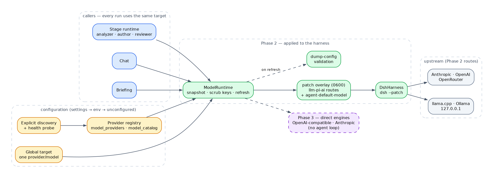

# Model Providers — Plan

**Status:** decisions confirmed 2026-11-13; **Phases 0–2 implemented**  
**Date:** 2026-11-13  
**Goal:** let AI Factory run on Claude, OpenAI, local llama.cpp and other third-party APIs through one interface — one global target for the whole Factory, with a documented seam for per-agent-behavior targets later — and no vendor logic in the core.



One global target feeds every caller; engines differ, the interface does not.

---

## 1. Scope

### In scope

- One provider-neutral contract for model calls (completion, streaming, usage, errors, capabilities).
- Adapters for: **Anthropic (Claude)**, **OpenAI**, **llama.cpp** (local), and a generic **OpenAI-compatible** adapter covering OpenRouter, Groq, Together, DeepSeek, vLLM, Ollama, LM Studio and Azure-style gateways.
- Per-provider configuration: endpoint, credentials reference, headers, timeouts, retry policy.
- **One global target** for the whole Factory: every project and every stage uses the selected provider and model. Per-project and per-stage overrides are explicitly out of scope.
- A designed extension point for future **agent-behavior** targets (per predefined agent behavior), not implemented yet.
- Normalized usage and cost, so the existing stats API keeps working across providers.
- Failure isolation: a dead, slow or rate-limited provider must not fail a stage run or block the API.
- A **static** model catalogue with an explicit "discover" action (no live discovery by default).

### Out of scope

- Re-implementing vendor wire protocols that the harness already speaks (pi-ai covers Anthropic Messages, OpenAI Responses/Chat Completions and Google).
- Fine-tuning, training, model hosting.
- Provider-side billing reconciliation.
- Per-project and per-stage model selection (out of scope; see §3.4).
- Per-project user-supplied keys.
- Multimodal features beyond what the harness already projects.
- llama.cpp runtime testing in this iteration: the route and adapter are implemented and configured, but validation is deferred until you start `llama-server --jinja`.

## 2. What already exists

Grounding facts, so the plan builds on real seams rather than inventing new ones:

| Fact | Where |
|---|---|
| The harness routes model requests by **provider + model**, with pi-ai profiles carrying `api`, `baseURL`, `apiKeyEnv`, `headers`, `models`, `reasoning`, `retryPolicy` | `packages/llm/llm-pi-ai/README.md` |
| Hand-declared routes support self-hosted/OpenAI-compatible endpoints (`api: openai-completions` + `baseURL`) | same |
| Default routing per agent is configurable (`provider`, `model`, `reasoningEffort`, all `Volatile`) | `@deepseek-ai/dsh-agent-default-model` in `docs/config-catalog.md` |
| The launcher accepts config overlays: `dsh --profile <p> --patch <file>` | `apps/cli/src/args.ts` (help examples), `resolveBoot` |
| Compaction policies are keyed by provider/model and need `contextWindow` | `@deepseek-ai/dsh-compaction-basic` config |
| AI Factory already has role-level config tables reserved for later: `stage_role_configs` (provider, model, reasoning_effort, max_tokens, temperature, skills, tools, system_prompt) and `project_role_overrides` | `src/workspace.ts` migration |
| Harness events already carry normalized usage (`inputTokens`, `outputTokens`, `totalTokens`, `cacheReadTokens`, `cacheWriteTokens`) | observed in `stage_run_events`; consumed by `src/stats.ts` |
| Embeddings already use an OpenAI-compatible client (`/v1/embeddings`) | `src/embeddings.ts` |
| A proven port/adapter/registry pattern exists for observability | `src/observability/` |

**Implication:** AI Factory should not write HTTP clients for Anthropic or OpenAI. It should own the *routing, policy and normalization* layer, and delegate the wire protocol to the harness — with direct engines only where an agent loop is unnecessary.

## 3. Architecture

Three layers, each replaceable on its own.

### 3.1 Provider registry (data)

A provider is a named route plus credentials reference and defaults:

```ts
interface ProviderDefinition {
  id: string                    // 'anthropic' | 'openai' | 'llamacpp' | 'openrouter' | custom
  kind: 'anthropic' | 'openai-compatible' | 'google' | 'bedrock' | 'azure-openai'
  baseUrl?: string
  apiKeyEnv?: string            // credential *reference*, never the secret
  headers?: Record<string, string>
  models: ModelDefinition[]     // id, display name, contextWindow, maxOutput, modalities
  defaults?: { temperature?: number; maxTokens?: number; reasoningEffort?: string }
  timeoutMs?: number
  retry?: { maxRetries: number; baseMs: number; maxMs: number }
}
```

Stored in PostgreSQL (`model_providers`) with an environment override for bootstrap, mirroring `settings`. Keys are **references** (`OPENAI_API_KEY`), resolved at call time.

### 3.2 ModelEngine port (behavior)

```ts
interface ModelEngine {
  readonly kind: string
  complete(request: ModelRequest, signal: AbortSignal): Promise<ModelResponse>
  stream(request: ModelRequest, signal: AbortSignal): AsyncIterable<ModelEvent>
  health(): Promise<EngineHealth>
}

interface ModelRequest {
  provider: string
  model: string
  messages: ChatMessage[]
  system?: string
  tools?: ToolSchema[]
  temperature?: number
  maxTokens?: number
  reasoningEffort?: string
  responseFormat?: { type: 'text' } | { type: 'json'; schema?: unknown }
  stop?: string[]
  // ambient
  projectId?: string
  stageRunId?: string
  role?: string
}

interface ModelResponse {
  text: string
  thinking?: string
  toolCalls: ToolCall[]
  usage: Usage            // input/output/total/cacheRead/cacheWrite
  finishReason: 'stop' | 'tool_calls' | 'length' | 'error'
  providerRequestId?: string
  costUsd?: number
}

type ModelEvent =
  | { type: 'text'; text: string }
  | { type: 'thinking'; text: string }
  | { type: 'tool_call'; call: ToolCall }
  | { type: 'usage'; usage: Usage }
  | { type: 'done'; response: ModelResponse }
  | { type: 'error'; error: ModelError }
```

`ModelEvent` deliberately mirrors the harness event vocabulary already used by chat and the stage runtime (`text`, `thinking`, `tool_call`, `final`), so no new streaming contract leaks to the UI.

### 3.3 Engines

| Engine | Used for | Wire protocol |
|---|---|---|
| **HarnessEngine** | all agent work: stage roles, chat with tools, briefings that need tools | `dsh --profile headless --patch <generated.yml>` |
| **OpenAICompatibleEngine** | llama.cpp, Ollama, vLLM, LM Studio, OpenRouter, Groq, Together, DeepSeek, Azure | `/v1/chat/completions` |
| **AnthropicEngine** | Claude without a harness tool loop | `/v1/messages` |
| Gemini / Bedrock | later | native |

**HarnessEngine is the default for stage roles.** It preserves tools, sessions, sandboxing, compaction and normalized usage. The direct engines exist for calls that need no agent loop (classification, extraction, short summaries, health probes, local-only deployments).

### 3.4 One global target (and the future agent-behavior seam)

For this iteration there is exactly one active target for the Factory:

```ts
interface FactoryModelTarget {
  provider: string
  model: string
  engine: 'harness' | 'direct'   // derived from the provider kind and task
  params: { temperature?: number; maxTokens?: number; reasoningEffort?: string }
  fallback: Array<{ provider: string; model: string }>
}
```

Resolution:

1. `settings.models` (database) when present;
2. otherwise the environment (`AIFACTORY_MODEL_PROVIDER` / `AIFACTORY_MODEL`);
3. otherwise "unconfigured" — the Factory starts, and model-backed features fail with `MODEL_UNCONFIGURED` until a target is set.

The target is a **snapshot taken when a run starts**. Changing it affects subsequent runs only; an in-flight stage run keeps the target it started with, so a configuration change cannot corrupt a half-finished run.

**Reserved extension point (not implemented):** per-agent-behavior targets. When that work starts, resolution becomes `agentBehavior → factory`, using a table such as:

```sql
CREATE TABLE agent_behavior_models (
  behavior TEXT PRIMARY KEY,      -- e.g. 'analyzer', 'author', 'reviewer'
  provider TEXT NOT NULL,
  model TEXT NOT NULL,
  params JSONB NOT NULL DEFAULT '{}'
);
```

`stage_role_configs` and `project_role_overrides` already exist in the schema and are the natural home for that later work, but they are **not read** in this iteration and must not be documented as active.

### 3.5 Patch generation

For `engine: harness`, AI Factory writes a short-lived overlay (mode 0600, outside project roots):

```yaml
- name: '@deepseek-ai/dsh-llm-pi-ai'
  config:
    providers:
      anthropic: { apiKeyEnv: ANTHROPIC_API_KEY }
      openai:    { apiKeyEnv: OPENAI_API_KEY }
      local:
        api: openai-completions
        baseURL: http://127.0.0.1:8080/v1
        models: [{ id: local-model, contextWindow: 32768 }]
- name: '@deepseek-ai/dsh-agent-default-model'
  config:
    provider: anthropic
    model: claude-sonnet-4-5
    reasoningEffort: medium
```

Then `dsh --profile headless --patch <file>`. Secrets never enter the file: it references `apiKeyEnv`, and the API passes only the needed variables to the child process.

The overlay is validated before spawning with `dsh --dump-config --patch <file>`; a validation failure is a configuration error, not a run failure.

## 4. Provider matrix

| Provider | Protocol | Auth | Tools | Thinking | Notes |
|---|---|---|---|---|---|
| **Anthropic** | `/v1/messages` | `x-api-key` + `anthropic-version` | `tool_use`/`tool_result` blocks | thinking blocks with budget | `max_tokens` required; system prompt is a top-level field; 429/529 retry semantics; prompt caching reports `cacheReadTokens` |
| **OpenAI** | Responses or Chat Completions | `Authorization: Bearer` | function calling | reasoning models | `max_completion_tokens` vs `max_tokens`; reasoning models reject `temperature`; streaming usage needs `stream_options.include_usage`; org/project headers |
| **llama.cpp** | OpenAI-compatible `/v1/chat/completions` | none (local) | only with `--jinja` | model-dependent | `/v1/models` for catalogue, `/props` for context size; slow first token on CPU; generous timeouts; no rate limits |
| **Ollama / vLLM / LM Studio** | OpenAI-compatible | optional key | usually | some | treat as OpenAI-compatible with per-route quirks |
| **OpenRouter / Groq / Together / DeepSeek** | OpenAI-compatible | bearer | varies | varies | gateway headers (`HTTP-Referer`, `X-Title`) per route |
| **Azure OpenAI** | OpenAI-compatible, deployment path | `api-key` header | yes | — | `api-version` query, deployment in path; separate adapter config, not a new engine |
| **Google Gemini / Bedrock** | native | ADC / SigV4 / OAuth | yes | yes | deferred; adapter or harness route |

**Rule:** new providers are configuration, not code, unless their protocol differs from OpenAI-compatible. The matrix documents the exceptions so quirks are not discovered in production.

## 5. Normalization

### 5.1 Usage

All usage maps to the existing shape used by `stats.ts`:

```ts
interface Usage { inputTokens: number; outputTokens: number; totalTokens: number; cacheReadTokens: number; cacheWriteTokens: number }
```

- Harness path: already normalized — no change.
- Direct path: map `usage.prompt_tokens`/`completion_tokens` (OpenAI), `usage.input_tokens`/`output_tokens` (Anthropic), and cache fields.
- `totalTokens` falls back to `input + output` when a provider omits it (same rule as `stats.ts`).

### 5.2 Cost

A versioned price table (`model_prices`) keyed by provider/model with `input`, `output`, `cacheRead`, `cacheWrite` per million tokens. Cost is computed at record time and stored in the run event, so historical stats do not change when prices change. Local models have price 0.

### 5.3 Errors

```ts
type ModelErrorKind =
  | 'auth' | 'quota' | 'rate_limit' | 'overloaded'
  | 'timeout' | 'network' | 'invalid_request'
  | 'context_overflow' | 'content_filter' | 'unsupported' | 'unknown'
```

| Kind | Retry | Fallback | User-visible |
|---|---|---|---|
| `rate_limit`, `overloaded`, `timeout`, `network` | yes, jittered backoff | yes | "provider busy, retrying" |
| `auth`, `invalid_request`, `unsupported` | no | next in chain | configuration error |
| `context_overflow` | no | model with larger window | run fails with actionable message |
| `content_filter` | no | no | surfaced to the reviewer/human gate |

### 5.4 Capabilities

Per model: `contextWindow`, `maxOutputTokens`, `tools`, `thinking`, `jsonMode`, `vision`, `streaming`. The router rejects an incompatible request before network I/O (`UNSUPPORTED_CAPABILITY`) instead of sending it and misinterpreting the failure.

## 6. Configuration and routing

### 6.1 Schema

```sql
CREATE TABLE model_providers (
  id TEXT PRIMARY KEY,
  kind TEXT NOT NULL,
  base_url TEXT,
  api_key_env TEXT,
  headers JSONB NOT NULL DEFAULT '{}',
  defaults JSONB NOT NULL DEFAULT '{}',
  enabled BOOLEAN NOT NULL DEFAULT true,
  created_at TIMESTAMPTZ NOT NULL DEFAULT now(),
  updated_at TIMESTAMPTZ NOT NULL DEFAULT now()
);

CREATE TABLE model_catalog (
  provider TEXT NOT NULL REFERENCES model_providers(id) ON DELETE CASCADE,
  model TEXT NOT NULL,
  display_name TEXT,
  context_window INTEGER,
  max_output INTEGER,
  capabilities JSONB NOT NULL DEFAULT '{}',
  price JSONB NOT NULL DEFAULT '{}',
  PRIMARY KEY (provider, model)
);
```

A `factory_model` row is stored in the existing `settings` table (key `models`), not a new table:

```json
{
  "provider": "anthropic",
  "model": "claude-sonnet-4-5",
  "temperature": 0.2,
  "maxTokens": 8000,
  "reasoningEffort": "medium",
  "fallback": [{ "provider": "openai", "model": "gpt-5" }]
}
```

`stage_role_configs` and `project_role_overrides` remain unused in this iteration; they are reserved for agent-behavior targets later.

### 6.2 Global configuration

Priority: **database setting → environment variables → unconfigured**.

```sh
# .env (development) or injected environment (deployment)
AIFACTORY_MODEL_PROVIDER=anthropic
AIFACTORY_MODEL=claude-sonnet-4-5
AIFACTORY_MODEL_TEMPERATURE=0.2
AIFACTORY_MODEL_MAX_TOKENS=8000
AIFACTORY_MODEL_FALLBACK=openai:gpt-5,local:qwen3
ANTHROPIC_API_KEY=...
OPENAI_API_KEY=...
```

Provider definitions (endpoint, kind, headers, default models) may also come from the database so an operator can add an OpenAI-compatible gateway without a redeploy; credentials are always environment references.

Changing the global target applies to runs started after the change. There is no per-project or per-stage override.

### 6.3 APIs

| Method | Path | Purpose |
|---|---|---|
| `GET` | `/api/models/providers` | Configured providers and health (no secrets) |
| `GET` | `/api/models` | Catalogue with capabilities and prices |
| `POST` | `/api/models/providers/:id/discover` | Explicit catalogue discovery (bounded) |
| `POST` | `/api/models/providers/:id/health` | Probe one route (bounded) |
| `GET` | `/api/settings/models` | Current global target, effective source, fallback chain |
| `PATCH` | `/api/settings/models` | Validate, persist and apply a new global target |
| `GET` | `/api/projects/:id/stats?groupBy=model` | Tokens/cost per provider/model |

There is deliberately no per-project model endpoint.

## 7. Failure isolation

Same discipline as the observability and logging work:

1. **Per-attempt timeout.** Cloud default 120 s; local llama.cpp 600 s (CPU), configurable per route.
2. **Bounded retry** with exponential backoff and jitter, only for retryable kinds.
3. **Per-route circuit breaker.** After N consecutive failures, the route opens for a cool-down; requests go straight to the fallback chain. Reuses the tested `SinkRunner` pattern (open → drop/probe → close).
4. **Fallback chain** honoured only when the failure is retryable and the next target satisfies capabilities.
5. **Stage run never fails because a provider is down**, unless every target in the chain fails; then the run fails with `STAGE_ROLE_FAILED` and a cause (`MODEL_UNAVAILABLE`).
6. **No provider call inside a request handler** unless the caller awaits it; health probes are explicit and bounded.
7. **Logging**: provider, model, kind, duration, tokens, retry count — never prompts or keys by default (same capture switch as Phoenix).

## 8. Streaming

Direct engines normalize deltas to `ModelEvent`. The chat SSE endpoint already streams `text`/`thinking`/`tool_call`/`final`; the direct engine emits the same shapes, so the UI needs no change.

Harness path is unchanged (NDJSON → SSE projection).

## 9. Security and credentials

**Where keys live (recommendation adopted):**

| Environment | Where the secret lives |
|---|---|
| Development | root `.env` in the AI Factory workspace (git-ignored; `.env.example` holds empty placeholders) |
| Deployment | real environment variables injected by the platform (containers, systemd, Kubernetes Secrets) |

- The database stores only the **variable name** (`apiKeyEnv: ANTHROPIC_API_KEY`), never the value.
- `.env` is never committed. `.gitignore` already excludes it; keep `.env.example` as the contract.
- Load order: real environment variables win over `.env`, so a container injects secrets without editing files. `dsh` inherits only the provider variables it needs, not the whole environment.
- **Startup validation** reports which providers have a resolvable key without printing values; an unusable provider is marked `unconfigured` rather than crashing the API.
- **Root `.env` support:** `loadDotEnv` currently reads only `cwd/.env`. Phase 1 extends it to also look for a workspace-root `.env` (walking up from the working directory, stopping at the repository root) so a single root file works when the API is started from `apps/chat-cli`. Existing `apps/chat-cli/.env` keeps working.
- Redaction already exists in `src/logging/sanitize.ts`; extend it with provider key patterns and assert it in tests.
- **Per-child environment minimisation**: the spawned harness receives only the selected provider's key plus its own configuration.
- **Local vs cloud policy**: `AIFACTORY_MODEL_EGRESS=local-only` restricts routing to localhost providers.
- No secret may appear in logs, traces, error messages, generated patches or any HTTP response; this is a tested invariant.

## 10. Phases

| Phase | Scope | Exit criteria |
|---|---|---|
| **0 — Contract** | `ModelEngine`/`ModelRequest`/`ModelResponse`/`ModelError`/`Usage` ports, capability matrix, conformance suite, `FakeEngine` | Core compiles against ports; conformance suite green for fake + one real engine |
| **1 — Registry and global target** | `model_providers`/`model_catalog` tables, root `.env` loading, key validation, `settings.models`, `/api/models*` and `/api/settings/models`, health + explicit discover | Providers and catalogue listable; global target settable; no secrets in responses; missing key reported, not fatal |
| **2 — Harness engine** | patch generator, global target applied to every run, `--dump-config` validation, Anthropic + OpenAI + llama.cpp-configured profiles | A stage run uses the configured provider; changing the target affects the next run only; usage and stats unchanged |
| **3 — Direct engines** | `OpenAICompatibleEngine` (incl. llama.cpp), `AnthropicEngine`, normalized usage/cost, retry/breaker/fallback | Non-tool calls work; a killed provider falls back; the API and stage runs stay responsive |
| **4 — Product surface** | stats by model, cost report, admin UI prompt, docs | UI shows per-provider tokens/cost; docs updated |
| **5 — Agent behaviors (future)** | per-agent-behavior targets using `agent_behavior_models` / existing role tables | Not in this iteration; the seam is documented and unused |
| **6 — Extra providers** | Gemini, Bedrock, Azure, per-project allowlists | Adapter checklist complete; no core changes |

Effort estimate for phases 0–4: **7–10 days**. Phase 5 is intentionally deferred.

## 10.1 Phase 0 implemented (2026-11-13)

Code: `apps/chat-cli/src/models/`.

| Item | Status |
|---|---|
| `ports.ts` — `ModelEngine`, `ModelRequest`/`Response`/`Event`, `ModelError` (+ kinds, retryability, HTTP mapping), `Usage` + normalization, `ModelCapabilities`, capability assertions | Done |
| `fake.ts` — deterministic `FakeEngine` (scripted responses, usage, thinking, latency, abort, simulated failure) | Done |
| `index.ts` — public surface | Done |
| `test/support/model-engine-contract.ts` — reusable contract suite: usage integrity, no request mutation, exactly one `done`, abort semantics, unsupported-capability rejection, health shape | Done |
| `scripts/check-model-imports.mjs` + `npm run check:models` — ports stay vendor-free; core files may not import an adapter directly | Done |
| `test/models-ports.test.ts` — 20 tests covering the contract, normalization, error mapping and the guard | Done |

**Invariants now enforced by tests:**

- `complete`/`stream` reject only with `ModelError`;
- a caller abort yields kind `aborted` and no `done` event;
- `usage.totalTokens` is never below input + output, and every counter is a non-negative integer;
- an unsupported capability fails before the engine is called (no state change);
- `stream` produces exactly one terminal `done` whose text equals the concatenated deltas;
- requests are never mutated.

**Adding an engine** = implement `ModelEngine`, then add one line:

```ts
defineModelEngineContract('openai-compatible', () => new OpenAICompatibleEngine({ ... }), {
  withoutTools: () => new OpenAICompatibleEngine({ ...withoutTools }),
})
```

Phase 1 (registry + global target + root `.env` + `/api/models*`) is next.

## 10.2 Phase 1 implemented (2026-11-13)

Code: `apps/chat-cli/src/models/` (`catalog/`, `settings.ts`, `service.ts`).

| Item | Status |
|---|---|
| `model_providers` / `model_catalog` tables, idempotent migration, seeded providers (`anthropic`, `openai`, `openrouter`, `llamacpp`, `ollama`) | Done |
| Credential handling: `apiKeyEnv` references only; `credentialPresent` booleans; missing keys are warnings | Done |
| Global target in `settings` key `models`, with `GET/PATCH/DELETE /api/settings/models` | Done |
| Resolution: settings → environment → `unconfigured`, with snapshot-per-run semantics | Done |
| Validation: provider existence/enabled state, catalogue membership (when non-empty), temperature 0–2, max tokens, fallback ≤ 4 with no duplicates | Done |
| Explicit discovery (`POST /api/models/providers/:id/discover`) for OpenAI-compatible and Anthropic, persisting the static catalogue | Done |
| Bounded health probe (`POST .../health`): credential check, reachability, latency; cloud routes with vendor defaults are not probed | Done |
| Root `.env` resolution: cwd → nearest parent up to the workspace root (`.git`), `AIFACTORY_DOTENV` override, environment wins | Done |
| `GET /api/models/providers`, `GET /api/models?provider=` | Done |
| `npm run check:models` — ports **and** `catalog/` stay vendor-free; core may not import an adapter | Done |

**Live verification** (fake llama.cpp endpoint on `127.0.0.1:8080`):

| Check | Result |
|---|---|
| `GET /api/models/providers` | 5 seeded providers; `llamacpp.credentialPresent:true`, cloud providers `false` |
| `POST /api/models/providers/llamacpp/health` | `healthy`, `reachable:true`, 24 ms |
| `POST .../discover` | 2 models written, context window captured |
| `PATCH /api/settings/models` | target saved, `source:"settings"` |
| `PATCH` with an unknown model | `400 MODEL_NOT_FOUND` |
| `DELETE /api/settings/models` | `source:"unconfigured"` |

**Deferred to Phase 2:** applying the target to stage runs through the harness (patch generation), and to Phase 3: direct engines, usage/cost, retry/breaker/fallback.

## 10.3 Phase 2 implemented (2026-11-13)

Code: `apps/chat-cli/src/models/harness/` plus `DshHarness` changes.

| Item | Status |
|---|---|
| `buildModelPatch` — overlay with `llm-pi-ai` routes and `agent-default-model` | Done |
| Route mapping: catalog providers keep their `apiKeyEnv`; `openai-compatible` routes are hand-declared with `api`, `baseURL` and `models` | Done |
| Fallbacks routed together; a provider used twice gets one route with both models | Done |
| `ModelRuntime` — snapshot, patch file lifecycle, key scrubbing, bounded `--dump-config` validation, refresh on target change | Done |
| `DshHarness` — `--patch` before app flags, `envDelete` to drop unselected credentials | Done |
| Every harness consumer (stage roles, chat, briefings) goes through the runtime | Done |
| `GET /api/admin/models` — applied target, patch path, warnings, last error | Done |

**Behavioural decisions:**

- A refresh failure **keeps the previous patch** applied and reports `lastError`: a bad settings change must not break runs.
- Patch validation failures are **warnings**. A broken `DSH_HOME` or a `dsh` that cannot run must not block saving a target; `AIFACTORY_MODEL_PATCH_VALIDATE=0` disables validation entirely.
- The previous patch file is kept on disk (last five) so a harness spawned moments earlier can still read it.
- Only managed cloud keys are scrubbed; the harness's own credentials (for example DeepSeek) are untouched.

**End-to-end verification** (wrapper harness that records argv, fake llama.cpp on `:8080`):

| Check | Result |
|---|---|
| Discovery | `qwen3-8b`, context window 32768 |
| `PATCH /api/settings/models` | patch regenerated, `applied:true` |
| Validation | two `--dump-config` invocations, both accepted (no warnings) |
| Stage run | **3 role invocations**, each `--profile headless --patch …/model-target-….json` |
| Patch content | route `llamacpp` + `agent-default-model`, no secrets |
| `DELETE` target | patch removed, `applied:false` |

**Deviation:** the plan expected the harness to receive *only* the selected provider key. It now receives only the selected **managed** keys; unrelated ambient credentials still pass through. Full environment minimisation needs a harness-level allowlist and is tracked as future work.

## 11. Test strategy

- **Conformance suite** (same shape as `test/observability-contract.test.ts`): every engine must satisfy usage normalization, error mapping, capability rejection, timeout, and non-throwing behavior.
- **Golden payload tests**: recorded request/response JSON for Anthropic, OpenAI and llama.cpp, asserting serialization of tools, system prompts, thinking and usage parsing. No network.
- **Local integration**: a real `llama-server` on `127.0.0.1` (already used for embeddings), skipped when absent.
- **Failure tests**: 429, 500, timeout, TCP reset, context overflow, auth failure — assert retry/fallback/breaker decisions.
- **Patch validation**: generated overlays parse and pass `dsh --dump-config`.
- **Security tests**: no key appears in logs, errors, traces or API responses.
- **Regression**: existing 148 tests stay green.

## 12. Acceptance criteria

- [ ] One global target applies to **every project and every stage**; there is no per-project or per-stage override.
- [ ] The target can be set from `settings` or environment, with a documented priority and an explicit `MODEL_UNCONFIGURED` state.
- [ ] Changing the target affects subsequent runs only; an in-flight run keeps its snapshot.
- [ ] Claude, OpenAI and a llama.cpp-configured route are all reachable through the same interface.
- [ ] Adding an OpenAI-compatible provider is configuration only.
- [ ] A provider outage falls back or fails cleanly; stage runs and the API stay responsive.
- [ ] Usage and cost appear in `/api/projects/:id/stats` for every provider.
- [ ] No vendor SDK import exists outside `src/models/<adapter>/`.
- [ ] No secret is written to disk, logged, traced or returned by any endpoint; missing keys are reported without values.
- [ ] `npm test`, typecheck and the import guard pass.

## 13. Decisions

| # | Decision |
|---|---|
| 1 | **Global-only.** One provider/model for the entire Factory (all projects, all stages). A curated per-agent-behavior layer is a later phase; `stage_role_configs` / `project_role_overrides` stay unused until then. |
| 2 | **Credentials in `.env` (development) and environment variables (deployment).** The database stores variable names only. Root `.env` support is added in Phase 1. |
| 3 | **Global only** — no per-project keys or overrides. |
| 4 | **Static catalogue** with an explicit `discover` action; no live discovery by default. |
| 5 | **llama.cpp with `--jinja`** is the reference local runtime. Validation is deferred until you start the server. |

### Remaining questions for the agent-behavior phase (not blocking)

1. Which behaviors are configurable (analyzer/author/reviewer, or broader task types)?
2. Is a behavior target global, per-project, or both?
3. How does an unconfigured behavior fall back — to the factory target, or to a hard-coded default?
4. Do behavior targets need their own temperature/token budgets, or inherit from the global target?
