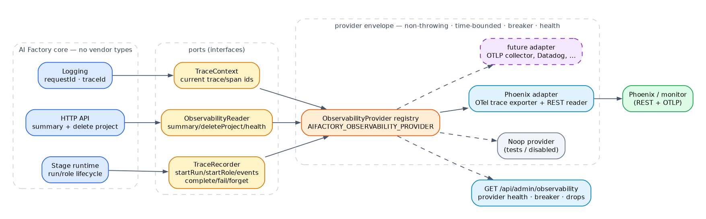

# Observability Ports — Phoenix Review and Refactor Plan

**Status:** complete — Phases 0–4 implemented 2026-11-13  
**Date:** 2026-11-13  
**Scope:** Phoenix trace/read integration, its coupling to the AI Factory core, and how to replace it with another monitor later.



---

## 1. Verdict

**Runtime isolation is strong. Structural replaceability is not.**

A dead or stopped Phoenix does not break stage runs, HTTP, logs or shutdown today. That was verified again on the current build with Phoenix stopped:

| Check | Result |
|---|---|
| Planning run | `awaiting_human`, HTTP 200 in **285 ms** |
| `GET /api/health` | 200 in **1.2 ms** |
| `GET /projects/:id/observability` | 200 in **15 ms**, `available:false` |
| `DELETE /projects/:id` | 204 in **23 ms** (Phoenix cleanup is background) |
| Phoenix exporter/client tests | **10 pass** |

However, Phoenix is **not modular**: vendor types and vendor semantics are spread across the stage runtime, HTTP server and composition root. Replacing Phoenix would require editing all three, not adding an adapter.

## 2. What is already good

Keep these; the refactor must preserve them:

- `ResilientSpanExporter` wraps OTLP export with a hard timeout, per-project circuit breaker, drop accounting and no throwing.
- Every `PhoenixTelemetry` method is wrapped and cannot throw into a stage run.
- Provider shutdown is bounded (3 s), so a dead OTLP endpoint cannot hold API shutdown.
- `PhoenixClient` REST calls have a 5 s timeout and a process-local breaker.
- Project deletion performs Phoenix cleanup in the background.
- `/observability` returns `available:false` instead of an error when Phoenix is down.
- Telemetry is optional; a missing/disabled Phoenix is a no-op.

These guarantees are tested in `test/phoenix.test.ts`, `test/phoenix-resilience.test.ts` and were validated live.

## 3. Findings

| # | Finding | Severity for replaceability | Evidence |
|---|---|---|---|
| F1 | **No observability ports.** `stage-runtime.ts` imports `PhoenixTelemetry` and calls it directly; `server.ts` imports `PhoenixClient` and `PhoenixError`; `api.ts` constructs both concrete classes. | **High** | `src/stage-runtime.ts` (type + calls), `src/server.ts` (options, error mapping), `src/api.ts` (composition) |
| F2 | **Stage runtime depends on the OTel `Span` API directly.** It calls `setAttribute`, `setStatus`, `recordException`, `end` and `spanContext()`, not just the telemetry object. Even a `Telemetry` interface would not remove this dependency. | **High** | `src/stage-runtime.ts` run-span/role-span code |
| F3 | **Trace/span correlation is wired to OTel globally.** Logging enriches records from `trace.getActiveSpan()`. A replacement monitor that does not use OTel would lose `traceId`/`spanId` correlation in logs unless the adapter also installs OTel. | **High** | `src/logging/context.ts` → `@opentelemetry/api` |
| F4 | **Read and write contracts are conflated.** `PhoenixClient` (REST reader) and `PhoenixTelemetry` (trace writer) are separate classes but share one `PhoenixConfig` and are constructed together; there is no provider lifecycle or single health object. | Medium | `src/phoenix.ts`, `src/api.ts` |
| F5 | **Per-project providers are unbounded.** Each project gets a `NodeTracerProvider` + `BatchSpanProcessor`. The map is never evicted, including when a project is deleted; only the Phoenix project is deleted. Long-lived instances with many projects accumulate providers, queues and timers. | **Medium** | `PhoenixTelemetry.providers` / `exporters`; `DELETE /projects` |
| F6 | **The read path has no overall deadline, cache or single-flight.** `listSpans` pages up to 10,000 spans; each page has a 5 s timeout. A dashboard polling `/observability` can hold requests for many seconds and continually hit Phoenix. | Medium | `PhoenixClient.listSpans` |
| F7 | **Vendor semantics leak into HTTP.** `503 PHOENIX_DISABLED`, `PhoenixError` mapping, and a response type named `PhoenixObservabilitySummary` are part of the API surface. A replacement must change HTTP codes/types, or expose misleading Phoenix names. | Medium | `src/server.ts`, `src/phoenix.ts` |
| F8 | **No generic observability health.** Exporter breaker/dropped-span state exists internally but is only visible to tests. There is no admin endpoint or UI indication that traces are being dropped while the app is healthy. | Medium | `PhoenixTelemetry.health()` not wired |
| F9 | **Configuration is provider-specific and parsed in the composition root.** `AIFACTORY_PHOENIX_*`, `OTEL_EXPORTER_OTLP_ENDPOINT`, project prefix, content capture and retention are assembled together in `api.ts`; adding a provider means editing bootstrap logic. | Medium | `src/api.ts` |
| F10 | **No contract tests prove a second provider works.** Tests verify Phoenix behavior, but nothing asserts that the core works with a different/no-op provider. Replaceability is therefore unproven. | Medium | `test/*` |

### What is *not* a problem

- Phoenix being down does **not** affect application logs, the log spool, PostgreSQL writes, project deletion or shutdown. The isolation envelope is doing its job.
- Stage runs are not awaiting exports; telemetry calls are synchronous and guarded.
- Observability data loss is acceptable and explicitly counted; the domain audit log remains separate and durable.

## 4. Target design

### 4.1 Ports, owned by the core

New `src/observability/` module with no Phoenix imports:

```ts
interface TraceSpan {
  readonly traceId: string
  readonly spanId: string
  setAttribute(key: string, value: string | number | boolean): void
  addEvent(name: string, attributes?: Record<string, unknown>): void
  recordException(error: unknown): void
  setStatus(status: 'ok' | 'error', message?: string): void
  end(): void
}

interface TraceRecorder {
  startRun(input: RunTraceInput): TraceSpan | undefined
  startRole(input: RoleTraceInput & { parent?: TraceSpan }): TraceSpan | undefined
  recordHarnessEvent(span: TraceSpan | undefined, event: HarnessEvent): void
  recordReview(span: TraceSpan | undefined, decision: string, findings: number): void
  recordDocument(span: TraceSpan | undefined, kind: string, path: string): void
  recordHumanDecision(projectId: string, runId: string, decision: string): void
  forgetProject(projectId: string): Promise<void>
  currentTraceContext(): { traceId: string; spanId: string } | undefined
}

interface ObservabilityReader {
  summary(projectId: string, hours: number): Promise<ObservabilitySummary>
  deleteProject(projectId: string): Promise<void>
  health(): ObservabilityHealth
}

interface ObservabilityProvider {
  readonly name: string
  readonly recorder: TraceRecorder
  readonly reader: ObservabilityReader
  shutdown(timeoutMs?: number): Promise<void>
}
```

`ObservabilitySummary`, `ObservabilityHealth` and all errors are provider-neutral DTOs. `NoopProvider` is the default in tests and when observability is disabled.

### 4.2 Phoenix becomes an adapter

Move the existing code behind the ports:

```text
src/observability/
  ports.ts          # interfaces + neutral DTOs
  noop.ts           # NoopProvider
  registry.ts       # provider id -> factory
  phoenix/
    provider.ts     # PhoenixProvider implements ObservabilityProvider
    exporter.ts     # ResilientSpanExporter (moved)
    client.ts       # REST reader -> ObservabilityReader
    telemetry.ts    # OTel writer -> TraceRecorder/TraceSpan
    config.ts       # AIFACTORY_PHOENIX_*/OTEL_* parsing
```

`api.ts` becomes the only place that imports a concrete provider:

```ts
const provider = createObservabilityProvider(config) // registry
stageRuntime = new PlanningStageRuntime({ ..., traces: provider.recorder })
server = createChatServer({ ..., observability: provider.reader })
logging = createLogging({ ..., traceContext: provider.recorder })
```

`stage-runtime.ts` no longer imports `@opentelemetry/api` or `phoenix.ts`.
`server.ts` no longer imports `PhoenixClient` or `PhoenixError`; it returns `503 OBSERVABILITY_DISABLED` and maps a generic `ObservabilityError`.
`logging/context.ts` obtains trace ids from the recorder port, not `trace.getActiveSpan()`.

### 4.3 Isolation envelope stays at the boundary

The provider contract requires every method to be non-throwing and time-bounded; the adapter is responsible, and the core still wraps calls defensively. Add:

- **Reader deadline + cache + single-flight:** one Phoenix fetch per project/window at a time; 15–30 s stale-while-revalidate cache; total deadline (e.g. 3 s) outside the per-page HTTP timeout.
- **Provider cap/eviction:** max active project providers (e.g. 64), idle eviction (e.g. 10 min), close on eviction; `forgetProject` on project deletion.
- **Generic health endpoint:** `GET /api/admin/observability` with provider name, enabled, breaker state, exports, failures, dropped spans, last error, provider count.
- **Startup isolation:** invalid provider config logs a warning and falls back to `NoopProvider`; it never prevents API startup.

### 4.4 Replaceability

Adding a provider should mean:

1. implement `ObservabilityProvider` in a new adapter folder;
2. register its factory;
3. select it with `AIFACTORY_OBSERVABILITY_PROVIDER=<name>`;
4. no changes to stage runtime, HTTP routes, logging or UI.

A simple `InMemoryObservabilityProvider` test adapter can prove this in CI before a real second backend is added.

## 4.5 Phase 0 implemented

Added:

- `src/observability/ports.ts` — `TraceSpan`, `TraceRecorder`, `ObservabilityReader`, `ObservabilityProvider`, neutral summary/health DTOs and `ObservabilityError`.
- `src/observability/noop.ts` — `NoopObservabilityProvider`, `NoopObservabilityReader`, `noopProvider`.
- `src/observability/index.ts` — public exports.
- `test/observability-ports.test.ts` — no-op contract, error shape, no vendor imports, guard smoke test.
- `scripts/check-observability-imports.mjs` — scans import specifiers; fails on vendor imports in the ports module. Prints current core violations as warnings; `npm run check:observability:strict` fails until Phase 1 removes them.
- `package.json` — `check:observability` and `check:observability:strict` scripts.

The running API is unchanged: no core file uses the ports yet. The strict guard currently reports the four known legacy imports (`stage-runtime.ts` → Phoenix/OTel, `server.ts` → Phoenix, `logging/context.ts` → OTel), which is the Phase 1 checklist.

## 4.6 Phase 1 implemented

The core now uses the ports:

- `stage-runtime.ts` uses `TraceRecorder`/`TraceSpan`; no Phoenix or OpenTelemetry import, no direct `Span` calls.
- `server.ts` accepts `ObservabilityReader`, returns `503 OBSERVABILITY_DISABLED`, and maps `ObservabilityError`.
- `logging/context.ts` gets trace ids from an injected trace-context source; no OTel import.
- `api.ts` is the only composition point: it creates a `PhoenixObservabilityProvider` through `src/observability/phoenix/index.ts`, passes `provider.recorder` to the stage runtime and `provider.reader` to the server.
- `check:observability:strict` now passes: **0 legacy core imports**.

Behavior is preserved: 113 tests pass, including the Phoenix resilience suite. Phase 2 still moves the legacy `src/phoenix.ts` implementation under `src/observability/phoenix/` and removes the adapter's dependency on the old file.

## 4.7 Phase 2 implemented

Phoenix now lives entirely inside its adapter directory; the legacy `src/phoenix.ts` is deleted.

```text
src/observability/
  ports.ts            # vendor-free contracts
  noop.ts             # no-op provider
  registry/index.ts   # provider registry + env selection
  phoenix/
    config.ts         # PhoenixConfig + phoenixConfigFromEnv
    errors.ts         # PhoenixError
    summary.ts        # span DTOs + summarizeSpans
    exporter.ts       # ResilientSpanExporter + settleWithin
    client.ts         # REST reader
    telemetry.ts      # OTLP writer
    provider.ts       # ObservabilityProvider adapter
    index.ts          # public adapter surface
```

Provider selection:

```text
AIFACTORY_OBSERVABILITY_PROVIDER=phoenix|noop|<registered>
  → explicit choice wins
  → otherwise Phoenix when AIFACTORY_PHOENIX_ENABLED is on
  → otherwise noop
```

An unknown name, a throwing factory, or a config that fails to build falls back to `noop`; observability can never prevent startup.

Verified live:

| Scenario | Result |
|---|---|
| `AIFACTORY_OBSERVABILITY_PROVIDER=noop` with Phoenix enabled | Planning run fine; **no Phoenix project created**; `/observability` returns `available:false, reason:"observability is disabled"` |
| Default Phoenix provider | 4 spans + correct role summary; project deletion works |
| Full suite | **118 tests pass** |
| Strict import guard | 3 port files clean, 0 legacy core imports |

## 4.8 Phase 3 implemented

**Reader hardening** (`src/observability/cached-reader.ts`, provider-neutral):

- TTL cache per `projectId:windowHours` (default 15 s, `AIFACTORY_OBSERVABILITY_CACHE_TTL_MS`).
- Single-flight: concurrent reads for the same key share one backend call.
- Overall deadline (default 3 s, `AIFACTORY_OBSERVABILITY_DEADLINE_MS`) independent of per-page HTTP timeouts.
- Stale fallback: a failed refresh returns the previous summary with `stale: true` and `cachedAt`.
- Unavailable results are cached briefly, so a dead backend is polled once per TTL, not once per request.
- Bounded cache (500 entries); `deleteProject` invalidates that project's windows.

**Provider lifecycle** (`PhoenixTelemetry`):

- Cap of 64 live per-project tracer providers (`AIFACTORY_PHOENIX_MAX_PROVIDERS`), LRU eviction.
- Idle eviction after 10 min (`AIFACTORY_PHOENIX_PROVIDER_IDLE_MS`), swept every minute.
- `forgetProject(projectId)` closes and removes a project's provider; called on project deletion through the recorder port.

**Health** (`GET /api/admin/observability`):

- `state` now combines the OTLP exporter breaker **and** the REST reader breaker (`healthy`/`degraded`/`open`/`disabled`).
- Reports live provider count, span-batch and REST request counts, total failures, dropped spans and last error.
- `cache` block: entries, hits, misses, deadline timeouts, TTL and deadline.
- Admin-only (bearer token, or loopback when no token is configured); `503 OBSERVABILITY_DISABLED` when off.

Live verification with Phoenix stopped:

| Check | Result |
|---|---|
| Cached read while healthy | 19 ms first, **0.9 ms** cached |
| Read after Phoenix stopped (TTL expired) | **3 ms**, `available:true, stale:true` |
| `/api/admin/observability` during outage | `state:"degraded"`, `failures:1`, `lastError:"fetch failed"` |
| `/api/health` during outage | 200 in **0.8 ms** |
| Full suite | **134 tests pass** |
| Strict import guard | 4 port files clean, 0 legacy core imports |

## 4.9 Phase 4 implemented — replaceability proven

**New adapter:** `src/observability/memory.ts` — `MemoryObservabilityProvider`, a bounded in-memory recorder/reader selected with `AIFACTORY_OBSERVABILITY_PROVIDER=memory`. It exists to exercise the ports end to end (tests, local development) and to prove that a provider swap needs no core changes.

**Contract tests:** `test/observability-contract.test.ts` runs the same seven invariants against **noop and memory**. Adding an adapter means adding one line to that list.

**Replaceability proof:** `test/observability-swap.test.ts` runs the *real* `PlanningStageRuntime` and PostgreSQL workspace against providers chosen purely by configuration:

| Provider | Result |
|---|---|
| `memory` | run reached `awaiting_human`; summary reported **1 trace, 4+ spans**, roles `analyzer/author/reviewer`; `forgetProject` dropped the spans |
| `noop` | same run completes normally, summary `available:false`, zero spans |

**Live HTTP proof** (`AIFACTORY_OBSERVABILITY_PROVIDER=memory` while `AIFACTORY_PHOENIX_ENABLED=1`):

- `/api/projects/:id/observability` → 1 trace, 4 spans, 3 roles — served from the memory provider;
- `/api/admin/observability` → `provider:"memory"`, `exports:4`;
- Phoenix received **no project** for that id, proving the explicit provider overrides Phoenix and nothing else touched it.

**Authoring guide:** [OBSERVABILITY-ADAPTERS.md](OBSERVABILITY-ADAPTERS.md) documents the port contract, invariants, registration, selection, testing and a checklist.

## 5. Plan

### Phase 0 — Contract and guardrails (no behavior change)

- Add `ports.ts`, neutral DTOs, `NoopProvider`, contract tests.
- Define explicit invariants: no throws, finite deadlines, no vendor types outside adapter.
- Add a lint/CI check that `src/stage-runtime.ts`, `src/server.ts` and `src/logging/` do not import `phoenix.ts` or OpenTelemetry.

### Phase 1 — Extract ports in the core

- `stage-runtime`: `telemetry?: PhoenixTelemetry` → `traces: TraceRecorder`; replace direct `Span` calls with `TraceSpan`.
- `server`: `phoenix?: PhoenixClient` → `observability?: ObservabilityReader`; generic error codes.
- `logging`: trace enrichment via recorder port; keep request context independent.
- Wire `NoopProvider` in tests; run the full suite before touching Phoenix.

### Phase 2 — Move Phoenix behind the adapter

- Move `ResilientSpanExporter`, `PhoenixTelemetry` and `PhoenixClient` into `src/observability/phoenix/`.
- Implement `PhoenixProvider`, config parser and registry.
- `api.ts` constructs only the provider; remove all other Phoenix references.
- Preserve current behavior and tests; update imports.

### Phase 3 — Harden the boundary

- Reader cache, single-flight and overall deadline.
- Provider cap/LRU, idle eviction, `forgetProject` on delete.
- `/api/admin/observability`; generic `503 OBSERVABILITY_DISABLED`; health in the UI prompt.
- Tests: Phoenix down/hung/slow, reader timeout, cache, provider eviction, shutdown.

### Phase 4 — Prove replaceability

- Add `InMemoryObservabilityProvider` (test only) and a test that swaps it via config without touching core files.
- Optionally add a second OTLP-backed adapter later; do not make OTel a requirement for the reader.
- Document adapter authoring in `docs/design/`.

## 6. Acceptance criteria

- [x] No `phoenix`/`Phoenix*` imports in `stage-runtime.ts`, `server.ts` or `logging/`; only `src/observability/phoenix/` and the registry know the adapter.
- [x] `AIFACTORY_OBSERVABILITY_PROVIDER=noop` runs the full suite with no vendor imports and no network calls.
- [x] A fake provider can be substituted with no changes outside configuration/composition (proven by the memory adapter).
- [x] Phoenix stopped, crashed or hung: stage runs, health, logs, project deletion and shutdown pass the existing isolation tests.
- [x] `/observability` is bounded, cached and single-flight; provider count is capped and evicted.
- [x] `/api/admin/observability` reports breaker, dropped spans and last error.
- [x] Public API no longer exposes `PHOENIX_DISABLED`/`PhoenixError`.

## 7. Open decisions

1. **Is OTel the canonical write protocol?** Recommended yes: keep OTLP as the export format so future monitors with an OTLP collector work, while the reader remains adapter-specific.
2. **Single provider or fan-out?** Start with one active provider; a composite recorder/reader can later fan out to Phoenix + another backend.
3. **Reader caching window:** 15 s stale-while-revalidate is a reasonable start; confirm expected dashboard freshness.
4. **Retention semantics:** provider-neutral `ObservabilitySummary` should state its window; Phoenix remains 24 h by default.
5. **Provider cap:** 64 active project providers and 10 min idle eviction, tunable by env.

## 8. Effort

Approximate, assuming current tests stay green:

| Phase | Effort |
|---|---|
| 0 — contracts/guardrails | 0.5 day |
| 1 — core ports | 1–1.5 days |
| 2 — Phoenix adapter | 1 day |
| 3 — hardening | 1–1.5 days |
| 4 — replaceability proof | 0.5 day |
| **Total** | **4–5 days** |
