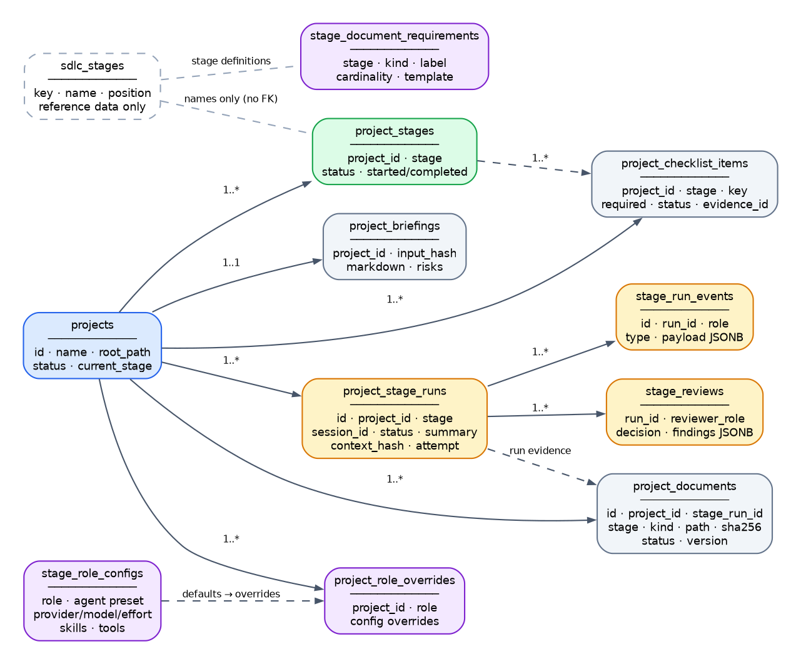
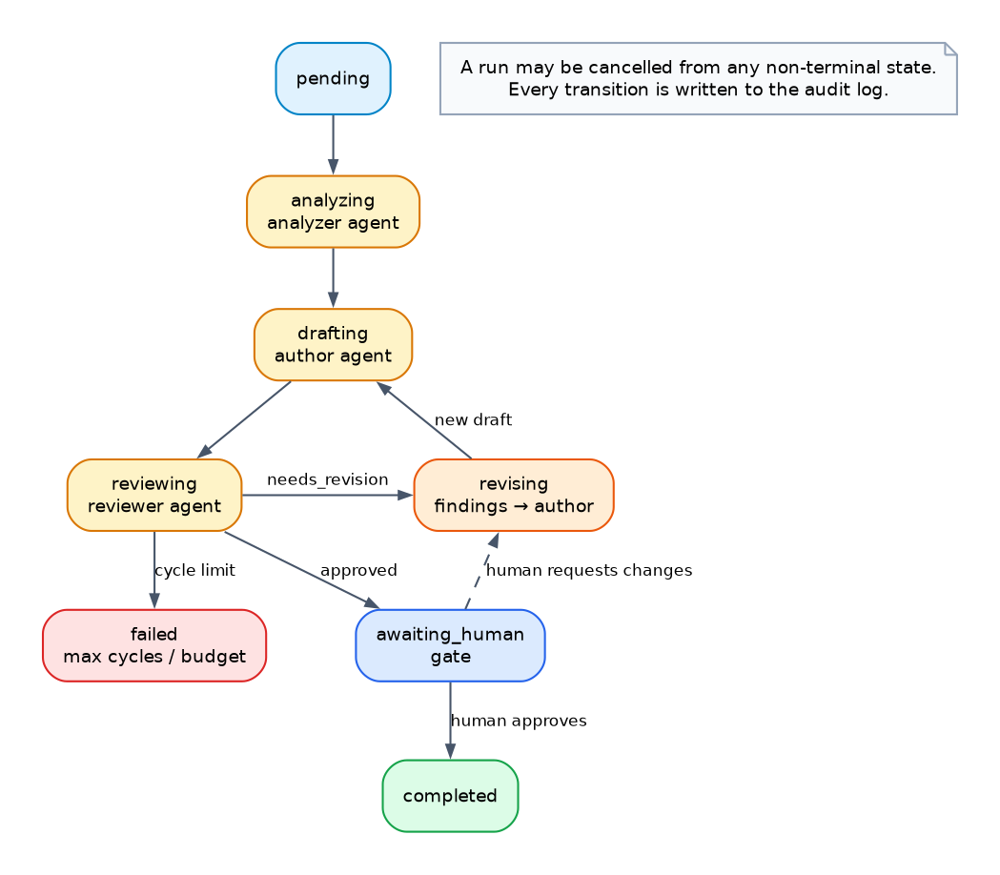
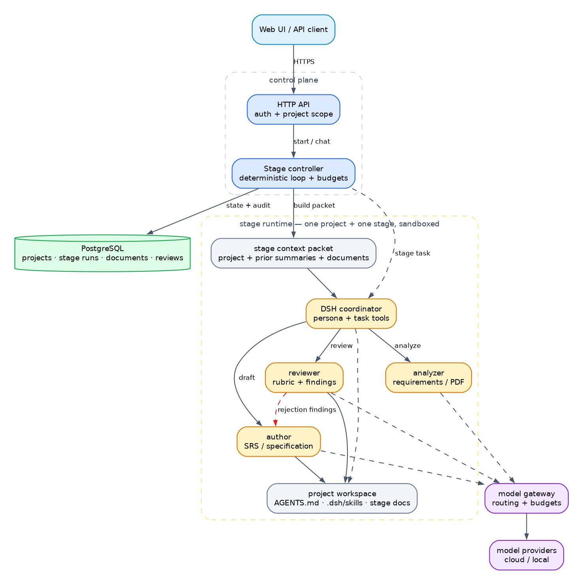
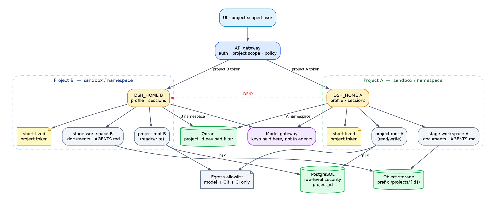
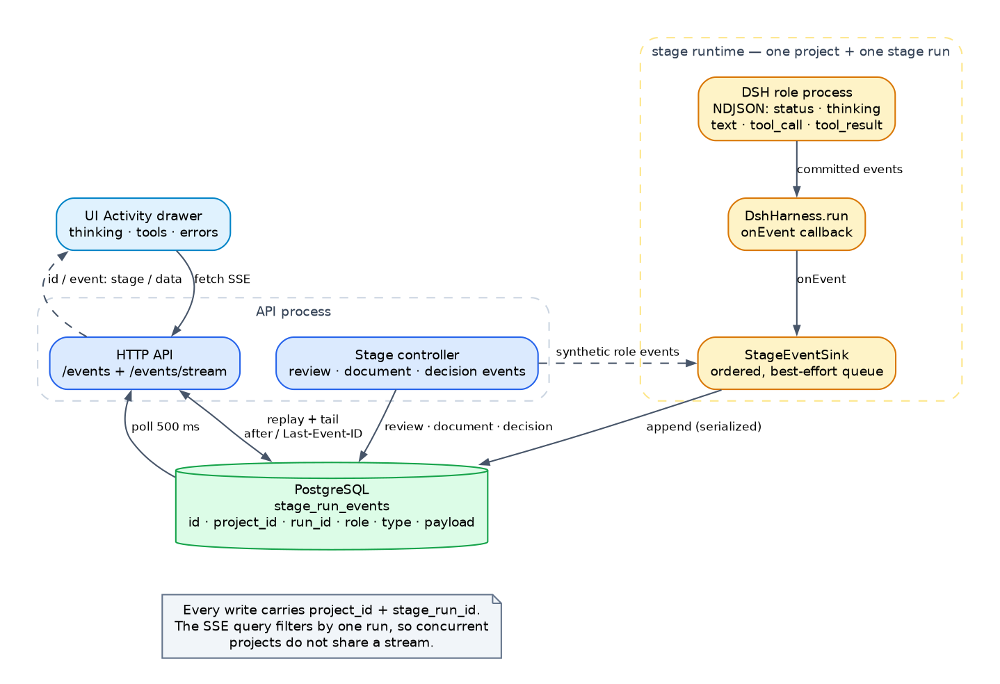
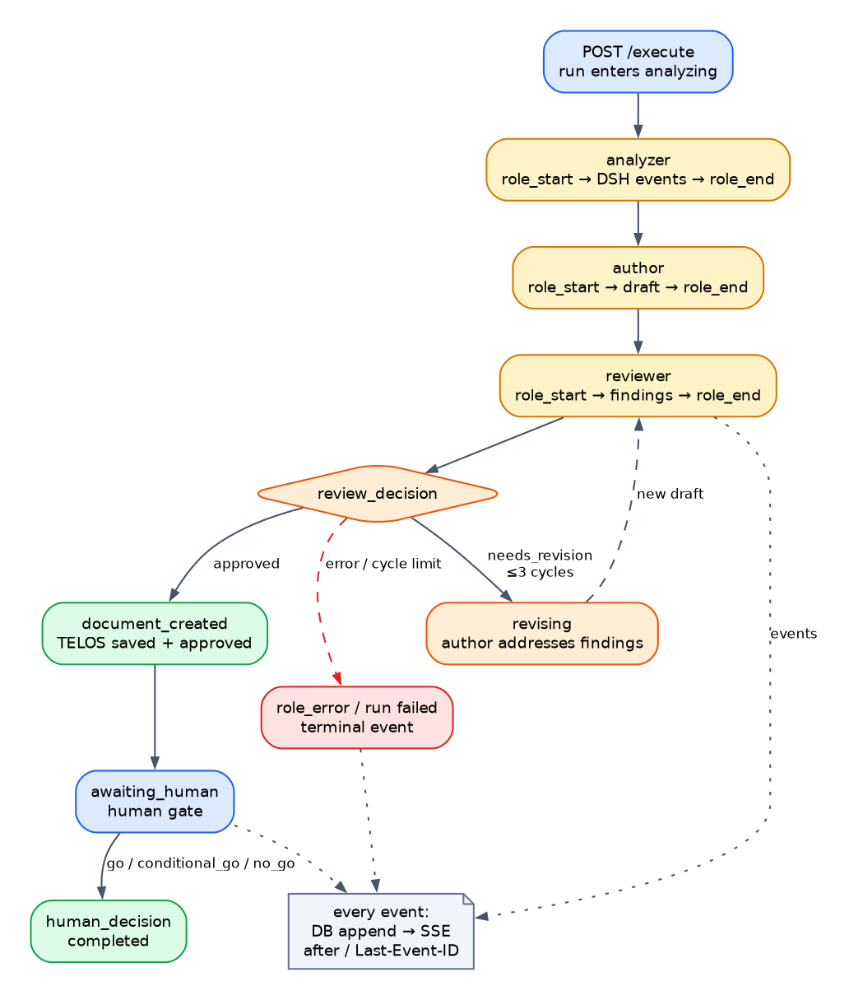

# Stage Runtime and Project Isolation — Design Proposal

**Status:** implemented (planning stage); the current system is described in [`../ARCHITECTURE.md`](../ARCHITECTURE.md)  
**Date:** 2026-11-10 (status updated 2026-11-17)  
**Scope:** stage-scoped execution, stage coordination, role agents, document review loops, per-project harness configuration, project security and isolation

This document turns the current project/status implementation into a stage-oriented runtime. It records the design decisions, data model, API shape, agent orchestration and security boundaries before implementation. Diagrams are in [`diagrams/`](diagrams/).

---

## 1. Summary

Each SDLC stage becomes a **stage run**: a durable, auditable execution with its own session, context packet, coordinator, role agents, documents, review history and summary.

The project remains the parent. A stage run receives:

- the project record;
- current stage state and checklist;
- summaries and decisions from completed stages;
- references to project documents;
- stage-specific rules and skills.

The platform, not the model, owns the state machine:

```text
analyze → draft → review → revise (bounded) → human gate → complete
```

A DSH coordinator can reason about the work and delegate to role agents, but the AI Factory **stage controller** enforces ordering, budgets, retries, review-cycle limits and human gates.

Project isolation is a first-class concern, not an afterthought. The target model is **one project sandbox, one project DSH home, one stage session at a time, short-lived credentials, project-scoped data access and an audited model gateway**.

---

## 2. Requirements interpreted

| ID | Requirement | Interpretation |
|---|---|---|
| R-01 | Each stage runs separately | A stage run is a durable entity with its own session and status. |
| R-02 | User can chat about an individual stage | Stage-scoped chat, not project-wide chat. |
| R-03 | Stage has project context | Context packet built from project, stage state, documents and previous summaries. |
| R-04 | Stage has previous stage outcomes | Prior stage summaries, decisions and artifact references are included. |
| R-05 | Document stage progress | Stage run summary, review records, document versions and checklist history. |
| R-06 | AGENTS.md references actual documents | A generated managed block contains paths/IDs, not full document contents. |
| R-07 | Stage acts as coordinator | Coordinator delegates to analyzer, author and reviewer agents. |
| R-08 | Reviewer rejection returns to author | Deterministic revision loop with findings, max cycles and escalation. |
| R-09 | Roles have custom skills/rules/model/temperature | Role configuration is separate from project configuration. |
| R-10 | Project security and isolation | Project-scoped auth, filesystem, runtime, credentials, storage and audit. |

**Naming note:** DSH loads `AGENTS.md` (plural), `CLAUDE.md`, and local overlays such as `AGENTS.local.md`. There is no singular `AGENT.md` convention.

---

## 2.1 Planning & Feasibility specialization

The first implemented stage is **Planning & Feasibility**. It deliberately does **not** produce an SRS or functional specification. It produces one **TELOS feasibility report**.

TELOS covers:

| Dimension | Question |
|---|---|
| **T**echnical | Can we build it with available technology and skills? |
| **E**conomic | Is the cost justified by the expected benefit? |
| **L**egal | Can we operate within legal, contractual and compliance constraints? |
| **O**perational | Can the organisation run and support it? |
| **S**chedule | Can it be delivered within the required dates and dependencies? |

### Stage checklist

| Key | Meaning | Required |
|---|---|---|
| `business_idea` | High-level business idea and problem statement are captured | yes |
| `stakeholder_goals` | Stakeholder goals, success measures and constraints are captured | yes |
| `telos_report` | The single TELOS feasibility report is provided | yes |
| `feasibility_decision` | Go / conditional-go / no-go decision and conditions are recorded | yes |

The business idea and stakeholder goals are inputs captured as checklist evidence; the only planning **document** is the TELOS report.

### Document slot

`stage_document_requirements` defines one planning document slot:

```text
stage = planning
kind = telos_report
cardinality = one
required = true
```

The seeded template has sections for executive summary, business idea/context, stakeholder goals, Technical, Economic, Legal, Operational and Schedule feasibility, risks/assumptions, recommendation and open questions.

### Planning roles

| Role | Planning-specific job |
|---|---|
| Analyzer | Extract business context, stakeholder goals, constraints and missing TELOS evidence. |
| Author | Draft the single TELOS report from the template and analysis. |
| Reviewer | Check each TELOS dimension, testability of assumptions, and decision quality. |
| Coordinator | Keep the review loop on the TELOS document; do not create an SRS. |

The database foundation and the Planning & Feasibility controller are in place. The analyzer → TELOS author → reviewer loop, bounded revisions, document persistence and human decision gate run end-to-end. Stage-scoped chat and configurable role models are next.

---

## 3. Design decisions

| ID | Decision | Rationale |
|---|---|---|
| D-01 | Add `project_stage_runs`; do not overload `project_stages` | A stage can be retried and has multiple review cycles. |
| D-02 | Use a deterministic stage controller plus an LLM coordinator | Loop limits, gates and audit cannot depend on model obedience. |
| D-03 | Build a context packet; never replay project chat history | Lower token cost and no cross-stage context contamination. |
| D-04 | One stage session per run; fresh context at stage boundaries | Stage isolation and reproducible runs. |
| D-05 | Role config is global by default, project-overridable | Matches the planned AI Factory settings model. |
| D-06 | Generate a managed AGENTS.md block with document references | Keeps instructions short and artifact locations discoverable. |
| D-07 | Per-project sandbox + per-project DSH home | Strong isolation without one global runtime pretending to be isolated. |
| D-08 | Tool restriction through agent presets, not a tool allowlist | `toolFilter` was removed from subagents; preset composition is the supported mechanism. |
| D-09 | Reviewer uses a different model family where possible | Reduces correlated review blind spots. |
| D-10 | AI writing is optional decoration; status is deterministic | The UI must remain correct without an LLM call. |

---

## 4. Data model



### 4.1 New stage run table

```sql
CREATE TABLE project_stage_runs (
  id UUID PRIMARY KEY,
  project_id UUID NOT NULL REFERENCES projects(id) ON DELETE CASCADE,
  stage TEXT NOT NULL,
  attempt INTEGER NOT NULL DEFAULT 1,
  session_id TEXT,
  status TEXT NOT NULL DEFAULT 'pending'
    CHECK (status IN (
      'pending', 'analyzing', 'drafting', 'reviewing', 'revising',
      'awaiting_human', 'completed', 'failed', 'cancelled'
    )),
  context_hash TEXT,
  summary_markdown TEXT,
  started_at TIMESTAMPTZ,
  completed_at TIMESTAMPTZ,
  created_at TIMESTAMPTZ NOT NULL DEFAULT now(),
  updated_at TIMESTAMPTZ NOT NULL DEFAULT now()
);

CREATE INDEX project_stage_runs_project_stage_idx
  ON project_stage_runs (project_id, stage, created_at DESC);
```

A project may have multiple runs per stage; the UI displays the latest and preserves history.

### 4.2 Review records

```sql
CREATE TABLE stage_reviews (
  id UUID PRIMARY KEY,
  stage_run_id UUID NOT NULL REFERENCES project_stage_runs(id) ON DELETE CASCADE,
  reviewer_role TEXT NOT NULL,
  decision TEXT NOT NULL
    CHECK (decision IN ('approved', 'needs_revision', 'rejected')),
  findings JSONB NOT NULL DEFAULT '[]'::jsonb,
  created_at TIMESTAMPTZ NOT NULL DEFAULT now()
);
```

Findings are structured:

```json
[
  {
    "id": "F-001",
    "severity": "blocker",
    "section": "3.2 Payments",
    "finding": "Refund policy is undefined.",
    "required_change": "Define refund eligibility, timing and approval path.",
    "evidence": "requirements.pdf p.4"
  }
]
```

### 4.3 Documents and versions

`project_documents` gains:

```sql
ALTER TABLE project_documents
  ADD COLUMN IF NOT EXISTS stage_run_id UUID
  REFERENCES project_stage_runs(id) ON DELETE SET NULL;
```

Documents remain versioned. A new SRS revision is a new row with `version + 1` and a `supersedes` relationship, or a `parent_document_id` column. The design recommends a `parent_document_id` self-reference:

```sql
ALTER TABLE project_documents
  ADD COLUMN IF NOT EXISTS parent_document_id UUID
  REFERENCES project_documents(id);
```

### 4.4 Role configuration

```sql
CREATE TABLE stage_role_configs (
  role TEXT PRIMARY KEY,             -- requirements_analyzer, requirements_author…
  agent_preset TEXT NOT NULL,
  provider TEXT,
  model TEXT,
  reasoning_effort TEXT,
  max_tokens INTEGER,
  temperature NUMERIC,               -- adapter-dependent; see §8.3
  skills JSONB NOT NULL DEFAULT '[]'::jsonb,
  tools JSONB NOT NULL DEFAULT '[]'::jsonb,
  system_prompt TEXT,
  updated_at TIMESTAMPTZ NOT NULL DEFAULT now()
);

CREATE TABLE project_role_overrides (
  project_id UUID NOT NULL REFERENCES projects(id) ON DELETE CASCADE,
  role TEXT NOT NULL,
  config JSONB NOT NULL,
  updated_at TIMESTAMPTZ NOT NULL DEFAULT now(),
  PRIMARY KEY (project_id, role)
);
```

The table is for the future AI Factory settings screen. For the first implementation, roles can be loaded from a versioned YAML file and cached in memory, then moved into the table.

### 4.5 Document requirements

```sql
CREATE TABLE stage_document_requirements (
  stage TEXT NOT NULL,
  kind TEXT NOT NULL,
  label TEXT NOT NULL,
  description TEXT NOT NULL DEFAULT '',
  cardinality TEXT NOT NULL DEFAULT 'one'
    CHECK (cardinality IN ('one', 'many')),
  required BOOLEAN NOT NULL DEFAULT true,
  template_markdown TEXT,
  PRIMARY KEY (stage, kind)
);
```

Seeded planning row:

```text
planning / telos_report / cardinality = one / required = true
```

`project_checklist_items` also gains `active BOOLEAN NOT NULL DEFAULT true` so changed stage definitions can retire old items without deleting historical evidence.

### 4.6 Stage event log

Every role turn writes an ordered event row:

```sql
CREATE TABLE stage_run_events (
  id BIGSERIAL PRIMARY KEY,
  project_id UUID NOT NULL REFERENCES projects(id) ON DELETE CASCADE,
  stage_run_id UUID NOT NULL REFERENCES project_stage_runs(id) ON DELETE CASCADE,
  role TEXT,
  agent_id TEXT,
  type TEXT NOT NULL,
  phase TEXT,
  payload JSONB NOT NULL DEFAULT '{}'::jsonb,
  created_at TIMESTAMPTZ NOT NULL DEFAULT now()
);
```

The stage runtime attaches `onEvent` to `harness.run`, tags each event with the
role, and serializes writes so database order matches model event order. Synthetic
`role_start`, `role_end` and `role_error` rows make duration visible even when the
model is silent. Reviews, document creation and human decisions are also events.

`GET /api/stage-runs/:runId/events` returns JSON. `GET
/api/stage-runs/:runId/events/stream` replays from `after` / `Last-Event-ID` and
then tails the DB every 500 ms. Events are filtered by `stage_run_id`, which is the
project-isolation boundary for the stream.

### 4.7 Existing tables

| Table | Role in the new model |
|---|---|
| `projects` | Parent; `current_stage` remains the current phase |
| `project_stages` | Current stage status and checklist summary |
| `project_checklist_items` | Stage evidence/gates |
| `project_documents` | Artifacts, now optionally tied to a run |
| `project_briefings` | Project-level AI narrative; separate from stage summaries |
| `sdlc_stages` | Display names/order only; no FK from project stages |

---

## 5. Stage context packet

The context packet is assembled before the run and at every model step where the stage changes materially.

```json
{
  "schemaVersion": 1,
  "project": {
    "id": "…",
    "name": "customer-portal",
    "rootPath": "/srv/projects/customer-portal",
    "organization": "Acme",
    "ownerEmail": "owner@acme.example",
    "status": "active",
    "currentStage": "requirements"
  },
  "stage": {
    "key": "requirements",
    "status": "in_progress",
    "checklist": [
      { "key": "requirement_document", "status": "done" },
      { "key": "acceptance_criteria", "status": "open" }
    ]
  },
  "priorStages": [
    {
      "stage": "planning",
      "status": "completed",
      "summary": "Scope: customer invoice portal. Goal: self-service payments.",
      "decisions": ["Use existing identity provider"],
      "documents": [".aifactory/stages/planning/telos.md"]
    }
  ],
  "documents": [
    {
      "id": "…",
      "stage": "requirements",
      "kind": "requirement_pdf",
      "path": ".aifactory/stages/requirements/requirements.pdf",
      "status": "uploaded"
    }
  ],
  "openQuestions": [],
  "constraints": {
    "maxReviewCycles": 3,
    "toolScope": ["fs_read", "fs_search", "pdf_read"],
    "tokenBudget": 250000
  }
}
```

Rules:

- The packet is **generated**, never edited by an agent. `toolScope` is advisory metadata; the role preset is the enforcement boundary.
- It contains document **references**, not PDF bodies or full SRS text.
- Prior stages contribute summaries, decisions and paths; full prior documents are available on demand.
- The packet is hashed into `context_hash` and attached to the run for audit.
- A context change that invalidates the hash does not silently mutate a running review; it creates a new run attempt.

---

## 6. Stage lifecycle



| State | Owner | Meaning |
|---|---|---|
| `pending` | Controller | Run created, not started |
| `analyzing` | Analyzer agent | Read project/stage context, identify gaps and inputs |
| `drafting` | Author agent | Produce or revise the stage artifact |
| `reviewing` | Reviewer agent | Score against rubric, produce findings |
| `revising` | Author agent | Address findings from reviewer or human |
| `awaiting_human` | Human | Automated review passed; human gate |
| `completed` | Controller | Checklist and gate satisfied |
| `failed` | Controller | Max cycles, budget or unrecoverable error |
| `cancelled` | Human/controller | Explicit stop |

Rules:

- Maximum review cycles: **3** by default.
- A revision loop must include new evidence; repeated identical findings trigger escalation, not another cycle.
- Human gate is mandatory for stage completion even when the reviewer approves.
- A stage advance (project `current_stage`) is a separate transaction from a stage run completion; both are audited.
- The controller writes a `stage_reviews` row for every decision.
- The controller records token/cost/CPU/wall-clock usage per run.

### 6.1 Run leases and recovery

Execution is claimed through the database, not only an in-process set:

```sql
project_stage_runs:
  locked_by TEXT
  lease_expires_at TIMESTAMPTZ
  execution_attempts INTEGER NOT NULL DEFAULT 0
```

Claim:

```sql
UPDATE project_stage_runs
SET locked_by = $worker,
    lease_expires_at = now() + ($lease_ms * interval '1 millisecond'),
    execution_attempts = execution_attempts + 1
WHERE id = $run
  AND status NOT IN ('completed','failed','cancelled','awaiting_human')
  AND (locked_by IS NULL OR lease_expires_at IS NULL OR lease_expires_at < now())
RETURNING ...;
```

The stage runtime:

- claims before any role call;
- renews the lease every 30 seconds (default lease: 120 seconds);
- releases the lease on success, failure or cancellation;
- rejects a second worker with `409 STAGE_RUN_LEASED`.

Recovery:

- at API startup and every 60 seconds, `recoverStrandedRuns()` selects active
  runs whose lease expired with `FOR UPDATE SKIP LOCKED`;
- the run is marked `failed`, the lease is cleared, and a `run_recovered` event
  is appended;
- the user can create a new attempt.

A stranded run is deliberately not auto-retried. Re-running would spend model
tokens and could duplicate document writes. Recovery makes the state explicit;
retry remains a user action.

---

## 7. Coordinator and role agents



### 7.1 Coordinator

The coordinator:

- receives the context packet and the user’s stage message;
- restates the objective, acceptance criteria and write scope;
- decides which role to call next within the controller’s allowed transitions;
- writes task contracts;
- summarizes outcomes for the user.

The coordinator does **not**:

- approve its own artifacts;
- change stage state directly;
- exceed the review-cycle or token budget;
- read another project’s data.

### 7.2 Roles

| Role | Input | Output | Typical skills |
|---|---|---|---|
| Analyzer | Context packet, requirement PDF, prior summaries | Structured analysis: gaps, ambiguities, questions, risks | requirements analysis, domain research, PDF extraction |
| Author | Analysis, template, prior artifacts | Draft the stage artifact (TELOS in planning, SRS/design later), document version | stage-specific writing, template conformance |
| Reviewer | Draft, rubric, project constraints | Findings + decision + score | requirements review, testability review |
| Coordinator | Context, role outputs, user message | Plan, task assignments, stage summary | project coordination |

### 7.3 Review loop

```text
analyzer → author → reviewer
                ↑        │
                └─ findings
```

The controller:

1. calls the analyzer;
2. calls the author with the analysis;
3. calls the reviewer with the draft;
4. if `needs_revision`, sends findings back to the **same author role**;
5. repeats at most three times;
6. on approval, creates an `awaiting_human` gate;
7. records all reviews and artifact versions.

The reviewer must be a different agent instance from the author, preferably a different model family. The author cannot approve its own work.

---

## 8. Role configuration

### 8.1 Global defaults, project overrides

```text
AI Factory settings (DB) → stage role configs
Project overrides (DB) → effective role config
Project files → AGENTS.md, skills, stage briefs
```

Resolution order:

1. platform defaults;
2. AI Factory role config;
3. project role override;
4. project/stage files for context and skills.

### 8.2 Fields

| Field | Example | Notes |
|---|---|---|
| `agent_preset` | `requirements_author` | DSH preset composition |
| `provider` | `deepseek-official` | Route registered in model gateway |
| `model` | `deepseek-v4-pro` | Provider-owned id |
| `reasoning_effort` | `high` | “Thinking level” |
| `max_tokens` | `16000` | Per-request cap |
| `temperature` | `0.2` | Adapter-dependent; see §8.3 |
| `skills` | `["srs-writing"]` | Skill names or project skill dirs |
| `tools` | `["fs_read","fs_write"]` | Compiled into the role preset; not a runtime filter |
| `system_prompt` | role instructions | Preset persona/instructions |

### 8.3 Temperature and tool choice caveats

- DSH `AgentOptions` supports `provider`, `model`, `reasoningEffort` and `maxTokens` directly.
- **Temperature** is supported by the LLM request configuration, but it is not a first-class per-agent `AgentOptions` field in this preview. Per-role temperature needs a small provider route or request hook. Do not assume a YAML `temperature:` on an agent preset works until verified against the installed adapter.
- **Tool choice** (`tool_choice`) is not part of the DSH core request vocabulary. The coordinator cannot force a specific tool call through configuration. Control behavior through:
  - which tools the role preset mounts;
  - prompt/task contracts;
  - permissions and approval policy;
  - deterministic controller steps.
- Tool restriction is by **agent preset composition**. The old subagent `toolFilter` was removed. A coder preset that mounts only file/edit/test tools is the supported way to limit capability.

### 8.4 Coder subagents

| Provider | Use |
|---|---|
| `spawn` | DSH-native coder with its own preset |
| `fork` | Fork parent context; inherits preset/tools |
| `claude-code` | Claude Code subprocess |
| `codex` | Codex subprocess |
| `dsh-sdk` | Nested DSH with own `dshHome`, profile, patches |
| `acp` | Generic ACP-compatible external agent |

Pi and opencode are not bundled providers in this checkout. Use ACP if they expose an ACP server, or write a `ctx.subagents` provider. Avoid scraping CLI text.

---

## 9. Harness setup per stage

### 9.1 Workspace layout

```text
<project>/
├── AGENTS.md                         # project-wide rules
├── .dsh/
│   ├── skills/                       # project skills
│   ├── home/                         # isolated DSH_HOME for this project
│   └── stages/
│       └── requirements/
│           ├── AGENTS.md             # stage rules/context
│           ├── stage.md              # generated stage brief
│           ├── documents/            # stage documents/versions
│           └── reviews/              # reviewer findings
```

Stage work should not write into another stage’s directory. The project root remains the code workspace for development stages.

### 9.2 Launch model

```sh
cd <project>/.dsh/stages/requirements
DSH_HOME=<project>/.dsh/home \
dsh --profile headless \
  --patch <project>/.dsh/aifactory.patch.yml \
  --add-dir <project>
```

- `cwd` controls instructions, skills and default file scope.
- `--add-dir` grants the project root when the stage needs it.
- `DSH_HOME` isolates profiles, sessions and credentials.
- `--patch` supplies the stage role model, tools, subagent providers and persona.
- The stage coordinator runs in the same sandbox as its role subagents.

### 9.3 AGENTS.md managed block

`AGENTS.md` is for stable instructions and **actual references**, not document bodies:

```md
<!-- AIFACTORY:BEGIN -->
## Current stage: Requirements

- Stage brief: .aifactory/stages/requirements/stage.md
- Source requirement: .aifactory/stages/requirements/documents/requirements.pdf
- SRS draft: .aifactory/stages/requirements/documents/srs.v2.md
- Review findings: .aifactory/stages/requirements/reviews/run-2.md
- Open checklist: acceptance_criteria, requirements_review
<!-- AIFACTORY:END -->
```

The block is regenerated when the run, documents or checklist change. Manual instructions stay outside the markers.

---

## 10. Project security and isolation



### 10.1 Current posture

The current implementation has:

- a global API bearer token, not user/project-scoped auth;
- one shared `DSH_HOME` and one API process;
- stage documents under the project root;
- project rows in PostgreSQL without row-level security;
- no per-project container/namespace;
- one shared model gateway key path.

This is acceptable for a local single-user prototype. It is **not sufficient** for multiple projects or untrusted content.

### 10.2 Isolation levels

| Level | Mechanism | Use |
|---|---|---|
| L0 | Logical only: project_id filters | Prototype, single trusted user |
| L1 | Per-project `DSH_HOME`, project-scoped cwd, sandbox policy, scoped token | Baseline for document stages |
| L2 | Per-project container/namespace + L1 + per-project storage prefix + egress allowlist | **Recommended for code stages** |
| L3 | Dedicated tenant cluster/namespace with separate DB/object/Qdrant | Regulated or hostile tenants |

The target for the AI Factory is **L2**.

### 10.3 Trust boundaries

| Boundary | Risk |
|---|---|
| UI → API | Cross-project access, token theft |
| API → DSH runtime | Runtime escapes project scope |
| DSH → model gateway | Data exfiltration, provider retention |
| DSH → project files | Path traversal, symlink escape |
| DSH → Git/CI | Wrong repository, force-push |
| Project A ↔ Project B | Shared caches, sessions, vectors, logs |
| Document upload → parser | Malformed PDF, parser exploit |
| AGENTS.md/skills → model | Prompt injection, malicious instructions |
| Subagent → host | Credential leakage, unrestricted shell |

### 10.4 Security controls

| ID | Control |
|---|---|
| SEC-P-01 | Project-scoped authorization: every request resolves a project membership and a project-scoped token; no global admin token for project work. |
| SEC-P-02 | PostgreSQL row-level security on every project table, with `project_id` from the authenticated context. Application filters are defense in depth, not the only control. |
| SEC-P-03 | Filesystem sandbox per stage run: read/write only the project root and stage workspace; deny home, sibling projects, `/etc`, Docker socket. |
| SEC-P-04 | Separate `DSH_HOME` per project (or per tenant) so profiles, sessions and credentials cannot cross projects. |
| SEC-P-05 | Short-lived, project-scoped credentials minted per run; no long-lived provider/DB/Git keys inside the sandbox. |
| SEC-P-06 | Secrets stay in the model gateway/secret broker; never in prompts, AGENTS.md, skills, logs or artifacts. |
| SEC-P-07 | Egress allowlist: model gateway, Git remote, CI, package registry; default deny everything else. |
| SEC-P-08 | Model gateway enforces provider allowlist, data classification, residency and per-project budgets; agents never call providers directly. |
| SEC-P-09 | Document paths are canonicalized and checked against the project root; reject traversal and symlink escapes. |
| SEC-P-10 | Upload scanning: MIME sniffing, PDF page/size limits, parser isolation, malware scan where available. |
| SEC-P-11 | AGENTS.md and skills are treated as code: project changes require review/approval; policy defines which paths may be auto-loaded from a branch. |
| SEC-P-12 | Role presets mount only the tools for that role; no shared “all tools” coder preset. |
| SEC-P-13 | External coder subagents run with credential-scrubbed env, project cwd and the same sandbox/network policy. |
| SEC-P-14 | Sessions are project-bound; resume checks project ID and refuses cross-project session adoption. |
| SEC-P-15 | Qdrant collections/filters are project-scoped; retrieval tests assert project isolation. |
| SEC-P-16 | Object storage uses per-project prefixes and short-lived signed URLs. |
| SEC-P-17 | RabbitMQ/Redis keys and queues carry project/run prefixes; no shared mutable queue payloads. |
| SEC-P-18 | Immutable audit: run, role call, tool call, document, decision, approval, deployment. |
| SEC-P-19 | Per-project quotas: tokens, wall-clock, CPU/memory, disk, subagent depth, concurrent runs. |
| SEC-P-20 | Kill switch per project/run stops all agents and subprocesses within 30 seconds. |
| SEC-P-21 | Cleanup removes sandbox, DSH home, temp files and short-lived credentials on completion/cancel; artifacts remain. |
| SEC-P-22 | Data residency routing per project; restricted content only to approved private/local models. |
| SEC-P-23 | Logs redact prompts, document text, secrets and personal data by default; debug capture is explicit and time-boxed. |
| SEC-P-24 | Incident response covers runaway agents, data leakage, provider compromise and malicious project content. |
| SEC-P-25 | Project deletion removes DB rows, object prefixes, vector namespaces, caches and sandbox state; project directory remains user-owned unless explicitly requested. |

### 10.5 Subagent-specific rules

- Subagents inherit the project scope; they cannot switch project.
- `maxDepth` should be `1` for coder subagents; the coordinator does not recursively spawn.
- Each coder subagent gets a **worktree/clone** of the project, not the live root, when it may edit code.
- Claude Code/Codex permission modes must never be `bypassPermissions` in production.
- External coder credentials are explicit env entries; parent env is scrubbed.
- A subagent’s tool set comes from its preset, not from a runtime prompt.
- Reviewer and author must be different agent instances and, ideally, different model families.
- A human gate is mandatory before a stage can complete, even at high autonomy.

### 10.6 Prompt injection and document safety

Project documents, AGENTS.md, skills and chat messages are untrusted data:

- delimit documents in prompts and label them as data;
- never treat document text as instructions;
- strip/deny embedded tool calls, URLs and credential-like strings;
- validate generated file paths and commands;
- require approval for destructive filesystem/Git operations;
- scan skills/AGENTS.md changes before loading them into a privileged role.

---

## 11. Proposed API surface

| Method | Path | Purpose |
|---|---|---|
| `GET` | `/api/projects/:id` | Project + stage state + active/latest run |
| `GET` | `/api/projects/:id/stages/:stage` | Stage detail, checklist, latest run |
| `POST` | `/api/projects/:id/stages/:stage/runs` | Start a new stage run |
| `GET` | `/api/stage-runs/:runId` | Run state, context hash, summary |
| `GET` | `/api/stage-runs/:runId/events` | Persisted event log |
| `GET` | `/api/stage-runs/:runId/events/stream` | SSE replay + live tail |
| `POST` | `/api/stage-runs/:runId/messages` | Stage-scoped chat |
| `POST` | `/api/stage-runs/:runId/execute` | Run analyzer → author → reviewer loop |
| `POST` | `/api/stage-runs/:runId/reviews/:reviewId/decision` | Human gate decision |
| `GET` | `/api/stage-runs/:runId/documents` | Run documents and versions |
| `GET` | `/api/stage-runs/:runId/reviews` | Review history |
| `POST` | `/api/stage-runs/:runId/cancel` | Cancel run |

Stage chat request:

```json
{
  "message": "The payment provider is now Stripe. Update the TELOS report.",
  "attachments": ["document-id"]
}
```

The stage controller injects the context packet; the UI does not send project history.

---

## 12. Event capture and streaming

### 12.1 Architecture



There are two event sources:

1. **DSH role events** — `DshHarness.run(prompt, { onEvent })` receives the
   committed headless projection: `session`, `status`, `thinking`, `text`,
   `tool_call`, `tool_result`, `final` and `error`.
2. **Controller events** — the stage controller emits `role_start`, `role_end`,
   `role_error`, `review_decision`, `document_created` and `human_decision`.

Both sources write to the same `stage_run_events` table. The role sink is
per-run and per-role; there is no global “current run” buffer.

### 12.2 Event record

```sql
CREATE TABLE stage_run_events (
  id BIGSERIAL PRIMARY KEY,
  project_id UUID NOT NULL REFERENCES projects(id) ON DELETE CASCADE,
  stage_run_id UUID NOT NULL REFERENCES project_stage_runs(id) ON DELETE CASCADE,
  role TEXT,
  agent_id TEXT,
  type TEXT NOT NULL,
  phase TEXT,
  payload JSONB NOT NULL DEFAULT '{}'::jsonb,
  created_at TIMESTAMPTZ NOT NULL DEFAULT now()
);

CREATE INDEX stage_run_events_run_idx ON stage_run_events (stage_run_id, id);
```

`id` is a database bigint and is serialized as a string in JSON/SSE. It is both
the ordering key and the replay cursor. Queries must order by
`stage_run_events.id`, not by the text alias `id` (a bug fixed during
implementation).

### 12.3 Capture path

```text
PlanningStageRuntime.runRole
  ├── role_start (await)
  ├── DSH process
  │     └── onEvent(event)
  │           └── StageEventSink.append(event.type, event, phase)
  ├── role_end / role_error (await)
  └── sink.flush()
```

`StageEventSink` queues writes on one promise chain. This preserves model event
order without blocking the NDJSON reader, and a logging failure does not fail
the model turn. The sink records the role and `agent_id` for every event.

Role events include:

- `role_start` payload `{ role, timeoutMs }`
- `role_end` payload `{ role, durationMs, textLength, stderr? }`
- `role_error` payload `{ role, durationMs, message }`

Run-level events are written directly by the controller:

- `review_decision` `{ decision, findings }`
- `document_created` `{ documentId, kind, storagePath }`
- `human_decision` `{ decision, note }`

### 12.4 Event taxonomy

| Type | Source | Payload | UI treatment |
|---|---|---|---|
| `role_start` | controller | role, timeout | Timeline row |
| `session` | DSH | sessionId, cwd | Hidden by default |
| `status` | DSH | phase, turn, step, usage | Compact step marker |
| `thinking` | DSH | text | Collapsed reasoning block |
| `text` | DSH | text | Assistant output block |
| `tool_call` | DSH | tool, input, callId | Tool row; command in monospace |
| `tool_result` | DSH | status, result, error | Collapsed output |
| `final` | DSH | reason, text, sessionId | Role completion summary |
| `role_end` | controller | duration, text length | Duration badge |
| `role_error` | controller | duration, safe message | Error row |
| `review_decision` | controller | decision, findings | Review card |
| `document_created` | controller | id, kind, path | Artifact card |
| `human_decision` | controller | decision, note | Gate result |
| `run_recovered` | recovery sweep | previousStatus, lockedBy | Interrupted-run notice |

### 12.5 Execution flow



The event flow follows the controller state machine:

```text
execute
  → analyzer role_start → DSH events → role_end
  → author role_start → DSH events → role_end
  → reviewer role_start → DSH events → role_end
  → review_decision
      ├── approved → document_created → awaiting_human → human_decision → completed
      ├── needs_revision → revising → reviewer (bounded)
      └── cycle limit / role error → failed
```

Only approved runs create the TELOS document. Failed runs retain partial
`analysisMarkdown` and `draftMarkdown` on the run.

### 12.6 SSE semantics

```text
GET /api/stage-runs/:runId/events?after=<id>&limit=200
GET /api/stage-runs/:runId/events/stream?after=<id>
GET /api/projects/:id/logs?level=&role=&runId=&before=&q=
```

`/logs` is the project-level, newest-first, filterable view used by the AI Factory log viewer. It joins events to their run/stage, derives a message and preview, and pages with `before`.

The stream:

1. reads `Last-Event-ID` first, then `after`, then `0`;
2. replays persisted events in numeric order;
3. polls the database every 500 ms for new rows;
4. emits `event: stage` with `id`, `event` and JSON `data`;
5. sends `: keepalive` every 15 seconds;
6. ends with `event: end` once a terminal run has no more events;
7. stays open for `awaiting_human` so the human decision can arrive.

The browser should use `fetch()` with a `ReadableStream`; `EventSource` cannot
send the bearer token. On reconnect, pass the last event id.

### 12.7 Concurrency and project isolation

All rows carry both `project_id` and `stage_run_id`. The stream query is:

```sql
WHERE stage_run_id = $1 AND id > $2
```

Each role creates its own sink bound to that run. Concurrent projects therefore
have separate event namespaces even in one API process.

This is **logical** stream isolation. The current runtime still shares one
`DSH_HOME`, one set of credentials and one API process. A production deployment
also needs:

- a database run lease so two API replicas cannot execute one run;
- per-project `DSH_HOME` and sandbox;
- project-scoped authorization before subscribing to a run;
- payload redaction and retention limits.

### 12.8 Limits

- **Claude Code/Codex children** still expose only the parent subagent call and
  final result unless their provider is extended with an activity bridge.
- **Thinking** appears only when the provider emits reasoning blocks; it may be
  summarized or absent.
- **Token-level streaming** is not provided; headless emits committed text and
  reasoning blocks.
- **Payload size** is bounded by DSH’s headless projection, but the current
  table does not yet redact secrets from tool arguments or thinking.
- **Retention** is not implemented; add a TTL/archive policy before multi-tenant
  use.

### 12.9 Verification

- 41 tests pass.
- A fake-harness planning run produced 20 ordered events:
  `role_start`, `session`, `status`, `text`, `final`, `role_end`,
  `review_decision`, `document_created`.
- The numeric ordering bug (`1, 10, 11, 2, …`) was fixed and verified.
- SSE replay and terminal `event: end` were verified.
- Existing runs created before the event table have no history; new runs do.

## 13. UI implications

- Project page shows current stage, stage list, progress, documents, latest run and next actions.
- Clicking a stage opens the stage workspace and chat.
- Stage chat shows the current run, review status, document versions and gate actions.
- Review inbox shows `awaiting_human` runs with findings and diffs.
- Previous stage summaries and decisions are visible as context, not as chat transcripts.
- Security/isolation state (sandbox, project scope) is visible to operators.

---

## 14. Build plan

### Implemented

- planning/TELOS stage definitions, checklist and document requirement;
- `project_stage_runs`, `stage_reviews`, document run links and role config tables;
- context packet + hash;
- analyzer → TELOS author → reviewer loop with up to three revisions;
- partial analysis/draft persistence and a separate 300-second per-role timeout;
- ordered `stage_run_events` capture and replayable SSE activity stream;
- database run lease, heartbeat and stranded-run recovery;
- approved TELOS document persistence and planning checklist evidence;
- asynchronous `execute` plus polling, and the human go/conditional-go/no-go gate.

### Next

- stage-scoped chat and message history;
- child-provider activity bridging for Claude Code/Codex;
- per-role model/reasoning configuration from `stage_role_configs`;
- configurable per-stage harness patches and coder subagents;
- project isolation controls from §10.

### Phase 1 — Stage runs and context

- `project_stage_runs`, `stage_reviews`, document `stage_run_id`.
- Stage context builder + hash.
- Stage detail API and stage-scoped chat.
- Stage summary persistence.

### Phase 2 — Coordinator and roles

- Role config (YAML first, DB later).
- Analyzer → author → reviewer controller.
- Bounded revision loop and human gate.
- Stage documents/versions and managed `AGENTS.md` block.

### Phase 3 — Per-stage harness

- Per-stage workspace and session.
- Per-project `DSH_HOME` and patch generation.
- External coder providers (Claude Code, Codex, ACP).

### Phase 4 — Isolation and hardening

- Per-project sandbox/container.
- Project-scoped auth and PostgreSQL RLS.
- Credential broker, egress allowlist, quotas, audit, kill switch.
- Security tests for cross-project access and prompt injection.

---

## 15. Open decisions

1. Should users chat with completed stages after the project advances? Recommendation: read-only chat with the historical stage run.
2. Should a retry create a new stage run or reopen the previous one? Recommendation: new run, linked to the prior.
3. Stage documents under `.aifactory/stages/<stage>/` or the existing `.aifactory/documents/<stage>/`? Recommendation: stage directory with versioned documents.
4. Are role configs global-first with project override, or project-first? Recommendation: global defaults, project override.
5. Which coder providers launch first? Recommendation: DSH native `spawn`, then Claude Code, then Codex/ACP.
6. Is per-project `DSH_HOME` sufficient, or do we require per-project containers from day one? Recommendation: L2 (container) for code stages.
7. Does the project owner need to approve AGENTS.md/skills changes? Recommendation: yes, for any project with untrusted contributors.

---

## Appendix A. Current implementation context

Existing tables and APIs already provide a foundation:

- `projects`, `project_stages`, `project_documents`, `project_checklist_items`, `project_briefings`, `sdlc_stages`
- `GET /api/projects/:id` returns stage state and documents
- `PATCH /api/projects/:id/stage` advances with checklist validation
- `POST /api/projects/:id/documents` and `/pdf-review`
- `POST /api/projects/:id/briefing`

Planning & Feasibility now has its TELOS checklist, single-document requirement and template seeded in the database. Its controller runs analyzer → author → reviewer with bounded revisions, persists the TELOS document and waits for a human decision. Stage-scoped chat and role-specific models are not implemented yet.

The current API runs one `DshHarness` per chat turn with a shared `DSH_HOME`. The stage runtime design above replaces that with one project-scoped stage runtime and one session per stage run.

## Appendix B. DSH configuration references

| Area | Mechanism |
|---|---|
| Persona / prompt | `dsh-persona`, `dsh-system-prompt` (`personaPrefix`, `personaSuffix`, `complete`, `toolOrder`) |
| Project instructions | `dsh-agent-instructions` (`AGENTS.md`, `CLAUDE.md`, local overlays, max bytes) |
| Skills | `dsh-skill-filesystem` (`.dsh/skills`, `.agents/skills`, custom dirs) |
| Tool set | Profile/preset plugin composition; `systemPrompt.toolOrder` only orders |
| Permissions | `dsh-permission-presets` (sandbox + approval) |
| Subagents | `dsh-tool-subagent`, providers `spawn`, `fork`, `claude-code`, `codex`, `dsh-sdk`, `acp` |
| Model | `dsh-agent-default-model`, agent options (`provider`, `model`, `reasoningEffort`, `maxTokens`) |
| Profiles | `$DSH_HOME/profiles`, `--profile`, `--patch`, `--dump-config` |

---

## 16. Semantic retrieval (pgvector)

The project now has an optional retrieval layer backed by PostgreSQL `pgvector`. It is deliberately **not** on the critical TELOS path yet: a planning run can complete without it.

### 16.1 Schema

```sql
CREATE EXTENSION IF NOT EXISTS vector;

CREATE TABLE project_chunks (
  id UUID PRIMARY KEY,
  project_id UUID NOT NULL REFERENCES projects(id) ON DELETE CASCADE,
  document_id UUID REFERENCES project_documents(id) ON DELETE CASCADE,
  stage_run_id UUID REFERENCES project_stage_runs(id) ON DELETE SET NULL,
  source_type TEXT NOT NULL,
  source_path TEXT NOT NULL DEFAULT '',
  chunk_index INTEGER NOT NULL,
  content TEXT NOT NULL,
  embedding vector(1024) NOT NULL,
  metadata JSONB NOT NULL DEFAULT '{}'::jsonb,
  created_at TIMESTAMPTZ NOT NULL DEFAULT now(),
  UNIQUE (project_id, source_type, source_path, chunk_index)
);

CREATE INDEX project_chunks_project_idx
  ON project_chunks (project_id, source_type);
CREATE INDEX project_chunks_embedding_idx
  ON project_chunks USING hnsw (embedding vector_cosine_ops);
```

The dimension is fixed at migration time. `AIFACTORY_EMBEDDING_DIMENSIONS` defaults to 1024, matching the local LFM embedding model used during development.

### 16.2 Configuration

```sh
AIFACTORY_EMBEDDING_URL=http://127.0.0.1:8081/v1
AIFACTORY_EMBEDDING_MODEL=LFM2.5-Embedding-350M-Q6_K.gguf
AIFACTORY_EMBEDDING_DIMENSIONS=1024
AIFACTORY_EMBEDDING_TIMEOUT_MS=30000
AIFACTORY_EMBEDDING_BATCH_SIZE=32
```

The client speaks the OpenAI-compatible `/v1/embeddings` shape. A local llama.cpp embedding server and a hosted endpoint are interchangeable.

`CREATE EXTENSION vector` must be run once by a database superuser. The API creates the table/index but does not run as a superuser.

### 16.3 Index and search

```text
POST /api/projects/:id/index
POST /api/projects/:id/index   { "documentId": "..." }
GET  /api/projects/:id/search?q=...&limit=8
```

Indexing:

- reads supported project documents;
- extracts PDF text when needed;
- chunks Markdown/text/code after normalizing newlines;
- embeds in batches;
- replaces the document's existing chunks transactionally.

Search:

```sql
SELECT ..., 1 - (embedding <=> $query) AS score
FROM project_chunks
WHERE project_id = $project
ORDER BY embedding <=> $query
LIMIT $limit;
```

Every query is filtered by `project_id`. There is no global vector namespace.

### 16.4 Current limits

- Only documents are indexed today; repository code retrieval is the next extension.
- Approved TELOS documents are auto-indexed in the background when retrieval is configured. Other uploads require the index endpoint.
- No embedding cache; re-indexing re-embeds.
- No retention or re-embedding migration when the embedding model/dimension changes.
- Retrieval is not yet injected into the stage context packet. That should happen only after measuring whether it helps the TELOS roles.

### 16.5 Verification

- Local llama.cpp embedding server returned 1024-dimensional vectors.
- `project_chunks` and the HNSW index were created.
- ABCClothing's TELOS indexed to 86 chunks.
- `GET /search?q=invoice payment` returned relevant TELOS chunks with cosine scores.
- 46 tests pass after adding chunker and embedding-client tests.
